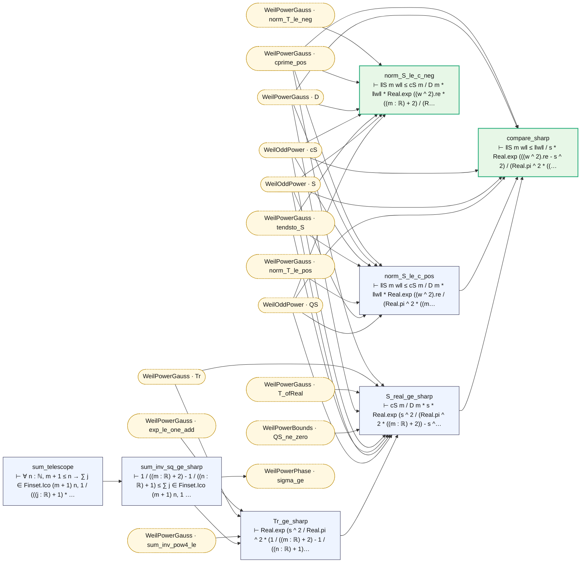

# `lean_stage3/Stage3/WeilPowerSharp.lean`

**What it does** (its own header): WeilPowerSharp — the Gaussian bounds with the constant kept exact and the tail sum sharp: the two lost factors of WeilPowerGauss removed. Rung 5, eleventh slice. 2026-09-06. Unit 0346; the decision is unit 0345.

**Imports:** [`WeilPowerGauss`](../lean_stage3/WeilPowerGauss.md).
**Imported by:** [`Stage3`](../lean_stage3/Stage3.md), [`WeilPowerAssembly`](../lean_stage3/WeilPowerAssembly.md), [`WeilPowerPhase`](../lean_stage3/WeilPowerPhase.md).

Blue: theorem. Green: a theorem nothing else uses (an end). Dashed white: connects to nothing. Grey: definition. Red: contains `sorry`. Yellow: in another file. An arrow A → B reads "A is used by B".

## Every declaration

| declaration | proves (output) | needs (input) | why (its own docstring) | uses | used by |
|---|---|---|---|---|---|
| `WeilPowerSharp.sum_telescope` theorem, line 53 | ∀ n : ℕ, m + 1 ≤ n → ∑ j ∈ Finset.Ico (m + 1) n, 1 / (((j : ℝ) + 1) * ((j : ℝ) + 2)) = 1 / ((m : ℝ) + 2) - 1 / ((n : ℝ) + 1) | m : ℕ | Telescoping sum over the tail. | — | `WeilPowerSharp.sum_inv_sq_ge_sharp` |
| `WeilPowerSharp.sum_inv_sq_ge_sharp` theorem, line 69 | 1 / ((m : ℝ) + 2) - 1 / ((n : ℝ) + 1) ≤ ∑ j ∈ Finset.Ico (m + 1) n, 1 / ((j : ℝ) + 1) ^ 2 | m : ℕ; hn : m + 1 ≤ n | The sharp lower bound for the tail sum: `1/(m+2) − 1/(n+1)`. | `WeilPowerSharp.sum_telescope` | `WeilPowerPhase.sigma_ge`, `WeilPowerSharp.Tr_ge_sharp` |
| `WeilPowerSharp.Tr_ge_sharp` theorem, line 80 | Real.exp (s ^ 2 / Real.pi ^ 2 * (1 / ((m : ℝ) + 2) - 1 / ((n : ℝ) + 1)) - s ^ 4 / (Real.pi ^ 4 * ((m : ℝ) + 1) ^ 3)) ≤ Tr m s n | hsmall : s ^ 2 ≤ Real.pi ^ 2 * ((m : ℝ) + 2) ^ 2 / 2; hn : m + 1 ≤ n | Tail product lower bound with the sharp sum. | `WeilPowerGauss.Tr`, `WeilPowerGauss.exp_le_one_add`, `WeilPowerGauss.sum_inv_pow4_le`, `WeilPowerSharp.sum_inv_sq_ge_sharp` | `WeilPowerSharp.S_real_ge_sharp` |
| `WeilPowerSharp.S_real_ge_sharp` theorem, line 133 | cS m / D m * s * Real.exp (s ^ 2 / (Real.pi ^ 2 * ((m : ℝ) + 2)) - s ^ 4 / (Real.pi ^ 4 * ((m : ℝ) + 1) ^ 3)) ≤ (S m (s : ℂ)).re | hs : 0 &lt; s; hsmall : s ^ 2 ≤ Real.pi ^ 2 * ((m : ℝ) + 2) ^ 2 / 2 | Lower bound at the target, sharp. The constant is `cS m / D m` itself and the rate is `s²/(π²(m+2))`. | `WeilOddPower.QS`, `WeilOddPower.S`, `WeilOddPower.cS`, `WeilPowerBounds.QS_ne_zero`, `WeilPowerGauss.D`, `WeilPowerGauss.T_ofReal`, `WeilPowerGauss.Tr`, `WeilPowerGauss.cprime_pos`, `WeilPowerGauss.tendsto_S`, `WeilPowerSharp.Tr_ge_sharp` | `WeilPowerSharp.compare_sharp` |
| `WeilPowerSharp.norm_S_le_c_pos` theorem, line 163 | ‖S m w‖ ≤ cS m / D m * ‖w‖ * Real.exp ((w ^ 2).re / (Real.pi ^ 2 * ((m : ℝ) + 1)) + ‖w‖ ^ 4 / (Real.pi ^ 4 * ((m : ℝ) + 1) ^ 3)) | hne : QS m w ≠ 0; hsmall : ‖w‖ ^ 2 ≤ Real.pi ^ 2 * ((m : ℝ) + 2) ^ 2 / 2; hre : 0 ≤ (w ^ 2).re | Upper bound, `Re(w²) ≥ 0`, constant kept. | `WeilOddPower.QS`, `WeilOddPower.S`, `WeilOddPower.cS`, `WeilPowerGauss.D`, `WeilPowerGauss.cprime_pos`, `WeilPowerGauss.norm_T_le_pos`, `WeilPowerGauss.tendsto_S` | `WeilPowerSharp.compare_sharp` |
| `WeilPowerSharp.norm_S_le_c_neg` theorem, line 175 | ‖S m w‖ ≤ cS m / D m * ‖w‖ * Real.exp ((w ^ 2).re * ((m : ℝ) + 2) / (Real.pi ^ 2 * (2 * (m : ℝ) + 3) ^ 2) + ‖w‖ ^ 4 / (Real.pi ^ 4 * ((m : ℝ) + 1) ^ 3)) | hne : QS m w ≠ 0; hsmall : ‖w‖ ^ 2 ≤ Real.pi ^ 2 * ((m : ℝ) + 2) ^ 2 / 2; hre : (w ^ 2).re ≤ 0 | Upper bound, `Re(w²) ≤ 0`, constant kept. The exponent is unit 0333's. | `WeilOddPower.QS`, `WeilOddPower.S`, `WeilOddPower.cS`, `WeilPowerGauss.D`, `WeilPowerGauss.cprime_pos`, `WeilPowerGauss.norm_T_le_neg`, `WeilPowerGauss.tendsto_S` | — |
| `WeilPowerSharp.compare_sharp` theorem, line 190 | ‖S m w‖ ≤ ‖w‖ / s * Real.exp (((w ^ 2).re - s ^ 2) / (Real.pi ^ 2 * ((m : ℝ) + 1)) + s ^ 2 / (Real.pi ^ 2 * ((m : ℝ) + 1) * ((m : ℝ) + 2)) + (‖w‖ ^ 4 + s ^ 4) / (Real.pi ^ 4 * ((m : ℝ) + 1) ^ 3)) * (S m (s : ℂ)).re | hne : QS m w ≠ 0; hs : 0 &lt; s; hw : ‖w‖ ^ 2 ≤ Real.pi ^ 2 * ((m : ℝ) + 2) ^ 2 / 2; hsm : s ^ 2 ≤ Real.pi ^ 2 * ((m : ℝ) + 2) ^ 2 / 2; hre : 0 ≤ (w ^ 2).re | The comparison with no lost factor. For `0 ≤ Re(w²)`, `0 &lt; s`, both in the regime, `‖S m w‖ ≤ (‖w‖/s) · exp(E) · Re (S m s)` with `E = (Re(w²) − s²)/(π²(m+1)) + s²/(π²(m+1)(m+2)) + (‖w‖⁴ + s⁴)/(π⁴(m+1)³)`. | `WeilOddPower.QS`, `WeilOddPower.S`, `WeilOddPower.cS`, `WeilPowerGauss.D`, `WeilPowerGauss.cprime_pos`, `WeilPowerSharp.S_real_ge_sharp`, `WeilPowerSharp.norm_S_le_c_pos` | — |
