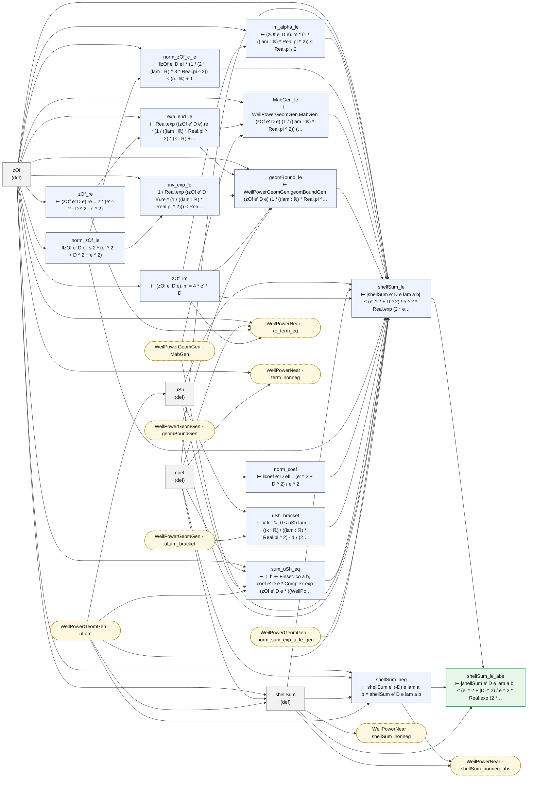

# `lean_stage3/Stage3/WeilPowerShell.lean`

**What it does** (its own header): WeilPowerShell — one shell member's weighted sum, explicit. Rung 5, sixteenth slice; worksheet § 13 block 13f. 2026-09-06.

**Imports:** [`WeilPowerGeomGen`](../lean_stage3/WeilPowerGeomGen.md).
**Imported by:** [`Stage3`](../lean_stage3/Stage3.md), [`WeilPowerNear`](../lean_stage3/WeilPowerNear.md).

Blue: theorem. Green: a theorem nothing else uses (an end). Dashed white: connects to nothing. Grey: definition. Red: contains `sorry`. Yellow: in another file. An arrow A → B reads "A is used by B".

## Every declaration

| declaration | proves (output) | needs (input) | why (its own docstring) | uses | used by |
|---|---|---|---|---|---|
| `WeilPowerShell.zOf` def, line 82 | ℂ | e' D e : ℝ | The exponent's coefficient at the shell member `ζ = ε' + iΔ` against the target at `ε`: `z = 2(ζ² − ε²)`. | — | `WeilPowerNear.re_term_eq`, `WeilPowerNear.term_nonneg`, `WeilPowerShell.MabGen_le`, `WeilPowerShell.exp_end_le`, `WeilPowerShell.geomBound_le`, `WeilPowerShell.im_alpha_le`, `WeilPowerShell.inv_exp_le`, `WeilPowerShell.norm_zOf_c_le`, `WeilPowerShell.norm_zOf_le`, `WeilPowerShell.shellSum`, `WeilPowerShell.shellSum_le`, `WeilPowerShell.shellSum_neg`, `WeilPowerShell.sum_uSh_eq`, `WeilPowerShell.zOf_im`, `WeilPowerShell.zOf_re` |
| `WeilPowerShell.coef` def, line 85 | ℂ | e' D e : ℝ | The member's weight relative to the target: `ζ²/ε²`. | — | `WeilPowerNear.re_term_eq`, `WeilPowerNear.term_nonneg`, `WeilPowerShell.norm_coef`, `WeilPowerShell.shellSum`, `WeilPowerShell.shellSum_le`, `WeilPowerShell.shellSum_neg`, `WeilPowerShell.sum_uSh_eq` |
| `WeilPowerShell.uSh` def, line 89 | ℝ | lam k : ℕ | `uLam` patched at `0` to the affine value, so that the bracket G7 of block 13e holds at every `k` and not only at `k ≥ 1`. | `WeilPowerGeomGen.uLam` | `WeilPowerShell.shellSum_le`, `WeilPowerShell.sum_uSh_eq`, `WeilPowerShell.uSh_bracket` |
| `WeilPowerShell.shellSum` def, line 93 | ℝ | e' D e : ℝ; lam a b : ℕ | One shell member's weighted sum over the range `[a, b)`. | `WeilPowerGeomGen.uLam`, `WeilPowerShell.coef`, `WeilPowerShell.zOf` | `WeilPowerNear.shellSum_nonneg`, `WeilPowerNear.shellSum_nonneg_abs`, `WeilPowerShell.shellSum_le`, `WeilPowerShell.shellSum_le_abs`, `WeilPowerShell.shellSum_neg` |
| `WeilPowerShell.zOf_re` theorem, line 98 | (zOf e' D e).re = 2 * (e' ^ 2 - D ^ 2 - e ^ 2) | e' D e : ℝ | The real part of the exponent's coefficient. | `WeilPowerShell.zOf` | `WeilPowerNear.re_term_eq`, `WeilPowerShell.exp_end_le` |
| `WeilPowerShell.zOf_im` theorem, line 102 | (zOf e' D e).im = 4 * e' * D | e' D e : ℝ | The imaginary part of the exponent's coefficient: the phase's rate. | `WeilPowerShell.zOf` | `WeilPowerNear.re_term_eq`, `WeilPowerShell.geomBound_le`, `WeilPowerShell.im_alpha_le`, `WeilPowerShell.shellSum_le` |
| `WeilPowerShell.norm_zOf_le` theorem, line 107 | ‖zOf e' D e‖ ≤ 2 * (e' ^ 2 + D ^ 2 + e ^ 2) | e' D e : ℝ | The size of the exponent's coefficient. | `WeilPowerShell.zOf` | `WeilPowerShell.inv_exp_le`, `WeilPowerShell.norm_zOf_c_le`, `WeilPowerShell.shellSum_le` |
| `WeilPowerShell.norm_coef` theorem, line 121 | ‖coef e' D e‖ = (e' ^ 2 + D ^ 2) / e ^ 2 | e' D e : ℝ | The member's weight, in size. | `WeilPowerShell.coef` | `WeilPowerShell.shellSum_le` |
| `WeilPowerShell.uSh_bracket` theorem, line 128 | ∀ k : ℕ, 0 ≤ uSh lam k - ((k : ℝ) / ((lam : ℝ) * Real.pi ^ 2) - 1 / (2 * (lam : ℝ) ^ 2 * Real.pi ^ 2)) ∧ uSh lam k - ((k : ℝ) / ((lam : ℝ) * Real.pi ^ 2) - 1 / (2 * (lam : ℝ) ^ 2 * Real.pi ^ 2)) ≤ 1 / (2 * (lam : ℝ) ^ 3 * Real.pi ^ 2) / ((k : ℝ) + 1) | hl : 1 ≤ lam | The bracket G7 for the patched sequence, at every `k` including `0`. | `WeilPowerGeomGen.uLam_bracket`, `WeilPowerShell.uSh` | `WeilPowerShell.shellSum_le` |
| `WeilPowerShell.sum_uSh_eq` theorem, line 152 | ∑ h ∈ Finset.Ico a b, coef e' D e * Complex.exp (zOf e' D e * ((WeilPowerGeomGen.uLam lam h : ℝ) : ℂ)) = ∑ h ∈ Finset.Ico a b, coef e' D e * Complex.exp (zOf e' D e * ((uSh lam h : ℝ) : ℂ)) | e' D e : ℝ; lam : ℕ; ha : 1 ≤ a | The patch does not change the sum: over `Ico a b` with `1 ≤ a` no index is `0`. | `WeilPowerGeomGen.uLam`, `WeilPowerShell.coef`, `WeilPowerShell.uSh`, `WeilPowerShell.zOf` | `WeilPowerShell.shellSum_le` |
| `WeilPowerShell.im_alpha_le` theorem, line 164 | (zOf e' D e).im * (1 / ((lam : ℝ) * Real.pi ^ 2)) ≤ Real.pi / 2 | h1 : 0 &lt; e'; h2 : e' ≤ 1 / 2; h3 : 0 &lt; D; h4 : D ≤ 1 / 2; hl : 1 ≤ lam | Jordan's hypothesis G3 holds at the shell's phase: `4ε'Δ ≤ 1` and `1/(λπ²) ≤ 1/9 &lt; π/2`. | `WeilPowerShell.zOf`, `WeilPowerShell.zOf_im` | `WeilPowerShell.shellSum_le` |
| `WeilPowerShell.norm_zOf_c_le` theorem, line 178 | ‖zOf e' D e‖ * (1 / (2 * (lam : ℝ) ^ 3 * Real.pi ^ 2)) ≤ (a : ℝ) + 1 | h1 : 0 &lt; e'; h2 : e' ≤ 1 / 2; h3 : 0 &lt; D; h4 : D ≤ 1 / 2; h5 : 0 &lt; e; h6 : e ≤ 1 / 2; hl : 1 ≤ lam; a : ℕ | The hypothesis G6 holds: `‖z‖ ≤ 3/2` and `c ≤ 1/18`, so the product is under `1 ≤ a + 1`. | `WeilPowerShell.norm_zOf_le`, `WeilPowerShell.zOf` | `WeilPowerShell.shellSum_le` |
| `WeilPowerShell.exp_end_le` theorem, line 201 | Real.exp ((zOf e' D e).re * (1 / ((lam : ℝ) * Real.pi ^ 2) * (k : ℝ) + -1 / (2 * (lam : ℝ) ^ 2 * Real.pi ^ 2))) ≤ Real.exp (2 * eta * (b : ℝ) / ((lam : ℝ) * Real.pi ^ 2)) | h7 : e' ^ 2 - D ^ 2 - e ^ 2 ≤ eta; h8 : 0 ≤ eta; hl : 1 ≤ lam; ha : 1 ≤ a; hak : a ≤ k; hkb : k ≤ b | The geometric factor at an interior index is at most `M = e^{2ηb/(λπ²)}`: the exponent is nonnegative and at most `αb`, and `z.re ≤ 2η`. | `WeilPowerShell.zOf`, `WeilPowerShell.zOf_re` | `WeilPowerShell.MabGen_le`, `WeilPowerShell.geomBound_le` |
| `WeilPowerShell.MabGen_le` theorem, line 242 | WeilPowerGeomGen.MabGen (zOf e' D e) (1 / ((lam : ℝ) * Real.pi ^ 2)) (-1 / (2 * (lam : ℝ) ^ 2 * Real.pi ^ 2)) a b ≤ Real.exp (2 * eta * (b : ℝ) / ((lam : ℝ) * Real.pi ^ 2)) | h7 : e' ^ 2 - D ^ 2 - e ^ 2 ≤ eta; h8 : 0 ≤ eta; hl : 1 ≤ lam; ha : 1 ≤ a; hab : a ≤ b | The endpoint factor is at most `M`. | `WeilPowerGeomGen.MabGen`, `WeilPowerShell.exp_end_le`, `WeilPowerShell.zOf` | `WeilPowerShell.shellSum_le` |
| `WeilPowerShell.inv_exp_le` theorem, line 251 | 1 / Real.exp ((zOf e' D e).re * (1 / ((lam : ℝ) * Real.pi ^ 2))) ≤ Real.exp (2 * (e' ^ 2 + D ^ 2 + e ^ 2) * (1 / ((lam : ℝ) * Real.pi ^ 2))) | e' D e : ℝ; lam : ℕ | The reciprocal of the ratio's modulus, bounded by the size of `z`. | `WeilPowerShell.norm_zOf_le`, `WeilPowerShell.zOf` | `WeilPowerShell.geomBound_le` |
| `WeilPowerShell.geomBound_le` theorem, line 263 | WeilPowerGeomGen.geomBoundGen (zOf e' D e) (1 / ((lam : ℝ) * Real.pi ^ 2)) (-1 / (2 * (lam : ℝ) ^ 2 * Real.pi ^ 2)) a b ≤ Real.exp (2 * eta * (b : ℝ) / ((lam : ℝ) * Real.pi ^ 2)) * (lam : ℝ) * Real.pi ^ 3 * Real.exp (2 * (e' ^ 2 + D ^ 2 + e ^ 2) * (1 / ((lam : ℝ) * Real.pi ^ 2))) / (4 * e' * D) | h1 : 0 &lt; e'; h3 : 0 &lt; D; h7 : e' ^ 2 - D ^ 2 - e ^ 2 ≤ eta; h8 : 0 ≤ eta; hl : 1 ≤ lam; ha : 1 ≤ a; hab : a ≤ b | The geometric part of the shell member's bound, explicit in `ε', Δ, ε, η, λ, b`. | `WeilPowerGeomGen.geomBoundGen`, `WeilPowerShell.exp_end_le`, `WeilPowerShell.inv_exp_le`, `WeilPowerShell.zOf`, `WeilPowerShell.zOf_im` | `WeilPowerShell.shellSum_le` |
| `WeilPowerShell.shellSum_le` theorem, line 316 | \|shellSum e' D e lam a b\| ≤ (e' ^ 2 + D ^ 2) / e ^ 2 * Real.exp (2 * eta * (b : ℝ) / ((lam : ℝ) * Real.pi ^ 2)) * ((lam : ℝ) * Real.pi ^ 3 * Real.exp (2 * (e' ^ 2 + D ^ 2 + e ^ 2) * (1 / ((lam : ℝ) * Real.pi ^ 2))) / (4 * e' * D) + 2 * (e' ^ 2 + D ^ 2 + e ^ 2) * (Real.log b - Real.log a) / ((lam : ℝ) ^ 3 * Real.pi ^ 2)) | h1 : 0 &lt; e'; h2 : e' ≤ 1 / 2; h3 : 0 &lt; D; h4 : D ≤ 1 / 2; h5 : 0 &lt; e; h6 : e ≤ 1 / 2; h7 : e' ^ 2 - D ^ 2 - e ^ 2 ≤ eta; h8 : 0 ≤ eta; hl : 1 ≤ lam; ha : 1 ≤ a; hab : a ≤ b | One shell member's weighted sum, explicit. The geometric part does not grow with the range; the correction grows like its logarithm. | `WeilPowerGeomGen.MabGen`, `WeilPowerGeomGen.geomBoundGen`, `WeilPowerGeomGen.norm_sum_exp_u_le_gen`, `WeilPowerGeomGen.uLam`, `WeilPowerShell.MabGen_le`, `WeilPowerShell.coef`, `WeilPowerShell.geomBound_le`, `WeilPowerShell.im_alpha_le`, `WeilPowerShell.norm_coef`, `WeilPowerShell.norm_zOf_c_le`, `WeilPowerShell.norm_zOf_le`, `WeilPowerShell.shellSum`, `WeilPowerShell.sum_uSh_eq`, `WeilPowerShell.uSh`, `WeilPowerShell.uSh_bracket`, `WeilPowerShell.zOf`, `WeilPowerShell.zOf_im` | `WeilPowerShell.shellSum_le_abs` |
| `WeilPowerShell.shellSum_neg` theorem, line 454 | shellSum e' (-D) e lam a b = shellSum e' D e lam a b | e' D e : ℝ; lam a b : ℕ | The sum is even in `Δ`: the member at `ε' − iΔ` is the conjugate of the member at `ε' + iΔ`, and the real part does not see the conjugation. | `WeilPowerGeomGen.uLam`, `WeilPowerShell.coef`, `WeilPowerShell.shellSum`, `WeilPowerShell.zOf` | `WeilPowerNear.shellSum_nonneg_abs`, `WeilPowerShell.shellSum_le_abs` |
| `WeilPowerShell.shellSum_le_abs` theorem, line 474 | \|shellSum e' D e lam a b\| ≤ (e' ^ 2 + \|D\| ^ 2) / e ^ 2 * Real.exp (2 * eta * (b : ℝ) / ((lam : ℝ) * Real.pi ^ 2)) * ((lam : ℝ) * Real.pi ^ 3 * Real.exp (2 * (e' ^ 2 + \|D\| ^ 2 + e ^ 2) * (1 / ((lam : ℝ) * Real.pi ^ 2))) / (4 * e' * \|D\|) + 2 * (e' ^ 2 + \|D\| ^ 2 + e ^ 2) * (Real.log b - Real.log a) / ((lam : ℝ) ^ 3 * Real.pi ^ 2)) | h1 : 0 &lt; e'; h2 : e' ≤ 1 / 2; hD0 : D ≠ 0; h4 : \|D\| ≤ 1 / 2; h5 : 0 &lt; e; h6 : e ≤ 1 / 2; h7 : e' ^ 2 - D ^ 2 - e ^ 2 ≤ eta; h8 : 0 ≤ eta; hl : 1 ≤ lam; ha : 1 ≤ a; hab : a ≤ b | The bound at a signed `Δ`, through the evenness. | `WeilPowerShell.shellSum`, `WeilPowerShell.shellSum_le`, `WeilPowerShell.shellSum_neg` | — |
