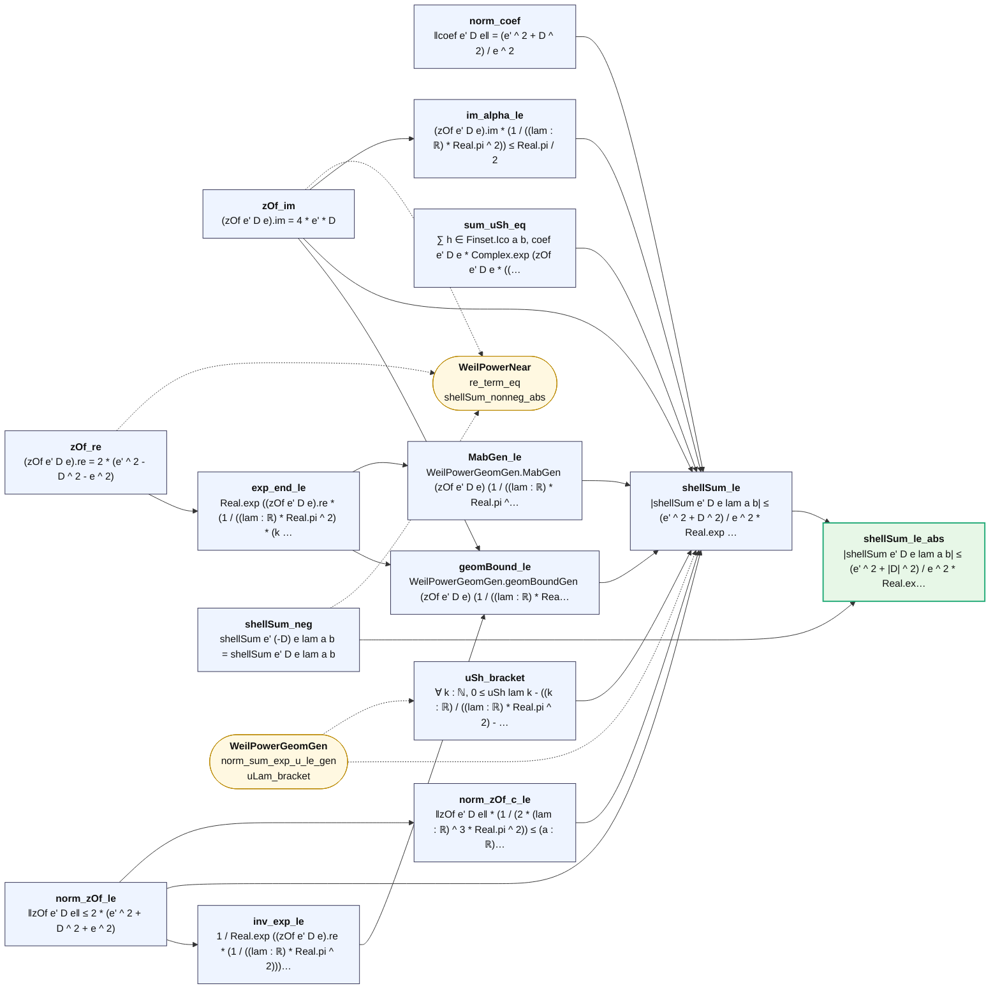

# `lean_stage3/Stage3/WeilPowerShell.lean`

WeilPowerShell — one shell member's weighted sum, explicit. Rung 5, sixteenth slice; worksheet § 13 block 13f. 2026-09-06.

15 theorems, 4 definitions, 516 lines. Arrows are Lean's own record of what each proof uses.

**Imports:** [`WeilPowerGeomGen`](../lean_stage3/WeilPowerGeomGen.md)  
**Imported by:** [`Stage3`](../lean_stage3/Stage3.md), [`WeilPowerNear`](../lean_stage3/WeilPowerNear.md)

## The picture



An arrow A → B reads "A is used in the proof of B". Blue: theorem. Green: a theorem nothing else uses (an end). Dashed: connects to nothing. Red: contains `sorry`. Yellow: theorems in another file, counted; a dotted arrow crosses files. Definitions are not drawn; they are listed below the diagram.

## Definitions

<a name="WeilPowerShell-zOf"></a>
### `WeilPowerShell.zOf`

def · line 82

The exponent's coefficient at the shell member `ζ = ε' + iΔ` against the target at `ε`: `z = 2(ζ² − ε²)`.

- **Is:** `` zOf (e' D e : ℝ) : ℂ := 2 * (((e' : ℂ) + Complex.I * (D : ℂ)) ^ 2 - (e : ℂ) ^ 2) ``
- **Used by 16:** [`WeilPowerNear.re_term_eq`](../lean_stage3/WeilPowerNear.md#WeilPowerNear-re_term_eq), [`WeilPowerNear.shellSum_nonneg`](../lean_stage3/WeilPowerNear.md#WeilPowerNear-shellSum_nonneg), [`WeilPowerNear.term_nonneg`](../lean_stage3/WeilPowerNear.md#WeilPowerNear-term_nonneg), [`WeilPowerShell.MabGen_le`](#WeilPowerShell-MabGen_le), [`WeilPowerShell.exp_end_le`](#WeilPowerShell-exp_end_le), [`WeilPowerShell.geomBound_le`](#WeilPowerShell-geomBound_le), [`WeilPowerShell.im_alpha_le`](#WeilPowerShell-im_alpha_le), [`WeilPowerShell.inv_exp_le`](#WeilPowerShell-inv_exp_le), [`WeilPowerShell.norm_zOf_c_le`](#WeilPowerShell-norm_zOf_c_le), [`WeilPowerShell.norm_zOf_le`](#WeilPowerShell-norm_zOf_le), [`WeilPowerShell.shellSum`](#WeilPowerShell-shellSum), [`WeilPowerShell.shellSum_le`](#WeilPowerShell-shellSum_le), [`WeilPowerShell.shellSum_neg`](#WeilPowerShell-shellSum_neg), [`WeilPowerShell.sum_uSh_eq`](#WeilPowerShell-sum_uSh_eq), [`WeilPowerShell.zOf_im`](#WeilPowerShell-zOf_im), [`WeilPowerShell.zOf_re`](#WeilPowerShell-zOf_re)

<a name="WeilPowerShell-coef"></a>
### `WeilPowerShell.coef`

def · line 85

The member's weight relative to the target: `ζ²/ε²`.

- **Is:** `` coef (e' D e : ℝ) : ℂ := ((e' : ℂ) + Complex.I * (D : ℂ)) ^ 2 / (e : ℂ) ^ 2 ``
- **Used by 8:** [`WeilPowerNear.re_term_eq`](../lean_stage3/WeilPowerNear.md#WeilPowerNear-re_term_eq), [`WeilPowerNear.shellSum_nonneg`](../lean_stage3/WeilPowerNear.md#WeilPowerNear-shellSum_nonneg), [`WeilPowerNear.term_nonneg`](../lean_stage3/WeilPowerNear.md#WeilPowerNear-term_nonneg), [`WeilPowerShell.norm_coef`](#WeilPowerShell-norm_coef), [`WeilPowerShell.shellSum`](#WeilPowerShell-shellSum), [`WeilPowerShell.shellSum_le`](#WeilPowerShell-shellSum_le), [`WeilPowerShell.shellSum_neg`](#WeilPowerShell-shellSum_neg), [`WeilPowerShell.sum_uSh_eq`](#WeilPowerShell-sum_uSh_eq)

<a name="WeilPowerShell-uSh"></a>
### `WeilPowerShell.uSh`

def · line 89

`uLam` patched at `0` to the affine value, so that the bracket G7 of block 13e holds at every `k` and not only at `k ≥ 1`.

- **Is:** `` uSh (lam k : ℕ) : ℝ := if k = 0 then -1 / (2 * (lam : ℝ) ^ 2 * Real.pi ^ 2) else WeilPowerGeomGen.uLam lam k ``
- **Built from:** [`WeilPowerGeomGen.uLam`](../lean_stage3/WeilPowerGeomGen.md#WeilPowerGeomGen-uLam)
- **Used by 3:** [`WeilPowerShell.shellSum_le`](#WeilPowerShell-shellSum_le), [`WeilPowerShell.sum_uSh_eq`](#WeilPowerShell-sum_uSh_eq), [`WeilPowerShell.uSh_bracket`](#WeilPowerShell-uSh_bracket)

<a name="WeilPowerShell-shellSum"></a>
### `WeilPowerShell.shellSum`

def · line 93

One shell member's weighted sum over the range `[a, b)`.

- **Is:** `` shellSum (e' D e : ℝ) (lam a b : ℕ) : ℝ := ∑ h ∈ Finset.Ico a b, (coef e' D e * Complex.exp (zOf e' D e * ((WeilPowerGeomGen.uLam lam h : ℝ) : ℂ))).re ``
- **Built from:** [`WeilPowerGeomGen.uLam`](../lean_stage3/WeilPowerGeomGen.md#WeilPowerGeomGen-uLam), [`WeilPowerShell.coef`](#WeilPowerShell-coef), [`WeilPowerShell.zOf`](#WeilPowerShell-zOf)
- **Used by 5:** [`WeilPowerNear.shellSum_nonneg`](../lean_stage3/WeilPowerNear.md#WeilPowerNear-shellSum_nonneg), [`WeilPowerNear.shellSum_nonneg_abs`](../lean_stage3/WeilPowerNear.md#WeilPowerNear-shellSum_nonneg_abs), [`WeilPowerShell.shellSum_le`](#WeilPowerShell-shellSum_le), [`WeilPowerShell.shellSum_le_abs`](#WeilPowerShell-shellSum_le_abs), [`WeilPowerShell.shellSum_neg`](#WeilPowerShell-shellSum_neg)

## Theorems

<a name="WeilPowerShell-zOf_re"></a>
### `WeilPowerShell.zOf_re`

line 98

**Why.** The real part of the exponent's coefficient.

**Proves**

```lean
(zOf e' D e).re = 2 * (e' ^ 2 - D ^ 2 - e ^ 2)
```

**Needs** (its hypotheses)

  - `` e' D e : ℝ ``

**Stated with:** [`WeilPowerShell.zOf`](#WeilPowerShell-zOf)

**Fed by:** no theorem of this repo; it stands on Mathlib and the definitions below.

**Feeds** (2 that use it)

  - [`WeilPowerNear.re_term_eq`](../lean_stage3/WeilPowerNear.md#WeilPowerNear-re_term_eq) (WeilPowerNear) — `` (WeilPowerShell.coef e' D e * Complex.exp (WeilPowerShell.zOf e' D e * (u : ℂ))).re = Real.exp (2 * (e' ^ 2 - D ^ 2 - e ^ 2) * u) / e ^ 2 * ((e' ^ 2 -… ``
  - [`WeilPowerShell.exp_end_le`](#WeilPowerShell-exp_end_le) — `` Real.exp ((zOf e' D e).re * (1 / ((lam : ℝ) * Real.pi ^ 2) * (k : ℝ) + -1 / (2 * (lam : ℝ) ^ 2 * Real.pi ^ 2))) ≤ Real.exp (2 * eta * (b : ℝ) / ((lam … ``

<a name="WeilPowerShell-zOf_im"></a>
### `WeilPowerShell.zOf_im`

line 102

**Why.** The imaginary part of the exponent's coefficient: the phase's rate.

**Proves**

```lean
(zOf e' D e).im = 4 * e' * D
```

**Needs** (its hypotheses)

  - `` e' D e : ℝ ``

**Stated with:** [`WeilPowerShell.zOf`](#WeilPowerShell-zOf)

**Fed by:** no theorem of this repo; it stands on Mathlib and the definitions below.

**Feeds** (4 that use it)

  - [`WeilPowerNear.re_term_eq`](../lean_stage3/WeilPowerNear.md#WeilPowerNear-re_term_eq) (WeilPowerNear) — `` (WeilPowerShell.coef e' D e * Complex.exp (WeilPowerShell.zOf e' D e * (u : ℂ))).re = Real.exp (2 * (e' ^ 2 - D ^ 2 - e ^ 2) * u) / e ^ 2 * ((e' ^ 2 -… ``
  - [`WeilPowerShell.geomBound_le`](#WeilPowerShell-geomBound_le) — `` WeilPowerGeomGen.geomBoundGen (zOf e' D e) (1 / ((lam : ℝ) * Real.pi ^ 2)) (-1 / (2 * (lam : ℝ) ^ 2 * Real.pi ^ 2)) a b ≤ Real.exp (2 * eta * (b : ℝ) … ``
  - [`WeilPowerShell.im_alpha_le`](#WeilPowerShell-im_alpha_le) — `` (zOf e' D e).im * (1 / ((lam : ℝ) * Real.pi ^ 2)) ≤ Real.pi / 2 ``
  - [`WeilPowerShell.shellSum_le`](#WeilPowerShell-shellSum_le) — `` |shellSum e' D e lam a b| ≤ (e' ^ 2 + D ^ 2) / e ^ 2 * Real.exp (2 * eta * (b : ℝ) / ((lam : ℝ) * Real.pi ^ 2)) * ((lam : ℝ) * Real.pi ^ 3 * Real.exp … ``

<a name="WeilPowerShell-norm_zOf_le"></a>
### `WeilPowerShell.norm_zOf_le`

line 107

**Why.** The size of the exponent's coefficient.

**Proves**

```lean
‖zOf e' D e‖ ≤ 2 * (e' ^ 2 + D ^ 2 + e ^ 2)
```

**Needs** (its hypotheses)

  - `` e' D e : ℝ ``

**Stated with:** [`WeilPowerShell.zOf`](#WeilPowerShell-zOf)

**Fed by:** no theorem of this repo; it stands on Mathlib and the definitions below.

**Feeds** (3 that use it)

  - [`WeilPowerShell.inv_exp_le`](#WeilPowerShell-inv_exp_le) — `` 1 / Real.exp ((zOf e' D e).re * (1 / ((lam : ℝ) * Real.pi ^ 2))) ≤ Real.exp (2 * (e' ^ 2 + D ^ 2 + e ^ 2) * (1 / ((lam : ℝ) * Real.pi ^ 2))) ``
  - [`WeilPowerShell.norm_zOf_c_le`](#WeilPowerShell-norm_zOf_c_le) — `` ‖zOf e' D e‖ * (1 / (2 * (lam : ℝ) ^ 3 * Real.pi ^ 2)) ≤ (a : ℝ) + 1 ``
  - [`WeilPowerShell.shellSum_le`](#WeilPowerShell-shellSum_le) — `` |shellSum e' D e lam a b| ≤ (e' ^ 2 + D ^ 2) / e ^ 2 * Real.exp (2 * eta * (b : ℝ) / ((lam : ℝ) * Real.pi ^ 2)) * ((lam : ℝ) * Real.pi ^ 3 * Real.exp … ``

<a name="WeilPowerShell-norm_coef"></a>
### `WeilPowerShell.norm_coef`

line 121

**Why.** The member's weight, in size.

**Proves**

```lean
‖coef e' D e‖ = (e' ^ 2 + D ^ 2) / e ^ 2
```

**Needs** (its hypotheses)

  - `` e' D e : ℝ ``

**Stated with:** [`WeilPowerShell.coef`](#WeilPowerShell-coef)

**Fed by:** no theorem of this repo; it stands on Mathlib and the definitions below.

**Feeds** (1 that use it)

  - [`WeilPowerShell.shellSum_le`](#WeilPowerShell-shellSum_le) — `` |shellSum e' D e lam a b| ≤ (e' ^ 2 + D ^ 2) / e ^ 2 * Real.exp (2 * eta * (b : ℝ) / ((lam : ℝ) * Real.pi ^ 2)) * ((lam : ℝ) * Real.pi ^ 3 * Real.exp … ``

<a name="WeilPowerShell-uSh_bracket"></a>
### `WeilPowerShell.uSh_bracket`

line 128

**Why.** The bracket G7 for the patched sequence, at every `k` including `0`.

**Proves**

```lean
∀ k : ℕ, 0 ≤ uSh lam k - ((k : ℝ) / ((lam : ℝ) * Real.pi ^ 2) - 1 / (2 * (lam : ℝ) ^ 2 * Real.pi ^ 2)) ∧ uSh lam k - ((k : ℝ) / ((lam : ℝ) * Real.pi ^ 2) - 1 / (2 * (lam : ℝ) ^ 2 * Real.pi ^ 2)) ≤ 1 / (2 * (lam : ℝ) ^ 3 * Real.pi ^ 2) / ((k : ℝ) + 1)
```

**Needs** (its hypotheses)

  - `` hl : 1 ≤ lam ``

**Stated with:** [`WeilPowerShell.uSh`](#WeilPowerShell-uSh)

**Fed by** (1 theorem its proof uses)

  - [`WeilPowerGeomGen.uLam_bracket`](../lean_stage3/WeilPowerGeomGen.md#WeilPowerGeomGen-uLam_bracket) (WeilPowerGeomGen) — `` 0 ≤ uLam lam h - ((h : ℝ) / ((lam : ℝ) * Real.pi ^ 2) - 1 / (2 * (lam : ℝ) ^ 2 * Real.pi ^ 2)) ∧ uLam lam h - ((h : ℝ) / ((lam : ℝ) * Real.pi ^ 2) - 1… ``

**Definitions its proof touches:** [`WeilPowerGeomGen.uLam`](../lean_stage3/WeilPowerGeomGen.md#WeilPowerGeomGen-uLam)

**Feeds** (1 that use it)

  - [`WeilPowerShell.shellSum_le`](#WeilPowerShell-shellSum_le) — `` |shellSum e' D e lam a b| ≤ (e' ^ 2 + D ^ 2) / e ^ 2 * Real.exp (2 * eta * (b : ℝ) / ((lam : ℝ) * Real.pi ^ 2)) * ((lam : ℝ) * Real.pi ^ 3 * Real.exp … ``

<a name="WeilPowerShell-sum_uSh_eq"></a>
### `WeilPowerShell.sum_uSh_eq`

line 152

**Why.** The patch does not change the sum: over `Ico a b` with `1 ≤ a` no index is `0`.

**Proves**

```lean
∑ h ∈ Finset.Ico a b, coef e' D e * Complex.exp (zOf e' D e * ((WeilPowerGeomGen.uLam lam h : ℝ) : ℂ)) = ∑ h ∈ Finset.Ico a b, coef e' D e * Complex.exp (zOf e' D e * ((uSh lam h : ℝ) : ℂ))
```

**Needs** (its hypotheses)

  - `` e' D e : ℝ ``
  - `` lam : ℕ ``
  - `` ha : 1 ≤ a ``

**Stated with:** [`WeilPowerGeomGen.uLam`](../lean_stage3/WeilPowerGeomGen.md#WeilPowerGeomGen-uLam), [`WeilPowerShell.coef`](#WeilPowerShell-coef), [`WeilPowerShell.uSh`](#WeilPowerShell-uSh), [`WeilPowerShell.zOf`](#WeilPowerShell-zOf)

**Fed by:** no theorem of this repo; it stands on Mathlib and the definitions below.

**Feeds** (1 that use it)

  - [`WeilPowerShell.shellSum_le`](#WeilPowerShell-shellSum_le) — `` |shellSum e' D e lam a b| ≤ (e' ^ 2 + D ^ 2) / e ^ 2 * Real.exp (2 * eta * (b : ℝ) / ((lam : ℝ) * Real.pi ^ 2)) * ((lam : ℝ) * Real.pi ^ 3 * Real.exp … ``

<a name="WeilPowerShell-im_alpha_le"></a>
### `WeilPowerShell.im_alpha_le`

line 164

**Why.** Jordan's hypothesis G3 holds at the shell's phase: `4ε'Δ ≤ 1` and `1/(λπ²) ≤ 1/9 < π/2`.

**Proves**

```lean
(zOf e' D e).im * (1 / ((lam : ℝ) * Real.pi ^ 2)) ≤ Real.pi / 2
```

**Needs** (its hypotheses)

  - `` h1 : 0 < e' ``
  - `` h2 : e' ≤ 1 / 2 ``
  - `` h3 : 0 < D ``
  - `` h4 : D ≤ 1 / 2 ``
  - `` hl : 1 ≤ lam ``

**Stated with:** [`WeilPowerShell.zOf`](#WeilPowerShell-zOf)

**Fed by** (1 theorem its proof uses)

  - [`WeilPowerShell.zOf_im`](#WeilPowerShell-zOf_im) — `` (zOf e' D e).im = 4 * e' * D ``

**Feeds** (1 that use it)

  - [`WeilPowerShell.shellSum_le`](#WeilPowerShell-shellSum_le) — `` |shellSum e' D e lam a b| ≤ (e' ^ 2 + D ^ 2) / e ^ 2 * Real.exp (2 * eta * (b : ℝ) / ((lam : ℝ) * Real.pi ^ 2)) * ((lam : ℝ) * Real.pi ^ 3 * Real.exp … ``

<a name="WeilPowerShell-norm_zOf_c_le"></a>
### `WeilPowerShell.norm_zOf_c_le`

line 178

**Why.** The hypothesis G6 holds: `‖z‖ ≤ 3/2` and `c ≤ 1/18`, so the product is under `1 ≤ a + 1`.

**Proves**

```lean
‖zOf e' D e‖ * (1 / (2 * (lam : ℝ) ^ 3 * Real.pi ^ 2)) ≤ (a : ℝ) + 1
```

**Needs** (its hypotheses)

  - `` h1 : 0 < e' ``
  - `` h2 : e' ≤ 1 / 2 ``
  - `` h3 : 0 < D ``
  - `` h4 : D ≤ 1 / 2 ``
  - `` h5 : 0 < e ``
  - `` h6 : e ≤ 1 / 2 ``
  - `` hl : 1 ≤ lam ``
  - `` a : ℕ ``

**Stated with:** [`WeilPowerShell.zOf`](#WeilPowerShell-zOf)

**Fed by** (1 theorem its proof uses)

  - [`WeilPowerShell.norm_zOf_le`](#WeilPowerShell-norm_zOf_le) — `` ‖zOf e' D e‖ ≤ 2 * (e' ^ 2 + D ^ 2 + e ^ 2) ``

**Feeds** (1 that use it)

  - [`WeilPowerShell.shellSum_le`](#WeilPowerShell-shellSum_le) — `` |shellSum e' D e lam a b| ≤ (e' ^ 2 + D ^ 2) / e ^ 2 * Real.exp (2 * eta * (b : ℝ) / ((lam : ℝ) * Real.pi ^ 2)) * ((lam : ℝ) * Real.pi ^ 3 * Real.exp … ``

<a name="WeilPowerShell-exp_end_le"></a>
### `WeilPowerShell.exp_end_le`

line 201

**Why.** The geometric factor at an interior index is at most `M = e^{2ηb/(λπ²)}`: the exponent is nonnegative and at most `αb`, and `z.re ≤ 2η`.

**Proves**

```lean
Real.exp ((zOf e' D e).re * (1 / ((lam : ℝ) * Real.pi ^ 2) * (k : ℝ) + -1 / (2 * (lam : ℝ) ^ 2 * Real.pi ^ 2))) ≤ Real.exp (2 * eta * (b : ℝ) / ((lam : ℝ) * Real.pi ^ 2))
```

**Needs** (its hypotheses)

  - `` h7 : e' ^ 2 - D ^ 2 - e ^ 2 ≤ eta ``
  - `` h8 : 0 ≤ eta ``
  - `` hl : 1 ≤ lam ``
  - `` ha : 1 ≤ a ``
  - `` hak : a ≤ k ``
  - `` hkb : k ≤ b ``

**Stated with:** [`WeilPowerShell.zOf`](#WeilPowerShell-zOf)

**Fed by** (1 theorem its proof uses)

  - [`WeilPowerShell.zOf_re`](#WeilPowerShell-zOf_re) — `` (zOf e' D e).re = 2 * (e' ^ 2 - D ^ 2 - e ^ 2) ``

**Feeds** (2 that use it)

  - [`WeilPowerShell.MabGen_le`](#WeilPowerShell-MabGen_le) — `` WeilPowerGeomGen.MabGen (zOf e' D e) (1 / ((lam : ℝ) * Real.pi ^ 2)) (-1 / (2 * (lam : ℝ) ^ 2 * Real.pi ^ 2)) a b ≤ Real.exp (2 * eta * (b : ℝ) / ((la… ``
  - [`WeilPowerShell.geomBound_le`](#WeilPowerShell-geomBound_le) — `` WeilPowerGeomGen.geomBoundGen (zOf e' D e) (1 / ((lam : ℝ) * Real.pi ^ 2)) (-1 / (2 * (lam : ℝ) ^ 2 * Real.pi ^ 2)) a b ≤ Real.exp (2 * eta * (b : ℝ) … ``

<a name="WeilPowerShell-MabGen_le"></a>
### `WeilPowerShell.MabGen_le`

line 242

**Why.** The endpoint factor is at most `M`.

**Proves**

```lean
WeilPowerGeomGen.MabGen (zOf e' D e) (1 / ((lam : ℝ) * Real.pi ^ 2)) (-1 / (2 * (lam : ℝ) ^ 2 * Real.pi ^ 2)) a b ≤ Real.exp (2 * eta * (b : ℝ) / ((lam : ℝ) * Real.pi ^ 2))
```

**Needs** (its hypotheses)

  - `` h7 : e' ^ 2 - D ^ 2 - e ^ 2 ≤ eta ``
  - `` h8 : 0 ≤ eta ``
  - `` hl : 1 ≤ lam ``
  - `` ha : 1 ≤ a ``
  - `` hab : a ≤ b ``

**Stated with:** [`WeilPowerGeomGen.MabGen`](../lean_stage3/WeilPowerGeomGen.md#WeilPowerGeomGen-MabGen), [`WeilPowerShell.zOf`](#WeilPowerShell-zOf)

**Fed by** (1 theorem its proof uses)

  - [`WeilPowerShell.exp_end_le`](#WeilPowerShell-exp_end_le) — `` Real.exp ((zOf e' D e).re * (1 / ((lam : ℝ) * Real.pi ^ 2) * (k : ℝ) + -1 / (2 * (lam : ℝ) ^ 2 * Real.pi ^ 2))) ≤ Real.exp (2 * eta * (b : ℝ) / ((lam … ``

**Feeds** (1 that use it)

  - [`WeilPowerShell.shellSum_le`](#WeilPowerShell-shellSum_le) — `` |shellSum e' D e lam a b| ≤ (e' ^ 2 + D ^ 2) / e ^ 2 * Real.exp (2 * eta * (b : ℝ) / ((lam : ℝ) * Real.pi ^ 2)) * ((lam : ℝ) * Real.pi ^ 3 * Real.exp … ``

<a name="WeilPowerShell-inv_exp_le"></a>
### `WeilPowerShell.inv_exp_le`

line 251

**Why.** The reciprocal of the ratio's modulus, bounded by the size of `z`.

**Proves**

```lean
1 / Real.exp ((zOf e' D e).re * (1 / ((lam : ℝ) * Real.pi ^ 2))) ≤ Real.exp (2 * (e' ^ 2 + D ^ 2 + e ^ 2) * (1 / ((lam : ℝ) * Real.pi ^ 2)))
```

**Needs** (its hypotheses)

  - `` e' D e : ℝ ``
  - `` lam : ℕ ``

**Stated with:** [`WeilPowerShell.zOf`](#WeilPowerShell-zOf)

**Fed by** (1 theorem its proof uses)

  - [`WeilPowerShell.norm_zOf_le`](#WeilPowerShell-norm_zOf_le) — `` ‖zOf e' D e‖ ≤ 2 * (e' ^ 2 + D ^ 2 + e ^ 2) ``

**Feeds** (1 that use it)

  - [`WeilPowerShell.geomBound_le`](#WeilPowerShell-geomBound_le) — `` WeilPowerGeomGen.geomBoundGen (zOf e' D e) (1 / ((lam : ℝ) * Real.pi ^ 2)) (-1 / (2 * (lam : ℝ) ^ 2 * Real.pi ^ 2)) a b ≤ Real.exp (2 * eta * (b : ℝ) … ``

<a name="WeilPowerShell-geomBound_le"></a>
### `WeilPowerShell.geomBound_le`

line 263

**Why.** The geometric part of the shell member's bound, explicit in `ε', Δ, ε, η, λ, b`.

**Proves**

```lean
WeilPowerGeomGen.geomBoundGen (zOf e' D e) (1 / ((lam : ℝ) * Real.pi ^ 2)) (-1 / (2 * (lam : ℝ) ^ 2 * Real.pi ^ 2)) a b ≤ Real.exp (2 * eta * (b : ℝ) / ((lam : ℝ) * Real.pi ^ 2)) * (lam : ℝ) * Real.pi ^ 3 * Real.exp (2 * (e' ^ 2 + D ^ 2 + e ^ 2) * (1 / ((lam : ℝ) * Real.pi ^ 2))) / (4 * e' * D)
```

**Needs** (its hypotheses)

  - `` h1 : 0 < e' ``
  - `` h3 : 0 < D ``
  - `` h7 : e' ^ 2 - D ^ 2 - e ^ 2 ≤ eta ``
  - `` h8 : 0 ≤ eta ``
  - `` hl : 1 ≤ lam ``
  - `` ha : 1 ≤ a ``
  - `` hab : a ≤ b ``

**Stated with:** [`WeilPowerGeomGen.geomBoundGen`](../lean_stage3/WeilPowerGeomGen.md#WeilPowerGeomGen-geomBoundGen), [`WeilPowerShell.zOf`](#WeilPowerShell-zOf)

**Fed by** (3 theorems its proof uses)

  - [`WeilPowerShell.exp_end_le`](#WeilPowerShell-exp_end_le) — `` Real.exp ((zOf e' D e).re * (1 / ((lam : ℝ) * Real.pi ^ 2) * (k : ℝ) + -1 / (2 * (lam : ℝ) ^ 2 * Real.pi ^ 2))) ≤ Real.exp (2 * eta * (b : ℝ) / ((lam … ``
  - [`WeilPowerShell.inv_exp_le`](#WeilPowerShell-inv_exp_le) — `` 1 / Real.exp ((zOf e' D e).re * (1 / ((lam : ℝ) * Real.pi ^ 2))) ≤ Real.exp (2 * (e' ^ 2 + D ^ 2 + e ^ 2) * (1 / ((lam : ℝ) * Real.pi ^ 2))) ``
  - [`WeilPowerShell.zOf_im`](#WeilPowerShell-zOf_im) — `` (zOf e' D e).im = 4 * e' * D ``

**Feeds** (1 that use it)

  - [`WeilPowerShell.shellSum_le`](#WeilPowerShell-shellSum_le) — `` |shellSum e' D e lam a b| ≤ (e' ^ 2 + D ^ 2) / e ^ 2 * Real.exp (2 * eta * (b : ℝ) / ((lam : ℝ) * Real.pi ^ 2)) * ((lam : ℝ) * Real.pi ^ 3 * Real.exp … ``

<a name="WeilPowerShell-shellSum_le"></a>
### `WeilPowerShell.shellSum_le`

line 316

**Why.** One shell member's weighted sum, explicit. The geometric part does not grow with the range; the correction grows like its logarithm.

**Proves**

```lean
|shellSum e' D e lam a b| ≤ (e' ^ 2 + D ^ 2) / e ^ 2 * Real.exp (2 * eta * (b : ℝ) / ((lam : ℝ) * Real.pi ^ 2)) * ((lam : ℝ) * Real.pi ^ 3 * Real.exp (2 * (e' ^ 2 + D ^ 2 + e ^ 2) * (1 / ((lam : ℝ) * Real.pi ^ 2))) / (4 * e' * D) + 2 * (e' ^ 2 + D ^ 2 + e ^ 2) * (Real.log b - Real.log a) / ((lam : ℝ) ^ 3 * Real.pi ^ 2))
```

**Needs** (its hypotheses)

  - `` h1 : 0 < e' ``
  - `` h2 : e' ≤ 1 / 2 ``
  - `` h3 : 0 < D ``
  - `` h4 : D ≤ 1 / 2 ``
  - `` h5 : 0 < e ``
  - `` h6 : e ≤ 1 / 2 ``
  - `` h7 : e' ^ 2 - D ^ 2 - e ^ 2 ≤ eta ``
  - `` h8 : 0 ≤ eta ``
  - `` hl : 1 ≤ lam ``
  - `` ha : 1 ≤ a ``
  - `` hab : a ≤ b ``

**Stated with:** [`WeilPowerShell.shellSum`](#WeilPowerShell-shellSum)

**Fed by** (10 theorems its proof uses)

  - [`WeilPowerGeomGen.norm_sum_exp_u_le_gen`](../lean_stage3/WeilPowerGeomGen.md#WeilPowerGeomGen-norm_sum_exp_u_le_gen) (WeilPowerGeomGen) — `` ‖∑ h ∈ Finset.Ico a b, Complex.exp (z * (u h : ℂ))‖ ≤ geomBoundGen z α β₀ a b + 2 * ‖z‖ * c * MabGen z α β₀ a b * (Real.log b - Real.log a) ``
  - [`WeilPowerShell.MabGen_le`](#WeilPowerShell-MabGen_le) — `` WeilPowerGeomGen.MabGen (zOf e' D e) (1 / ((lam : ℝ) * Real.pi ^ 2)) (-1 / (2 * (lam : ℝ) ^ 2 * Real.pi ^ 2)) a b ≤ Real.exp (2 * eta * (b : ℝ) / ((la… ``
  - [`WeilPowerShell.geomBound_le`](#WeilPowerShell-geomBound_le) — `` WeilPowerGeomGen.geomBoundGen (zOf e' D e) (1 / ((lam : ℝ) * Real.pi ^ 2)) (-1 / (2 * (lam : ℝ) ^ 2 * Real.pi ^ 2)) a b ≤ Real.exp (2 * eta * (b : ℝ) … ``
  - [`WeilPowerShell.im_alpha_le`](#WeilPowerShell-im_alpha_le) — `` (zOf e' D e).im * (1 / ((lam : ℝ) * Real.pi ^ 2)) ≤ Real.pi / 2 ``
  - [`WeilPowerShell.norm_coef`](#WeilPowerShell-norm_coef) — `` ‖coef e' D e‖ = (e' ^ 2 + D ^ 2) / e ^ 2 ``
  - [`WeilPowerShell.norm_zOf_c_le`](#WeilPowerShell-norm_zOf_c_le) — `` ‖zOf e' D e‖ * (1 / (2 * (lam : ℝ) ^ 3 * Real.pi ^ 2)) ≤ (a : ℝ) + 1 ``
  - [`WeilPowerShell.norm_zOf_le`](#WeilPowerShell-norm_zOf_le) — `` ‖zOf e' D e‖ ≤ 2 * (e' ^ 2 + D ^ 2 + e ^ 2) ``
  - [`WeilPowerShell.sum_uSh_eq`](#WeilPowerShell-sum_uSh_eq) — `` ∑ h ∈ Finset.Ico a b, coef e' D e * Complex.exp (zOf e' D e * ((WeilPowerGeomGen.uLam lam h : ℝ) : ℂ)) = ∑ h ∈ Finset.Ico a b, coef e' D e * Complex.e… ``
  - [`WeilPowerShell.uSh_bracket`](#WeilPowerShell-uSh_bracket) — `` ∀ k : ℕ, 0 ≤ uSh lam k - ((k : ℝ) / ((lam : ℝ) * Real.pi ^ 2) - 1 / (2 * (lam : ℝ) ^ 2 * Real.pi ^ 2)) ∧ uSh lam k - ((k : ℝ) / ((lam : ℝ) * Real.pi ^… ``
  - [`WeilPowerShell.zOf_im`](#WeilPowerShell-zOf_im) — `` (zOf e' D e).im = 4 * e' * D ``

**Definitions its proof touches:** [`WeilPowerGeomGen.MabGen`](../lean_stage3/WeilPowerGeomGen.md#WeilPowerGeomGen-MabGen), [`WeilPowerGeomGen.geomBoundGen`](../lean_stage3/WeilPowerGeomGen.md#WeilPowerGeomGen-geomBoundGen), [`WeilPowerGeomGen.uLam`](../lean_stage3/WeilPowerGeomGen.md#WeilPowerGeomGen-uLam), [`WeilPowerShell.coef`](#WeilPowerShell-coef), [`WeilPowerShell.uSh`](#WeilPowerShell-uSh), [`WeilPowerShell.zOf`](#WeilPowerShell-zOf)

**Feeds** (1 that use it)

  - [`WeilPowerShell.shellSum_le_abs`](#WeilPowerShell-shellSum_le_abs) — `` |shellSum e' D e lam a b| ≤ (e' ^ 2 + |D| ^ 2) / e ^ 2 * Real.exp (2 * eta * (b : ℝ) / ((lam : ℝ) * Real.pi ^ 2)) * ((lam : ℝ) * Real.pi ^ 3 * Real.ex… ``

<a name="WeilPowerShell-shellSum_neg"></a>
### `WeilPowerShell.shellSum_neg`

line 454

**Why.** The sum is even in `Δ`: the member at `ε' − iΔ` is the conjugate of the member at `ε' + iΔ`, and the real part does not see the conjugation.

**Proves**

```lean
shellSum e' (-D) e lam a b = shellSum e' D e lam a b
```

**Needs** (its hypotheses)

  - `` e' D e : ℝ ``
  - `` lam a b : ℕ ``

**Stated with:** [`WeilPowerShell.shellSum`](#WeilPowerShell-shellSum)

**Fed by:** no theorem of this repo; it stands on Mathlib and the definitions below.

**Definitions its proof touches:** [`WeilPowerGeomGen.uLam`](../lean_stage3/WeilPowerGeomGen.md#WeilPowerGeomGen-uLam), [`WeilPowerShell.coef`](#WeilPowerShell-coef), [`WeilPowerShell.zOf`](#WeilPowerShell-zOf)

**Feeds** (2 that use it)

  - [`WeilPowerNear.shellSum_nonneg_abs`](../lean_stage3/WeilPowerNear.md#WeilPowerNear-shellSum_nonneg_abs) (WeilPowerNear) — `` 0 ≤ WeilPowerShell.shellSum e' D e lam a b ``
  - [`WeilPowerShell.shellSum_le_abs`](#WeilPowerShell-shellSum_le_abs) — `` |shellSum e' D e lam a b| ≤ (e' ^ 2 + |D| ^ 2) / e ^ 2 * Real.exp (2 * eta * (b : ℝ) / ((lam : ℝ) * Real.pi ^ 2)) * ((lam : ℝ) * Real.pi ^ 3 * Real.ex… ``

<a name="WeilPowerShell-shellSum_le_abs"></a>
### `WeilPowerShell.shellSum_le_abs`

line 474

**Why.** The bound at a signed `Δ`, through the evenness.

**Proves**

```lean
|shellSum e' D e lam a b| ≤ (e' ^ 2 + |D| ^ 2) / e ^ 2 * Real.exp (2 * eta * (b : ℝ) / ((lam : ℝ) * Real.pi ^ 2)) * ((lam : ℝ) * Real.pi ^ 3 * Real.exp (2 * (e' ^ 2 + |D| ^ 2 + e ^ 2) * (1 / ((lam : ℝ) * Real.pi ^ 2))) / (4 * e' * |D|) + 2 * (e' ^ 2 + |D| ^ 2 + e ^ 2) * (Real.log b - Real.log a) / ((lam : ℝ) ^ 3 * Real.pi ^ 2))
```

**Needs** (its hypotheses)

  - `` h1 : 0 < e' ``
  - `` h2 : e' ≤ 1 / 2 ``
  - `` hD0 : D ≠ 0 ``
  - `` h4 : |D| ≤ 1 / 2 ``
  - `` h5 : 0 < e ``
  - `` h6 : e ≤ 1 / 2 ``
  - `` h7 : e' ^ 2 - D ^ 2 - e ^ 2 ≤ eta ``
  - `` h8 : 0 ≤ eta ``
  - `` hl : 1 ≤ lam ``
  - `` ha : 1 ≤ a ``
  - `` hab : a ≤ b ``

**Stated with:** [`WeilPowerShell.shellSum`](#WeilPowerShell-shellSum)

**Fed by** (2 theorems its proof uses)

  - [`WeilPowerShell.shellSum_le`](#WeilPowerShell-shellSum_le) — `` |shellSum e' D e lam a b| ≤ (e' ^ 2 + D ^ 2) / e ^ 2 * Real.exp (2 * eta * (b : ℝ) / ((lam : ℝ) * Real.pi ^ 2)) * ((lam : ℝ) * Real.pi ^ 3 * Real.exp … ``
  - [`WeilPowerShell.shellSum_neg`](#WeilPowerShell-shellSum_neg) — `` shellSum e' (-D) e lam a b = shellSum e' D e lam a b ``

**Feeds:** nothing. It is an end.

