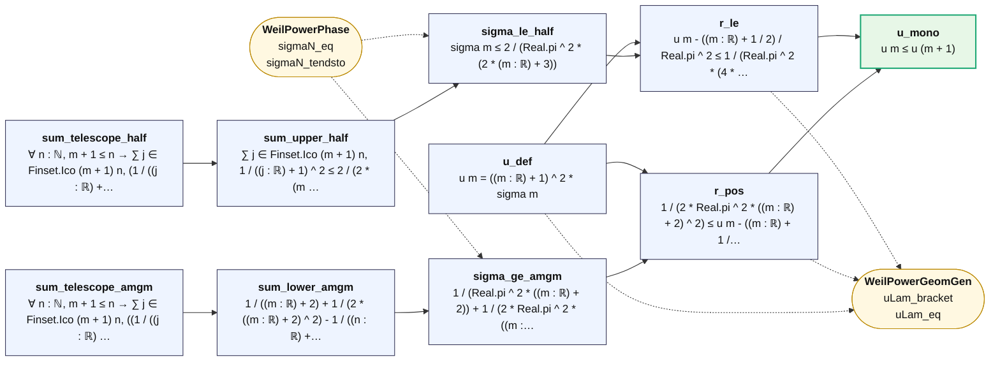

# `lean_stage3/Stage3/WeilPowerSigma.lean`

WeilPowerSigma — the tail sum to order `1/m`: `σ(m) = Σ_{j≥m+2} 1/(π²j²)` bracketed sharply enough that `u m = (m+1)²σ(m)` is `(m+½)/π²` plus a correction of size `1/m`. Rung 5, thirteenth slice; worksheet § 13 block 13c. 2026-09-06.

10 theorems, 1 definition, 256 lines. Arrows are Lean's own record of what each proof uses.

**Imports:** [`WeilPowerPhase`](../lean_stage3/WeilPowerPhase.md)  
**Imported by:** [`Stage3`](../lean_stage3/Stage3.md), [`WeilPowerGeomGen`](../lean_stage3/WeilPowerGeomGen.md)

## The picture



An arrow A → B reads "A is used in the proof of B". Blue: theorem. Green: a theorem nothing else uses (an end). Dashed: connects to nothing. Red: contains `sorry`. Yellow: theorems in another file, counted; a dotted arrow crosses files. Definitions are not drawn; they are listed below the diagram.

## Definitions

<a name="WeilPowerSigma-u"></a>
### `WeilPowerSigma.u`

def · line 187

The normalized tail sum `u m = (m+1)²σ(m)`, the exponent's shape at `λ = 1`.

- **Is:** `` u (m : ℕ) : ℝ := ((m : ℝ) + 1) ^ 2 * sigma m ``
- **Built from:** [`WeilPowerPhase.sigma`](../lean_stage3/WeilPowerPhase.md#WeilPowerPhase-sigma)
- **Used by 6:** [`WeilPowerGeomGen.uLam_bracket`](../lean_stage3/WeilPowerGeomGen.md#WeilPowerGeomGen-uLam_bracket), [`WeilPowerGeomGen.uLam_eq`](../lean_stage3/WeilPowerGeomGen.md#WeilPowerGeomGen-uLam_eq), [`WeilPowerSigma.r_le`](#WeilPowerSigma-r_le), [`WeilPowerSigma.r_pos`](#WeilPowerSigma-r_pos), [`WeilPowerSigma.u_def`](#WeilPowerSigma-u_def), [`WeilPowerSigma.u_mono`](#WeilPowerSigma-u_mono)

## Theorems

<a name="WeilPowerSigma-sum_telescope_half"></a>
### `WeilPowerSigma.sum_telescope_half`

line 58

**Why.** Telescoping the half-shifted differences.

**Proves**

```lean
∀ n : ℕ, m + 1 ≤ n → ∑ j ∈ Finset.Ico (m + 1) n, (1 / ((j : ℝ) + 1 / 2) - 1 / ((j : ℝ) + 3 / 2)) = 1 / ((m : ℝ) + 3 / 2) - 1 / ((n : ℝ) + 1 / 2)
```

**Needs** (its hypotheses)

  - `` m : ℕ ``

**Fed by:** no theorem of this repo; it stands on Mathlib.

**Feeds** (1 that use it)

  - [`WeilPowerSigma.sum_upper_half`](#WeilPowerSigma-sum_upper_half) — `` ∑ j ∈ Finset.Ico (m + 1) n, 1 / ((j : ℝ) + 1) ^ 2 ≤ 2 / (2 * (m : ℝ) + 3) ``

<a name="WeilPowerSigma-sum_upper_half"></a>
### `WeilPowerSigma.sum_upper_half`

line 73

**Why.** The sharp upper bound for the tail sum, `2/(2m+3)`.

**Proves**

```lean
∑ j ∈ Finset.Ico (m + 1) n, 1 / ((j : ℝ) + 1) ^ 2 ≤ 2 / (2 * (m : ℝ) + 3)
```

**Needs** (its hypotheses)

  - `` m : ℕ ``
  - `` hn : m + 1 ≤ n ``

**Fed by** (1 theorem its proof uses)

  - [`WeilPowerSigma.sum_telescope_half`](#WeilPowerSigma-sum_telescope_half) — `` ∀ n : ℕ, m + 1 ≤ n → ∑ j ∈ Finset.Ico (m + 1) n, (1 / ((j : ℝ) + 1 / 2) - 1 / ((j : ℝ) + 3 / 2)) = 1 / ((m : ℝ) + 3 / 2) - 1 / ((n : ℝ) + 1 / 2) ``

**Feeds** (1 that use it)

  - [`WeilPowerSigma.sigma_le_half`](#WeilPowerSigma-sigma_le_half) — `` sigma m ≤ 2 / (Real.pi ^ 2 * (2 * (m : ℝ) + 3)) ``

<a name="WeilPowerSigma-sum_telescope_amgm"></a>
### `WeilPowerSigma.sum_telescope_amgm`

line 98

**Why.** Telescoping the AM–GM differences.

**Proves**

```lean
∀ n : ℕ, m + 1 ≤ n → ∑ j ∈ Finset.Ico (m + 1) n, ((1 / ((j : ℝ) + 1) - 1 / ((j : ℝ) + 2)) + (1 / (2 * ((j : ℝ) + 1) ^ 2) - 1 / (2 * ((j : ℝ) + 2) ^ 2))) = (1 / ((m : ℝ) + 2) - 1 / ((n : ℝ) + 1)) + (1 / (2 * ((m : ℝ) + 2) ^ 2) - 1 / (2 * ((n : ℝ) + 1) ^ 2))
```

**Needs** (its hypotheses)

  - `` m : ℕ ``

**Fed by:** no theorem of this repo; it stands on Mathlib.

**Feeds** (1 that use it)

  - [`WeilPowerSigma.sum_lower_amgm`](#WeilPowerSigma-sum_lower_amgm) — `` 1 / ((m : ℝ) + 2) + 1 / (2 * ((m : ℝ) + 2) ^ 2) - 1 / ((n : ℝ) + 1) - 1 / (2 * ((n : ℝ) + 1) ^ 2) ≤ ∑ j ∈ Finset.Ico (m + 1) n, 1 / ((j : ℝ) + 1) ^ 2 ``

<a name="WeilPowerSigma-sum_lower_amgm"></a>
### `WeilPowerSigma.sum_lower_amgm`

line 116

**Why.** The sharp lower bound for the tail sum, to order `1/n²` on both ends.

**Proves**

```lean
1 / ((m : ℝ) + 2) + 1 / (2 * ((m : ℝ) + 2) ^ 2) - 1 / ((n : ℝ) + 1) - 1 / (2 * ((n : ℝ) + 1) ^ 2) ≤ ∑ j ∈ Finset.Ico (m + 1) n, 1 / ((j : ℝ) + 1) ^ 2
```

**Needs** (its hypotheses)

  - `` m : ℕ ``
  - `` hn : m + 1 ≤ n ``

**Fed by** (1 theorem its proof uses)

  - [`WeilPowerSigma.sum_telescope_amgm`](#WeilPowerSigma-sum_telescope_amgm) — `` ∀ n : ℕ, m + 1 ≤ n → ∑ j ∈ Finset.Ico (m + 1) n, ((1 / ((j : ℝ) + 1) - 1 / ((j : ℝ) + 2)) + (1 / (2 * ((j : ℝ) + 1) ^ 2) - 1 / (2 * ((j : ℝ) + 2) ^ 2)… ``

**Feeds** (1 that use it)

  - [`WeilPowerSigma.sigma_ge_amgm`](#WeilPowerSigma-sigma_ge_amgm) — `` 1 / (Real.pi ^ 2 * ((m : ℝ) + 2)) + 1 / (2 * Real.pi ^ 2 * ((m : ℝ) + 2) ^ 2) ≤ sigma m ``

<a name="WeilPowerSigma-sigma_le_half"></a>
### `WeilPowerSigma.sigma_le_half`

line 140

**Why.** `σ` from above, `2/(π²(2m+3))`: sharper than unit 0347's `1/(π²(m+1))`.

**Proves**

```lean
sigma m ≤ 2 / (Real.pi ^ 2 * (2 * (m : ℝ) + 3))
```

**Needs** (its hypotheses)

  - `` m : ℕ ``

**Stated with:** [`WeilPowerPhase.sigma`](../lean_stage3/WeilPowerPhase.md#WeilPowerPhase-sigma)

**Fed by** (3 theorems its proof uses)

  - [`WeilPowerPhase.sigmaN_eq`](../lean_stage3/WeilPowerPhase.md#WeilPowerPhase-sigmaN_eq) (WeilPowerPhase) — `` sigmaN m n = 1 / Real.pi ^ 2 * ∑ j ∈ Finset.Ico (m + 1) n, 1 / ((j : ℝ) + 1) ^ 2 ``
  - [`WeilPowerPhase.sigmaN_tendsto`](../lean_stage3/WeilPowerPhase.md#WeilPowerPhase-sigmaN_tendsto) (WeilPowerPhase) — `` Tendsto (fun n => sigmaN m n) atTop (𝓝 (sigma m)) ``
  - [`WeilPowerSigma.sum_upper_half`](#WeilPowerSigma-sum_upper_half) — `` ∑ j ∈ Finset.Ico (m + 1) n, 1 / ((j : ℝ) + 1) ^ 2 ≤ 2 / (2 * (m : ℝ) + 3) ``

**Definitions its proof touches:** [`WeilPowerPhase.sigmaN`](../lean_stage3/WeilPowerPhase.md#WeilPowerPhase-sigmaN)

**Feeds** (1 that use it)

  - [`WeilPowerSigma.r_le`](#WeilPowerSigma-r_le) — `` u m - ((m : ℝ) + 1 / 2) / Real.pi ^ 2 ≤ 1 / (Real.pi ^ 2 * (4 * (m : ℝ) + 6)) ``

<a name="WeilPowerSigma-sigma_ge_amgm"></a>
### `WeilPowerSigma.sigma_ge_amgm`

line 154

**Why.** `σ` from below, with the `1/m²` term: sharper than unit 0347's `1/(π²(m+2))`.

**Proves**

```lean
1 / (Real.pi ^ 2 * ((m : ℝ) + 2)) + 1 / (2 * Real.pi ^ 2 * ((m : ℝ) + 2) ^ 2) ≤ sigma m
```

**Needs** (its hypotheses)

  - `` m : ℕ ``

**Stated with:** [`WeilPowerPhase.sigma`](../lean_stage3/WeilPowerPhase.md#WeilPowerPhase-sigma)

**Fed by** (3 theorems its proof uses)

  - [`WeilPowerPhase.sigmaN_eq`](../lean_stage3/WeilPowerPhase.md#WeilPowerPhase-sigmaN_eq) (WeilPowerPhase) — `` sigmaN m n = 1 / Real.pi ^ 2 * ∑ j ∈ Finset.Ico (m + 1) n, 1 / ((j : ℝ) + 1) ^ 2 ``
  - [`WeilPowerPhase.sigmaN_tendsto`](../lean_stage3/WeilPowerPhase.md#WeilPowerPhase-sigmaN_tendsto) (WeilPowerPhase) — `` Tendsto (fun n => sigmaN m n) atTop (𝓝 (sigma m)) ``
  - [`WeilPowerSigma.sum_lower_amgm`](#WeilPowerSigma-sum_lower_amgm) — `` 1 / ((m : ℝ) + 2) + 1 / (2 * ((m : ℝ) + 2) ^ 2) - 1 / ((n : ℝ) + 1) - 1 / (2 * ((n : ℝ) + 1) ^ 2) ≤ ∑ j ∈ Finset.Ico (m + 1) n, 1 / ((j : ℝ) + 1) ^ 2 ``

**Definitions its proof touches:** [`WeilPowerPhase.sigmaN`](../lean_stage3/WeilPowerPhase.md#WeilPowerPhase-sigmaN)

**Feeds** (1 that use it)

  - [`WeilPowerSigma.r_pos`](#WeilPowerSigma-r_pos) — `` 1 / (2 * Real.pi ^ 2 * ((m : ℝ) + 2) ^ 2) ≤ u m - ((m : ℝ) + 1 / 2) / Real.pi ^ 2 ``

<a name="WeilPowerSigma-u_def"></a>
### `WeilPowerSigma.u_def`

line 189

**Proves**

```lean
u m = ((m : ℝ) + 1) ^ 2 * sigma m
```

**Needs** (its hypotheses)

  - `` m : ℕ ``

**Stated with:** [`WeilPowerPhase.sigma`](../lean_stage3/WeilPowerPhase.md#WeilPowerPhase-sigma), [`WeilPowerSigma.u`](#WeilPowerSigma-u)

**Fed by:** no theorem of this repo; it stands on Mathlib and the definitions below.

**Feeds** (3 that use it)

  - [`WeilPowerGeomGen.uLam_eq`](../lean_stage3/WeilPowerGeomGen.md#WeilPowerGeomGen-uLam_eq) (WeilPowerGeomGen) — `` uLam lam h = WeilPowerSigma.u (lam * h - 1) / (lam : ℝ) ^ 2 ``
  - [`WeilPowerSigma.r_le`](#WeilPowerSigma-r_le) — `` u m - ((m : ℝ) + 1 / 2) / Real.pi ^ 2 ≤ 1 / (Real.pi ^ 2 * (4 * (m : ℝ) + 6)) ``
  - [`WeilPowerSigma.r_pos`](#WeilPowerSigma-r_pos) — `` 1 / (2 * Real.pi ^ 2 * ((m : ℝ) + 2) ^ 2) ≤ u m - ((m : ℝ) + 1 / 2) / Real.pi ^ 2 ``

<a name="WeilPowerSigma-r_pos"></a>
### `WeilPowerSigma.r_pos`

line 192

**Why.** The correction is positive, at least `1/(2π²(m+2)²)`.

**Proves**

```lean
1 / (2 * Real.pi ^ 2 * ((m : ℝ) + 2) ^ 2) ≤ u m - ((m : ℝ) + 1 / 2) / Real.pi ^ 2
```

**Needs** (its hypotheses)

  - `` m : ℕ ``

**Stated with:** [`WeilPowerSigma.u`](#WeilPowerSigma-u)

**Fed by** (2 theorems its proof uses)

  - [`WeilPowerSigma.sigma_ge_amgm`](#WeilPowerSigma-sigma_ge_amgm) — `` 1 / (Real.pi ^ 2 * ((m : ℝ) + 2)) + 1 / (2 * Real.pi ^ 2 * ((m : ℝ) + 2) ^ 2) ≤ sigma m ``
  - [`WeilPowerSigma.u_def`](#WeilPowerSigma-u_def) — `` u m = ((m : ℝ) + 1) ^ 2 * sigma m ``

**Definitions its proof touches:** [`WeilPowerPhase.sigma`](../lean_stage3/WeilPowerPhase.md#WeilPowerPhase-sigma)

**Feeds** (2 that use it)

  - [`WeilPowerGeomGen.uLam_bracket`](../lean_stage3/WeilPowerGeomGen.md#WeilPowerGeomGen-uLam_bracket) (WeilPowerGeomGen) — `` 0 ≤ uLam lam h - ((h : ℝ) / ((lam : ℝ) * Real.pi ^ 2) - 1 / (2 * (lam : ℝ) ^ 2 * Real.pi ^ 2)) ∧ uLam lam h - ((h : ℝ) / ((lam : ℝ) * Real.pi ^ 2) - 1… ``
  - [`WeilPowerSigma.u_mono`](#WeilPowerSigma-u_mono) — `` u m ≤ u (m + 1) ``

<a name="WeilPowerSigma-r_le"></a>
### `WeilPowerSigma.r_le`

line 208

**Why.** The correction is `O(1/m)`, at most `1/(π²(4m+6))`.

**Proves**

```lean
u m - ((m : ℝ) + 1 / 2) / Real.pi ^ 2 ≤ 1 / (Real.pi ^ 2 * (4 * (m : ℝ) + 6))
```

**Needs** (its hypotheses)

  - `` m : ℕ ``

**Stated with:** [`WeilPowerSigma.u`](#WeilPowerSigma-u)

**Fed by** (2 theorems its proof uses)

  - [`WeilPowerSigma.sigma_le_half`](#WeilPowerSigma-sigma_le_half) — `` sigma m ≤ 2 / (Real.pi ^ 2 * (2 * (m : ℝ) + 3)) ``
  - [`WeilPowerSigma.u_def`](#WeilPowerSigma-u_def) — `` u m = ((m : ℝ) + 1) ^ 2 * sigma m ``

**Definitions its proof touches:** [`WeilPowerPhase.sigma`](../lean_stage3/WeilPowerPhase.md#WeilPowerPhase-sigma)

**Feeds** (2 that use it)

  - [`WeilPowerGeomGen.uLam_bracket`](../lean_stage3/WeilPowerGeomGen.md#WeilPowerGeomGen-uLam_bracket) (WeilPowerGeomGen) — `` 0 ≤ uLam lam h - ((h : ℝ) / ((lam : ℝ) * Real.pi ^ 2) - 1 / (2 * (lam : ℝ) ^ 2 * Real.pi ^ 2)) ∧ uLam lam h - ((h : ℝ) / ((lam : ℝ) * Real.pi ^ 2) - 1… ``
  - [`WeilPowerSigma.u_mono`](#WeilPowerSigma-u_mono) — `` u m ≤ u (m + 1) ``

<a name="WeilPowerSigma-u_mono"></a>
### `WeilPowerSigma.u_mono`

line 223

**Why.** `u` is increasing: the step `1/π²` beats the correction's whole range.

**Proves**

```lean
u m ≤ u (m + 1)
```

**Needs** (its hypotheses)

  - `` m : ℕ ``

**Stated with:** [`WeilPowerSigma.u`](#WeilPowerSigma-u)

**Fed by** (2 theorems its proof uses)

  - [`WeilPowerSigma.r_le`](#WeilPowerSigma-r_le) — `` u m - ((m : ℝ) + 1 / 2) / Real.pi ^ 2 ≤ 1 / (Real.pi ^ 2 * (4 * (m : ℝ) + 6)) ``
  - [`WeilPowerSigma.r_pos`](#WeilPowerSigma-r_pos) — `` 1 / (2 * Real.pi ^ 2 * ((m : ℝ) + 2) ^ 2) ≤ u m - ((m : ℝ) + 1 / 2) / Real.pi ^ 2 ``

**Feeds:** nothing. It is an end.

