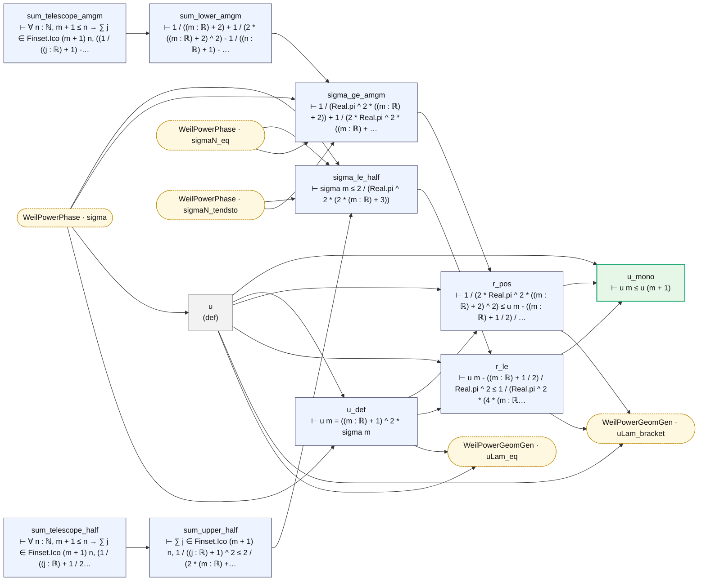

# `lean_stage3/Stage3/WeilPowerSigma.lean`

**What it does** (its own header): WeilPowerSigma — the tail sum to order `1/m`: `σ(m) = Σ_{j≥m+2} 1/(π²j²)` bracketed sharply enough that `u m = (m+1)²σ(m)` is `(m+½)/π²` plus a correction of size `1/m`. Rung 5, thirteenth slice; worksheet § 13 block 13c. 2026-09-06.

**Imports:** [`WeilPowerPhase`](../lean_stage3/WeilPowerPhase.md).
**Imported by:** [`Stage3`](../lean_stage3/Stage3.md), [`WeilPowerGeomGen`](../lean_stage3/WeilPowerGeomGen.md).

Blue: theorem. Green: a theorem nothing else uses (an end). Dashed white: connects to nothing. Grey: definition. Red: contains `sorry`. Yellow: in another file. An arrow A → B reads "A is used by B".

## Every declaration

| declaration | proves (output) | needs (input) | why (its own docstring) | uses | used by |
|---|---|---|---|---|---|
| `WeilPowerSigma.sum_telescope_half` theorem, line 58 | ∀ n : ℕ, m + 1 ≤ n → ∑ j ∈ Finset.Ico (m + 1) n, (1 / ((j : ℝ) + 1 / 2) - 1 / ((j : ℝ) + 3 / 2)) = 1 / ((m : ℝ) + 3 / 2) - 1 / ((n : ℝ) + 1 / 2) | m : ℕ | Telescoping the half-shifted differences. | — | `WeilPowerSigma.sum_upper_half` |
| `WeilPowerSigma.sum_upper_half` theorem, line 73 | ∑ j ∈ Finset.Ico (m + 1) n, 1 / ((j : ℝ) + 1) ^ 2 ≤ 2 / (2 * (m : ℝ) + 3) | m : ℕ; hn : m + 1 ≤ n | The sharp upper bound for the tail sum, `2/(2m+3)`. | `WeilPowerSigma.sum_telescope_half` | `WeilPowerSigma.sigma_le_half` |
| `WeilPowerSigma.sum_telescope_amgm` theorem, line 98 | ∀ n : ℕ, m + 1 ≤ n → ∑ j ∈ Finset.Ico (m + 1) n, ((1 / ((j : ℝ) + 1) - 1 / ((j : ℝ) + 2)) + (1 / (2 * ((j : ℝ) + 1) ^ 2) - 1 / (2 * ((j : ℝ) + 2) ^ 2))) = (1 / ((m : ℝ) + 2) - 1 / ((n : ℝ) + 1)) + (1 / (2 * ((m : ℝ) + 2) ^ 2) - 1 / (2 * ((n : ℝ) + 1) ^ 2)) | m : ℕ | Telescoping the AM–GM differences. | — | `WeilPowerSigma.sum_lower_amgm` |
| `WeilPowerSigma.sum_lower_amgm` theorem, line 116 | 1 / ((m : ℝ) + 2) + 1 / (2 * ((m : ℝ) + 2) ^ 2) - 1 / ((n : ℝ) + 1) - 1 / (2 * ((n : ℝ) + 1) ^ 2) ≤ ∑ j ∈ Finset.Ico (m + 1) n, 1 / ((j : ℝ) + 1) ^ 2 | m : ℕ; hn : m + 1 ≤ n | The sharp lower bound for the tail sum, to order `1/n²` on both ends. | `WeilPowerSigma.sum_telescope_amgm` | `WeilPowerSigma.sigma_ge_amgm` |
| `WeilPowerSigma.sigma_le_half` theorem, line 140 | sigma m ≤ 2 / (Real.pi ^ 2 * (2 * (m : ℝ) + 3)) | m : ℕ | `σ` from above, `2/(π²(2m+3))`: sharper than unit 0347's `1/(π²(m+1))`. | `WeilPowerPhase.sigma`, `WeilPowerPhase.sigmaN_eq`, `WeilPowerPhase.sigmaN_tendsto`, `WeilPowerSigma.sum_upper_half` | `WeilPowerSigma.r_le` |
| `WeilPowerSigma.sigma_ge_amgm` theorem, line 154 | 1 / (Real.pi ^ 2 * ((m : ℝ) + 2)) + 1 / (2 * Real.pi ^ 2 * ((m : ℝ) + 2) ^ 2) ≤ sigma m | m : ℕ | `σ` from below, with the `1/m²` term: sharper than unit 0347's `1/(π²(m+2))`. | `WeilPowerPhase.sigma`, `WeilPowerPhase.sigmaN_eq`, `WeilPowerPhase.sigmaN_tendsto`, `WeilPowerSigma.sum_lower_amgm` | `WeilPowerSigma.r_pos` |
| `WeilPowerSigma.u` def, line 187 | ℝ | m : ℕ | The normalized tail sum `u m = (m+1)²σ(m)`, the exponent's shape at `λ = 1`. | `WeilPowerPhase.sigma` | `WeilPowerGeomGen.uLam_bracket`, `WeilPowerGeomGen.uLam_eq`, `WeilPowerSigma.r_le`, `WeilPowerSigma.r_pos`, `WeilPowerSigma.u_def`, `WeilPowerSigma.u_mono` |
| `WeilPowerSigma.u_def` theorem, line 189 | u m = ((m : ℝ) + 1) ^ 2 * sigma m | m : ℕ | — | `WeilPowerPhase.sigma`, `WeilPowerSigma.u` | `WeilPowerGeomGen.uLam_eq`, `WeilPowerSigma.r_le`, `WeilPowerSigma.r_pos` |
| `WeilPowerSigma.r_pos` theorem, line 192 | 1 / (2 * Real.pi ^ 2 * ((m : ℝ) + 2) ^ 2) ≤ u m - ((m : ℝ) + 1 / 2) / Real.pi ^ 2 | m : ℕ | The correction is positive, at least `1/(2π²(m+2)²)`. | `WeilPowerSigma.sigma_ge_amgm`, `WeilPowerSigma.u`, `WeilPowerSigma.u_def` | `WeilPowerGeomGen.uLam_bracket`, `WeilPowerSigma.u_mono` |
| `WeilPowerSigma.r_le` theorem, line 208 | u m - ((m : ℝ) + 1 / 2) / Real.pi ^ 2 ≤ 1 / (Real.pi ^ 2 * (4 * (m : ℝ) + 6)) | m : ℕ | The correction is `O(1/m)`, at most `1/(π²(4m+6))`. | `WeilPowerSigma.sigma_le_half`, `WeilPowerSigma.u`, `WeilPowerSigma.u_def` | `WeilPowerGeomGen.uLam_bracket`, `WeilPowerSigma.u_mono` |
| `WeilPowerSigma.u_mono` theorem, line 223 | u m ≤ u (m + 1) | m : ℕ | `u` is increasing: the step `1/π²` beats the correction's whole range. | `WeilPowerSigma.r_le`, `WeilPowerSigma.r_pos`, `WeilPowerSigma.u` | — |
