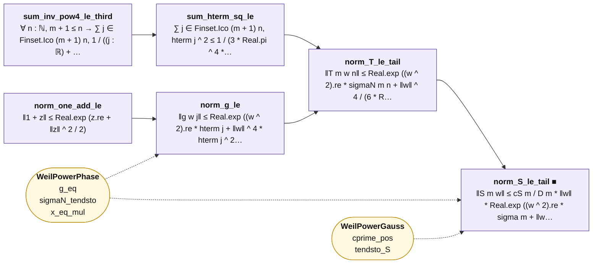

# `lean_stage3/Stage3/WeilPowerTail.lean`

WeilPowerTail — the tail bound: an upper bound on `‖S m w‖` for every `w`, with no regime. Block 16a of `lean_stage3/design/rung5.md` (section 16, its line T12). 2026-11-22. Priced in unit 0378.

6 theorems, 0 definitions, 212 lines. Arrows are Lean's own record of what each proof uses.

**Imports:** [`WeilPowerPhase`](../lean_stage3/WeilPowerPhase.md)  
**Imported by:** [`Stage3`](../lean_stage3/Stage3.md)

## The picture



An arrow A → B reads "A is used in the proof of B". Green: counting, integers only. Violet: shape, analysis with no ζ. Blue: reads ζ. A name ending in ■ is an end: nothing else uses it. Red: contains `sorry`. Yellow: theorems in another file, counted; a dotted arrow crosses files. Definitions are not drawn; they are listed below the diagram.

## Theorems

<a name="WeilPowerTail-sum_inv_pow4_le_third"></a>
### `WeilPowerTail.sum_inv_pow4_le_third`

line 54

**Shape.** Uses real or complex analysis; nothing in it or beneath it reads ζ.

**Why.** The fourth-power tail, telescoped: `1/(k+1)⁴ ≤ (1/3)(1/k³ − 1/(k+1)³)`.

**Proves**

```lean
∀ n : ℕ, m + 1 ≤ n → ∑ j ∈ Finset.Ico (m + 1) n, 1 / ((j : ℝ) + 1) ^ 4 ≤ 1 / 3 * (1 / ((m : ℝ) + 1) ^ 3 - 1 / (n : ℝ) ^ 3)
```

**Needs** (its hypotheses)

  - `` m : ℕ ``

**Fed by:** no theorem of this repo; it stands on Mathlib.

**Feeds** (1 that use it)

  - [`WeilPowerTail.sum_hterm_sq_le`](#WeilPowerTail-sum_hterm_sq_le) — `` ∑ j ∈ Finset.Ico (m + 1) n, hterm j ^ 2 ≤ 1 / (3 * Real.pi ^ 4 * ((m : ℝ) + 1) ^ 3) ``

<a name="WeilPowerTail-sum_hterm_sq_le"></a>
### `WeilPowerTail.sum_hterm_sq_le`

line 77

**Shape.** Uses real or complex analysis; nothing in it or beneath it reads ζ.

**Why.** The squared tail weights sum to at most `1/(3π⁴(m+1)³)`.

**Proves**

```lean
∑ j ∈ Finset.Ico (m + 1) n, hterm j ^ 2 ≤ 1 / (3 * Real.pi ^ 4 * ((m : ℝ) + 1) ^ 3)
```

**Needs** (its hypotheses)

  - `` m n : ℕ ``

**Stated with:** [`WeilPowerPhase.hterm`](../lean_stage3/WeilPowerPhase.md#WeilPowerPhase-hterm)

**Fed by** (1 theorem its proof uses)

  - [`WeilPowerTail.sum_inv_pow4_le_third`](#WeilPowerTail-sum_inv_pow4_le_third) — `` ∀ n : ℕ, m + 1 ≤ n → ∑ j ∈ Finset.Ico (m + 1) n, 1 / ((j : ℝ) + 1) ^ 4 ≤ 1 / 3 * (1 / ((m : ℝ) + 1) ^ 3 - 1 / (n : ℝ) ^ 3) ``

**Feeds** (1 that use it)

  - [`WeilPowerTail.norm_T_le_tail`](#WeilPowerTail-norm_T_le_tail) — `` ‖T m w n‖ ≤ Real.exp ((w ^ 2).re * sigmaN m n + ‖w‖ ^ 4 / (6 * Real.pi ^ 4 * ((m : ℝ) + 1) ^ 3)) ``

<a name="WeilPowerTail-norm_one_add_le"></a>
### `WeilPowerTail.norm_one_add_le`

line 105

**Shape.** Uses real or complex analysis; nothing in it or beneath it reads ζ.

**Why.** `‖1 + z‖ ≤ exp(Re z + ‖z‖²/2)`, for every complex `z`.

**Proves**

```lean
‖1 + z‖ ≤ Real.exp (z.re + ‖z‖ ^ 2 / 2)
```

**Needs** (its hypotheses)

  - `` z : ℂ ``

**Fed by:** no theorem of this repo; it stands on Mathlib.

**Feeds** (1 that use it)

  - [`WeilPowerTail.norm_g_le`](#WeilPowerTail-norm_g_le) — `` ‖g w j‖ ≤ Real.exp ((w ^ 2).re * hterm j + ‖w‖ ^ 4 * hterm j ^ 2 / 2) ``

<a name="WeilPowerTail-norm_g_le"></a>
### `WeilPowerTail.norm_g_le`

line 125

**Shape.** Uses real or complex analysis; nothing in it or beneath it reads ζ.

**Why.** One factor of the tail product.

**Proves**

```lean
‖g w j‖ ≤ Real.exp ((w ^ 2).re * hterm j + ‖w‖ ^ 4 * hterm j ^ 2 / 2)
```

**Needs** (its hypotheses)

  - `` w : ℂ ``
  - `` j : ℕ ``

**Stated with:** [`WeilPowerGauss.g`](../lean_stage3/WeilPowerGauss.md#WeilPowerGauss-g), [`WeilPowerPhase.hterm`](../lean_stage3/WeilPowerPhase.md#WeilPowerPhase-hterm)

**Fed by** (3 theorems its proof uses)

  - [`WeilPowerPhase.g_eq`](../lean_stage3/WeilPowerPhase.md#WeilPowerPhase-g_eq) (WeilPowerPhase) — `` g w j = 1 + x w j ``
  - [`WeilPowerPhase.x_eq_mul`](../lean_stage3/WeilPowerPhase.md#WeilPowerPhase-x_eq_mul) (WeilPowerPhase) — `` x w j = w ^ 2 * ((hterm j : ℝ) : ℂ) ``
  - [`WeilPowerTail.norm_one_add_le`](#WeilPowerTail-norm_one_add_le) — `` ‖1 + z‖ ≤ Real.exp (z.re + ‖z‖ ^ 2 / 2) ``

**Definitions its proof touches:** [`WeilPowerPhase.x`](../lean_stage3/WeilPowerPhase.md#WeilPowerPhase-x)

**Feeds** (1 that use it)

  - [`WeilPowerTail.norm_T_le_tail`](#WeilPowerTail-norm_T_le_tail) — `` ‖T m w n‖ ≤ Real.exp ((w ^ 2).re * sigmaN m n + ‖w‖ ^ 4 / (6 * Real.pi ^ 4 * ((m : ℝ) + 1) ^ 3)) ``

<a name="WeilPowerTail-norm_T_le_tail"></a>
### `WeilPowerTail.norm_T_le_tail`

line 139

**Shape.** Uses real or complex analysis; nothing in it or beneath it reads ζ.

**Why.** The tail product, bounded with the partial tail sum.

**Proves**

```lean
‖T m w n‖ ≤ Real.exp ((w ^ 2).re * sigmaN m n + ‖w‖ ^ 4 / (6 * Real.pi ^ 4 * ((m : ℝ) + 1) ^ 3))
```

**Needs** (its hypotheses)

  - `` m : ℕ ``
  - `` w : ℂ ``
  - `` n : ℕ ``

**Stated with:** [`WeilPowerGauss.T`](../lean_stage3/WeilPowerGauss.md#WeilPowerGauss-T), [`WeilPowerPhase.sigmaN`](../lean_stage3/WeilPowerPhase.md#WeilPowerPhase-sigmaN)

**Fed by** (2 theorems its proof uses)

  - [`WeilPowerTail.norm_g_le`](#WeilPowerTail-norm_g_le) — `` ‖g w j‖ ≤ Real.exp ((w ^ 2).re * hterm j + ‖w‖ ^ 4 * hterm j ^ 2 / 2) ``
  - [`WeilPowerTail.sum_hterm_sq_le`](#WeilPowerTail-sum_hterm_sq_le) — `` ∑ j ∈ Finset.Ico (m + 1) n, hterm j ^ 2 ≤ 1 / (3 * Real.pi ^ 4 * ((m : ℝ) + 1) ^ 3) ``

**Definitions its proof touches:** [`WeilPowerGauss.g`](../lean_stage3/WeilPowerGauss.md#WeilPowerGauss-g), [`WeilPowerPhase.hterm`](../lean_stage3/WeilPowerPhase.md#WeilPowerPhase-hterm)

**Feeds** (1 that use it)

  - [`WeilPowerTail.norm_S_le_tail`](#WeilPowerTail-norm_S_le_tail) — `` ‖S m w‖ ≤ cS m / D m * ‖w‖ * Real.exp ((w ^ 2).re * sigma m + ‖w‖ ^ 4 / (6 * Real.pi ^ 4 * ((m : ℝ) + 1) ^ 3)) ``

<a name="WeilPowerTail-norm_S_le_tail"></a>
### `WeilPowerTail.norm_S_le_tail`

line 178

**Shape.** Uses real or complex analysis; nothing in it or beneath it reads ζ.

**Why.** The tail bound. For every `w` with `QS m w ≠ 0`, no regime: `‖S m w‖ ≤ (cS m/D m)·‖w‖·exp(Re(w²)·sigma m + ‖w‖⁴/(6π⁴(m+1)³))`.

**Proves**

```lean
‖S m w‖ ≤ cS m / D m * ‖w‖ * Real.exp ((w ^ 2).re * sigma m + ‖w‖ ^ 4 / (6 * Real.pi ^ 4 * ((m : ℝ) + 1) ^ 3))
```

**Needs** (its hypotheses)

  - `` hne : QS m w ≠ 0 ``

**Stated with:** [`WeilOddPower.QS`](../lean_stage3/WeilOddPower.md#WeilOddPower-QS), [`WeilOddPower.S`](../lean_stage3/WeilOddPower.md#WeilOddPower-S), [`WeilOddPower.cS`](../lean_stage3/WeilOddPower.md#WeilOddPower-cS), [`WeilPowerGauss.D`](../lean_stage3/WeilPowerGauss.md#WeilPowerGauss-D), [`WeilPowerPhase.sigma`](../lean_stage3/WeilPowerPhase.md#WeilPowerPhase-sigma)

**Fed by** (4 theorems its proof uses)

  - [`WeilPowerGauss.cprime_pos`](../lean_stage3/WeilPowerGauss.md#WeilPowerGauss-cprime_pos) (WeilPowerGauss) — `` 0 < cS m / D m ``
  - [`WeilPowerGauss.tendsto_S`](../lean_stage3/WeilPowerGauss.md#WeilPowerGauss-tendsto_S) (WeilPowerGauss) — `` Tendsto (fun n : ℕ => ((cS m / D m : ℝ) : ℂ) * w * T m w n) atTop (𝓝 (S m w)) ``
  - [`WeilPowerPhase.sigmaN_tendsto`](../lean_stage3/WeilPowerPhase.md#WeilPowerPhase-sigmaN_tendsto) (WeilPowerPhase) — `` Tendsto (fun n => sigmaN m n) atTop (𝓝 (sigma m)) ``
  - [`WeilPowerTail.norm_T_le_tail`](#WeilPowerTail-norm_T_le_tail) — `` ‖T m w n‖ ≤ Real.exp ((w ^ 2).re * sigmaN m n + ‖w‖ ^ 4 / (6 * Real.pi ^ 4 * ((m : ℝ) + 1) ^ 3)) ``

**Definitions its proof touches:** [`WeilPowerGauss.T`](../lean_stage3/WeilPowerGauss.md#WeilPowerGauss-T), [`WeilPowerPhase.sigmaN`](../lean_stage3/WeilPowerPhase.md#WeilPowerPhase-sigmaN)

**Feeds:** nothing. It is an end.

