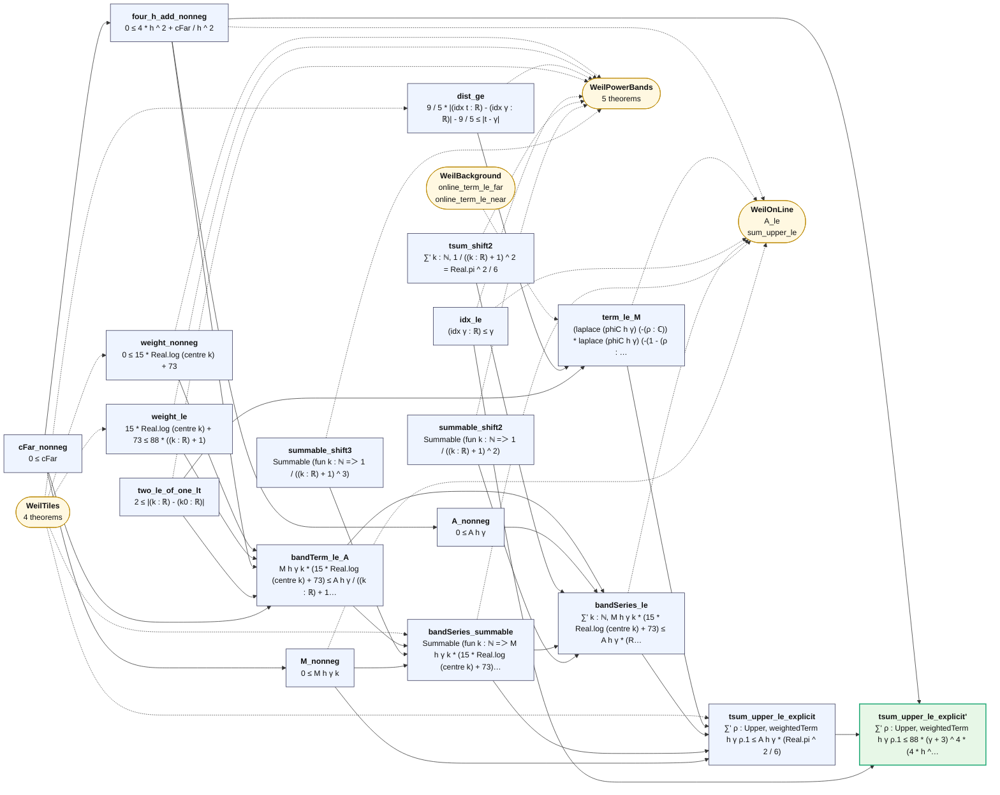

# `lean_stage3/Stage3/WeilSeries.lean`

WeilSeries — the band series made explicit. Rung 4b, second half, slice B2 of the detection ladder (units 0316–0322). 2026-09-06.

18 theorems, 3 definitions, 322 lines. Arrows are Lean's own record of what each proof uses.

**Imports:** [`WeilTiles`](../lean_stage3/WeilTiles.md)  
**Imported by:** [`Stage3`](../lean_stage3/Stage3.md), [`WeilOnLine`](../lean_stage3/WeilOnLine.md), [`WeilPowerBands`](../lean_stage3/WeilPowerBands.md)

## The picture



An arrow A → B reads "A is used in the proof of B". Blue: theorem. Green: a theorem nothing else uses (an end). Dashed: connects to nothing. Red: contains `sorry`. Yellow: theorems in another file, counted; a dotted arrow crosses files. Definitions are not drawn; they are listed below the diagram.

## Definitions

<a name="WeilSeries-cFar"></a>
### `WeilSeries.cFar`

def · line 44

The far constant `(2π+π²)²·(10/9)⁴`.

- **Is:** `` cFar : ℝ := (2 * Real.pi + Real.pi ^ 2) ^ 2 * (10 / 9) ^ 4 ``
- **Used by 11:** [`WeilOnLine.A_le`](../lean_stage3/WeilOnLine.md#WeilOnLine-A_le), [`WeilOnLine.onLineBound_le`](../lean_stage3/WeilOnLine.md#WeilOnLine-onLineBound_le), [`WeilSeries.A`](#WeilSeries-A), [`WeilSeries.A_nonneg`](#WeilSeries-A_nonneg), [`WeilSeries.M`](#WeilSeries-M), [`WeilSeries.M_nonneg`](#WeilSeries-M_nonneg), [`WeilSeries.bandTerm_le_A`](#WeilSeries-bandTerm_le_A), [`WeilSeries.cFar_nonneg`](#WeilSeries-cFar_nonneg), [`WeilSeries.four_h_add_nonneg`](#WeilSeries-four_h_add_nonneg), [`WeilSeries.term_le_M`](#WeilSeries-term_le_M), [`WeilSeries.tsum_upper_le_explicit'`](#WeilSeries-tsum_upper_le_explicit-)

<a name="WeilSeries-M"></a>
### `WeilSeries.M`

def · line 51

The dominating band series.

- **Is:** `` M (h γ : ℝ) (k : ℕ) : ℝ := if |(k : ℝ) - (idx γ : ℝ)| ≤ 1 then 4 * h ^ 2 else cFar / (h ^ 2 * |(k : ℝ) - (idx γ : ℝ)| ^ 4) ``
- **Built from:** [`WeilSeries.cFar`](#WeilSeries-cFar), [`WeilTiles.idx`](../lean_stage3/WeilTiles.md#WeilTiles-idx)
- **Used by 7:** [`WeilOnLine.sum_upper_le`](../lean_stage3/WeilOnLine.md#WeilOnLine-sum_upper_le), [`WeilSeries.M_nonneg`](#WeilSeries-M_nonneg), [`WeilSeries.bandSeries_le`](#WeilSeries-bandSeries_le), [`WeilSeries.bandSeries_summable`](#WeilSeries-bandSeries_summable), [`WeilSeries.bandTerm_le_A`](#WeilSeries-bandTerm_le_A), [`WeilSeries.term_le_M`](#WeilSeries-term_le_M), [`WeilSeries.tsum_upper_le_explicit`](#WeilSeries-tsum_upper_le_explicit)

<a name="WeilSeries-A"></a>
### `WeilSeries.A`

def · line 141

The crude constant: `M k·(15·log (centre k) + 73) ≤ A/(k+1)³`.

- **Is:** `` A (h γ : ℝ) : ℝ := 88 * ((idx γ : ℝ) + 3) ^ 4 * (4 * h ^ 2 + cFar / h ^ 2) ``
- **Built from:** [`WeilSeries.cFar`](#WeilSeries-cFar), [`WeilTiles.idx`](../lean_stage3/WeilTiles.md#WeilTiles-idx)
- **Used by 10:** [`WeilOnLine.A_le`](../lean_stage3/WeilOnLine.md#WeilOnLine-A_le), [`WeilOnLine.B`](../lean_stage3/WeilOnLine.md#WeilOnLine-B), [`WeilOnLine.onLineBound_le`](../lean_stage3/WeilOnLine.md#WeilOnLine-onLineBound_le), [`WeilOnLine.sum_upper_le`](../lean_stage3/WeilOnLine.md#WeilOnLine-sum_upper_le), [`WeilSeries.A_nonneg`](#WeilSeries-A_nonneg), [`WeilSeries.bandSeries_le`](#WeilSeries-bandSeries_le), [`WeilSeries.bandSeries_summable`](#WeilSeries-bandSeries_summable), [`WeilSeries.bandTerm_le_A`](#WeilSeries-bandTerm_le_A), [`WeilSeries.tsum_upper_le_explicit`](#WeilSeries-tsum_upper_le_explicit), [`WeilSeries.tsum_upper_le_explicit'`](#WeilSeries-tsum_upper_le_explicit-)

## Theorems

<a name="WeilSeries-cFar_nonneg"></a>
### `WeilSeries.cFar_nonneg`

line 46

**Proves**

```lean
0 ≤ cFar
```

**Stated with:** [`WeilSeries.cFar`](#WeilSeries-cFar)

**Fed by:** no theorem of this repo; it stands on Mathlib and the definitions below.

**Feeds** (3 that use it)

  - [`WeilSeries.M_nonneg`](#WeilSeries-M_nonneg) — `` 0 ≤ M h γ k ``
  - [`WeilSeries.bandTerm_le_A`](#WeilSeries-bandTerm_le_A) — `` M h γ k * (15 * Real.log (centre k) + 73) ≤ A h γ / ((k : ℝ) + 1) ^ 3 ``
  - [`WeilSeries.four_h_add_nonneg`](#WeilSeries-four_h_add_nonneg) — `` 0 ≤ 4 * h ^ 2 + cFar / h ^ 2 ``

<a name="WeilSeries-M_nonneg"></a>
### `WeilSeries.M_nonneg`

line 55

**Proves**

```lean
0 ≤ M h γ k
```

**Needs** (its hypotheses)

  - `` h γ : ℝ ``
  - `` k : ℕ ``

**Stated with:** [`WeilSeries.M`](#WeilSeries-M)

**Fed by** (1 theorem its proof uses)

  - [`WeilSeries.cFar_nonneg`](#WeilSeries-cFar_nonneg) — `` 0 ≤ cFar ``

**Definitions its proof touches:** [`WeilSeries.cFar`](#WeilSeries-cFar), [`WeilTiles.idx`](../lean_stage3/WeilTiles.md#WeilTiles-idx)

**Feeds** (3 that use it)

  - [`WeilOnLine.sum_upper_le`](../lean_stage3/WeilOnLine.md#WeilOnLine-sum_upper_le) (WeilOnLine) — `` ∑ ρ ∈ S, weightedTerm h γ ρ ≤ B h γ ``
  - [`WeilSeries.bandSeries_summable`](#WeilSeries-bandSeries_summable) — `` Summable (fun k : ℕ => M h γ k * (15 * Real.log (centre k) + 73)) ``
  - [`WeilSeries.tsum_upper_le_explicit`](#WeilSeries-tsum_upper_le_explicit) — `` ∑' ρ : Upper, weightedTerm h γ ρ.1 ≤ A h γ * (Real.pi ^ 2 / 6) ``

<a name="WeilSeries-two_le_of_one_lt"></a>
### `WeilSeries.two_le_of_one_lt`

line 62

**Why.** A gap between naturals that exceeds `1` is at least `2`.

**Proves**

```lean
2 ≤ |(k : ℝ) - (k0 : ℝ)|
```

**Needs** (its hypotheses)

  - `` h : 1 < |(k : ℝ) - (k0 : ℝ)| ``

**Fed by:** no theorem of this repo; it stands on Mathlib.

**Feeds** (4 that use it)

  - [`WeilPowerBands.bandTerm_le_A`](../lean_stage3/WeilPowerBands.md#WeilPowerBands-bandTerm_le_A) (WeilPowerBands) — `` M h γ m k * (15 * Real.log (centre k) + 73) ≤ A h γ m / ((k : ℝ) + 1) ^ 3 ``
  - [`WeilPowerBands.term_le_M`](../lean_stage3/WeilPowerBands.md#WeilPowerBands-term_le_M) (WeilPowerBands) — `` termW h γ m ρ ≤ M h γ m (idx (ρ : ℂ).im) ``
  - [`WeilSeries.bandTerm_le_A`](#WeilSeries-bandTerm_le_A) — `` M h γ k * (15 * Real.log (centre k) + 73) ≤ A h γ / ((k : ℝ) + 1) ^ 3 ``
  - [`WeilSeries.term_le_M`](#WeilSeries-term_le_M) — `` (laplace (phiC h γ) (-(ρ : ℂ)) * laplace (phiC h γ) (-(1 - (ρ : ℂ)))).re ≤ M h γ (idx (ρ : ℂ).im) ``

<a name="WeilSeries-dist_ge"></a>
### `WeilSeries.dist_ge`

line 71

**Why.** The distance from a height to `γ`, read off the band gap.

**Proves**

```lean
9 / 5 * |(idx t : ℝ) - (idx γ : ℝ)| - 9 / 5 ≤ |t - γ|
```

**Needs** (its hypotheses)

  - `` ht : 11 / 10 ≤ t ``
  - `` hγ : 11 / 10 ≤ γ ``

**Stated with:** [`WeilTiles.idx`](../lean_stage3/WeilTiles.md#WeilTiles-idx)

**Fed by** (1 theorem its proof uses)

  - [`WeilTiles.idx_spec`](../lean_stage3/WeilTiles.md#WeilTiles-idx_spec) (WeilTiles) — `` |t - centre (idx t)| ≤ 9 / 10 ``

**Definitions its proof touches:** [`WeilTiles.centre`](../lean_stage3/WeilTiles.md#WeilTiles-centre)

**Feeds** (2 that use it)

  - [`WeilPowerBands.term_le_M`](../lean_stage3/WeilPowerBands.md#WeilPowerBands-term_le_M) (WeilPowerBands) — `` termW h γ m ρ ≤ M h γ m (idx (ρ : ℂ).im) ``
  - [`WeilSeries.term_le_M`](#WeilSeries-term_le_M) — `` (laplace (phiC h γ) (-(ρ : ℂ)) * laplace (phiC h γ) (-(1 - (ρ : ℂ)))).re ≤ M h γ (idx (ρ : ℂ).im) ``

<a name="WeilSeries-term_le_M"></a>
### `WeilSeries.term_le_M`

line 89

**Why.** Domination. Every on-line term of height `≥ 11/10` is at most `M` at its band index.

**Proves**

```lean
(laplace (phiC h γ) (-(ρ : ℂ)) * laplace (phiC h γ) (-(1 - (ρ : ℂ)))).re ≤ M h γ (idx (ρ : ℂ).im)
```

**Needs** (its hypotheses)

  - `` hh : 0 < h ``
  - `` hγ : 11 / 10 ≤ γ ``
  - `` ρ : Kadiri.NontrivialZeros ``
  - `` hre : (ρ : ℂ).re = 1 / 2 ``
  - `` him : 11 / 10 ≤ (ρ : ℂ).im ``

**Stated with:** [`WeilBackground.phiC`](../lean_stage3/WeilBackground.md#WeilBackground-phiC), [`WeilDetect.laplace`](../lean_stage3/WeilDetect.md#WeilDetect-laplace), [`WeilSeries.M`](#WeilSeries-M), [`WeilTiles.idx`](../lean_stage3/WeilTiles.md#WeilTiles-idx)

**Fed by** (4 theorems its proof uses)

  - [`WeilBackground.online_term_le_far`](../lean_stage3/WeilBackground.md#WeilBackground-online_term_le_far) (WeilBackground) — `` (laplace (phiC h γ) (-ρ) * laplace (phiC h γ) (-(1 - ρ))).re ≤ (h / 2) ^ 2 * ((2 * Real.pi + Real.pi ^ 2) / (h * (ρ.im - γ)) ^ 2 + (2 * Real.pi + Real… ``
  - [`WeilBackground.online_term_le_near`](../lean_stage3/WeilBackground.md#WeilBackground-online_term_le_near) (WeilBackground) — `` (laplace (phiC h γ) (-ρ) * laplace (phiC h γ) (-(1 - ρ))).re ≤ 4 * h ^ 2 ``
  - [`WeilSeries.dist_ge`](#WeilSeries-dist_ge) — `` 9 / 5 * |(idx t : ℝ) - (idx γ : ℝ)| - 9 / 5 ≤ |t - γ| ``
  - [`WeilSeries.two_le_of_one_lt`](#WeilSeries-two_le_of_one_lt) — `` 2 ≤ |(k : ℝ) - (k0 : ℝ)| ``

**Definitions its proof touches:** [`WeilSeries.cFar`](#WeilSeries-cFar)

**Feeds** (2 that use it)

  - [`WeilOnLine.sum_upper_le`](../lean_stage3/WeilOnLine.md#WeilOnLine-sum_upper_le) (WeilOnLine) — `` ∑ ρ ∈ S, weightedTerm h γ ρ ≤ B h γ ``
  - [`WeilSeries.tsum_upper_le_explicit`](#WeilSeries-tsum_upper_le_explicit) — `` ∑' ρ : Upper, weightedTerm h γ ρ.1 ≤ A h γ * (Real.pi ^ 2 / 6) ``

<a name="WeilSeries-four_h_add_nonneg"></a>
### `WeilSeries.four_h_add_nonneg`

line 143

**Proves**

```lean
0 ≤ 4 * h ^ 2 + cFar / h ^ 2
```

**Needs** (its hypotheses)

  - `` h : ℝ ``

**Stated with:** [`WeilSeries.cFar`](#WeilSeries-cFar)

**Fed by** (1 theorem its proof uses)

  - [`WeilSeries.cFar_nonneg`](#WeilSeries-cFar_nonneg) — `` 0 ≤ cFar ``

**Feeds** (4 that use it)

  - [`WeilOnLine.A_le`](../lean_stage3/WeilOnLine.md#WeilOnLine-A_le) (WeilOnLine) — `` A h γ ≤ 88 * (γ + 3) ^ 4 * (4 * h ^ 2 + cFar / h ^ 2) ``
  - [`WeilSeries.A_nonneg`](#WeilSeries-A_nonneg) — `` 0 ≤ A h γ ``
  - [`WeilSeries.bandTerm_le_A`](#WeilSeries-bandTerm_le_A) — `` M h γ k * (15 * Real.log (centre k) + 73) ≤ A h γ / ((k : ℝ) + 1) ^ 3 ``
  - [`WeilSeries.tsum_upper_le_explicit'`](#WeilSeries-tsum_upper_le_explicit-) — `` ∑' ρ : Upper, weightedTerm h γ ρ.1 ≤ 88 * (γ + 3) ^ 4 * (4 * h ^ 2 + cFar / h ^ 2) * (Real.pi ^ 2 / 6) ``

<a name="WeilSeries-A_nonneg"></a>
### `WeilSeries.A_nonneg`

line 148

**Proves**

```lean
0 ≤ A h γ
```

**Needs** (its hypotheses)

  - `` h γ : ℝ ``

**Stated with:** [`WeilSeries.A`](#WeilSeries-A)

**Fed by** (1 theorem its proof uses)

  - [`WeilSeries.four_h_add_nonneg`](#WeilSeries-four_h_add_nonneg) — `` 0 ≤ 4 * h ^ 2 + cFar / h ^ 2 ``

**Definitions its proof touches:** [`WeilSeries.cFar`](#WeilSeries-cFar), [`WeilTiles.idx`](../lean_stage3/WeilTiles.md#WeilTiles-idx)

**Feeds** (1 that use it)

  - [`WeilSeries.bandSeries_le`](#WeilSeries-bandSeries_le) — `` ∑' k : ℕ, M h γ k * (15 * Real.log (centre k) + 73) ≤ A h γ * (Real.pi ^ 2 / 6) ``

<a name="WeilSeries-weight_le"></a>
### `WeilSeries.weight_le`

line 153

**Why.** The band weight, with `log x ≤ x − 1`.

**Proves**

```lean
15 * Real.log (centre k) + 73 ≤ 88 * ((k : ℝ) + 1)
```

**Needs** (its hypotheses)

  - `` k : ℕ ``

**Stated with:** [`WeilTiles.centre`](../lean_stage3/WeilTiles.md#WeilTiles-centre)

**Fed by** (1 theorem its proof uses)

  - [`WeilTiles.two_le_centre`](../lean_stage3/WeilTiles.md#WeilTiles-two_le_centre) (WeilTiles) — `` 2 ≤ centre k ``

**Feeds** (2 that use it)

  - [`WeilPowerBands.bandTerm_le_A`](../lean_stage3/WeilPowerBands.md#WeilPowerBands-bandTerm_le_A) (WeilPowerBands) — `` M h γ m k * (15 * Real.log (centre k) + 73) ≤ A h γ m / ((k : ℝ) + 1) ^ 3 ``
  - [`WeilSeries.bandTerm_le_A`](#WeilSeries-bandTerm_le_A) — `` M h γ k * (15 * Real.log (centre k) + 73) ≤ A h γ / ((k : ℝ) + 1) ^ 3 ``

<a name="WeilSeries-weight_nonneg"></a>
### `WeilSeries.weight_nonneg`

line 161

**Proves**

```lean
0 ≤ 15 * Real.log (centre k) + 73
```

**Needs** (its hypotheses)

  - `` k : ℕ ``

**Stated with:** [`WeilTiles.centre`](../lean_stage3/WeilTiles.md#WeilTiles-centre)

**Fed by** (1 theorem its proof uses)

  - [`WeilTiles.two_le_centre`](../lean_stage3/WeilTiles.md#WeilTiles-two_le_centre) (WeilTiles) — `` 2 ≤ centre k ``

**Feeds** (2 that use it)

  - [`WeilPowerBands.bandTerm_le_A`](../lean_stage3/WeilPowerBands.md#WeilPowerBands-bandTerm_le_A) (WeilPowerBands) — `` M h γ m k * (15 * Real.log (centre k) + 73) ≤ A h γ m / ((k : ℝ) + 1) ^ 3 ``
  - [`WeilSeries.bandTerm_le_A`](#WeilSeries-bandTerm_le_A) — `` M h γ k * (15 * Real.log (centre k) + 73) ≤ A h γ / ((k : ℝ) + 1) ^ 3 ``

<a name="WeilSeries-bandTerm_le_A"></a>
### `WeilSeries.bandTerm_le_A`

line 166

**Why.** Comparison. Each band term is at most `A/(k+1)³`.

**Proves**

```lean
M h γ k * (15 * Real.log (centre k) + 73) ≤ A h γ / ((k : ℝ) + 1) ^ 3
```

**Needs** (its hypotheses)

  - `` hh : 0 < h ``
  - `` k : ℕ ``

**Stated with:** [`WeilSeries.A`](#WeilSeries-A), [`WeilSeries.M`](#WeilSeries-M), [`WeilTiles.centre`](../lean_stage3/WeilTiles.md#WeilTiles-centre)

**Fed by** (5 theorems its proof uses)

  - [`WeilSeries.cFar_nonneg`](#WeilSeries-cFar_nonneg) — `` 0 ≤ cFar ``
  - [`WeilSeries.four_h_add_nonneg`](#WeilSeries-four_h_add_nonneg) — `` 0 ≤ 4 * h ^ 2 + cFar / h ^ 2 ``
  - [`WeilSeries.two_le_of_one_lt`](#WeilSeries-two_le_of_one_lt) — `` 2 ≤ |(k : ℝ) - (k0 : ℝ)| ``
  - [`WeilSeries.weight_le`](#WeilSeries-weight_le) — `` 15 * Real.log (centre k) + 73 ≤ 88 * ((k : ℝ) + 1) ``
  - [`WeilSeries.weight_nonneg`](#WeilSeries-weight_nonneg) — `` 0 ≤ 15 * Real.log (centre k) + 73 ``

**Definitions its proof touches:** [`WeilSeries.cFar`](#WeilSeries-cFar), [`WeilTiles.idx`](../lean_stage3/WeilTiles.md#WeilTiles-idx)

**Feeds** (2 that use it)

  - [`WeilSeries.bandSeries_le`](#WeilSeries-bandSeries_le) — `` ∑' k : ℕ, M h γ k * (15 * Real.log (centre k) + 73) ≤ A h γ * (Real.pi ^ 2 / 6) ``
  - [`WeilSeries.bandSeries_summable`](#WeilSeries-bandSeries_summable) — `` Summable (fun k : ℕ => M h γ k * (15 * Real.log (centre k) + 73)) ``

<a name="WeilSeries-summable_shift3"></a>
### `WeilSeries.summable_shift3`

line 221

**Proves**

```lean
Summable (fun k : ℕ => 1 / ((k : ℝ) + 1) ^ 3)
```

**Fed by:** no theorem of this repo; it stands on Mathlib.

**Feeds** (2 that use it)

  - [`WeilPowerBands.bandSeries_summable`](../lean_stage3/WeilPowerBands.md#WeilPowerBands-bandSeries_summable) (WeilPowerBands) — `` Summable (fun k : ℕ => M h γ m k * (15 * Real.log (centre k) + 73)) ``
  - [`WeilSeries.bandSeries_summable`](#WeilSeries-bandSeries_summable) — `` Summable (fun k : ℕ => M h γ k * (15 * Real.log (centre k) + 73)) ``

<a name="WeilSeries-summable_shift2"></a>
### `WeilSeries.summable_shift2`

line 229

**Proves**

```lean
Summable (fun k : ℕ => 1 / ((k : ℝ) + 1) ^ 2)
```

**Fed by:** no theorem of this repo; it stands on Mathlib.

**Feeds** (2 that use it)

  - [`WeilPowerBands.bandSeries_le`](../lean_stage3/WeilPowerBands.md#WeilPowerBands-bandSeries_le) (WeilPowerBands) — `` ∑' k : ℕ, M h γ m k * (15 * Real.log (centre k) + 73) ≤ A h γ m * (Real.pi ^ 2 / 6) ``
  - [`WeilSeries.bandSeries_le`](#WeilSeries-bandSeries_le) — `` ∑' k : ℕ, M h γ k * (15 * Real.log (centre k) + 73) ≤ A h γ * (Real.pi ^ 2 / 6) ``

<a name="WeilSeries-bandSeries_summable"></a>
### `WeilSeries.bandSeries_summable`

line 238

**Why.** Summability of the band series, by comparison with `A/(k+1)³`.

**Proves**

```lean
Summable (fun k : ℕ => M h γ k * (15 * Real.log (centre k) + 73))
```

**Needs** (its hypotheses)

  - `` hh : 0 < h ``

**Stated with:** [`WeilSeries.M`](#WeilSeries-M), [`WeilTiles.centre`](../lean_stage3/WeilTiles.md#WeilTiles-centre)

**Fed by** (4 theorems its proof uses)

  - [`WeilSeries.M_nonneg`](#WeilSeries-M_nonneg) — `` 0 ≤ M h γ k ``
  - [`WeilSeries.bandTerm_le_A`](#WeilSeries-bandTerm_le_A) — `` M h γ k * (15 * Real.log (centre k) + 73) ≤ A h γ / ((k : ℝ) + 1) ^ 3 ``
  - [`WeilSeries.summable_shift3`](#WeilSeries-summable_shift3) — `` Summable (fun k : ℕ => 1 / ((k : ℝ) + 1) ^ 3) ``
  - [`WeilTiles.bandSeries_nonneg`](../lean_stage3/WeilTiles.md#WeilTiles-bandSeries_nonneg) (WeilTiles) — `` 0 ≤ M k * (15 * Real.log (centre k) + 73) ``

**Definitions its proof touches:** [`WeilSeries.A`](#WeilSeries-A)

**Feeds** (3 that use it)

  - [`WeilOnLine.sum_upper_le`](../lean_stage3/WeilOnLine.md#WeilOnLine-sum_upper_le) (WeilOnLine) — `` ∑ ρ ∈ S, weightedTerm h γ ρ ≤ B h γ ``
  - [`WeilSeries.bandSeries_le`](#WeilSeries-bandSeries_le) — `` ∑' k : ℕ, M h γ k * (15 * Real.log (centre k) + 73) ≤ A h γ * (Real.pi ^ 2 / 6) ``
  - [`WeilSeries.tsum_upper_le_explicit`](#WeilSeries-tsum_upper_le_explicit) — `` ∑' ρ : Upper, weightedTerm h γ ρ.1 ≤ A h γ * (Real.pi ^ 2 / 6) ``

<a name="WeilSeries-tsum_shift2"></a>
### `WeilSeries.tsum_shift2`

line 247

**Why.** `Σ_{k≥0} 1/(k+1)² = π²/6`, from `hasSum_zeta_two`.

**Proves**

```lean
∑' k : ℕ, 1 / ((k : ℝ) + 1) ^ 2 = Real.pi ^ 2 / 6
```

**Fed by:** no theorem of this repo; it stands on Mathlib.

**Feeds** (2 that use it)

  - [`WeilPowerBands.bandSeries_le`](../lean_stage3/WeilPowerBands.md#WeilPowerBands-bandSeries_le) (WeilPowerBands) — `` ∑' k : ℕ, M h γ m k * (15 * Real.log (centre k) + 73) ≤ A h γ m * (Real.pi ^ 2 / 6) ``
  - [`WeilSeries.bandSeries_le`](#WeilSeries-bandSeries_le) — `` ∑' k : ℕ, M h γ k * (15 * Real.log (centre k) + 73) ≤ A h γ * (Real.pi ^ 2 / 6) ``

<a name="WeilSeries-bandSeries_le"></a>
### `WeilSeries.bandSeries_le`

line 260

**Why.** The band series in closed form: at most `A·π²/6`.

**Proves**

```lean
∑' k : ℕ, M h γ k * (15 * Real.log (centre k) + 73) ≤ A h γ * (Real.pi ^ 2 / 6)
```

**Needs** (its hypotheses)

  - `` hh : 0 < h ``

**Stated with:** [`WeilSeries.A`](#WeilSeries-A), [`WeilSeries.M`](#WeilSeries-M), [`WeilTiles.centre`](../lean_stage3/WeilTiles.md#WeilTiles-centre)

**Fed by** (5 theorems its proof uses)

  - [`WeilSeries.A_nonneg`](#WeilSeries-A_nonneg) — `` 0 ≤ A h γ ``
  - [`WeilSeries.bandSeries_summable`](#WeilSeries-bandSeries_summable) — `` Summable (fun k : ℕ => M h γ k * (15 * Real.log (centre k) + 73)) ``
  - [`WeilSeries.bandTerm_le_A`](#WeilSeries-bandTerm_le_A) — `` M h γ k * (15 * Real.log (centre k) + 73) ≤ A h γ / ((k : ℝ) + 1) ^ 3 ``
  - [`WeilSeries.summable_shift2`](#WeilSeries-summable_shift2) — `` Summable (fun k : ℕ => 1 / ((k : ℝ) + 1) ^ 2) ``
  - [`WeilSeries.tsum_shift2`](#WeilSeries-tsum_shift2) — `` ∑' k : ℕ, 1 / ((k : ℝ) + 1) ^ 2 = Real.pi ^ 2 / 6 ``

**Feeds** (2 that use it)

  - [`WeilOnLine.sum_upper_le`](../lean_stage3/WeilOnLine.md#WeilOnLine-sum_upper_le) (WeilOnLine) — `` ∑ ρ ∈ S, weightedTerm h γ ρ ≤ B h γ ``
  - [`WeilSeries.tsum_upper_le_explicit`](#WeilSeries-tsum_upper_le_explicit) — `` ∑' ρ : Upper, weightedTerm h γ ρ.1 ≤ A h γ * (Real.pi ^ 2 / 6) ``

<a name="WeilSeries-idx_le"></a>
### `WeilSeries.idx_le`

line 275

**Why.** The band index of `γ` is at most `γ`.

**Proves**

```lean
(idx γ : ℝ) ≤ γ
```

**Needs** (its hypotheses)

  - `` hγ : 11 / 10 ≤ γ ``

**Stated with:** [`WeilTiles.idx`](../lean_stage3/WeilTiles.md#WeilTiles-idx)

**Fed by:** no theorem of this repo; it stands on Mathlib and the definitions below.

**Feeds** (3 that use it)

  - [`WeilOnLine.A_le`](../lean_stage3/WeilOnLine.md#WeilOnLine-A_le) (WeilOnLine) — `` A h γ ≤ 88 * (γ + 3) ^ 4 * (4 * h ^ 2 + cFar / h ^ 2) ``
  - [`WeilPowerBands.A_le`](../lean_stage3/WeilPowerBands.md#WeilPowerBands-A_le) (WeilPowerBands) — `` A h γ m ≤ 88 * (γ + r h m + 2) ^ 4 * (4 * h ^ 2 + cFarM m / h ^ 2) ``
  - [`WeilSeries.tsum_upper_le_explicit'`](#WeilSeries-tsum_upper_le_explicit-) — `` ∑' ρ : Upper, weightedTerm h γ ρ.1 ≤ 88 * (γ + 3) ^ 4 * (4 * h ^ 2 + cFar / h ^ 2) * (Real.pi ^ 2 / 6) ``

<a name="WeilSeries-tsum_upper_le_explicit"></a>
### `WeilSeries.tsum_upper_le_explicit`

line 285

**Why.** Upper on-line background. For `h > 0` and `γ ≥ 11/10`, the full weighted sum over on-line zeros of height `≥ 11/10` is at most `A·π²/6`.

**Proves**

```lean
∑' ρ : Upper, weightedTerm h γ ρ.1 ≤ A h γ * (Real.pi ^ 2 / 6)
```

**Needs** (its hypotheses)

  - `` hh : 0 < h ``
  - `` hγ : 11 / 10 ≤ γ ``

**Stated with:** [`WeilBands.weightedTerm`](../lean_stage3/WeilBands.md#WeilBands-weightedTerm), [`WeilSeries.A`](#WeilSeries-A), [`WeilTiles.Upper`](../lean_stage3/WeilTiles.md#WeilTiles-Upper)

**Fed by** (5 theorems its proof uses)

  - [`WeilSeries.M_nonneg`](#WeilSeries-M_nonneg) — `` 0 ≤ M h γ k ``
  - [`WeilSeries.bandSeries_le`](#WeilSeries-bandSeries_le) — `` ∑' k : ℕ, M h γ k * (15 * Real.log (centre k) + 73) ≤ A h γ * (Real.pi ^ 2 / 6) ``
  - [`WeilSeries.bandSeries_summable`](#WeilSeries-bandSeries_summable) — `` Summable (fun k : ℕ => M h γ k * (15 * Real.log (centre k) + 73)) ``
  - [`WeilSeries.term_le_M`](#WeilSeries-term_le_M) — `` (laplace (phiC h γ) (-(ρ : ℂ)) * laplace (phiC h γ) (-(1 - (ρ : ℂ)))).re ≤ M h γ (idx (ρ : ℂ).im) ``
  - [`WeilTiles.tsum_upper_le`](../lean_stage3/WeilTiles.md#WeilTiles-tsum_upper_le) (WeilTiles) — `` ∑' ρ : Upper, weightedTerm h γ ρ.1 ≤ ∑' k : ℕ, M k * (15 * Real.log (centre k) + 73) ``

**Definitions its proof touches:** [`WeilSeries.M`](#WeilSeries-M), [`WeilTiles.centre`](../lean_stage3/WeilTiles.md#WeilTiles-centre)

**Feeds** (1 that use it)

  - [`WeilSeries.tsum_upper_le_explicit'`](#WeilSeries-tsum_upper_le_explicit-) — `` ∑' ρ : Upper, weightedTerm h γ ρ.1 ≤ 88 * (γ + 3) ^ 4 * (4 * h ^ 2 + cFar / h ^ 2) * (Real.pi ^ 2 / 6) ``

<a name="WeilSeries-tsum_upper_le_explicit-"></a>
### `WeilSeries.tsum_upper_le_explicit'`

line 294

**Why.** Upper on-line background, in `γ` and `h` alone: `≤ 88·(γ+3)⁴·(4h² + cFar/h²)·π²/6`.

**Proves**

```lean
∑' ρ : Upper, weightedTerm h γ ρ.1 ≤ 88 * (γ + 3) ^ 4 * (4 * h ^ 2 + cFar / h ^ 2) * (Real.pi ^ 2 / 6)
```

**Needs** (its hypotheses)

  - `` hh : 0 < h ``
  - `` hγ : 11 / 10 ≤ γ ``

**Stated with:** [`WeilBands.weightedTerm`](../lean_stage3/WeilBands.md#WeilBands-weightedTerm), [`WeilSeries.cFar`](#WeilSeries-cFar), [`WeilTiles.Upper`](../lean_stage3/WeilTiles.md#WeilTiles-Upper)

**Fed by** (3 theorems its proof uses)

  - [`WeilSeries.four_h_add_nonneg`](#WeilSeries-four_h_add_nonneg) — `` 0 ≤ 4 * h ^ 2 + cFar / h ^ 2 ``
  - [`WeilSeries.idx_le`](#WeilSeries-idx_le) — `` (idx γ : ℝ) ≤ γ ``
  - [`WeilSeries.tsum_upper_le_explicit`](#WeilSeries-tsum_upper_le_explicit) — `` ∑' ρ : Upper, weightedTerm h γ ρ.1 ≤ A h γ * (Real.pi ^ 2 / 6) ``

**Definitions its proof touches:** [`WeilSeries.A`](#WeilSeries-A), [`WeilTiles.idx`](../lean_stage3/WeilTiles.md#WeilTiles-idx)

**Feeds:** nothing. It is an end.

