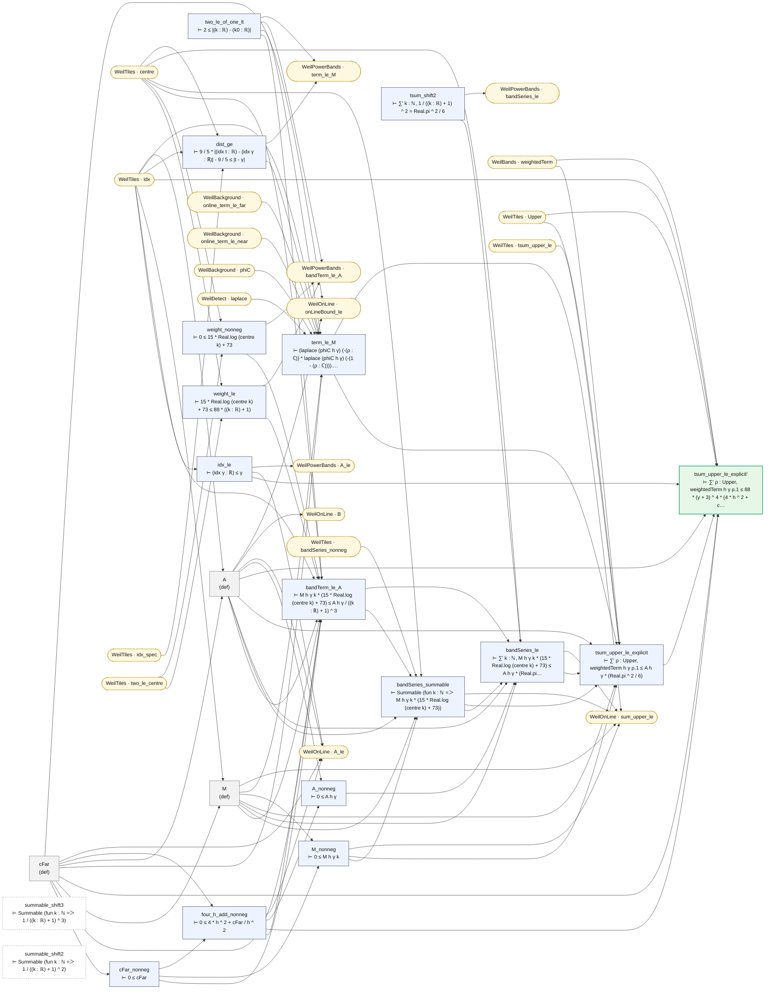

# `lean_stage3/Stage3/WeilSeries.lean`

**What it does** (its own header): WeilSeries — the band series made explicit. Rung 4b, second half, slice B2 of the detection ladder (units 0316–0322). 2026-09-06.

**Imports:** [`WeilTiles`](../lean_stage3/WeilTiles.md).
**Imported by:** [`Stage3`](../lean_stage3/Stage3.md), [`WeilOnLine`](../lean_stage3/WeilOnLine.md), [`WeilPowerBands`](../lean_stage3/WeilPowerBands.md).

Blue: theorem. Green: a theorem nothing else uses (an end). Dashed white: connects to nothing. Grey: definition. Red: contains `sorry`. Yellow: in another file. An arrow A → B reads "A is used by B".

## Every declaration

| declaration | proves (output) | needs (input) | why (its own docstring) | uses | used by |
|---|---|---|---|---|---|
| `WeilSeries.cFar` def, line 44 | ℝ | — | The far constant `(2π+π²)²·(10/9)⁴`. | — | `WeilOnLine.A_le`, `WeilOnLine.onLineBound_le`, `WeilSeries.A`, `WeilSeries.M`, `WeilSeries.bandTerm_le_A`, `WeilSeries.cFar_nonneg`, `WeilSeries.four_h_add_nonneg`, `WeilSeries.term_le_M`, `WeilSeries.tsum_upper_le_explicit'` |
| `WeilSeries.cFar_nonneg` theorem, line 46 | 0 ≤ cFar | — | — | `WeilSeries.cFar` | `WeilSeries.M_nonneg`, `WeilSeries.bandTerm_le_A`, `WeilSeries.four_h_add_nonneg` |
| `WeilSeries.M` def, line 51 | ℝ | h γ : ℝ; k : ℕ | The dominating band series. | `WeilSeries.cFar`, `WeilTiles.idx` | `WeilOnLine.sum_upper_le`, `WeilSeries.M_nonneg`, `WeilSeries.bandSeries_le`, `WeilSeries.bandSeries_summable`, `WeilSeries.bandTerm_le_A`, `WeilSeries.term_le_M`, `WeilSeries.tsum_upper_le_explicit` |
| `WeilSeries.M_nonneg` theorem, line 55 | 0 ≤ M h γ k | h γ : ℝ; k : ℕ | — | `WeilSeries.M`, `WeilSeries.cFar_nonneg` | `WeilOnLine.sum_upper_le`, `WeilSeries.bandSeries_summable`, `WeilSeries.tsum_upper_le_explicit` |
| `WeilSeries.two_le_of_one_lt` theorem, line 62 | 2 ≤ \|(k : ℝ) - (k0 : ℝ)\| | h : 1 &lt; \|(k : ℝ) - (k0 : ℝ)\| | A gap between naturals that exceeds `1` is at least `2`. | — | `WeilPowerBands.bandTerm_le_A`, `WeilPowerBands.term_le_M`, `WeilSeries.bandTerm_le_A`, `WeilSeries.term_le_M` |
| `WeilSeries.dist_ge` theorem, line 71 | 9 / 5 * \|(idx t : ℝ) - (idx γ : ℝ)\| - 9 / 5 ≤ \|t - γ\| | ht : 11 / 10 ≤ t; hγ : 11 / 10 ≤ γ | The distance from a height to `γ`, read off the band gap. | `WeilTiles.centre`, `WeilTiles.idx`, `WeilTiles.idx_spec` | `WeilPowerBands.term_le_M`, `WeilSeries.term_le_M` |
| `WeilSeries.term_le_M` theorem, line 89 | (laplace (phiC h γ) (-(ρ : ℂ)) * laplace (phiC h γ) (-(1 - (ρ : ℂ)))).re ≤ M h γ (idx (ρ : ℂ).im) | hh : 0 &lt; h; hγ : 11 / 10 ≤ γ; ρ : Kadiri.NontrivialZeros; hre : (ρ : ℂ).re = 1 / 2; him : 11 / 10 ≤ (ρ : ℂ).im | Domination. Every on-line term of height `≥ 11/10` is at most `M` at its band index. | `WeilBackground.online_term_le_far`, `WeilBackground.online_term_le_near`, `WeilBackground.phiC`, `WeilDetect.laplace`, `WeilSeries.M`, `WeilSeries.cFar`, `WeilSeries.dist_ge`, `WeilSeries.two_le_of_one_lt`, `WeilTiles.idx` | `WeilOnLine.sum_upper_le`, `WeilSeries.tsum_upper_le_explicit` |
| `WeilSeries.A` def, line 141 | ℝ | h γ : ℝ | The crude constant: `M k·(15·log (centre k) + 73) ≤ A/(k+1)³`. | `WeilSeries.cFar`, `WeilTiles.idx` | `WeilOnLine.A_le`, `WeilOnLine.B`, `WeilOnLine.onLineBound_le`, `WeilSeries.A_nonneg`, `WeilSeries.bandSeries_le`, `WeilSeries.bandSeries_summable`, `WeilSeries.bandTerm_le_A`, `WeilSeries.tsum_upper_le_explicit`, `WeilSeries.tsum_upper_le_explicit'` |
| `WeilSeries.four_h_add_nonneg` theorem, line 143 | 0 ≤ 4 * h ^ 2 + cFar / h ^ 2 | h : ℝ | — | `WeilSeries.cFar`, `WeilSeries.cFar_nonneg` | `WeilOnLine.A_le`, `WeilSeries.A_nonneg`, `WeilSeries.bandTerm_le_A`, `WeilSeries.tsum_upper_le_explicit'` |
| `WeilSeries.A_nonneg` theorem, line 148 | 0 ≤ A h γ | h γ : ℝ | — | `WeilSeries.A`, `WeilSeries.four_h_add_nonneg` | `WeilSeries.bandSeries_le` |
| `WeilSeries.weight_le` theorem, line 153 | 15 * Real.log (centre k) + 73 ≤ 88 * ((k : ℝ) + 1) | k : ℕ | The band weight, with `log x ≤ x − 1`. | `WeilTiles.centre`, `WeilTiles.two_le_centre` | `WeilPowerBands.bandTerm_le_A`, `WeilSeries.bandTerm_le_A` |
| `WeilSeries.weight_nonneg` theorem, line 161 | 0 ≤ 15 * Real.log (centre k) + 73 | k : ℕ | — | `WeilTiles.centre`, `WeilTiles.two_le_centre` | `WeilPowerBands.bandTerm_le_A`, `WeilSeries.bandTerm_le_A` |
| `WeilSeries.bandTerm_le_A` theorem, line 166 | M h γ k * (15 * Real.log (centre k) + 73) ≤ A h γ / ((k : ℝ) + 1) ^ 3 | hh : 0 &lt; h; k : ℕ | Comparison. Each band term is at most `A/(k+1)³`. | `WeilSeries.A`, `WeilSeries.M`, `WeilSeries.cFar`, `WeilSeries.cFar_nonneg`, `WeilSeries.four_h_add_nonneg`, `WeilSeries.two_le_of_one_lt`, `WeilSeries.weight_le`, `WeilSeries.weight_nonneg`, `WeilTiles.centre`, `WeilTiles.idx` | `WeilSeries.bandSeries_le`, `WeilSeries.bandSeries_summable` |
| `WeilSeries.summable_shift3` theorem, line 221 | Summable (fun k : ℕ =&gt; 1 / ((k : ℝ) + 1) ^ 3) | — | — | — | — |
| `WeilSeries.summable_shift2` theorem, line 229 | Summable (fun k : ℕ =&gt; 1 / ((k : ℝ) + 1) ^ 2) | — | — | — | — |
| `WeilSeries.bandSeries_summable` theorem, line 238 | Summable (fun k : ℕ =&gt; M h γ k * (15 * Real.log (centre k) + 73)) | hh : 0 &lt; h | Summability of the band series, by comparison with `A/(k+1)³`. | `WeilSeries.A`, `WeilSeries.M`, `WeilSeries.M_nonneg`, `WeilSeries.bandTerm_le_A`, `WeilTiles.bandSeries_nonneg`, `WeilTiles.centre` | `WeilOnLine.sum_upper_le`, `WeilSeries.bandSeries_le`, `WeilSeries.tsum_upper_le_explicit` |
| `WeilSeries.tsum_shift2` theorem, line 247 | ∑' k : ℕ, 1 / ((k : ℝ) + 1) ^ 2 = Real.pi ^ 2 / 6 | — | `Σ_{k≥0} 1/(k+1)² = π²/6`, from `hasSum_zeta_two`. | — | `WeilPowerBands.bandSeries_le`, `WeilSeries.bandSeries_le` |
| `WeilSeries.bandSeries_le` theorem, line 260 | ∑' k : ℕ, M h γ k * (15 * Real.log (centre k) + 73) ≤ A h γ * (Real.pi ^ 2 / 6) | hh : 0 &lt; h | The band series in closed form: at most `A·π²/6`. | `WeilSeries.A`, `WeilSeries.A_nonneg`, `WeilSeries.M`, `WeilSeries.bandSeries_summable`, `WeilSeries.bandTerm_le_A`, `WeilSeries.tsum_shift2`, `WeilTiles.centre` | `WeilOnLine.sum_upper_le`, `WeilSeries.tsum_upper_le_explicit` |
| `WeilSeries.idx_le` theorem, line 275 | (idx γ : ℝ) ≤ γ | hγ : 11 / 10 ≤ γ | The band index of `γ` is at most `γ`. | `WeilTiles.idx` | `WeilOnLine.A_le`, `WeilPowerBands.A_le`, `WeilSeries.tsum_upper_le_explicit'` |
| `WeilSeries.tsum_upper_le_explicit` theorem, line 285 | ∑' ρ : Upper, weightedTerm h γ ρ.1 ≤ A h γ * (Real.pi ^ 2 / 6) | hh : 0 &lt; h; hγ : 11 / 10 ≤ γ | Upper on-line background. For `h &gt; 0` and `γ ≥ 11/10`, the full weighted sum over on-line zeros of height `≥ 11/10` is at most `A·π²/6`. | `WeilBands.weightedTerm`, `WeilSeries.A`, `WeilSeries.M`, `WeilSeries.M_nonneg`, `WeilSeries.bandSeries_le`, `WeilSeries.bandSeries_summable`, `WeilSeries.term_le_M`, `WeilTiles.Upper`, `WeilTiles.tsum_upper_le` | `WeilSeries.tsum_upper_le_explicit'` |
| `WeilSeries.tsum_upper_le_explicit'` theorem, line 294 | ∑' ρ : Upper, weightedTerm h γ ρ.1 ≤ 88 * (γ + 3) ^ 4 * (4 * h ^ 2 + cFar / h ^ 2) * (Real.pi ^ 2 / 6) | hh : 0 &lt; h; hγ : 11 / 10 ≤ γ | Upper on-line background, in `γ` and `h` alone: `≤ 88·(γ+3)⁴·(4h² + cFar/h²)·π²/6`. | `WeilBands.weightedTerm`, `WeilSeries.A`, `WeilSeries.cFar`, `WeilSeries.four_h_add_nonneg`, `WeilSeries.idx_le`, `WeilSeries.tsum_upper_le_explicit`, `WeilTiles.Upper`, `WeilTiles.idx` | — |
