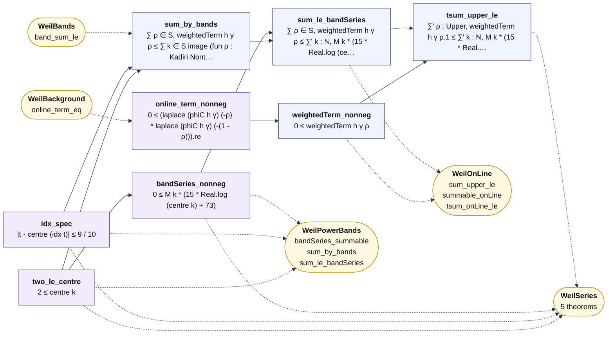

# `lean_stage3/Stage3/WeilTiles.lean`

WeilTiles — the heights tiled by bands. Rung 4b, second half, slice B1 of the detection ladder (units 0316–0321). 2026-09-06.

8 theorems, 3 definitions, 170 lines. Arrows are Lean's own record of what each proof uses.

**Imports:** [`WeilBands`](../lean_stage3/WeilBands.md)  
**Imported by:** [`Stage3`](../lean_stage3/Stage3.md), [`WeilSeries`](../lean_stage3/WeilSeries.md)

## The picture



An arrow A → B reads "A is used in the proof of B". Green: counting, integers only. Violet: shape, analysis with no ζ. Blue: reads ζ. A name ending in ■ is an end: nothing else uses it. Red: contains `sorry`. Yellow: theorems in another file, counted; a dotted arrow crosses files. Definitions are not drawn; they are listed below the diagram.

## Definitions

<a name="WeilTiles-centre"></a>
### `WeilTiles.centre`

def · line 41

Band centres `2 + (9/5)·k`.

- **Is:** `` centre (k : ℕ) : ℝ := 2 + 9 / 5 * k ``
- **Used by 22:** [`WeilOnLine.sum_upper_le`](../lean_stage3/WeilOnLine.md#WeilOnLine-sum_upper_le), [`WeilPowerBands.bandSeries_le`](../lean_stage3/WeilPowerBands.md#WeilPowerBands-bandSeries_le), [`WeilPowerBands.bandSeries_summable`](../lean_stage3/WeilPowerBands.md#WeilPowerBands-bandSeries_summable), [`WeilPowerBands.bandTerm_le_A`](../lean_stage3/WeilPowerBands.md#WeilPowerBands-bandTerm_le_A), [`WeilPowerBands.sum_by_bands`](../lean_stage3/WeilPowerBands.md#WeilPowerBands-sum_by_bands), [`WeilPowerBands.sum_le_bandSeries`](../lean_stage3/WeilPowerBands.md#WeilPowerBands-sum_le_bandSeries), [`WeilPowerBands.tsum_upper_le`](../lean_stage3/WeilPowerBands.md#WeilPowerBands-tsum_upper_le), [`WeilPowerBands.tsum_upper_le_explicit`](../lean_stage3/WeilPowerBands.md#WeilPowerBands-tsum_upper_le_explicit), [`WeilPowerOnLine.sum_upper_le`](../lean_stage3/WeilPowerOnLine.md#WeilPowerOnLine-sum_upper_le), [`WeilSeries.bandSeries_le`](../lean_stage3/WeilSeries.md#WeilSeries-bandSeries_le), [`WeilSeries.bandSeries_summable`](../lean_stage3/WeilSeries.md#WeilSeries-bandSeries_summable), [`WeilSeries.bandTerm_le_A`](../lean_stage3/WeilSeries.md#WeilSeries-bandTerm_le_A), [`WeilSeries.dist_ge`](../lean_stage3/WeilSeries.md#WeilSeries-dist_ge), [`WeilSeries.tsum_upper_le_explicit`](../lean_stage3/WeilSeries.md#WeilSeries-tsum_upper_le_explicit), [`WeilSeries.weight_le`](../lean_stage3/WeilSeries.md#WeilSeries-weight_le), [`WeilSeries.weight_nonneg`](../lean_stage3/WeilSeries.md#WeilSeries-weight_nonneg), [`WeilTiles.bandSeries_nonneg`](#WeilTiles-bandSeries_nonneg), [`WeilTiles.idx_spec`](#WeilTiles-idx_spec), [`WeilTiles.sum_by_bands`](#WeilTiles-sum_by_bands), [`WeilTiles.sum_le_bandSeries`](#WeilTiles-sum_le_bandSeries), [`WeilTiles.tsum_upper_le`](#WeilTiles-tsum_upper_le), [`WeilTiles.two_le_centre`](#WeilTiles-two_le_centre)

<a name="WeilTiles-idx"></a>
### `WeilTiles.idx`

def · line 44

Band index of a height `t`; meaningful for `t ≥ 11/10`.

- **Is:** `` idx (t : ℝ) : ℕ := ⌊(t - 11 / 10) / (9 / 5)⌋₊ ``
- **Used by 24:** [`WeilOnLine.A_le`](../lean_stage3/WeilOnLine.md#WeilOnLine-A_le), [`WeilPowerBands.A`](../lean_stage3/WeilPowerBands.md#WeilPowerBands-A), [`WeilPowerBands.A_le`](../lean_stage3/WeilPowerBands.md#WeilPowerBands-A_le), [`WeilPowerBands.A_nonneg`](../lean_stage3/WeilPowerBands.md#WeilPowerBands-A_nonneg), [`WeilPowerBands.M`](../lean_stage3/WeilPowerBands.md#WeilPowerBands-M), [`WeilPowerBands.M_nonneg`](../lean_stage3/WeilPowerBands.md#WeilPowerBands-M_nonneg), [`WeilPowerBands.bandTerm_le_A`](../lean_stage3/WeilPowerBands.md#WeilPowerBands-bandTerm_le_A), [`WeilPowerBands.sum_by_bands`](../lean_stage3/WeilPowerBands.md#WeilPowerBands-sum_by_bands), [`WeilPowerBands.sum_le_bandSeries`](../lean_stage3/WeilPowerBands.md#WeilPowerBands-sum_le_bandSeries), [`WeilPowerBands.term_le_M`](../lean_stage3/WeilPowerBands.md#WeilPowerBands-term_le_M), [`WeilPowerBands.tsum_upper_le`](../lean_stage3/WeilPowerBands.md#WeilPowerBands-tsum_upper_le), [`WeilSeries.A`](../lean_stage3/WeilSeries.md#WeilSeries-A), [`WeilSeries.A_nonneg`](../lean_stage3/WeilSeries.md#WeilSeries-A_nonneg), [`WeilSeries.M`](../lean_stage3/WeilSeries.md#WeilSeries-M), [`WeilSeries.M_nonneg`](../lean_stage3/WeilSeries.md#WeilSeries-M_nonneg), [`WeilSeries.bandTerm_le_A`](../lean_stage3/WeilSeries.md#WeilSeries-bandTerm_le_A), [`WeilSeries.dist_ge`](../lean_stage3/WeilSeries.md#WeilSeries-dist_ge), [`WeilSeries.idx_le`](../lean_stage3/WeilSeries.md#WeilSeries-idx_le), [`WeilSeries.term_le_M`](../lean_stage3/WeilSeries.md#WeilSeries-term_le_M), [`WeilSeries.tsum_upper_le_explicit'`](../lean_stage3/WeilSeries.md#WeilSeries-tsum_upper_le_explicit-), [`WeilTiles.idx_spec`](#WeilTiles-idx_spec), [`WeilTiles.sum_by_bands`](#WeilTiles-sum_by_bands), [`WeilTiles.sum_le_bandSeries`](#WeilTiles-sum_le_bandSeries), [`WeilTiles.tsum_upper_le`](#WeilTiles-tsum_upper_le)

<a name="WeilTiles-Upper"></a>
### `WeilTiles.Upper`

abbrev · line 126

On-line zeros of height at least `11/10`.

- **Is:** `` Upper : Type := {ρ : Kadiri.NontrivialZeros // (ρ : ℂ).re = 1 / 2 ∧ 11 / 10 ≤ (ρ : ℂ).im} ``
- **Used by 6:** [`WeilPowerBands.tsum_upper_le`](../lean_stage3/WeilPowerBands.md#WeilPowerBands-tsum_upper_le), [`WeilPowerBands.tsum_upper_le_explicit`](../lean_stage3/WeilPowerBands.md#WeilPowerBands-tsum_upper_le_explicit), [`WeilPowerBands.tsum_upper_le_explicit'`](../lean_stage3/WeilPowerBands.md#WeilPowerBands-tsum_upper_le_explicit-), [`WeilSeries.tsum_upper_le_explicit`](../lean_stage3/WeilSeries.md#WeilSeries-tsum_upper_le_explicit), [`WeilSeries.tsum_upper_le_explicit'`](../lean_stage3/WeilSeries.md#WeilSeries-tsum_upper_le_explicit-), [`WeilTiles.tsum_upper_le`](#WeilTiles-tsum_upper_le)

## Theorems

<a name="WeilTiles-two_le_centre"></a>
### `WeilTiles.two_le_centre`

line 46

**Shape.** Uses real or complex analysis; nothing in it or beneath it reads ζ.

**Proves**

```lean
2 ≤ centre k
```

**Needs** (its hypotheses)

  - `` k : ℕ ``

**Stated with:** [`WeilTiles.centre`](#WeilTiles-centre)

**Fed by:** no theorem of this repo; it stands on Mathlib and the definitions below.

**Feeds** (5 that use it)

  - [`WeilPowerBands.sum_by_bands`](../lean_stage3/WeilPowerBands.md#WeilPowerBands-sum_by_bands) (WeilPowerBands) — `` ∑ ρ ∈ S, weightedTermW h γ m ρ ≤ ∑ k ∈ S.image (fun ρ : Kadiri.NontrivialZeros => idx (ρ : ℂ).im), M k * (15 * Real.log (centre k) + 73) ``
  - [`WeilSeries.weight_le`](../lean_stage3/WeilSeries.md#WeilSeries-weight_le) (WeilSeries) — `` 15 * Real.log (centre k) + 73 ≤ 88 * ((k : ℝ) + 1) ``
  - [`WeilSeries.weight_nonneg`](../lean_stage3/WeilSeries.md#WeilSeries-weight_nonneg) (WeilSeries) — `` 0 ≤ 15 * Real.log (centre k) + 73 ``
  - [`WeilTiles.bandSeries_nonneg`](#WeilTiles-bandSeries_nonneg) — `` 0 ≤ M k * (15 * Real.log (centre k) + 73) ``
  - [`WeilTiles.sum_by_bands`](#WeilTiles-sum_by_bands) — `` ∑ ρ ∈ S, weightedTerm h γ ρ ≤ ∑ k ∈ S.image (fun ρ : Kadiri.NontrivialZeros => idx (ρ : ℂ).im), M k * (15 * Real.log (centre k) + 73) ``

<a name="WeilTiles-idx_spec"></a>
### `WeilTiles.idx_spec`

line 52

**Shape.** Uses real or complex analysis; nothing in it or beneath it reads ζ.

**Why.** Every height `t ≥ 11/10` lies within `9/10` of its band centre.

**Proves**

```lean
|t - centre (idx t)| ≤ 9 / 10
```

**Needs** (its hypotheses)

  - `` ht : 11 / 10 ≤ t ``

**Stated with:** [`WeilTiles.centre`](#WeilTiles-centre), [`WeilTiles.idx`](#WeilTiles-idx)

**Fed by:** no theorem of this repo; it stands on Mathlib and the definitions below.

**Feeds** (3 that use it)

  - [`WeilPowerBands.sum_by_bands`](../lean_stage3/WeilPowerBands.md#WeilPowerBands-sum_by_bands) (WeilPowerBands) — `` ∑ ρ ∈ S, weightedTermW h γ m ρ ≤ ∑ k ∈ S.image (fun ρ : Kadiri.NontrivialZeros => idx (ρ : ℂ).im), M k * (15 * Real.log (centre k) + 73) ``
  - [`WeilSeries.dist_ge`](../lean_stage3/WeilSeries.md#WeilSeries-dist_ge) (WeilSeries) — `` 9 / 5 * |(idx t : ℝ) - (idx γ : ℝ)| - 9 / 5 ≤ |t - γ| ``
  - [`WeilTiles.sum_by_bands`](#WeilTiles-sum_by_bands) — `` ∑ ρ ∈ S, weightedTerm h γ ρ ≤ ∑ k ∈ S.image (fun ρ : Kadiri.NontrivialZeros => idx (ρ : ℂ).im), M k * (15 * Real.log (centre k) + 73) ``

<a name="WeilTiles-online_term_nonneg"></a>
### `WeilTiles.online_term_nonneg`

line 67

**Shape.** Uses real or complex analysis; nothing in it or beneath it reads ζ.

**Why.** The on-line term is a real square, hence nonnegative.

**Proves**

```lean
0 ≤ (laplace (phiC h γ) (-ρ) * laplace (phiC h γ) (-(1 - ρ))).re
```

**Needs** (its hypotheses)

  - `` hh : 0 < h ``
  - `` γ : ℝ ``
  - `` hρ : ρ.re = 1 / 2 ``

**Stated with:** [`WeilBackground.phiC`](../lean_stage3/WeilBackground.md#WeilBackground-phiC), [`WeilDetect.laplace`](../lean_stage3/WeilDetect.md#WeilDetect-laplace)

**Fed by** (1 theorem its proof uses)

  - [`WeilBackground.online_term_eq`](../lean_stage3/WeilBackground.md#WeilBackground-online_term_eq) (WeilBackground) — `` laplace (phiC h γ) (-ρ) * laplace (phiC h γ) (-(1 - ρ)) = (((h / 2) ^ 2 * (WeilTransform.Psi (h * (ρ.im + γ)) + WeilTransform.Psi (h * (ρ.im - γ))) ^ … ``

**Definitions its proof touches:** [`WeilTransform.Psi`](../lean_stage3/WeilTransform.md#WeilTransform-Psi)

**Feeds** (1 that use it)

  - [`WeilTiles.weightedTerm_nonneg`](#WeilTiles-weightedTerm_nonneg) — `` 0 ≤ weightedTerm h γ ρ ``

<a name="WeilTiles-weightedTerm_nonneg"></a>
### `WeilTiles.weightedTerm_nonneg`

line 72

**Reads ζ.** It, or something it rests on, uses the zeta function, its zeros or the Riemann hypothesis.

**Proves**

```lean
0 ≤ weightedTerm h γ ρ
```

**Needs** (its hypotheses)

  - `` hh : 0 < h ``
  - `` γ : ℝ ``
  - `` ρ : Kadiri.NontrivialZeros ``
  - `` hρ : (ρ : ℂ).re = 1 / 2 ``

**Stated with:** [`WeilBands.weightedTerm`](../lean_stage3/WeilBands.md#WeilBands-weightedTerm)

**Fed by** (1 theorem its proof uses)

  - [`WeilTiles.online_term_nonneg`](#WeilTiles-online_term_nonneg) — `` 0 ≤ (laplace (phiC h γ) (-ρ) * laplace (phiC h γ) (-(1 - ρ))).re ``

**Definitions its proof touches:** [`WeilBackground.phiC`](../lean_stage3/WeilBackground.md#WeilBackground-phiC), [`WeilDetect.laplace`](../lean_stage3/WeilDetect.md#WeilDetect-laplace)

**Feeds** (3 that use it)

  - [`WeilOnLine.summable_onLine`](../lean_stage3/WeilOnLine.md#WeilOnLine-summable_onLine) (WeilOnLine) — `` Summable (fun ρ : OnLine => weightedTerm h γ ρ.1) ``
  - [`WeilOnLine.tsum_onLine_le`](../lean_stage3/WeilOnLine.md#WeilOnLine-tsum_onLine_le) (WeilOnLine) — `` ∑' ρ : OnLine, weightedTerm h γ ρ.1 ≤ onLineBound h γ ``
  - [`WeilTiles.tsum_upper_le`](#WeilTiles-tsum_upper_le) — `` ∑' ρ : Upper, weightedTerm h γ ρ.1 ≤ ∑' k : ℕ, M k * (15 * Real.log (centre k) + 73) ``

<a name="WeilTiles-sum_by_bands"></a>
### `WeilTiles.sum_by_bands`

line 81

**Reads ζ.** It, or something it rests on, uses the zeta function, its zeros or the Riemann hypothesis.

**Why.** Sum by bands. A finite set of on-line zeros of height `≥ 11/10`, split by band index, has weighted sum at most the band series over the indices that occur.

**Proves**

```lean
∑ ρ ∈ S, weightedTerm h γ ρ ≤ ∑ k ∈ S.image (fun ρ : Kadiri.NontrivialZeros => idx (ρ : ℂ).im), M k * (15 * Real.log (centre k) + 73)
```

**Needs** (its hypotheses)

  - `` S : Finset Kadiri.NontrivialZeros ``
  - `` hS : ∀ ρ ∈ S, (ρ : ℂ).re = 1 / 2 ∧ 11 / 10 ≤ (ρ : ℂ).im ``
  - `` M : ℕ → ℝ ``
  - `` hM0 : ∀ k, 0 ≤ M k ``
  - `` hM : ∀ ρ ∈ S, (laplace (phiC h γ) (-(ρ : ℂ)) * laplace (phiC h γ) (-(1 - (ρ : ℂ)))).re ≤ M (idx (ρ : ℂ).im) ``

**Stated with:** [`WeilBackground.phiC`](../lean_stage3/WeilBackground.md#WeilBackground-phiC), [`WeilBands.weightedTerm`](../lean_stage3/WeilBands.md#WeilBands-weightedTerm), [`WeilDetect.laplace`](../lean_stage3/WeilDetect.md#WeilDetect-laplace), [`WeilTiles.centre`](#WeilTiles-centre), [`WeilTiles.idx`](#WeilTiles-idx)

**Fed by** (3 theorems its proof uses)

  - [`WeilBands.band_sum_le`](../lean_stage3/WeilBands.md#WeilBands-band_sum_le) (WeilBands) — `` ∑ ρ ∈ S, weightedTerm h γ ρ ≤ M * (15 * Real.log T + 73) ``
  - [`WeilTiles.idx_spec`](#WeilTiles-idx_spec) — `` |t - centre (idx t)| ≤ 9 / 10 ``
  - [`WeilTiles.two_le_centre`](#WeilTiles-two_le_centre) — `` 2 ≤ centre k ``

**Feeds** (1 that use it)

  - [`WeilTiles.sum_le_bandSeries`](#WeilTiles-sum_le_bandSeries) — `` ∑ ρ ∈ S, weightedTerm h γ ρ ≤ ∑' k : ℕ, M k * (15 * Real.log (centre k) + 73) ``

<a name="WeilTiles-bandSeries_nonneg"></a>
### `WeilTiles.bandSeries_nonneg`

line 108

**Shape.** Uses real or complex analysis; nothing in it or beneath it reads ζ.

**Proves**

```lean
0 ≤ M k * (15 * Real.log (centre k) + 73)
```

**Needs** (its hypotheses)

  - `` M : ℕ → ℝ ``
  - `` hM0 : ∀ k, 0 ≤ M k ``
  - `` k : ℕ ``

**Stated with:** [`WeilTiles.centre`](#WeilTiles-centre)

**Fed by** (1 theorem its proof uses)

  - [`WeilTiles.two_le_centre`](#WeilTiles-two_le_centre) — `` 2 ≤ centre k ``

**Feeds** (4 that use it)

  - [`WeilPowerBands.bandSeries_summable`](../lean_stage3/WeilPowerBands.md#WeilPowerBands-bandSeries_summable) (WeilPowerBands) — `` Summable (fun k : ℕ => M h γ m k * (15 * Real.log (centre k) + 73)) ``
  - [`WeilPowerBands.sum_le_bandSeries`](../lean_stage3/WeilPowerBands.md#WeilPowerBands-sum_le_bandSeries) (WeilPowerBands) — `` ∑ ρ ∈ S, weightedTermW h γ m ρ ≤ ∑' k : ℕ, M k * (15 * Real.log (centre k) + 73) ``
  - [`WeilSeries.bandSeries_summable`](../lean_stage3/WeilSeries.md#WeilSeries-bandSeries_summable) (WeilSeries) — `` Summable (fun k : ℕ => M h γ k * (15 * Real.log (centre k) + 73)) ``
  - [`WeilTiles.sum_le_bandSeries`](#WeilTiles-sum_le_bandSeries) — `` ∑ ρ ∈ S, weightedTerm h γ ρ ≤ ∑' k : ℕ, M k * (15 * Real.log (centre k) + 73) ``

<a name="WeilTiles-sum_le_bandSeries"></a>
### `WeilTiles.sum_le_bandSeries`

line 115

**Reads ζ.** It, or something it rests on, uses the zeta function, its zeros or the Riemann hypothesis.

**Why.** A finite on-line sum of height `≥ 11/10` is at most the full band series.

**Proves**

```lean
∑ ρ ∈ S, weightedTerm h γ ρ ≤ ∑' k : ℕ, M k * (15 * Real.log (centre k) + 73)
```

**Needs** (its hypotheses)

  - `` S : Finset Kadiri.NontrivialZeros ``
  - `` hS : ∀ ρ ∈ S, (ρ : ℂ).re = 1 / 2 ∧ 11 / 10 ≤ (ρ : ℂ).im ``
  - `` M : ℕ → ℝ ``
  - `` hM0 : ∀ k, 0 ≤ M k ``
  - `` hM : ∀ ρ ∈ S, (laplace (phiC h γ) (-(ρ : ℂ)) * laplace (phiC h γ) (-(1 - (ρ : ℂ)))).re ≤ M (idx (ρ : ℂ).im) ``
  - `` hsum : Summable (fun k : ℕ => M k * (15 * Real.log (centre k) + 73)) ``

**Stated with:** [`WeilBackground.phiC`](../lean_stage3/WeilBackground.md#WeilBackground-phiC), [`WeilBands.weightedTerm`](../lean_stage3/WeilBands.md#WeilBands-weightedTerm), [`WeilDetect.laplace`](../lean_stage3/WeilDetect.md#WeilDetect-laplace), [`WeilTiles.centre`](#WeilTiles-centre), [`WeilTiles.idx`](#WeilTiles-idx)

**Fed by** (2 theorems its proof uses)

  - [`WeilTiles.bandSeries_nonneg`](#WeilTiles-bandSeries_nonneg) — `` 0 ≤ M k * (15 * Real.log (centre k) + 73) ``
  - [`WeilTiles.sum_by_bands`](#WeilTiles-sum_by_bands) — `` ∑ ρ ∈ S, weightedTerm h γ ρ ≤ ∑ k ∈ S.image (fun ρ : Kadiri.NontrivialZeros => idx (ρ : ℂ).im), M k * (15 * Real.log (centre k) + 73) ``

**Feeds** (2 that use it)

  - [`WeilOnLine.sum_upper_le`](../lean_stage3/WeilOnLine.md#WeilOnLine-sum_upper_le) (WeilOnLine) — `` ∑ ρ ∈ S, weightedTerm h γ ρ ≤ B h γ ``
  - [`WeilTiles.tsum_upper_le`](#WeilTiles-tsum_upper_le) — `` ∑' ρ : Upper, weightedTerm h γ ρ.1 ≤ ∑' k : ℕ, M k * (15 * Real.log (centre k) + 73) ``

<a name="WeilTiles-tsum_upper_le"></a>
### `WeilTiles.tsum_upper_le`

line 132

**Reads ζ.** It, or something it rests on, uses the zeta function, its zeros or the Riemann hypothesis.

**Why.** Upper on-line sum. The full weighted sum over on-line zeros of height `≥ 11/10` is at most the band series, for any nonnegative summable `M` dominating the terms at their band indices.

**Proves**

```lean
∑' ρ : Upper, weightedTerm h γ ρ.1 ≤ ∑' k : ℕ, M k * (15 * Real.log (centre k) + 73)
```

**Needs** (its hypotheses)

  - `` hh : 0 < h ``
  - `` M : ℕ → ℝ ``
  - `` hM0 : ∀ k, 0 ≤ M k ``
  - `` hM : ∀ ρ : Kadiri.NontrivialZeros, (ρ : ℂ).re = 1 / 2 → 11 / 10 ≤ (ρ : ℂ).im → (laplace (phiC h γ) (-(ρ : ℂ)) * laplace (phiC h γ) (-(1 - (ρ : ℂ)))).re ≤ M (idx (ρ : ℂ).im) ``
  - `` hsum : Summable (fun k : ℕ => M k * (15 * Real.log (centre k) + 73)) ``

**Stated with:** [`WeilBackground.phiC`](../lean_stage3/WeilBackground.md#WeilBackground-phiC), [`WeilBands.weightedTerm`](../lean_stage3/WeilBands.md#WeilBands-weightedTerm), [`WeilDetect.laplace`](../lean_stage3/WeilDetect.md#WeilDetect-laplace), [`WeilTiles.Upper`](#WeilTiles-Upper), [`WeilTiles.centre`](#WeilTiles-centre), [`WeilTiles.idx`](#WeilTiles-idx)

**Fed by** (2 theorems its proof uses)

  - [`WeilTiles.sum_le_bandSeries`](#WeilTiles-sum_le_bandSeries) — `` ∑ ρ ∈ S, weightedTerm h γ ρ ≤ ∑' k : ℕ, M k * (15 * Real.log (centre k) + 73) ``
  - [`WeilTiles.weightedTerm_nonneg`](#WeilTiles-weightedTerm_nonneg) — `` 0 ≤ weightedTerm h γ ρ ``

**Feeds** (1 that use it)

  - [`WeilSeries.tsum_upper_le_explicit`](../lean_stage3/WeilSeries.md#WeilSeries-tsum_upper_le_explicit) (WeilSeries) — `` ∑' ρ : Upper, weightedTerm h γ ρ.1 ≤ A h γ * (Real.pi ^ 2 / 6) ``

