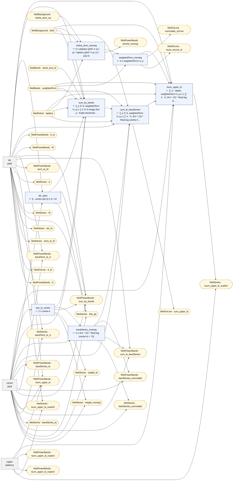

# `lean_stage3/Stage3/WeilTiles.lean`

**What it does** (its own header): WeilTiles — the heights tiled by bands. Rung 4b, second half, slice B1 of the detection ladder (units 0316–0321). 2026-09-06.

**Imports:** [`WeilBands`](../lean_stage3/WeilBands.md).
**Imported by:** [`Stage3`](../lean_stage3/Stage3.md), [`WeilSeries`](../lean_stage3/WeilSeries.md).

Blue: theorem. Green: a theorem nothing else uses (an end). Dashed white: connects to nothing. Grey: definition. Red: contains `sorry`. Yellow: in another file. An arrow A → B reads "A is used by B".

## Every declaration

| declaration | proves (output) | needs (input) | why (its own docstring) | uses | used by |
|---|---|---|---|---|---|
| `WeilTiles.centre` def, line 41 | ℝ | k : ℕ | Band centres `2 + (9/5)·k`. | — | `WeilPowerBands.bandSeries_le`, `WeilPowerBands.bandSeries_summable`, `WeilPowerBands.bandTerm_le_A`, `WeilPowerBands.sum_by_bands`, `WeilPowerBands.sum_le_bandSeries`, `WeilPowerBands.tsum_upper_le`, `WeilSeries.bandSeries_le`, `WeilSeries.bandSeries_summable`, `WeilSeries.bandTerm_le_A`, `WeilSeries.dist_ge`, `WeilSeries.weight_le`, `WeilSeries.weight_nonneg`, `WeilTiles.bandSeries_nonneg`, `WeilTiles.idx_spec`, `WeilTiles.sum_by_bands`, `WeilTiles.sum_le_bandSeries`, `WeilTiles.tsum_upper_le`, `WeilTiles.two_le_centre` |
| `WeilTiles.idx` def, line 44 | ℕ | t : ℝ | Band index of a height `t`; meaningful for `t ≥ 11/10`. | — | `WeilOnLine.A_le`, `WeilPowerBands.A`, `WeilPowerBands.A_le`, `WeilPowerBands.M`, `WeilPowerBands.bandTerm_le_A`, `WeilPowerBands.sum_by_bands`, `WeilPowerBands.sum_le_bandSeries`, `WeilPowerBands.term_le_M`, `WeilPowerBands.tsum_upper_le`, `WeilSeries.A`, `WeilSeries.M`, `WeilSeries.bandTerm_le_A`, `WeilSeries.dist_ge`, `WeilSeries.idx_le`, `WeilSeries.term_le_M`, `WeilSeries.tsum_upper_le_explicit'`, `WeilTiles.idx_spec`, `WeilTiles.sum_by_bands`, `WeilTiles.sum_le_bandSeries`, `WeilTiles.tsum_upper_le` |
| `WeilTiles.two_le_centre` theorem, line 46 | 2 ≤ centre k | k : ℕ | — | `WeilTiles.centre` | `WeilPowerBands.sum_by_bands`, `WeilSeries.weight_le`, `WeilSeries.weight_nonneg`, `WeilTiles.bandSeries_nonneg`, `WeilTiles.sum_by_bands` |
| `WeilTiles.idx_spec` theorem, line 52 | \|t - centre (idx t)\| ≤ 9 / 10 | ht : 11 / 10 ≤ t | Every height `t ≥ 11/10` lies within `9/10` of its band centre. | `WeilTiles.centre`, `WeilTiles.idx` | `WeilPowerBands.sum_by_bands`, `WeilSeries.dist_ge`, `WeilTiles.sum_by_bands` |
| `WeilTiles.online_term_nonneg` theorem, line 67 | 0 ≤ (laplace (phiC h γ) (-ρ) * laplace (phiC h γ) (-(1 - ρ))).re | hh : 0 &lt; h; γ : ℝ; hρ : ρ.re = 1 / 2 | The on-line term is a real square, hence nonnegative. | `WeilBackground.online_term_eq`, `WeilBackground.phiC`, `WeilDetect.laplace` | `WeilPowerBands.termW_nonneg`, `WeilTiles.weightedTerm_nonneg` |
| `WeilTiles.weightedTerm_nonneg` theorem, line 72 | 0 ≤ weightedTerm h γ ρ | hh : 0 &lt; h; γ : ℝ; ρ : Kadiri.NontrivialZeros; hρ : (ρ : ℂ).re = 1 / 2 | — | `WeilBands.weightedTerm`, `WeilTiles.online_term_nonneg` | `WeilOnLine.summable_onLine`, `WeilOnLine.tsum_onLine_le`, `WeilTiles.tsum_upper_le` |
| `WeilTiles.sum_by_bands` theorem, line 81 | ∑ ρ ∈ S, weightedTerm h γ ρ ≤ ∑ k ∈ S.image (fun ρ : Kadiri.NontrivialZeros =&gt; idx (ρ : ℂ).im), M k * (15 * Real.log (centre k) + 73) | S : Finset Kadiri.NontrivialZeros; hS : ∀ ρ ∈ S, (ρ : ℂ).re = 1 / 2 ∧ 11 / 10 ≤ (ρ : ℂ).im; M : ℕ → ℝ; hM0 : ∀ k, 0 ≤ M k; hM : ∀ ρ ∈ S, (laplace (phiC h γ) (-(ρ : ℂ)) * laplace (phiC h γ) (-(1 - (ρ : ℂ)))).re ≤ M (idx (ρ : ℂ).im) | Sum by bands. A finite set of on-line zeros of height `≥ 11/10`, split by band index, has weighted sum at most the band series over the indices that occur. | `WeilBackground.phiC`, `WeilBands.band_sum_le`, `WeilBands.weightedTerm`, `WeilDetect.laplace`, `WeilTiles.centre`, `WeilTiles.idx`, `WeilTiles.idx_spec`, `WeilTiles.two_le_centre` | `WeilTiles.sum_le_bandSeries` |
| `WeilTiles.bandSeries_nonneg` theorem, line 108 | 0 ≤ M k * (15 * Real.log (centre k) + 73) | M : ℕ → ℝ; hM0 : ∀ k, 0 ≤ M k; k : ℕ | — | `WeilTiles.centre`, `WeilTiles.two_le_centre` | `WeilPowerBands.bandSeries_summable`, `WeilPowerBands.sum_le_bandSeries`, `WeilSeries.bandSeries_summable`, `WeilTiles.sum_le_bandSeries` |
| `WeilTiles.sum_le_bandSeries` theorem, line 115 | ∑ ρ ∈ S, weightedTerm h γ ρ ≤ ∑' k : ℕ, M k * (15 * Real.log (centre k) + 73) | S : Finset Kadiri.NontrivialZeros; hS : ∀ ρ ∈ S, (ρ : ℂ).re = 1 / 2 ∧ 11 / 10 ≤ (ρ : ℂ).im; M : ℕ → ℝ; hM0 : ∀ k, 0 ≤ M k; hM : ∀ ρ ∈ S, (laplace (phiC h γ) (-(ρ : ℂ)) * laplace (phiC h γ) (-(1 - (ρ : ℂ)))).re ≤ M (idx (ρ : ℂ).im); hsum : Summable (fun k : ℕ =&gt; M k * (15 * Real.log (centre k) + 73)) | A finite on-line sum of height `≥ 11/10` is at most the full band series. | `WeilBackground.phiC`, `WeilBands.weightedTerm`, `WeilDetect.laplace`, `WeilTiles.bandSeries_nonneg`, `WeilTiles.centre`, `WeilTiles.idx`, `WeilTiles.sum_by_bands` | `WeilOnLine.sum_upper_le`, `WeilTiles.tsum_upper_le` |
| `WeilTiles.Upper` abbrev, line 126 | Type | — | On-line zeros of height at least `11/10`. | — | `WeilPowerBands.tsum_upper_le`, `WeilPowerBands.tsum_upper_le_explicit`, `WeilPowerBands.tsum_upper_le_explicit'`, `WeilSeries.tsum_upper_le_explicit`, `WeilSeries.tsum_upper_le_explicit'`, `WeilTiles.tsum_upper_le` |
| `WeilTiles.tsum_upper_le` theorem, line 132 | ∑' ρ : Upper, weightedTerm h γ ρ.1 ≤ ∑' k : ℕ, M k * (15 * Real.log (centre k) + 73) | hh : 0 &lt; h; M : ℕ → ℝ; hM0 : ∀ k, 0 ≤ M k; hM : ∀ ρ : Kadiri.NontrivialZeros, (ρ : ℂ).re = 1 / 2 → 11 / 10 ≤ (ρ : ℂ).im → (laplace (phiC h γ) (-(ρ : ℂ)) * laplace (phiC h γ) (-(1 - (ρ : ℂ)))).re ≤ M (idx (ρ : ℂ).im); hsum : Summable (fun k : ℕ =&gt; M k * (15 * Real.log (centre k) + 73)) | Upper on-line sum. The full weighted sum over on-line zeros of height `≥ 11/10` is at most the band series, for any nonnegative summable `M` dominating the terms at their band indices. | `WeilBackground.phiC`, `WeilBands.weightedTerm`, `WeilDetect.laplace`, `WeilTiles.Upper`, `WeilTiles.centre`, `WeilTiles.idx`, `WeilTiles.sum_le_bandSeries`, `WeilTiles.weightedTerm_nonneg` | `WeilSeries.tsum_upper_le_explicit` |
