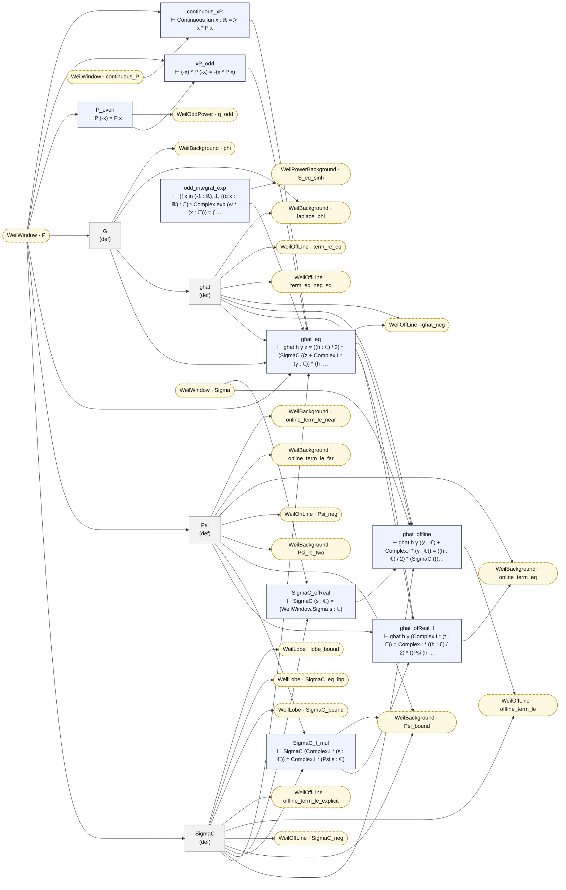

# `lean_stage3/Stage3/WeilTransform.lean`

**What it does** (its own header): WeilTransform — the transform of the tuned window in closed form. Rung 3 of the detection ladder (units 0316, 0317). 2026-09-06.

**Imports:** [`WeilWindow`](../lean_stage3/WeilWindow.md).
**Imported by:** [`Stage3`](../lean_stage3/Stage3.md), [`WeilLobe`](../lean_stage3/WeilLobe.md).

Blue: theorem. Green: a theorem nothing else uses (an end). Dashed white: connects to nothing. Grey: definition. Red: contains `sorry`. Yellow: in another file. An arrow A → B reads "A is used by B".

## Every declaration

| declaration | proves (output) | needs (input) | why (its own docstring) | uses | used by |
|---|---|---|---|---|---|
| `WeilTransform.SigmaC` def, line 48 | ℂ | w : ℂ | The odd envelope at complex argument, `∫₋₁¹ x·P(x)·sinh(w x) dx`. | `WeilWindow.P` | `WeilBackground.Psi_bound`, `WeilLobe.SigmaC_bound`, `WeilLobe.SigmaC_eq_ibp`, `WeilLobe.lobe_bound`, `WeilOffLine.SigmaC_neg`, `WeilOffLine.offline_term_le`, `WeilOffLine.offline_term_le_explicit`, `WeilTransform.SigmaC_I_mul`, `WeilTransform.SigmaC_ofReal`, `WeilTransform.ghat_eq`, `WeilTransform.ghat_offline` |
| `WeilTransform.Psi` def, line 52 | ℝ | s : ℝ | `Ψ(s) = ∫₋₁¹ x·P(x)·sin(s x) dx`, entry 302's transform of the envelope. | `WeilWindow.P` | `WeilBackground.Psi_bound`, `WeilBackground.Psi_le_two`, `WeilBackground.online_term_eq`, `WeilBackground.online_term_le_far`, `WeilBackground.online_term_le_near`, `WeilOnLine.Psi_neg`, `WeilTransform.SigmaC_I_mul`, `WeilTransform.ghat_ofReal_I` |
| `WeilTransform.G` def, line 55 | ℝ | h γ : ℝ; u : ℝ | The tuned window: `(u/h)·P(u/h)·cos(γu)`, read on `[−h, h]`. | `WeilWindow.P` | `WeilBackground.laplace_phi`, `WeilBackground.phi`, `WeilTransform.ghat`, `WeilTransform.ghat_eq` |
| `WeilTransform.ghat` def, line 58 | ℂ | h γ : ℝ; z : ℂ | Its transform, `∫₋ₕʰ G(u)·e^{zu} du`. | `WeilTransform.G` | `WeilBackground.laplace_phi`, `WeilOffLine.ghat_neg`, `WeilOffLine.term_eq_neg_sq`, `WeilOffLine.term_re_eq`, `WeilTransform.ghat_eq`, `WeilTransform.ghat_ofReal_I`, `WeilTransform.ghat_offline` |
| `WeilTransform.P_even` theorem, line 61 | P (-x) = P x | x : ℝ | — | `WeilWindow.P` | `WeilOddPower.q_odd`, `WeilTransform.xP_odd` |
| `WeilTransform.xP_odd` theorem, line 65 | (-x) * P (-x) = -(x * P x) | x : ℝ | — | `WeilTransform.P_even`, `WeilWindow.P` | `WeilTransform.ghat_eq` |
| `WeilTransform.continuous_xP` theorem, line 68 | Continuous fun x : ℝ =&gt; x * P x | — | — | `WeilWindow.P`, `WeilWindow.continuous_P` | `WeilTransform.ghat_eq` |
| `WeilTransform.SigmaC_ofReal` theorem, line 72 | SigmaC (s : ℂ) = (WeilWindow.Sigma s : ℂ) | s : ℝ | `Σc` at a real argument is `Σ`. | `WeilTransform.SigmaC`, `WeilWindow.Sigma` | `WeilTransform.ghat_offline` |
| `WeilTransform.SigmaC_I_mul` theorem, line 80 | SigmaC (Complex.I * (s : ℂ)) = Complex.I * (Psi s : ℂ) | s : ℝ | `Σc(i s) = i·Ψ(s)`: `sinh(iθ) = i·sin θ`. | `WeilTransform.Psi`, `WeilTransform.SigmaC` | `WeilBackground.Psi_bound`, `WeilTransform.ghat_ofReal_I` |
| `WeilTransform.odd_integral_exp` theorem, line 94 | (∫ x in (-1 : ℝ)..1, ((q x : ℝ) : ℂ) * Complex.exp (w * (x : ℂ))) = ∫ x in (-1 : ℝ)..1, ((q x : ℝ) : ℂ) * Complex.sinh (w * (x : ℂ)) | q : ℝ → ℝ; hq : ∀ x, q (-x) = -q x; hc : Continuous q; w : ℂ | The odd-part lemma. For odd continuous `q` on `[−1, 1]`, `∫ q·e^{w·} = ∫ q·sinh(w·)`: the `cosh` part of `e^{w·}` pairs with `q` into an odd function, whose integral over the symmetric interval vanishes. | — | `WeilPowerBackground.S_eq_sinh`, `WeilTransform.ghat_eq` |
| `WeilTransform.ghat_eq` theorem, line 144 | ghat h γ z = ((h : ℂ) / 2) * (SigmaC ((z + Complex.I * (γ : ℂ)) * (h : ℂ)) + SigmaC ((z - Complex.I * (γ : ℂ)) * (h : ℂ))) | hh : 0 &lt; h; γ : ℝ; z : ℂ | (★) The transform in closed form. | `WeilTransform.G`, `WeilTransform.SigmaC`, `WeilTransform.continuous_xP`, `WeilTransform.ghat`, `WeilTransform.odd_integral_exp`, `WeilTransform.xP_odd`, `WeilWindow.P` | `WeilOffLine.ghat_neg`, `WeilTransform.ghat_ofReal_I`, `WeilTransform.ghat_offline` |
| `WeilTransform.ghat_ofReal_I` theorem, line 195 | ghat h γ (Complex.I * (t : ℂ)) = Complex.I * ((h : ℂ) / 2) * ((Psi (h * (t + γ)) : ℂ) + (Psi (h * (t - γ)) : ℂ)) | hh : 0 &lt; h; γ t : ℝ | (★) on the real line: entry 302's `(ih/2)[Ψ(h(t+γ)) + Ψ(h(t−γ))]`. | `WeilTransform.Psi`, `WeilTransform.SigmaC_I_mul`, `WeilTransform.ghat`, `WeilTransform.ghat_eq` | `WeilBackground.online_term_eq` |
| `WeilTransform.ghat_offline` theorem, line 208 | ghat h γ ((ε : ℂ) + Complex.I * (γ : ℂ)) = ((h : ℂ) / 2) * (SigmaC (((ε : ℂ) + 2 * Complex.I * (γ : ℂ)) * (h : ℂ)) + (WeilWindow.Sigma (ε * h) : ℂ)) | hh : 0 &lt; h; γ ε : ℝ | (★) at the off-line point `z = ε + iγ`: the main term `Σ(εh)` of unit 0317 plus the `2γ` lobe `Σc((ε + 2iγ)h)`. | `WeilTransform.SigmaC`, `WeilTransform.SigmaC_ofReal`, `WeilTransform.ghat`, `WeilTransform.ghat_eq`, `WeilWindow.Sigma` | `WeilOffLine.offline_term_le` |
