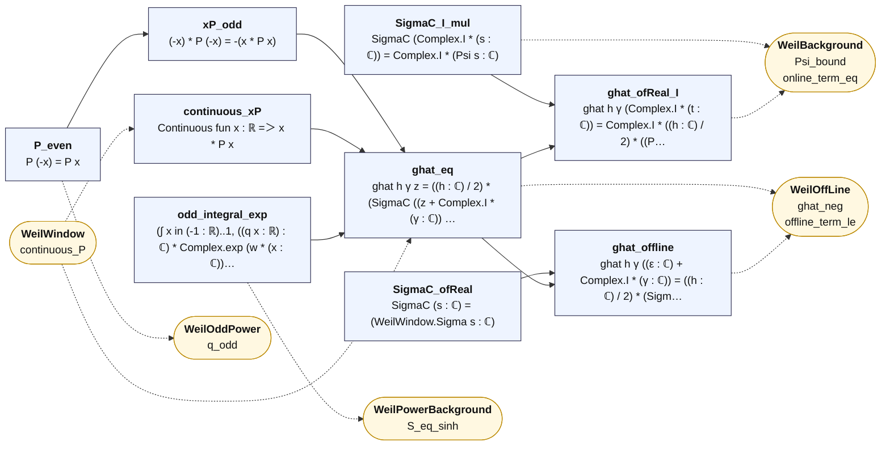

# `lean_stage3/Stage3/WeilTransform.lean`

WeilTransform — the transform of the tuned window in closed form. Rung 3 of the detection ladder (units 0316, 0317). 2026-09-06.

9 theorems, 4 definitions, 238 lines. Arrows are Lean's own record of what each proof uses.

**Imports:** [`WeilWindow`](../lean_stage3/WeilWindow.md)  
**Imported by:** [`Stage3`](../lean_stage3/Stage3.md), [`WeilLobe`](../lean_stage3/WeilLobe.md)

## The picture



An arrow A → B reads "A is used in the proof of B". Blue: theorem. Green: a theorem nothing else uses (an end). Dashed: connects to nothing. Red: contains `sorry`. Yellow: theorems in another file, counted; a dotted arrow crosses files. Definitions are not drawn; they are listed below the diagram.

## Definitions

<a name="WeilTransform-SigmaC"></a>
### `WeilTransform.SigmaC`

def · line 48

The odd envelope at complex argument, `∫₋₁¹ x·P(x)·sinh(w x) dx`.

- **Is:** `` SigmaC (w : ℂ) : ℂ := ∫ x in (-1 : ℝ)..1, ((x * P x : ℝ) : ℂ) * Complex.sinh (w * (x : ℂ)) ``
- **Built from:** [`WeilWindow.P`](../lean_stage3/WeilWindow.md#WeilWindow-P)
- **Used by 13:** [`WeilBackground.Psi_bound`](../lean_stage3/WeilBackground.md#WeilBackground-Psi_bound), [`WeilLobe.SigmaC_bound`](../lean_stage3/WeilLobe.md#WeilLobe-SigmaC_bound), [`WeilLobe.SigmaC_eq_ibp`](../lean_stage3/WeilLobe.md#WeilLobe-SigmaC_eq_ibp), [`WeilLobe.lobe_bound`](../lean_stage3/WeilLobe.md#WeilLobe-lobe_bound), [`WeilOffLine.SigmaC_neg`](../lean_stage3/WeilOffLine.md#WeilOffLine-SigmaC_neg), [`WeilOffLine.ghat_neg`](../lean_stage3/WeilOffLine.md#WeilOffLine-ghat_neg), [`WeilOffLine.offline_term_le`](../lean_stage3/WeilOffLine.md#WeilOffLine-offline_term_le), [`WeilOffLine.offline_term_le_explicit`](../lean_stage3/WeilOffLine.md#WeilOffLine-offline_term_le_explicit), [`WeilTransform.SigmaC_I_mul`](#WeilTransform-SigmaC_I_mul), [`WeilTransform.SigmaC_ofReal`](#WeilTransform-SigmaC_ofReal), [`WeilTransform.ghat_eq`](#WeilTransform-ghat_eq), [`WeilTransform.ghat_ofReal_I`](#WeilTransform-ghat_ofReal_I), [`WeilTransform.ghat_offline`](#WeilTransform-ghat_offline)

<a name="WeilTransform-Psi"></a>
### `WeilTransform.Psi`

def · line 52

`Ψ(s) = ∫₋₁¹ x·P(x)·sin(s x) dx`, entry 302's transform of the envelope.

- **Is:** `` Psi (s : ℝ) : ℝ := ∫ x in (-1 : ℝ)..1, x * P x * Real.sin (s * x) ``
- **Built from:** [`WeilWindow.P`](../lean_stage3/WeilWindow.md#WeilWindow-P)
- **Used by 10:** [`WeilBackground.Psi_bound`](../lean_stage3/WeilBackground.md#WeilBackground-Psi_bound), [`WeilBackground.Psi_le_two`](../lean_stage3/WeilBackground.md#WeilBackground-Psi_le_two), [`WeilBackground.online_term_eq`](../lean_stage3/WeilBackground.md#WeilBackground-online_term_eq), [`WeilBackground.online_term_le_far`](../lean_stage3/WeilBackground.md#WeilBackground-online_term_le_far), [`WeilBackground.online_term_le_near`](../lean_stage3/WeilBackground.md#WeilBackground-online_term_le_near), [`WeilOnLine.Psi_neg`](../lean_stage3/WeilOnLine.md#WeilOnLine-Psi_neg), [`WeilOnLine.term_conj`](../lean_stage3/WeilOnLine.md#WeilOnLine-term_conj), [`WeilTiles.online_term_nonneg`](../lean_stage3/WeilTiles.md#WeilTiles-online_term_nonneg), [`WeilTransform.SigmaC_I_mul`](#WeilTransform-SigmaC_I_mul), [`WeilTransform.ghat_ofReal_I`](#WeilTransform-ghat_ofReal_I)

<a name="WeilTransform-G"></a>
### `WeilTransform.G`

def · line 55

The tuned window: `(u/h)·P(u/h)·cos(γu)`, read on `[−h, h]`.

- **Is:** `` G (h γ : ℝ) (u : ℝ) : ℝ := (u / h) * P (u / h) * Real.cos (γ * u) ``
- **Built from:** [`WeilWindow.P`](../lean_stage3/WeilWindow.md#WeilWindow-P)
- **Used by 4:** [`WeilBackground.laplace_phi`](../lean_stage3/WeilBackground.md#WeilBackground-laplace_phi), [`WeilBackground.phi`](../lean_stage3/WeilBackground.md#WeilBackground-phi), [`WeilTransform.ghat`](#WeilTransform-ghat), [`WeilTransform.ghat_eq`](#WeilTransform-ghat_eq)

<a name="WeilTransform-ghat"></a>
### `WeilTransform.ghat`

def · line 58

Its transform, `∫₋ₕʰ G(u)·e^{zu} du`.

- **Is:** `` ghat (h γ : ℝ) (z : ℂ) : ℂ := ∫ u in (-h)..h, ((G h γ u : ℝ) : ℂ) * Complex.exp (z * (u : ℂ)) ``
- **Built from:** [`WeilTransform.G`](#WeilTransform-G)
- **Used by 9:** [`WeilBackground.laplace_phi`](../lean_stage3/WeilBackground.md#WeilBackground-laplace_phi), [`WeilBackground.online_term_eq`](../lean_stage3/WeilBackground.md#WeilBackground-online_term_eq), [`WeilOffLine.ghat_neg`](../lean_stage3/WeilOffLine.md#WeilOffLine-ghat_neg), [`WeilOffLine.offline_term_le`](../lean_stage3/WeilOffLine.md#WeilOffLine-offline_term_le), [`WeilOffLine.term_eq_neg_sq`](../lean_stage3/WeilOffLine.md#WeilOffLine-term_eq_neg_sq), [`WeilOffLine.term_re_eq`](../lean_stage3/WeilOffLine.md#WeilOffLine-term_re_eq), [`WeilTransform.ghat_eq`](#WeilTransform-ghat_eq), [`WeilTransform.ghat_ofReal_I`](#WeilTransform-ghat_ofReal_I), [`WeilTransform.ghat_offline`](#WeilTransform-ghat_offline)

## Theorems

<a name="WeilTransform-P_even"></a>
### `WeilTransform.P_even`

line 61

**Proves**

```lean
P (-x) = P x
```

**Needs** (its hypotheses)

  - `` x : ℝ ``

**Stated with:** [`WeilWindow.P`](../lean_stage3/WeilWindow.md#WeilWindow-P)

**Fed by:** no theorem of this repo; it stands on Mathlib and the definitions below.

**Feeds** (2 that use it)

  - [`WeilOddPower.q_odd`](../lean_stage3/WeilOddPower.md#WeilOddPower-q_odd) (WeilOddPower) — `` q m (-x) = -q m x ``
  - [`WeilTransform.xP_odd`](#WeilTransform-xP_odd) — `` (-x) * P (-x) = -(x * P x) ``

<a name="WeilTransform-xP_odd"></a>
### `WeilTransform.xP_odd`

line 65

**Proves**

```lean
(-x) * P (-x) = -(x * P x)
```

**Needs** (its hypotheses)

  - `` x : ℝ ``

**Stated with:** [`WeilWindow.P`](../lean_stage3/WeilWindow.md#WeilWindow-P)

**Fed by** (1 theorem its proof uses)

  - [`WeilTransform.P_even`](#WeilTransform-P_even) — `` P (-x) = P x ``

**Feeds** (1 that use it)

  - [`WeilTransform.ghat_eq`](#WeilTransform-ghat_eq) — `` ghat h γ z = ((h : ℂ) / 2) * (SigmaC ((z + Complex.I * (γ : ℂ)) * (h : ℂ)) + SigmaC ((z - Complex.I * (γ : ℂ)) * (h : ℂ))) ``

<a name="WeilTransform-continuous_xP"></a>
### `WeilTransform.continuous_xP`

line 68

**Proves**

```lean
Continuous fun x : ℝ => x * P x
```

**Stated with:** [`WeilWindow.P`](../lean_stage3/WeilWindow.md#WeilWindow-P)

**Fed by** (1 theorem its proof uses)

  - [`WeilWindow.continuous_P`](../lean_stage3/WeilWindow.md#WeilWindow-continuous_P) (WeilWindow) — `` Continuous P ``

**Feeds** (1 that use it)

  - [`WeilTransform.ghat_eq`](#WeilTransform-ghat_eq) — `` ghat h γ z = ((h : ℂ) / 2) * (SigmaC ((z + Complex.I * (γ : ℂ)) * (h : ℂ)) + SigmaC ((z - Complex.I * (γ : ℂ)) * (h : ℂ))) ``

<a name="WeilTransform-SigmaC_ofReal"></a>
### `WeilTransform.SigmaC_ofReal`

line 72

**Why.** `Σc` at a real argument is `Σ`.

**Proves**

```lean
SigmaC (s : ℂ) = (WeilWindow.Sigma s : ℂ)
```

**Needs** (its hypotheses)

  - `` s : ℝ ``

**Stated with:** [`WeilTransform.SigmaC`](#WeilTransform-SigmaC), [`WeilWindow.Sigma`](../lean_stage3/WeilWindow.md#WeilWindow-Sigma)

**Fed by:** no theorem of this repo; it stands on Mathlib and the definitions below.

**Definitions its proof touches:** [`WeilWindow.P`](../lean_stage3/WeilWindow.md#WeilWindow-P)

**Feeds** (1 that use it)

  - [`WeilTransform.ghat_offline`](#WeilTransform-ghat_offline) — `` ghat h γ ((ε : ℂ) + Complex.I * (γ : ℂ)) = ((h : ℂ) / 2) * (SigmaC (((ε : ℂ) + 2 * Complex.I * (γ : ℂ)) * (h : ℂ)) + (WeilWindow.Sigma (ε * h) : ℂ)) ``

<a name="WeilTransform-SigmaC_I_mul"></a>
### `WeilTransform.SigmaC_I_mul`

line 80

**Why.** `Σc(i s) = i·Ψ(s)`: `sinh(iθ) = i·sin θ`.

**Proves**

```lean
SigmaC (Complex.I * (s : ℂ)) = Complex.I * (Psi s : ℂ)
```

**Needs** (its hypotheses)

  - `` s : ℝ ``

**Stated with:** [`WeilTransform.Psi`](#WeilTransform-Psi), [`WeilTransform.SigmaC`](#WeilTransform-SigmaC)

**Fed by:** no theorem of this repo; it stands on Mathlib and the definitions below.

**Definitions its proof touches:** [`WeilWindow.P`](../lean_stage3/WeilWindow.md#WeilWindow-P)

**Feeds** (2 that use it)

  - [`WeilBackground.Psi_bound`](../lean_stage3/WeilBackground.md#WeilBackground-Psi_bound) (WeilBackground) — `` |WeilTransform.Psi s| ≤ (2 * Real.pi + Real.pi ^ 2) / s ^ 2 ``
  - [`WeilTransform.ghat_ofReal_I`](#WeilTransform-ghat_ofReal_I) — `` ghat h γ (Complex.I * (t : ℂ)) = Complex.I * ((h : ℂ) / 2) * ((Psi (h * (t + γ)) : ℂ) + (Psi (h * (t - γ)) : ℂ)) ``

<a name="WeilTransform-odd_integral_exp"></a>
### `WeilTransform.odd_integral_exp`

line 94

**Why.** The odd-part lemma. For odd continuous `q` on `[−1, 1]`, `∫ q·e^{w·} = ∫ q·sinh(w·)`: the `cosh` part of `e^{w·}` pairs with `q` into an odd function, whose integral over the symmetric interval vanishes.

**Proves**

```lean
(∫ x in (-1 : ℝ)..1, ((q x : ℝ) : ℂ) * Complex.exp (w * (x : ℂ))) = ∫ x in (-1 : ℝ)..1, ((q x : ℝ) : ℂ) * Complex.sinh (w * (x : ℂ))
```

**Needs** (its hypotheses)

  - `` q : ℝ → ℝ ``
  - `` hq : ∀ x, q (-x) = -q x ``
  - `` hc : Continuous q ``
  - `` w : ℂ ``

**Fed by:** no theorem of this repo; it stands on Mathlib.

**Feeds** (2 that use it)

  - [`WeilPowerBackground.S_eq_sinh`](../lean_stage3/WeilPowerBackground.md#WeilPowerBackground-S_eq_sinh) (WeilPowerBackground) — `` S m w = ∫ x in (-1 : ℝ)..1, ((q m x : ℝ) : ℂ) * Complex.sinh (w * (x : ℂ)) ``
  - [`WeilTransform.ghat_eq`](#WeilTransform-ghat_eq) — `` ghat h γ z = ((h : ℂ) / 2) * (SigmaC ((z + Complex.I * (γ : ℂ)) * (h : ℂ)) + SigmaC ((z - Complex.I * (γ : ℂ)) * (h : ℂ))) ``

<a name="WeilTransform-ghat_eq"></a>
### `WeilTransform.ghat_eq`

line 144

**Why.** (★) The transform in closed form.

**Proves**

```lean
ghat h γ z = ((h : ℂ) / 2) * (SigmaC ((z + Complex.I * (γ : ℂ)) * (h : ℂ)) + SigmaC ((z - Complex.I * (γ : ℂ)) * (h : ℂ)))
```

**Needs** (its hypotheses)

  - `` hh : 0 < h ``
  - `` γ : ℝ ``
  - `` z : ℂ ``

**Stated with:** [`WeilTransform.SigmaC`](#WeilTransform-SigmaC), [`WeilTransform.ghat`](#WeilTransform-ghat)

**Fed by** (4 theorems its proof uses)

  - [`WeilTransform.continuous_xP`](#WeilTransform-continuous_xP) — `` Continuous fun x : ℝ => x * P x ``
  - [`WeilTransform.odd_integral_exp`](#WeilTransform-odd_integral_exp) — `` (∫ x in (-1 : ℝ)..1, ((q x : ℝ) : ℂ) * Complex.exp (w * (x : ℂ))) = ∫ x in (-1 : ℝ)..1, ((q x : ℝ) : ℂ) * Complex.sinh (w * (x : ℂ)) ``
  - [`WeilTransform.xP_odd`](#WeilTransform-xP_odd) — `` (-x) * P (-x) = -(x * P x) ``
  - [`WeilWindow.continuous_P`](../lean_stage3/WeilWindow.md#WeilWindow-continuous_P) (WeilWindow) — `` Continuous P ``

**Definitions its proof touches:** [`WeilTransform.G`](#WeilTransform-G), [`WeilWindow.P`](../lean_stage3/WeilWindow.md#WeilWindow-P)

**Feeds** (3 that use it)

  - [`WeilOffLine.ghat_neg`](../lean_stage3/WeilOffLine.md#WeilOffLine-ghat_neg) (WeilOffLine) — `` ghat h γ (-z) = -ghat h γ z ``
  - [`WeilTransform.ghat_ofReal_I`](#WeilTransform-ghat_ofReal_I) — `` ghat h γ (Complex.I * (t : ℂ)) = Complex.I * ((h : ℂ) / 2) * ((Psi (h * (t + γ)) : ℂ) + (Psi (h * (t - γ)) : ℂ)) ``
  - [`WeilTransform.ghat_offline`](#WeilTransform-ghat_offline) — `` ghat h γ ((ε : ℂ) + Complex.I * (γ : ℂ)) = ((h : ℂ) / 2) * (SigmaC (((ε : ℂ) + 2 * Complex.I * (γ : ℂ)) * (h : ℂ)) + (WeilWindow.Sigma (ε * h) : ℂ)) ``

<a name="WeilTransform-ghat_ofReal_I"></a>
### `WeilTransform.ghat_ofReal_I`

line 195

**Why.** (★) on the real line: entry 302's `(ih/2)[Ψ(h(t+γ)) + Ψ(h(t−γ))]`.

**Proves**

```lean
ghat h γ (Complex.I * (t : ℂ)) = Complex.I * ((h : ℂ) / 2) * ((Psi (h * (t + γ)) : ℂ) + (Psi (h * (t - γ)) : ℂ))
```

**Needs** (its hypotheses)

  - `` hh : 0 < h ``
  - `` γ t : ℝ ``

**Stated with:** [`WeilTransform.Psi`](#WeilTransform-Psi), [`WeilTransform.ghat`](#WeilTransform-ghat)

**Fed by** (2 theorems its proof uses)

  - [`WeilTransform.SigmaC_I_mul`](#WeilTransform-SigmaC_I_mul) — `` SigmaC (Complex.I * (s : ℂ)) = Complex.I * (Psi s : ℂ) ``
  - [`WeilTransform.ghat_eq`](#WeilTransform-ghat_eq) — `` ghat h γ z = ((h : ℂ) / 2) * (SigmaC ((z + Complex.I * (γ : ℂ)) * (h : ℂ)) + SigmaC ((z - Complex.I * (γ : ℂ)) * (h : ℂ))) ``

**Definitions its proof touches:** [`WeilTransform.SigmaC`](#WeilTransform-SigmaC)

**Feeds** (1 that use it)

  - [`WeilBackground.online_term_eq`](../lean_stage3/WeilBackground.md#WeilBackground-online_term_eq) (WeilBackground) — `` laplace (phiC h γ) (-ρ) * laplace (phiC h γ) (-(1 - ρ)) = (((h / 2) ^ 2 * (WeilTransform.Psi (h * (ρ.im + γ)) + WeilTransform.Psi (h * (ρ.im - γ))) ^ … ``

<a name="WeilTransform-ghat_offline"></a>
### `WeilTransform.ghat_offline`

line 208

**Why.** (★) at the off-line point `z = ε + iγ`: the main term `Σ(εh)` of unit 0317 plus the `2γ` lobe `Σc((ε + 2iγ)h)`.

**Proves**

```lean
ghat h γ ((ε : ℂ) + Complex.I * (γ : ℂ)) = ((h : ℂ) / 2) * (SigmaC (((ε : ℂ) + 2 * Complex.I * (γ : ℂ)) * (h : ℂ)) + (WeilWindow.Sigma (ε * h) : ℂ))
```

**Needs** (its hypotheses)

  - `` hh : 0 < h ``
  - `` γ ε : ℝ ``

**Stated with:** [`WeilTransform.SigmaC`](#WeilTransform-SigmaC), [`WeilTransform.ghat`](#WeilTransform-ghat), [`WeilWindow.Sigma`](../lean_stage3/WeilWindow.md#WeilWindow-Sigma)

**Fed by** (2 theorems its proof uses)

  - [`WeilTransform.SigmaC_ofReal`](#WeilTransform-SigmaC_ofReal) — `` SigmaC (s : ℂ) = (WeilWindow.Sigma s : ℂ) ``
  - [`WeilTransform.ghat_eq`](#WeilTransform-ghat_eq) — `` ghat h γ z = ((h : ℂ) / 2) * (SigmaC ((z + Complex.I * (γ : ℂ)) * (h : ℂ)) + SigmaC ((z - Complex.I * (γ : ℂ)) * (h : ℂ))) ``

**Feeds** (1 that use it)

  - [`WeilOffLine.offline_term_le`](../lean_stage3/WeilOffLine.md#WeilOffLine-offline_term_le) (WeilOffLine) — `` (laplace (phiC h γ) (-offPt ε γ) * laplace (phiC h γ) (-(1 - offPt ε γ))).re ≤ -((h / 2) ^ 2 * (WeilWindow.Sigma (ε * h) * (WeilWindow.Sigma (ε * h) -… ``

