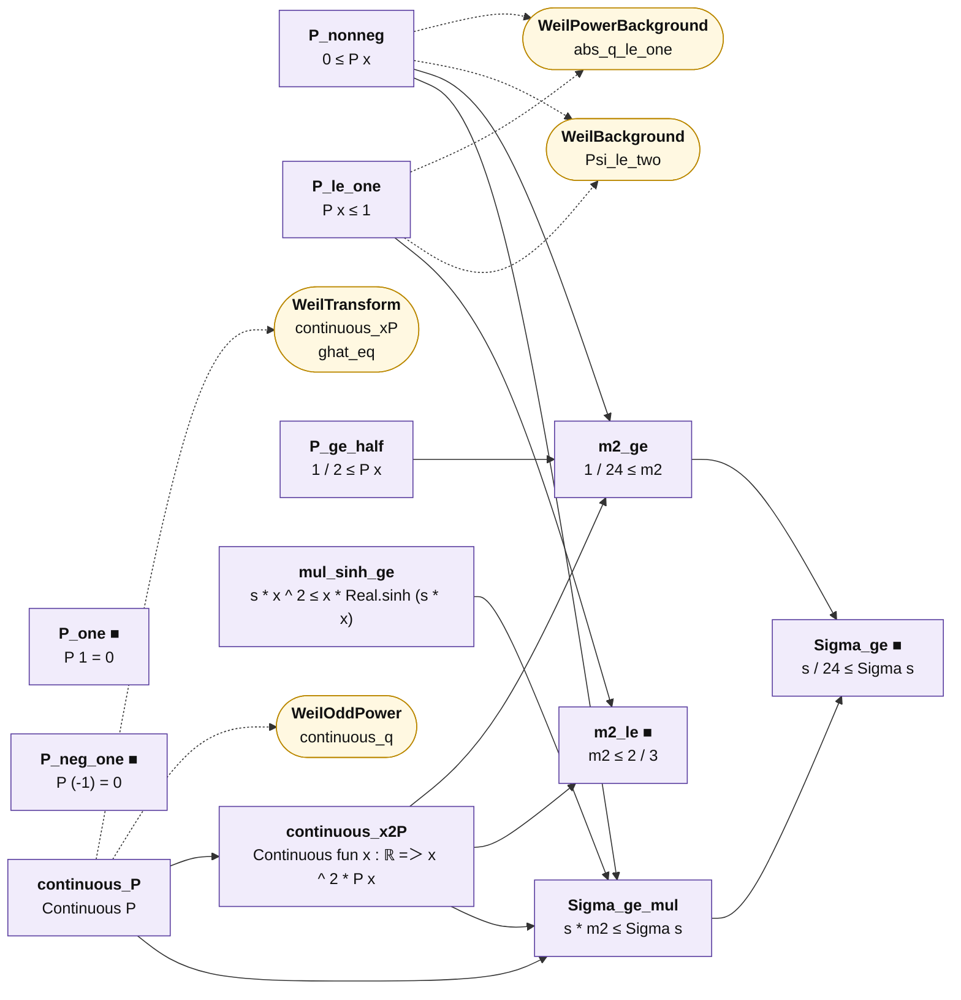

# `lean_stage3/Stage3/WeilWindow.lean`

WeilWindow — the raised-cosine window of entry 302, first two rungs of the detection ladder, crude constants. 2026-09-06.

12 theorems, 3 definitions, 183 lines. Arrows are Lean's own record of what each proof uses.

**Imports:** nothing in this tree  
**Imported by:** [`Stage3`](../lean_stage3/Stage3.md), [`WeilTransform`](../lean_stage3/WeilTransform.md)

## The picture



An arrow A → B reads "A is used in the proof of B". Green: counting, integers only. Violet: shape, analysis with no ζ. Blue: reads ζ. A name ending in ■ is an end: nothing else uses it. Red: contains `sorry`. Yellow: theorems in another file, counted; a dotted arrow crosses files. Definitions are not drawn; they are listed below the diagram.

## Definitions

<a name="WeilWindow-P"></a>
### `WeilWindow.P`

def · line 44

The raised-cosine window, `cos²(πx/2)`, read on `[−1, 1]`.

- **Is:** `` P (x : ℝ) : ℝ := Real.cos (Real.pi * x / 2) ^ 2 ``
- **Used by 39:** [`WeilBackground.Psi_le_two`](../lean_stage3/WeilBackground.md#WeilBackground-Psi_le_two), [`WeilLobe.P_eq`](../lean_stage3/WeilLobe.md#WeilLobe-P_eq), [`WeilLobe.SigmaC_eq_ibp`](../lean_stage3/WeilLobe.md#WeilLobe-SigmaC_eq_ibp), [`WeilLobe.q_eq`](../lean_stage3/WeilLobe.md#WeilLobe-q_eq), [`WeilOddPower.S_eq`](../lean_stage3/WeilOddPower.md#WeilOddPower-S_eq), [`WeilOddPower.continuous_q`](../lean_stage3/WeilOddPower.md#WeilOddPower-continuous_q), [`WeilOddPower.q`](../lean_stage3/WeilOddPower.md#WeilOddPower-q), [`WeilOddPower.q_eq`](../lean_stage3/WeilOddPower.md#WeilOddPower-q_eq), [`WeilOddPower.q_odd`](../lean_stage3/WeilOddPower.md#WeilOddPower-q_odd), [`WeilOffLine.SigmaC_neg`](../lean_stage3/WeilOffLine.md#WeilOffLine-SigmaC_neg), [`WeilOnLine.Psi_neg`](../lean_stage3/WeilOnLine.md#WeilOnLine-Psi_neg), [`WeilPower.K`](../lean_stage3/WeilPower.md#WeilPower-K), [`WeilPower.K_succ`](../lean_stage3/WeilPower.md#WeilPower-K_succ), [`WeilPower.K_zero_mul`](../lean_stage3/WeilPower.md#WeilPower-K_zero_mul), [`WeilPower.P_eq_c_sq`](../lean_stage3/WeilPower.md#WeilPower-P_eq_c_sq), [`WeilPower.P_pow`](../lean_stage3/WeilPower.md#WeilPower-P_pow), [`WeilPowerAssembly.phiW_contDiff_one`](../lean_stage3/WeilPowerAssembly.md#WeilPowerAssembly-phiW_contDiff_one), [`WeilPowerBackground.abs_q_le_one`](../lean_stage3/WeilPowerBackground.md#WeilPowerBackground-abs_q_le_one), [`WeilTransform.G`](../lean_stage3/WeilTransform.md#WeilTransform-G), [`WeilTransform.P_even`](../lean_stage3/WeilTransform.md#WeilTransform-P_even), [`WeilTransform.Psi`](../lean_stage3/WeilTransform.md#WeilTransform-Psi), [`WeilTransform.SigmaC`](../lean_stage3/WeilTransform.md#WeilTransform-SigmaC), [`WeilTransform.SigmaC_I_mul`](../lean_stage3/WeilTransform.md#WeilTransform-SigmaC_I_mul), [`WeilTransform.SigmaC_ofReal`](../lean_stage3/WeilTransform.md#WeilTransform-SigmaC_ofReal), [`WeilTransform.continuous_xP`](../lean_stage3/WeilTransform.md#WeilTransform-continuous_xP), [`WeilTransform.ghat_eq`](../lean_stage3/WeilTransform.md#WeilTransform-ghat_eq), [`WeilTransform.xP_odd`](../lean_stage3/WeilTransform.md#WeilTransform-xP_odd), [`WeilWindow.P_ge_half`](#WeilWindow-P_ge_half), [`WeilWindow.P_le_one`](#WeilWindow-P_le_one), [`WeilWindow.P_neg_one`](#WeilWindow-P_neg_one), [`WeilWindow.P_nonneg`](#WeilWindow-P_nonneg), [`WeilWindow.P_one`](#WeilWindow-P_one), [`WeilWindow.Sigma`](#WeilWindow-Sigma), [`WeilWindow.Sigma_ge_mul`](#WeilWindow-Sigma_ge_mul), [`WeilWindow.continuous_P`](#WeilWindow-continuous_P), [`WeilWindow.continuous_x2P`](#WeilWindow-continuous_x2P), [`WeilWindow.m2`](#WeilWindow-m2), [`WeilWindow.m2_ge`](#WeilWindow-m2_ge), [`WeilWindow.m2_le`](#WeilWindow-m2_le)

<a name="WeilWindow-m2"></a>
### `WeilWindow.m2`

def · line 47

The second moment `∫₋₁¹ x²·P(x) dx`.

- **Is:** `` m2 : ℝ := ∫ x in (-1 : ℝ)..1, x ^ 2 * P x ``
- **Built from:** [`WeilWindow.P`](#WeilWindow-P)
- **Used by 4:** [`WeilWindow.Sigma_ge`](#WeilWindow-Sigma_ge), [`WeilWindow.Sigma_ge_mul`](#WeilWindow-Sigma_ge_mul), [`WeilWindow.m2_ge`](#WeilWindow-m2_ge), [`WeilWindow.m2_le`](#WeilWindow-m2_le)

<a name="WeilWindow-Sigma"></a>
### `WeilWindow.Sigma`

def · line 50

The odd-envelope integral `Σ(s) = ∫₋₁¹ x·P(x)·sinh(s x) dx`.

- **Is:** `` Sigma (s : ℝ) : ℝ := ∫ x in (-1 : ℝ)..1, x * P x * Real.sinh (s * x) ``
- **Built from:** [`WeilWindow.P`](#WeilWindow-P)
- **Used by 6:** [`WeilOffLine.offline_term_le`](../lean_stage3/WeilOffLine.md#WeilOffLine-offline_term_le), [`WeilOffLine.offline_term_le_explicit`](../lean_stage3/WeilOffLine.md#WeilOffLine-offline_term_le_explicit), [`WeilTransform.SigmaC_ofReal`](../lean_stage3/WeilTransform.md#WeilTransform-SigmaC_ofReal), [`WeilTransform.ghat_offline`](../lean_stage3/WeilTransform.md#WeilTransform-ghat_offline), [`WeilWindow.Sigma_ge`](#WeilWindow-Sigma_ge), [`WeilWindow.Sigma_ge_mul`](#WeilWindow-Sigma_ge_mul)

## Theorems

<a name="WeilWindow-P_nonneg"></a>
### `WeilWindow.P_nonneg`

line 53

**Shape.** Uses real or complex analysis; nothing in it or beneath it reads ζ.

**Why.** The raised-cosine window is nonnegative at every real `x`.

**Proves**

```lean
0 ≤ P x
```

**Needs** (its hypotheses)

  - `` x : ℝ ``

**Stated with:** [`WeilWindow.P`](#WeilWindow-P)

**Fed by:** no theorem of this repo; it stands on Mathlib and the definitions below.

**Feeds** (4 that use it)

  - [`WeilBackground.Psi_le_two`](../lean_stage3/WeilBackground.md#WeilBackground-Psi_le_two) (WeilBackground) — `` |WeilTransform.Psi s| ≤ 2 ``
  - [`WeilPowerBackground.abs_q_le_one`](../lean_stage3/WeilPowerBackground.md#WeilPowerBackground-abs_q_le_one) (WeilPowerBackground) — `` |q m x| ≤ 1 ``
  - [`WeilWindow.Sigma_ge_mul`](#WeilWindow-Sigma_ge_mul) — `` s * m2 ≤ Sigma s ``
  - [`WeilWindow.m2_ge`](#WeilWindow-m2_ge) — `` 1 / 24 ≤ m2 ``

<a name="WeilWindow-P_le_one"></a>
### `WeilWindow.P_le_one`

line 57

**Shape.** Uses real or complex analysis; nothing in it or beneath it reads ζ.

**Why.** The raised-cosine window is at most `1` at every real `x`.

**Proves**

```lean
P x ≤ 1
```

**Needs** (its hypotheses)

  - `` x : ℝ ``

**Stated with:** [`WeilWindow.P`](#WeilWindow-P)

**Fed by:** no theorem of this repo; it stands on Mathlib and the definitions below.

**Feeds** (3 that use it)

  - [`WeilBackground.Psi_le_two`](../lean_stage3/WeilBackground.md#WeilBackground-Psi_le_two) (WeilBackground) — `` |WeilTransform.Psi s| ≤ 2 ``
  - [`WeilPowerBackground.abs_q_le_one`](../lean_stage3/WeilPowerBackground.md#WeilPowerBackground-abs_q_le_one) (WeilPowerBackground) — `` |q m x| ≤ 1 ``
  - [`WeilWindow.m2_le`](#WeilWindow-m2_le) — `` m2 ≤ 2 / 3 ``

<a name="WeilWindow-P_one"></a>
### `WeilWindow.P_one`

line 63

**Shape.** Uses real or complex analysis; nothing in it or beneath it reads ζ.

**Why.** The raised-cosine window vanishes at the right endpoint `x = 1`.

**Proves**

```lean
P 1 = 0
```

**Stated with:** [`WeilWindow.P`](#WeilWindow-P)

**Fed by:** no theorem of this repo; it stands on Mathlib and the definitions below.

**Feeds:** nothing. It is an end.

<a name="WeilWindow-P_neg_one"></a>
### `WeilWindow.P_neg_one`

line 69

**Shape.** Uses real or complex analysis; nothing in it or beneath it reads ζ.

**Why.** The raised-cosine window vanishes at the left endpoint `x = −1`.

**Proves**

```lean
P (-1) = 0
```

**Stated with:** [`WeilWindow.P`](#WeilWindow-P)

**Fed by:** no theorem of this repo; it stands on Mathlib and the definitions below.

**Feeds:** nothing. It is an end.

<a name="WeilWindow-continuous_P"></a>
### `WeilWindow.continuous_P`

line 76

**Shape.** Uses real or complex analysis; nothing in it or beneath it reads ζ.

**Why.** Helper: the raised-cosine window is continuous.

**Proves**

```lean
Continuous P
```

**Stated with:** [`WeilWindow.P`](#WeilWindow-P)

**Fed by:** no theorem of this repo; it stands on Mathlib and the definitions below.

**Feeds** (5 that use it)

  - [`WeilOddPower.continuous_q`](../lean_stage3/WeilOddPower.md#WeilOddPower-continuous_q) (WeilOddPower) — `` Continuous (q m) ``
  - [`WeilTransform.continuous_xP`](../lean_stage3/WeilTransform.md#WeilTransform-continuous_xP) (WeilTransform) — `` Continuous fun x : ℝ => x * P x ``
  - [`WeilTransform.ghat_eq`](../lean_stage3/WeilTransform.md#WeilTransform-ghat_eq) (WeilTransform) — `` ghat h γ z = ((h : ℂ) / 2) * (SigmaC ((z + Complex.I * (γ : ℂ)) * (h : ℂ)) + SigmaC ((z - Complex.I * (γ : ℂ)) * (h : ℂ))) ``
  - [`WeilWindow.Sigma_ge_mul`](#WeilWindow-Sigma_ge_mul) — `` s * m2 ≤ Sigma s ``
  - [`WeilWindow.continuous_x2P`](#WeilWindow-continuous_x2P) — `` Continuous fun x : ℝ => x ^ 2 * P x ``

<a name="WeilWindow-continuous_x2P"></a>
### `WeilWindow.continuous_x2P`

line 80

**Shape.** Uses real or complex analysis; nothing in it or beneath it reads ζ.

**Why.** Helper: the second-moment integrand `x²·P(x)` is continuous.

**Proves**

```lean
Continuous fun x : ℝ => x ^ 2 * P x
```

**Stated with:** [`WeilWindow.P`](#WeilWindow-P)

**Fed by** (1 theorem its proof uses)

  - [`WeilWindow.continuous_P`](#WeilWindow-continuous_P) — `` Continuous P ``

**Feeds** (3 that use it)

  - [`WeilWindow.Sigma_ge_mul`](#WeilWindow-Sigma_ge_mul) — `` s * m2 ≤ Sigma s ``
  - [`WeilWindow.m2_ge`](#WeilWindow-m2_ge) — `` 1 / 24 ≤ m2 ``
  - [`WeilWindow.m2_le`](#WeilWindow-m2_le) — `` m2 ≤ 2 / 3 ``

<a name="WeilWindow-P_ge_half"></a>
### `WeilWindow.P_ge_half`

line 84

**Shape.** Uses real or complex analysis; nothing in it or beneath it reads ζ.

**Why.** On `|x| ≤ 1/2` the window is at least `1/2`: `cos(πx/2) ≥ cos(π/4) = √2/2`.

**Proves**

```lean
1 / 2 ≤ P x
```

**Needs** (its hypotheses)

  - `` hx : |x| ≤ 1 / 2 ``

**Stated with:** [`WeilWindow.P`](#WeilWindow-P)

**Fed by:** no theorem of this repo; it stands on Mathlib and the definitions below.

**Feeds** (1 that use it)

  - [`WeilWindow.m2_ge`](#WeilWindow-m2_ge) — `` 1 / 24 ≤ m2 ``

<a name="WeilWindow-m2_le"></a>
### `WeilWindow.m2_le`

line 105

**Shape.** Uses real or complex analysis; nothing in it or beneath it reads ζ.

**Why.** Upper bound on the second moment of the window: `m₂ ≤ 2/3`.

**Proves**

```lean
m2 ≤ 2 / 3
```

**Stated with:** [`WeilWindow.m2`](#WeilWindow-m2)

**Fed by** (2 theorems its proof uses)

  - [`WeilWindow.P_le_one`](#WeilWindow-P_le_one) — `` P x ≤ 1 ``
  - [`WeilWindow.continuous_x2P`](#WeilWindow-continuous_x2P) — `` Continuous fun x : ℝ => x ^ 2 * P x ``

**Definitions its proof touches:** [`WeilWindow.P`](#WeilWindow-P)

**Feeds:** nothing. It is an end.

<a name="WeilWindow-m2_ge"></a>
### `WeilWindow.m2_ge`

line 119

**Shape.** Uses real or complex analysis; nothing in it or beneath it reads ζ.

**Why.** Lower bound on the second moment of the window: `1/24 ≤ m₂`.

**Proves**

```lean
1 / 24 ≤ m2
```

**Stated with:** [`WeilWindow.m2`](#WeilWindow-m2)

**Fed by** (3 theorems its proof uses)

  - [`WeilWindow.P_ge_half`](#WeilWindow-P_ge_half) — `` 1 / 2 ≤ P x ``
  - [`WeilWindow.P_nonneg`](#WeilWindow-P_nonneg) — `` 0 ≤ P x ``
  - [`WeilWindow.continuous_x2P`](#WeilWindow-continuous_x2P) — `` Continuous fun x : ℝ => x ^ 2 * P x ``

**Definitions its proof touches:** [`WeilWindow.P`](#WeilWindow-P)

**Feeds** (1 that use it)

  - [`WeilWindow.Sigma_ge`](#WeilWindow-Sigma_ge) — `` s / 24 ≤ Sigma s ``

<a name="WeilWindow-mul_sinh_ge"></a>
### `WeilWindow.mul_sinh_ge`

line 141

**Shape.** Uses real or complex analysis; nothing in it or beneath it reads ζ.

**Why.** `x·sinh(s x) ≥ s·x²` for every real `x`, when `s ≥ 0`.

**Proves**

```lean
s * x ^ 2 ≤ x * Real.sinh (s * x)
```

**Needs** (its hypotheses)

  - `` hs : 0 ≤ s ``
  - `` x : ℝ ``

**Fed by:** no theorem of this repo; it stands on Mathlib.

**Feeds** (1 that use it)

  - [`WeilWindow.Sigma_ge_mul`](#WeilWindow-Sigma_ge_mul) — `` s * m2 ≤ Sigma s ``

<a name="WeilWindow-Sigma_ge_mul"></a>
### `WeilWindow.Sigma_ge_mul`

line 150

**Shape.** Uses real or complex analysis; nothing in it or beneath it reads ζ.

**Why.** For `s ≥ 0`, the odd-envelope integral is at least `s` times the second moment: `s·m₂ ≤ Σ(s)`.

**Proves**

```lean
s * m2 ≤ Sigma s
```

**Needs** (its hypotheses)

  - `` hs : 0 ≤ s ``

**Stated with:** [`WeilWindow.Sigma`](#WeilWindow-Sigma), [`WeilWindow.m2`](#WeilWindow-m2)

**Fed by** (4 theorems its proof uses)

  - [`WeilWindow.P_nonneg`](#WeilWindow-P_nonneg) — `` 0 ≤ P x ``
  - [`WeilWindow.continuous_P`](#WeilWindow-continuous_P) — `` Continuous P ``
  - [`WeilWindow.continuous_x2P`](#WeilWindow-continuous_x2P) — `` Continuous fun x : ℝ => x ^ 2 * P x ``
  - [`WeilWindow.mul_sinh_ge`](#WeilWindow-mul_sinh_ge) — `` s * x ^ 2 ≤ x * Real.sinh (s * x) ``

**Definitions its proof touches:** [`WeilWindow.P`](#WeilWindow-P)

**Feeds** (1 that use it)

  - [`WeilWindow.Sigma_ge`](#WeilWindow-Sigma_ge) — `` s / 24 ≤ Sigma s ``

<a name="WeilWindow-Sigma_ge"></a>
### `WeilWindow.Sigma_ge`

line 163

**Shape.** Uses real or complex analysis; nothing in it or beneath it reads ζ.

**Why.** For `s ≥ 0`, the odd-envelope integral satisfies `s/24 ≤ Σ(s)`.

**Proves**

```lean
s / 24 ≤ Sigma s
```

**Needs** (its hypotheses)

  - `` hs : 0 ≤ s ``

**Stated with:** [`WeilWindow.Sigma`](#WeilWindow-Sigma)

**Fed by** (2 theorems its proof uses)

  - [`WeilWindow.Sigma_ge_mul`](#WeilWindow-Sigma_ge_mul) — `` s * m2 ≤ Sigma s ``
  - [`WeilWindow.m2_ge`](#WeilWindow-m2_ge) — `` 1 / 24 ≤ m2 ``

**Definitions its proof touches:** [`WeilWindow.m2`](#WeilWindow-m2)

**Feeds:** nothing. It is an end.

