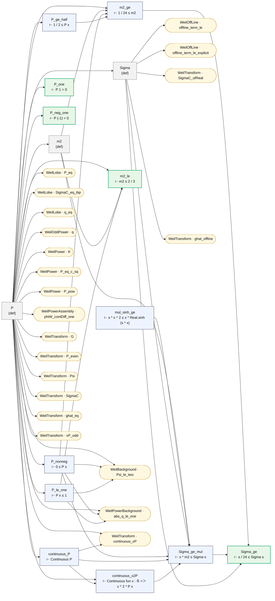

# `lean_stage3/Stage3/WeilWindow.lean`

**What it does** (its own header): WeilWindow — the raised-cosine window of entry 302, first two rungs of the detection ladder, crude constants. 2026-09-06.

**Imports:** nothing in this tree.
**Imported by:** [`Stage3`](../lean_stage3/Stage3.md), [`WeilTransform`](../lean_stage3/WeilTransform.md).

Blue: theorem. Green: a theorem nothing else uses (an end). Dashed white: connects to nothing. Grey: definition. Red: contains `sorry`. Yellow: in another file. An arrow A → B reads "A is used by B".

## Every declaration

| declaration | proves (output) | needs (input) | why (its own docstring) | uses | used by |
|---|---|---|---|---|---|
| `WeilWindow.P` def, line 44 | ℝ | x : ℝ | The raised-cosine window, `cos²(πx/2)`, read on `[−1, 1]`. | — | `WeilBackground.Psi_le_two`, `WeilLobe.P_eq`, `WeilLobe.SigmaC_eq_ibp`, `WeilLobe.q_eq`, `WeilOddPower.q`, `WeilPower.K`, `WeilPower.P_eq_c_sq`, `WeilPower.P_pow`, `WeilPowerAssembly.phiW_contDiff_one`, `WeilPowerBackground.abs_q_le_one`, `WeilTransform.G`, `WeilTransform.P_even`, `WeilTransform.Psi`, `WeilTransform.SigmaC`, `WeilTransform.continuous_xP`, `WeilTransform.ghat_eq`, `WeilTransform.xP_odd`, `WeilWindow.P_ge_half`, `WeilWindow.P_le_one`, `WeilWindow.P_neg_one`, `WeilWindow.P_nonneg`, `WeilWindow.P_one`, `WeilWindow.Sigma`, `WeilWindow.continuous_P`, `WeilWindow.continuous_x2P`, `WeilWindow.m2`, `WeilWindow.m2_ge`, `WeilWindow.m2_le` |
| `WeilWindow.m2` def, line 47 | ℝ | — | The second moment `∫₋₁¹ x²·P(x) dx`. | `WeilWindow.P` | `WeilWindow.Sigma_ge_mul`, `WeilWindow.m2_ge`, `WeilWindow.m2_le` |
| `WeilWindow.Sigma` def, line 50 | ℝ | s : ℝ | The odd-envelope integral `Σ(s) = ∫₋₁¹ x·P(x)·sinh(s x) dx`. | `WeilWindow.P` | `WeilOffLine.offline_term_le`, `WeilOffLine.offline_term_le_explicit`, `WeilTransform.SigmaC_ofReal`, `WeilTransform.ghat_offline`, `WeilWindow.Sigma_ge`, `WeilWindow.Sigma_ge_mul` |
| `WeilWindow.P_nonneg` theorem, line 52 | 0 ≤ P x | x : ℝ | — | `WeilWindow.P` | `WeilBackground.Psi_le_two`, `WeilPowerBackground.abs_q_le_one`, `WeilWindow.Sigma_ge_mul`, `WeilWindow.m2_ge` |
| `WeilWindow.P_le_one` theorem, line 55 | P x ≤ 1 | x : ℝ | — | `WeilWindow.P` | `WeilBackground.Psi_le_two`, `WeilPowerBackground.abs_q_le_one`, `WeilWindow.m2_le` |
| `WeilWindow.P_one` theorem, line 60 | P 1 = 0 | — | — | `WeilWindow.P` | — |
| `WeilWindow.P_neg_one` theorem, line 65 | P (-1) = 0 | — | — | `WeilWindow.P` | — |
| `WeilWindow.continuous_P` theorem, line 71 | Continuous P | — | — | `WeilWindow.P` | `WeilTransform.continuous_xP`, `WeilWindow.Sigma_ge_mul`, `WeilWindow.continuous_x2P` |
| `WeilWindow.continuous_x2P` theorem, line 74 | Continuous fun x : ℝ =&gt; x ^ 2 * P x | — | — | `WeilWindow.P`, `WeilWindow.continuous_P` | `WeilWindow.Sigma_ge_mul` |
| `WeilWindow.P_ge_half` theorem, line 78 | 1 / 2 ≤ P x | hx : \|x\| ≤ 1 / 2 | On `\|x\| ≤ 1/2` the window is at least `1/2`: `cos(πx/2) ≥ cos(π/4) = √2/2`. | `WeilWindow.P` | `WeilWindow.m2_ge` |
| `WeilWindow.m2_le` theorem, line 98 | m2 ≤ 2 / 3 | — | — | `WeilWindow.P`, `WeilWindow.P_le_one`, `WeilWindow.m2` | — |
| `WeilWindow.m2_ge` theorem, line 111 | 1 / 24 ≤ m2 | — | — | `WeilWindow.P`, `WeilWindow.P_ge_half`, `WeilWindow.P_nonneg`, `WeilWindow.m2` | `WeilWindow.Sigma_ge` |
| `WeilWindow.mul_sinh_ge` theorem, line 133 | s * x ^ 2 ≤ x * Real.sinh (s * x) | hs : 0 ≤ s; x : ℝ | `x·sinh(s x) ≥ s·x²` for every real `x`, when `s ≥ 0`. | — | `WeilWindow.Sigma_ge_mul` |
| `WeilWindow.Sigma_ge_mul` theorem, line 140 | s * m2 ≤ Sigma s | hs : 0 ≤ s | — | `WeilWindow.P_nonneg`, `WeilWindow.Sigma`, `WeilWindow.continuous_P`, `WeilWindow.continuous_x2P`, `WeilWindow.m2`, `WeilWindow.mul_sinh_ge` | `WeilWindow.Sigma_ge` |
| `WeilWindow.Sigma_ge` theorem, line 152 | s / 24 ≤ Sigma s | hs : 0 ≤ s | — | `WeilWindow.Sigma`, `WeilWindow.Sigma_ge_mul`, `WeilWindow.m2_ge` | — |
