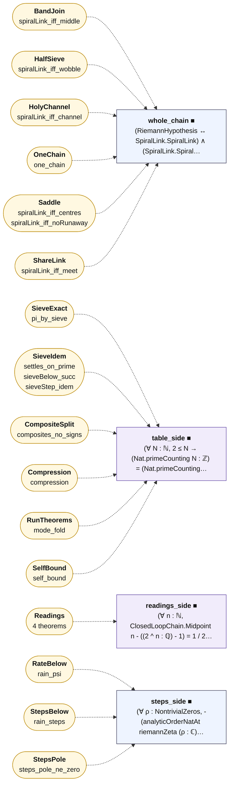

# `lean_stage3/Stage3/WholeChain.lean`

> **Read from the source text.** This file changed after the last `python3 utilities/lean_map.py --dump`, so the arrows on this page are names occurring in each proof and have not been confirmed by Lean.

WholeChain — blocks J8 and J11 of `lean_stage3/design/closedloop.md`. 2026-11-23.

4 theorems, 0 definitions, 128 lines. 

**Imports:** [`Compression`](../lean_stage3/Compression.md), [`HolyChannel`](../lean_stage3/HolyChannel.md), [`Readings`](../lean_stage3/Readings.md), [`RunTheorems`](../lean_stage3/RunTheorems.md), [`Saddle`](../lean_stage3/Saddle.md), [`SelfBound`](../lean_stage3/SelfBound.md), [`SieveIdem`](../lean_stage3/SieveIdem.md), [`StepsBelow`](../lean_stage3/StepsBelow.md)  
**Imported by:** [`Stage3`](../lean_stage3/Stage3.md)

## The picture



An arrow A → B reads "A is used in the proof of B". Green: counting, integers only. Violet: shape, analysis with no ζ. Blue: reads ζ. A name ending in ■ is an end: nothing else uses it. Red: contains `sorry`. Yellow: theorems in another file, counted; a dotted arrow crosses files. Definitions are not drawn; they are listed below the diagram.

## Theorems

<a name="WholeChain-whole_chain"></a>
### `WholeChain.whole_chain`

line 41 · arrows read from text

**Reads ζ.** It, or something it rests on, uses the zeta function, its zeros or the Riemann hypothesis.

**Why.** The whole chain. The spiral link, and every face of it compiled in the tree, are one statement.

**Proves**

```lean
(RiemannHypothesis ↔ SpiralLink.SpiralLink) ∧ (SpiralLink.SpiralLink ↔ OneAtEachHeight) ∧ (SpiralLink.SpiralLink ↔ ∃ (C : ℝ) (r₀ : ℤ), CellResidual.CellsSqrt C r₀) ∧ (SpiralLink.SpiralLink ↔ HalfSieve.WobbleSqrt) ∧ (SpiralLink.SpiralLink ↔ ∀ ρ : NontrivialZeros, ‖(2 : ℂ) ^ (-(ρ : ℂ))‖ = BandJoin.bandR (1 / 2)) ∧ (SpiralLink.SpiralLink ↔ ∀ ρ : NontrivialZeros, ‖((2 : ℝ) : ℂ) ^ (ρ : ℂ)‖ = ‖((2 : ℝ) : ℂ) ^ ((mirrorZ ρ : NontrivialZeros) : ℂ)‖) ∧ (SpiralLink.SpiralLink ↔ ∀ ρ : NontrivialZeros, Saddle.stretch ρ = 1) ∧ (SpiralLink.SpiralLink ↔ Saddle.NoRunaway) ∧ (SpiralLink.SpiralLink ↔ HolyChannel.ZeroIsChannel)
```

**Fed by** (7 theorems its proof uses)

  - [`BandJoin.spiralLink_iff_middle`](../lean_stage3/BandJoin.md#BandJoin-spiralLink_iff_middle) (BandJoin) — `` SpiralLink.SpiralLink ↔ ∀ ρ : NontrivialZeros, ‖(2:ℂ) ^ (-(ρ:ℂ))‖ = bandR (1 / 2) ``
  - [`HalfSieve.spiralLink_iff_wobble`](../lean_stage3/HalfSieve.md#HalfSieve-spiralLink_iff_wobble) (HalfSieve) — `` SpiralLink.SpiralLink ↔ WobbleSqrt ``
  - [`HolyChannel.spiralLink_iff_channel`](../lean_stage3/HolyChannel.md#HolyChannel-spiralLink_iff_channel) (HolyChannel) — `` SpiralLink.SpiralLink ↔ ZeroIsChannel ``
  - [`OneChain.one_chain`](../lean_stage3/OneChain.md#OneChain-one_chain) (OneChain) — `` (RiemannHypothesis ↔ SpiralLink.SpiralLink) ∧ (SpiralLink.SpiralLink ↔ OneAtEachHeight) ∧ (SpiralLink.SpiralLink ↔ ∀ ρ : NontrivialZeros, restoringFor… ``
  - [`Saddle.spiralLink_iff_centres`](../lean_stage3/Saddle.md#Saddle-spiralLink_iff_centres) (Saddle) — `` SpiralLink.SpiralLink ↔ ∀ ρ : NontrivialZeros, stretch ρ = 1 ``
  - [`Saddle.spiralLink_iff_noRunaway`](../lean_stage3/Saddle.md#Saddle-spiralLink_iff_noRunaway) (Saddle) — `` SpiralLink.SpiralLink ↔ NoRunaway ``
  - [`ShareLink.spiralLink_iff_meet`](../lean_stage3/ShareLink.md#ShareLink-spiralLink_iff_meet) (ShareLink) — `` SpiralLink.SpiralLink ↔ ∀ ρ : NontrivialZeros, ‖((2 : ℝ) : ℂ) ^ (ρ : ℂ)‖ = ‖((2 : ℝ) : ℂ) ^ ((mirrorZ ρ : NontrivialZeros) : ℂ)‖ ``

**Definitions its proof touches:** [`BandJoin.bandR`](../lean_stage3/BandJoin.md#BandJoin-bandR), [`CellResidual.CellsSqrt`](../lean_stage3/CellResidual.md#CellResidual-CellsSqrt), [`HalfSieve.WobbleSqrt`](../lean_stage3/HalfSieve.md#HalfSieve-WobbleSqrt), [`HolyChannel.ZeroIsChannel`](../lean_stage3/HolyChannel.md#HolyChannel-ZeroIsChannel), [`Saddle.NoRunaway`](../lean_stage3/Saddle.md#Saddle-NoRunaway), [`Saddle.stretch`](../lean_stage3/Saddle.md#Saddle-stretch), [`SpiralLink.OneAtEachHeight`](../lean_stage3/SpiralLink.md#SpiralLink-OneAtEachHeight), [`SpiralLink.SpiralLink`](../lean_stage3/SpiralLink.md#SpiralLink-SpiralLink), [`SpiralLink.mirrorZ`](../lean_stage3/SpiralLink.md#SpiralLink-mirrorZ)

**Feeds:** nothing. It is an end.

<a name="WholeChain-table_side"></a>
### `WholeChain.table_side`

line 61 · arrows read from text

**Shape.** Uses real or complex analysis; nothing in it or beneath it reads ζ.

**Why.** The table's side. What is proved of the table at every `N`, with no zero in the statement.

**Proves**

```lean
(∀ N : ℕ, 2 ≤ N → (Nat.primeCounting N : ℤ) = (Nat.primeCounting (Nat.sqrt N) : ℤ) - 1 + ∑ T ∈ (SieveExact.smallPrimes N).powerset, (-1 : ℤ) ^ T.card * ((N / ∏ p ∈ T, p : ℕ) : ℤ)) ∧ (∀ N : ℕ, ((Finset.Icc 2 N).filter (fun n => ¬ n.Prime)).card + (SieveExact.smallPrimes N).card = ∑ p ∈ SieveExact.smallPrimes N, CompositeSplit.rough N p) ∧ (∀ N : ℕ, N = Compression.smooth N + ∑ p ∈ Compression.newPrimes N, N / p) ∧ (∀ N : ℕ, ∑ k ∈ Finset.Icc 1 N, Chebyshev.psi ((N : ℝ) / (k : ℝ)) = ∑ n ∈ Finset.Icc 1 N, Real.log (n : ℝ)) ∧ (∀ (ρ : ℂ) (k : ℤ), (2 : ℂ) ^ (ρ + 2 * Real.pi * Complex.I * (k : ℂ) / (Real.log 2 : ℂ)) = (2 : ℂ) ^ ρ) ∧ (∀ (p : ℕ) (A : Finset ℕ), SieveIdem.sieveStep p (SieveIdem.sieveStep p A) = SieveIdem.sieveStep p A) ∧ (∀ (p : ℕ), p.Prime → ∀ A : Finset ℕ, SieveIdem.sieveBelow (p + 1) A = SieveIdem.sieveStep p (SieveIdem.sieveBelow p A)) ∧ (∀ m : ℕ, 2 ≤ m → (∀ q : ℕ, q.Prime → q < m → ¬ q ∣ m) → m.Prime)
```

**Fed by** (8 theorems its proof uses)

  - [`CompositeSplit.composites_no_signs`](../lean_stage3/CompositeSplit.md#CompositeSplit-composites_no_signs) (CompositeSplit) — `` ((Icc 2 N).filter (fun n => ¬ n.Prime)).card + (smallPrimes N).card = ∑ p ∈ smallPrimes N, rough N p ``
  - [`Compression.compression`](../lean_stage3/Compression.md#Compression-compression) (Compression) — `` N = smooth N + ∑ p ∈ newPrimes N, N / p ``
  - [`RunTheorems.mode_fold`](../lean_stage3/RunTheorems.md#RunTheorems-mode_fold) (RunTheorems) — `` (2:ℂ) ^ (ρ + 2 * Real.pi * Complex.I * (k : ℂ) / (Real.log 2 : ℂ)) = (2:ℂ) ^ ρ ``
  - [`SelfBound.self_bound`](../lean_stage3/SelfBound.md#SelfBound-self_bound) (SelfBound) — `` ∑ k ∈ Icc 1 N, Chebyshev.psi ((N : ℝ) / (k : ℝ)) = ∑ n ∈ Icc 1 N, Real.log (n : ℝ) ``
  - [`SieveExact.pi_by_sieve`](../lean_stage3/SieveExact.md#SieveExact-pi_by_sieve) (SieveExact) — `` (Nat.primeCounting N : ℤ) = (Nat.primeCounting (Nat.sqrt N) : ℤ) - 1 + ∑ T ∈ (smallPrimes N).powerset, (-1 : ℤ) ^ T.card * ((N / ∏ p ∈ T, p : ℕ) : ℤ) ``
  - [`SieveIdem.settles_on_prime`](../lean_stage3/SieveIdem.md#SieveIdem-settles_on_prime) (SieveIdem) — `` m.Prime ``
  - [`SieveIdem.sieveBelow_succ`](../lean_stage3/SieveIdem.md#SieveIdem-sieveBelow_succ) (SieveIdem) — `` sieveBelow (p + 1) A = sieveStep p (sieveBelow p A) ``
  - [`SieveIdem.sieveStep_idem`](../lean_stage3/SieveIdem.md#SieveIdem-sieveStep_idem) (SieveIdem) — `` sieveStep p (sieveStep p A) = sieveStep p A ``

**Definitions its proof touches:** [`CompositeSplit.rough`](../lean_stage3/CompositeSplit.md#CompositeSplit-rough), [`Compression.newPrimes`](../lean_stage3/Compression.md#Compression-newPrimes), [`Compression.smooth`](../lean_stage3/Compression.md#Compression-smooth), [`SieveExact.smallPrimes`](../lean_stage3/SieveExact.md#SieveExact-smallPrimes), [`SieveIdem.sieveBelow`](../lean_stage3/SieveIdem.md#SieveIdem-sieveBelow), [`SieveIdem.sieveStep`](../lean_stage3/SieveIdem.md#SieveIdem-sieveStep)

**Feeds:** nothing. It is an end.

<a name="WholeChain-readings_side"></a>
### `WholeChain.readings_side`

line 88 · arrows read from text

**Shape.** Uses real or complex analysis; nothing in it or beneath it reads ζ.

**Why.** The readings' side. The day's readings in exact form: the offset is one half at every doubling; a zero off the line makes the staircase run away; a half rung over its top is one less the reciprocal of the root of two; the closed loop's force at the Holy Family is five sixths.

**Proves**

```lean
(∀ n : ℕ, ClosedLoopChain.Midpoint n - ((2 ^ n : ℚ) - 1) = 1 / 2) ∧ (∀ ρ : NontrivialZeros, (ρ : ℂ).re ≠ 1 / 2 → ¬ Saddle.NoRunaway) ∧ (∀ k : ℝ, ((2 : ℝ) ^ (k / 2) - 2 ^ ((k - 1) / 2)) / 2 ^ (k / 2) = 1 - 1 / Real.sqrt 2) ∧ (∀ hf : ClosedLoopChain.HolyFamily, ClosedLoopJoin.restoringForce hf.J = 5 / 6 ∧ ClosedLoopJoin.restoringForce hf.M = 5 / 6)
```

**Fed by** (4 theorems its proof uses)

  - [`Readings.force_at_family`](../lean_stage3/Readings.md#Readings-force_at_family) (Readings) — `` restoringForce hf.J = 5 / 6 ∧ restoringForce hf.M = 5 / 6 ``
  - [`Readings.half_rung_ratio`](../lean_stage3/Readings.md#Readings-half_rung_ratio) (Readings) — `` ((2 : ℝ) ^ (k / 2) - 2 ^ ((k - 1) / 2)) / 2 ^ (k / 2) = 1 - 1 / Real.sqrt 2 ``
  - [`Readings.iv_exact`](../lean_stage3/Readings.md#Readings-iv_exact) (Readings) — `` ¬ Saddle.NoRunaway ``
  - [`Readings.offset_fixed`](../lean_stage3/Readings.md#Readings-offset_fixed) (Readings) — `` Midpoint n - ((2 ^ n : ℚ) - 1) = 1 / 2 ``

**Definitions its proof touches:** [`ClosedLoopChain.HolyFamily`](../lean_stage3/ClosedLoopChain.md#ClosedLoopChain-HolyFamily), [`ClosedLoopChain.Midpoint`](../lean_stage3/ClosedLoopChain.md#ClosedLoopChain-Midpoint), [`ClosedLoopJoin.restoringForce`](../lean_stage3/ClosedLoopJoin.md#ClosedLoopJoin-restoringForce), [`Saddle.NoRunaway`](../lean_stage3/Saddle.md#Saddle-NoRunaway)

**Feeds:** nothing. It is an end.

<a name="WholeChain-steps_side"></a>
### `WholeChain.steps_side`

line 99 · arrows read from text

**Reads ζ.** It, or something it rests on, uses the zeta function, its zeros or the Riemann hypothesis.

**Why.** The steps' side. What a zero does: it carries weight that is not zero, it makes the staircase leave every bound below its rate, and it makes the turned steps to a cutoff do the same.

**Proves**

```lean
(∀ ρ : NontrivialZeros, -(analyticOrderNatAt riemannZeta (ρ : ℂ) : ℂ) / (ρ : ℂ) ≠ 0) ∧ (∀ (ρ₀ : NontrivialZeros) (θ : ℝ), θ < (ρ₀ : ℂ).re → ∀ (C : ℝ) (k : ℕ) (x₀ : ℝ), ∃ x : ℝ, x₀ ≤ x ∧ C * x ^ θ * Real.log x ^ k < |Chebyshev.psi x - x|) ∧ (∀ (ρ₀ : NontrivialZeros) (s : ℂ), 0 < s.re → (ρ₀ : ℂ) ≠ s → ∀ δ : ℝ, 0 ≤ δ → δ < (ρ₀ : ℂ).re - s.re → ∀ (C : ℝ) (N₀ : ℕ), ∃ N : ℕ, N₀ ≤ N ∧ 2 ≤ N ∧ C * (N : ℝ) ^ δ < ‖StepsPeak.S N s - StepsPeak.K N s 1‖)
```

**Fed by** (3 theorems its proof uses)

  - [`RateBelow.rain_psi`](../lean_stage3/RateBelow.md#RateBelow-rain_psi) (RateBelow) — `` ∃ x : ℝ, x₀ ≤ x ∧ C * x ^ θ * Real.log x ^ k < |Chebyshev.psi x - x| ``
  - [`StepsBelow.rain_steps`](../lean_stage3/StepsBelow.md#StepsBelow-rain_steps) (StepsBelow) — `` ∃ N : ℕ, N₀ ≤ N ∧ 2 ≤ N ∧ C * (N : ℝ) ^ δ < ‖StepsPeak.S N s - StepsPeak.K N s 1‖ ``
  - [`StepsPole.steps_pole_ne_zero`](../lean_stage3/StepsPole.md#StepsPole-steps_pole_ne_zero) (StepsPole) — `` -(analyticOrderNatAt riemannZeta (ρ : ℂ) : ℂ) / (ρ : ℂ) ≠ 0 ``

**Definitions its proof touches:** [`StepsPeak.K`](../lean_stage3/StepsPeak.md#StepsPeak-K), [`StepsPeak.S`](../lean_stage3/StepsPeak.md#StepsPeak-S)

**Feeds:** nothing. It is an end.

