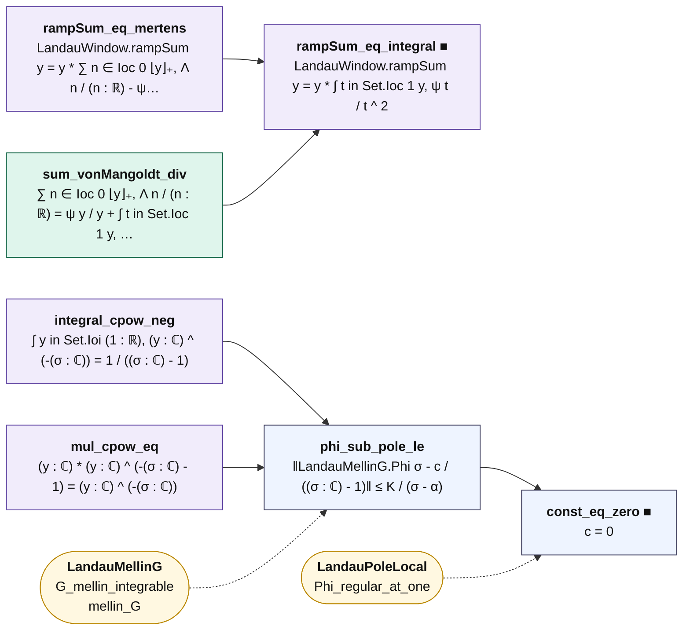

# `lean_stage3/Stage3/WindowsOfRH.lean`

> **Read from the source text.** This file changed after the last `python3 utilities/lean_map.py --dump`, so the arrows on this page are names occurring in each proof and have not been confirmed by Lean.

WindowsOfRH — block R16 of `lean_stage3/design/runs.md`. 2026-11-24. The reverse of `LandauCriterion.rh_of_windows`, built in steps. This file holds steps S2 and S4 of the design.

7 theorems, 0 definitions, 260 lines. 

**Imports:** [`JointDialGate`](../lean_stage3/JointDialGate.md), [`LandauCriterion`](../lean_stage3/LandauCriterion.md), [`LandauMellinG`](../lean_stage3/LandauMellinG.md), [`LandauPoleLocal`](../lean_stage3/LandauPoleLocal.md), [`Saddle`](../lean_stage3/Saddle.md)  
**Imported by:** nothing

## The picture



An arrow A → B reads "A is used in the proof of B". Green: counting, integers only. Violet: shape, analysis with no ζ. Blue: reads ζ. A name ending in ■ is an end: nothing else uses it. Red: contains `sorry`. Yellow: theorems in another file, counted; a dotted arrow crosses files. Definitions are not drawn; they are listed below the diagram.

## Theorems

<a name="WindowsOfRH-rampSum_eq_mertens"></a>
### `WindowsOfRH.rampSum_eq_mertens`

line 38 · arrows read from text

**Shape.** Uses real or complex analysis; nothing in it or beneath it reads ζ.

**Why.** The ramp sum through the Mertens sum. For `y ≥ 1`, `rampSum y = y·Σ_{n≤y} Λ(n)/n − ψ(y)`.

**Proves**

```lean
LandauWindow.rampSum y = y * ∑ n ∈ Ioc 0 ⌊y⌋₊, Λ n / (n : ℝ) - ψ y
```

**Needs** (its hypotheses)

  - `` hy : 1 ≤ y ``

**Fed by:** no theorem of this repo; it stands on Mathlib and the definitions below.

**Definitions its proof touches:** [`LandauWindow.rampSum`](../lean_stage3/LandauWindow.md#LandauWindow-rampSum)

**Feeds** (1 that use it)

  - [`WindowsOfRH.rampSum_eq_integral`](#WindowsOfRH-rampSum_eq_integral) — `` LandauWindow.rampSum y = y * ∫ t in Set.Ioc 1 y, ψ t / t ^ 2 ``

<a name="WindowsOfRH-sum_vonMangoldt_div"></a>
### `WindowsOfRH.sum_vonMangoldt_div`

line 67 · arrows read from text

**Counting.** Integers only: nothing in its statement or proof, or in anything it rests on, uses analysis or ζ.

**Why.** Abel summation. For `y ≥ 1`, `Σ_{n≤y} Λ(n)/n = ψ(y)/y + ∫_{(1,y]} ψ(t)/t²`.

**Proves**

```lean
∑ n ∈ Ioc 0 ⌊y⌋₊, Λ n / (n : ℝ) = ψ y / y + ∫ t in Set.Ioc 1 y, ψ t / t ^ 2
```

**Needs** (its hypotheses)

  - `` hy : 1 ≤ y ``

**Fed by:** no theorem of this repo; it stands on Mathlib.

**Feeds** (1 that use it)

  - [`WindowsOfRH.rampSum_eq_integral`](#WindowsOfRH-rampSum_eq_integral) — `` LandauWindow.rampSum y = y * ∫ t in Set.Ioc 1 y, ψ t / t ^ 2 ``

<a name="WindowsOfRH-rampSum_eq_integral"></a>
### `WindowsOfRH.rampSum_eq_integral`

line 103 · arrows read from text

**Shape.** Uses real or complex analysis; nothing in it or beneath it reads ζ.

**Why.** S2. For `y ≥ 1`, `rampSum y = y·∫_{(1,y]} ψ(t)/t²`.

**Proves**

```lean
LandauWindow.rampSum y = y * ∫ t in Set.Ioc 1 y, ψ t / t ^ 2
```

**Needs** (its hypotheses)

  - `` hy : 1 ≤ y ``

**Fed by** (2 theorems its proof uses)

  - [`WindowsOfRH.rampSum_eq_mertens`](#WindowsOfRH-rampSum_eq_mertens) — `` LandauWindow.rampSum y = y * ∑ n ∈ Ioc 0 ⌊y⌋₊, Λ n / (n : ℝ) - ψ y ``
  - [`WindowsOfRH.sum_vonMangoldt_div`](#WindowsOfRH-sum_vonMangoldt_div) — `` ∑ n ∈ Ioc 0 ⌊y⌋₊, Λ n / (n : ℝ) = ψ y / y + ∫ t in Set.Ioc 1 y, ψ t / t ^ 2 ``

**Definitions its proof touches:** [`LandauWindow.rampSum`](../lean_stage3/LandauWindow.md#LandauWindow-rampSum)

**Feeds:** nothing. It is an end.

<a name="WindowsOfRH-integral_cpow_neg"></a>
### `WindowsOfRH.integral_cpow_neg`

line 113 · arrows read from text

**Shape.** Uses real or complex analysis; nothing in it or beneath it reads ζ.

**Why.** The power integral `∫_{(1,∞)} y^(−σ) = 1/(σ − 1)` for real `σ > 1`, in `ℂ`.

**Proves**

```lean
∫ y in Set.Ioi (1 : ℝ), (y : ℂ) ^ (-(σ : ℂ)) = 1 / ((σ : ℂ) - 1)
```

**Needs** (its hypotheses)

  - `` hσ : 1 < σ ``

**Fed by:** no theorem of this repo; it stands on Mathlib.

**Feeds** (1 that use it)

  - [`WindowsOfRH.phi_sub_pole_le`](#WindowsOfRH-phi_sub_pole_le) — `` ‖LandauMellinG.Phi σ - c / ((σ : ℂ) - 1)‖ ≤ K / (σ - α) ``

<a name="WindowsOfRH-mul_cpow_eq"></a>
### `WindowsOfRH.mul_cpow_eq`

line 127 · arrows read from text

**Shape.** Uses real or complex analysis; nothing in it or beneath it reads ζ.

**Why.** On `(1, ∞)`, `y·y^(−σ−1) = y^(−σ)` in `ℂ`.

**Proves**

```lean
(y : ℂ) * (y : ℂ) ^ (-(σ : ℂ) - 1) = (y : ℂ) ^ (-(σ : ℂ))
```

**Needs** (its hypotheses)

  - `` hy : 0 < y ``
  - `` σ : ℝ ``

**Fed by:** no theorem of this repo; it stands on Mathlib.

**Feeds** (1 that use it)

  - [`WindowsOfRH.phi_sub_pole_le`](#WindowsOfRH-phi_sub_pole_le) — `` ‖LandauMellinG.Phi σ - c / ((σ : ℂ) - 1)‖ ≤ K / (σ - α) ``

<a name="WindowsOfRH-phi_sub_pole_le"></a>
### `WindowsOfRH.phi_sub_pole_le`

line 136 · arrows read from text

**Reads ζ.** It, or something it rests on, uses the zeta function, its zeros or the Riemann hypothesis.

**Why.** The Mellin transform less its pole. If `G y = c·y + r y` on `(1, ∞)` with `|r y| ≤ K·y^α`, `α < 1`, then for `σ > 1`, `‖Phi σ − c/(σ − 1)‖ ≤ K/(σ − α)`.

**Proves**

```lean
‖LandauMellinG.Phi σ - c / ((σ : ℂ) - 1)‖ ≤ K / (σ - α)
```

**Needs** (its hypotheses)

  - `` hα : α < 1 ``
  - `` hG : ∀ y ∈ Set.Ioi (1 : ℝ), LandauWindow.G y = c * y + r y ``
  - `` hr : ∀ y ∈ Set.Ioi (1 : ℝ), |r y| ≤ K * y ^ α ``
  - `` hσ : 1 < σ ``

**Fed by** (4 theorems its proof uses)

  - [`LandauMellinG.G_mellin_integrable`](../lean_stage3/LandauMellinG.md#LandauMellinG-G_mellin_integrable) (LandauMellinG) — `` IntegrableOn (fun y : ℝ => (LandauWindow.G y : ℂ) * (y : ℂ) ^ (-s - 1)) (Ioi 1) ``
  - [`LandauMellinG.mellin_G`](../lean_stage3/LandauMellinG.md#LandauMellinG-mellin_G) (LandauMellinG) — `` ∫ y in Ioi (1 : ℝ), (LandauWindow.G y : ℂ) * (y : ℂ) ^ (-s - 1) = Phi s ``
  - [`WindowsOfRH.integral_cpow_neg`](#WindowsOfRH-integral_cpow_neg) — `` ∫ y in Set.Ioi (1 : ℝ), (y : ℂ) ^ (-(σ : ℂ)) = 1 / ((σ : ℂ) - 1) ``
  - [`WindowsOfRH.mul_cpow_eq`](#WindowsOfRH-mul_cpow_eq) — `` (y : ℂ) * (y : ℂ) ^ (-(σ : ℂ) - 1) = (y : ℂ) ^ (-(σ : ℂ)) ``

**Definitions its proof touches:** [`LandauMellinG.Phi`](../lean_stage3/LandauMellinG.md#LandauMellinG-Phi), [`LandauWindow.G`](../lean_stage3/LandauWindow.md#LandauWindow-G)

**Feeds** (1 that use it)

  - [`WindowsOfRH.const_eq_zero`](#WindowsOfRH-const_eq_zero) — `` c = 0 ``

<a name="WindowsOfRH-const_eq_zero"></a>
### `WindowsOfRH.const_eq_zero`

line 183 · arrows read from text

**Reads ζ.** It, or something it rests on, uses the zeta function, its zeros or the Riemann hypothesis.

**Why.** S4. The constant is zero. If `G y = c·y + r y` on `(1, ∞)` with `|r y| ≤ K·y^α` and `α < 1`, then `c = 0`: `Phi` is regular at `1`, so it has no pole `c/(s − 1)` there.

**Proves**

```lean
c = 0
```

**Needs** (its hypotheses)

  - `` hα : α < 1 ``
  - `` hK : 0 ≤ K ``
  - `` hG : ∀ y ∈ Set.Ioi (1 : ℝ), LandauWindow.G y = c * y + r y ``
  - `` hr : ∀ y ∈ Set.Ioi (1 : ℝ), |r y| ≤ K * y ^ α ``

**Fed by** (2 theorems its proof uses)

  - [`LandauPoleLocal.Phi_regular_at_one`](../lean_stage3/LandauPoleLocal.md#LandauPoleLocal-Phi_regular_at_one) (LandauPoleLocal) — `` ∃ h : ℂ → ℂ, AnalyticAt ℂ h 1 ∧ ∀ᶠ s in 𝓝[≠] 1, LandauMellinG.Phi s = h s ``
  - [`WindowsOfRH.phi_sub_pole_le`](#WindowsOfRH-phi_sub_pole_le) — `` ‖LandauMellinG.Phi σ - c / ((σ : ℂ) - 1)‖ ≤ K / (σ - α) ``

**Definitions its proof touches:** [`LandauMellinG.Phi`](../lean_stage3/LandauMellinG.md#LandauMellinG-Phi), [`LandauWindow.G`](../lean_stage3/LandauWindow.md#LandauWindow-G)

**Feeds:** nothing. It is an end.

