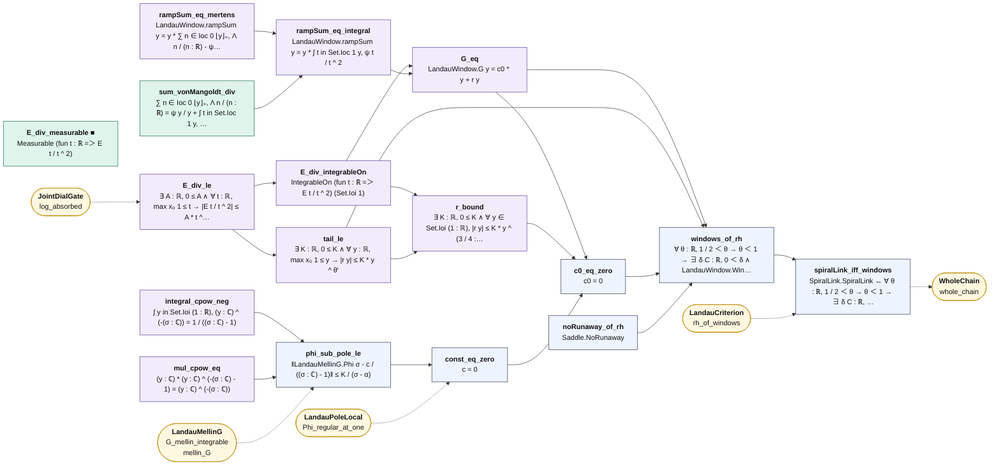

# `lean_stage3/Stage3/WindowsOfRH.lean`

> **Read from the source text.** This file changed after the last `python3 utilities/lean_map.py --dump`, so the arrows on this page are names occurring in each proof and have not been confirmed by Lean.

WindowsOfRH — block R16 of `lean_stage3/design/runs.md`. 2026-11-24. The reverse of `LandauCriterion.rh_of_windows`, built in steps. This file holds steps S2 and S4 of the design.

17 theorems, 3 definitions, 510 lines. 

**Imports:** [`JointDialGate`](../lean_stage3/JointDialGate.md), [`LandauCriterion`](../lean_stage3/LandauCriterion.md), [`LandauMellinG`](../lean_stage3/LandauMellinG.md), [`LandauPoleLocal`](../lean_stage3/LandauPoleLocal.md), [`Saddle`](../lean_stage3/Saddle.md)  
**Imported by:** [`Stage3`](../lean_stage3/Stage3.md), [`WholeChain`](../lean_stage3/WholeChain.md)

## The picture



An arrow A → B reads "A is used in the proof of B". Green: counting, integers only. Violet: shape, analysis with no ζ. Blue: reads ζ. A name ending in ■ is an end: nothing else uses it. Red: contains `sorry`. Yellow: theorems in another file, counted; a dotted arrow crosses files. Definitions are not drawn; they are listed below the diagram.

## Definitions

<a name="WindowsOfRH-E"></a>
### `WindowsOfRH.E`

def · line 289

- **Is:** `` E (t : ℝ) : ℝ := ψ t - t noncomputable ``
- **Used by 8:** [`WindowsOfRH.E_div_integrableOn`](#WindowsOfRH-E_div_integrableOn), [`WindowsOfRH.E_div_le`](#WindowsOfRH-E_div_le), [`WindowsOfRH.E_div_measurable`](#WindowsOfRH-E_div_measurable), [`WindowsOfRH.G_eq`](#WindowsOfRH-G_eq), [`WindowsOfRH.c0`](#WindowsOfRH-c0), [`WindowsOfRH.r`](#WindowsOfRH-r), [`WindowsOfRH.r_bound`](#WindowsOfRH-r_bound), [`WindowsOfRH.tail_le`](#WindowsOfRH-tail_le)

<a name="WindowsOfRH-c0"></a>
### `WindowsOfRH.c0`

def · line 293

- **Is:** `` c0 : ℝ := 1 + Real.eulerMascheroniConstant + ∫ t in Set.Ioi 1, E t / t ^ 2 noncomputable ``
- **Built from:** [`WindowsOfRH.E`](#WindowsOfRH-E)
- **Used by 2:** [`WindowsOfRH.G_eq`](#WindowsOfRH-G_eq), [`WindowsOfRH.c0_eq_zero`](#WindowsOfRH-c0_eq_zero)

<a name="WindowsOfRH-r"></a>
### `WindowsOfRH.r`

def · line 297

- **Is:** `` r (y : ℝ) : ℝ := -y * ∫ t in Set.Ioi y, E t / t ^ 2 ``
- **Built from:** [`WindowsOfRH.E`](#WindowsOfRH-E)
- **Used by 5:** [`WindowsOfRH.G_eq`](#WindowsOfRH-G_eq), [`WindowsOfRH.const_eq_zero`](#WindowsOfRH-const_eq_zero), [`WindowsOfRH.phi_sub_pole_le`](#WindowsOfRH-phi_sub_pole_le), [`WindowsOfRH.r_bound`](#WindowsOfRH-r_bound), [`WindowsOfRH.tail_le`](#WindowsOfRH-tail_le)

## Theorems

<a name="WindowsOfRH-rampSum_eq_mertens"></a>
### `WindowsOfRH.rampSum_eq_mertens`

line 55 · arrows read from text

**Shape.** Uses real or complex analysis; nothing in it or beneath it reads ζ.

**Why.** The ramp sum through the Mertens sum. For `y ≥ 1`, `rampSum y = y·Σ_{n≤y} Λ(n)/n − ψ(y)`.

**Proves**

```lean
LandauWindow.rampSum y = y * ∑ n ∈ Ioc 0 ⌊y⌋₊, Λ n / (n : ℝ) - ψ y
```

**Needs** (its hypotheses)

  - `` hy : 1 ≤ y ``

**Fed by:** no theorem of this repo; it stands on Mathlib and the definitions below.

**Definitions its proof touches:** [`LandauWindow.rampSum`](../lean_stage3/LandauWindow.md#LandauWindow-rampSum)

**Feeds** (1 that use it)

  - [`WindowsOfRH.rampSum_eq_integral`](#WindowsOfRH-rampSum_eq_integral) — `` LandauWindow.rampSum y = y * ∫ t in Set.Ioc 1 y, ψ t / t ^ 2 ``

<a name="WindowsOfRH-sum_vonMangoldt_div"></a>
### `WindowsOfRH.sum_vonMangoldt_div`

line 84 · arrows read from text

**Counting.** Integers only: nothing in its statement or proof, or in anything it rests on, uses analysis or ζ.

**Why.** Abel summation. For `y ≥ 1`, `Σ_{n≤y} Λ(n)/n = ψ(y)/y + ∫_{(1,y]} ψ(t)/t²`.

**Proves**

```lean
∑ n ∈ Ioc 0 ⌊y⌋₊, Λ n / (n : ℝ) = ψ y / y + ∫ t in Set.Ioc 1 y, ψ t / t ^ 2
```

**Needs** (its hypotheses)

  - `` hy : 1 ≤ y ``

**Fed by:** no theorem of this repo; it stands on Mathlib.

**Feeds** (1 that use it)

  - [`WindowsOfRH.rampSum_eq_integral`](#WindowsOfRH-rampSum_eq_integral) — `` LandauWindow.rampSum y = y * ∫ t in Set.Ioc 1 y, ψ t / t ^ 2 ``

<a name="WindowsOfRH-rampSum_eq_integral"></a>
### `WindowsOfRH.rampSum_eq_integral`

line 120 · arrows read from text

**Shape.** Uses real or complex analysis; nothing in it or beneath it reads ζ.

**Why.** S2. For `y ≥ 1`, `rampSum y = y·∫_{(1,y]} ψ(t)/t²`.

**Proves**

```lean
LandauWindow.rampSum y = y * ∫ t in Set.Ioc 1 y, ψ t / t ^ 2
```

**Needs** (its hypotheses)

  - `` hy : 1 ≤ y ``

**Fed by** (2 theorems its proof uses)

  - [`WindowsOfRH.rampSum_eq_mertens`](#WindowsOfRH-rampSum_eq_mertens) — `` LandauWindow.rampSum y = y * ∑ n ∈ Ioc 0 ⌊y⌋₊, Λ n / (n : ℝ) - ψ y ``
  - [`WindowsOfRH.sum_vonMangoldt_div`](#WindowsOfRH-sum_vonMangoldt_div) — `` ∑ n ∈ Ioc 0 ⌊y⌋₊, Λ n / (n : ℝ) = ψ y / y + ∫ t in Set.Ioc 1 y, ψ t / t ^ 2 ``

**Definitions its proof touches:** [`LandauWindow.rampSum`](../lean_stage3/LandauWindow.md#LandauWindow-rampSum)

**Feeds** (1 that use it)

  - [`WindowsOfRH.G_eq`](#WindowsOfRH-G_eq) — `` LandauWindow.G y = c0 * y + r y ``

<a name="WindowsOfRH-integral_cpow_neg"></a>
### `WindowsOfRH.integral_cpow_neg`

line 130 · arrows read from text

**Shape.** Uses real or complex analysis; nothing in it or beneath it reads ζ.

**Why.** The power integral `∫_{(1,∞)} y^(−σ) = 1/(σ − 1)` for real `σ > 1`, in `ℂ`.

**Proves**

```lean
∫ y in Set.Ioi (1 : ℝ), (y : ℂ) ^ (-(σ : ℂ)) = 1 / ((σ : ℂ) - 1)
```

**Needs** (its hypotheses)

  - `` hσ : 1 < σ ``

**Fed by:** no theorem of this repo; it stands on Mathlib.

**Feeds** (1 that use it)

  - [`WindowsOfRH.phi_sub_pole_le`](#WindowsOfRH-phi_sub_pole_le) — `` ‖LandauMellinG.Phi σ - c / ((σ : ℂ) - 1)‖ ≤ K / (σ - α) ``

<a name="WindowsOfRH-mul_cpow_eq"></a>
### `WindowsOfRH.mul_cpow_eq`

line 144 · arrows read from text

**Shape.** Uses real or complex analysis; nothing in it or beneath it reads ζ.

**Why.** On `(1, ∞)`, `y·y^(−σ−1) = y^(−σ)` in `ℂ`.

**Proves**

```lean
(y : ℂ) * (y : ℂ) ^ (-(σ : ℂ) - 1) = (y : ℂ) ^ (-(σ : ℂ))
```

**Needs** (its hypotheses)

  - `` hy : 0 < y ``
  - `` σ : ℝ ``

**Fed by:** no theorem of this repo; it stands on Mathlib.

**Feeds** (1 that use it)

  - [`WindowsOfRH.phi_sub_pole_le`](#WindowsOfRH-phi_sub_pole_le) — `` ‖LandauMellinG.Phi σ - c / ((σ : ℂ) - 1)‖ ≤ K / (σ - α) ``

<a name="WindowsOfRH-phi_sub_pole_le"></a>
### `WindowsOfRH.phi_sub_pole_le`

line 153 · arrows read from text

**Reads ζ.** It, or something it rests on, uses the zeta function, its zeros or the Riemann hypothesis.

**Why.** The Mellin transform less its pole. If `G y = c·y + r y` on `(1, ∞)` with `|r y| ≤ K·y^α`, `α < 1`, then for `σ > 1`, `‖Phi σ − c/(σ − 1)‖ ≤ K/(σ − α)`.

**Proves**

```lean
‖LandauMellinG.Phi σ - c / ((σ : ℂ) - 1)‖ ≤ K / (σ - α)
```

**Needs** (its hypotheses)

  - `` hα : α < 1 ``
  - `` hG : ∀ y ∈ Set.Ioi (1 : ℝ), LandauWindow.G y = c * y + r y ``
  - `` hr : ∀ y ∈ Set.Ioi (1 : ℝ), |r y| ≤ K * y ^ α ``
  - `` hσ : 1 < σ ``

**Fed by** (4 theorems its proof uses)

  - [`LandauMellinG.G_mellin_integrable`](../lean_stage3/LandauMellinG.md#LandauMellinG-G_mellin_integrable) (LandauMellinG) — `` IntegrableOn (fun y : ℝ => (LandauWindow.G y : ℂ) * (y : ℂ) ^ (-s - 1)) (Ioi 1) ``
  - [`LandauMellinG.mellin_G`](../lean_stage3/LandauMellinG.md#LandauMellinG-mellin_G) (LandauMellinG) — `` ∫ y in Ioi (1 : ℝ), (LandauWindow.G y : ℂ) * (y : ℂ) ^ (-s - 1) = Phi s ``
  - [`WindowsOfRH.integral_cpow_neg`](#WindowsOfRH-integral_cpow_neg) — `` ∫ y in Set.Ioi (1 : ℝ), (y : ℂ) ^ (-(σ : ℂ)) = 1 / ((σ : ℂ) - 1) ``
  - [`WindowsOfRH.mul_cpow_eq`](#WindowsOfRH-mul_cpow_eq) — `` (y : ℂ) * (y : ℂ) ^ (-(σ : ℂ) - 1) = (y : ℂ) ^ (-(σ : ℂ)) ``

**Definitions its proof touches:** [`LandauMellinG.Phi`](../lean_stage3/LandauMellinG.md#LandauMellinG-Phi), [`LandauWindow.G`](../lean_stage3/LandauWindow.md#LandauWindow-G), [`WindowsOfRH.r`](#WindowsOfRH-r)

**Feeds** (1 that use it)

  - [`WindowsOfRH.const_eq_zero`](#WindowsOfRH-const_eq_zero) — `` c = 0 ``

<a name="WindowsOfRH-const_eq_zero"></a>
### `WindowsOfRH.const_eq_zero`

line 200 · arrows read from text

**Reads ζ.** It, or something it rests on, uses the zeta function, its zeros or the Riemann hypothesis.

**Why.** S4. The constant is zero. If `G y = c·y + r y` on `(1, ∞)` with `|r y| ≤ K·y^α` and `α < 1`, then `c = 0`: `Phi` is regular at `1`, so it has no pole `c/(s − 1)` there.

**Proves**

```lean
c = 0
```

**Needs** (its hypotheses)

  - `` hα : α < 1 ``
  - `` hK : 0 ≤ K ``
  - `` hG : ∀ y ∈ Set.Ioi (1 : ℝ), LandauWindow.G y = c * y + r y ``
  - `` hr : ∀ y ∈ Set.Ioi (1 : ℝ), |r y| ≤ K * y ^ α ``

**Fed by** (2 theorems its proof uses)

  - [`LandauPoleLocal.Phi_regular_at_one`](../lean_stage3/LandauPoleLocal.md#LandauPoleLocal-Phi_regular_at_one) (LandauPoleLocal) — `` ∃ h : ℂ → ℂ, AnalyticAt ℂ h 1 ∧ ∀ᶠ s in 𝓝[≠] 1, LandauMellinG.Phi s = h s ``
  - [`WindowsOfRH.phi_sub_pole_le`](#WindowsOfRH-phi_sub_pole_le) — `` ‖LandauMellinG.Phi σ - c / ((σ : ℂ) - 1)‖ ≤ K / (σ - α) ``

**Definitions its proof touches:** [`LandauMellinG.Phi`](../lean_stage3/LandauMellinG.md#LandauMellinG-Phi), [`LandauWindow.G`](../lean_stage3/LandauWindow.md#LandauWindow-G), [`WindowsOfRH.r`](#WindowsOfRH-r)

**Feeds** (1 that use it)

  - [`WindowsOfRH.c0_eq_zero`](#WindowsOfRH-c0_eq_zero) — `` c0 = 0 ``

<a name="WindowsOfRH-noRunaway_of_rh"></a>
### `WindowsOfRH.noRunaway_of_rh`

line 270 · arrows read from text

**Reads ζ.** It, or something it rests on, uses the zeta function, its zeros or the Riemann hypothesis.

**Why.** S1. The Riemann hypothesis gives the staircase in the square-root frame: `|ψ(t) − t| ≤ C·t^(1/2)·(log t)^k` from some point on.

**Proves**

```lean
Saddle.NoRunaway
```

**Needs** (its hypotheses)

  - `` hRH : RiemannHypothesis ``

**Fed by:** no theorem of this repo; it stands on Mathlib and the definitions below.

**Definitions its proof touches:** [`Saddle.NoRunaway`](../lean_stage3/Saddle.md#Saddle-NoRunaway)

**Feeds** (1 that use it)

  - [`WindowsOfRH.windows_of_rh`](#WindowsOfRH-windows_of_rh) — `` ∀ θ : ℝ, 1 / 2 < θ → θ < 1 → ∃ δ C : ℝ, 0 < δ ∧ LandauWindow.WindowBound θ δ C ``

<a name="WindowsOfRH-E_div_measurable"></a>
### `WindowsOfRH.E_div_measurable`

line 299 · arrows read from text

**Counting.** Integers only: nothing in its statement or proof, or in anything it rests on, uses analysis or ζ.

**Proves**

```lean
Measurable (fun t : ℝ => E t / t ^ 2)
```

**Fed by:** no theorem of this repo; it stands on Mathlib and the definitions below.

**Definitions its proof touches:** [`WindowsOfRH.E`](#WindowsOfRH-E)

**Feeds:** nothing. It is an end.

<a name="WindowsOfRH-E_div_le"></a>
### `WindowsOfRH.E_div_le`

line 304 · arrows read from text

**Shape.** Uses real or complex analysis; nothing in it or beneath it reads ζ.

**Why.** Beyond `max x₀ 1`, `|E(t)/t²| ≤ A·t^(θ'−2)`, the log absorbed at `θ' > 1/2`.

**Proves**

```lean
∃ A : ℝ, 0 ≤ A ∧ ∀ t : ℝ, max x₀ 1 ≤ t → |E t / t ^ 2| ≤ A * t ^ (θ' - 2)
```

**Needs** (its hypotheses)

  - `` h : Stage3.StmtPsiWeakTheta (1 / 2) C k x₀ ``
  - `` hθ' : 1 / 2 < θ' ``

**Fed by** (1 theorem its proof uses)

  - [`JointDialGate.log_absorbed`](../lean_stage3/JointDialGate.md#JointDialGate-log_absorbed) (JointDialGate) — `` C * x ^ θ * Real.log x ^ k ≤ C / (2 * (θ' - θ) / (2 * ((k : ℝ) + 1))) ^ k * x ^ θ' ``

**Definitions its proof touches:** [`Stage3.StmtPsiWeakTheta`](../lean_stage3/ThetaPi.md#Stage3-StmtPsiWeakTheta), [`WindowsOfRH.E`](#WindowsOfRH-E)

**Feeds** (2 that use it)

  - [`WindowsOfRH.E_div_integrableOn`](#WindowsOfRH-E_div_integrableOn) — `` IntegrableOn (fun t : ℝ => E t / t ^ 2) (Set.Ioi 1) ``
  - [`WindowsOfRH.tail_le`](#WindowsOfRH-tail_le) — `` ∃ K : ℝ, 0 ≤ K ∧ ∀ y : ℝ, max x₀ 1 ≤ y → |r y| ≤ K * y ^ θ' ``

<a name="WindowsOfRH-E_div_integrableOn"></a>
### `WindowsOfRH.E_div_integrableOn`

line 331 · arrows read from text

**Shape.** Uses real or complex analysis; nothing in it or beneath it reads ζ.

**Why.** S3 (a). `E(t)/t²` is integrable on `(1, ∞)`.

**Proves**

```lean
IntegrableOn (fun t : ℝ => E t / t ^ 2) (Set.Ioi 1)
```

**Needs** (its hypotheses)

  - `` hN : Saddle.NoRunaway ``

**Fed by** (1 theorem its proof uses)

  - [`WindowsOfRH.E_div_le`](#WindowsOfRH-E_div_le) — `` ∃ A : ℝ, 0 ≤ A ∧ ∀ t : ℝ, max x₀ 1 ≤ t → |E t / t ^ 2| ≤ A * t ^ (θ' - 2) ``

**Definitions its proof touches:** [`Saddle.NoRunaway`](../lean_stage3/Saddle.md#Saddle-NoRunaway), [`WindowsOfRH.E`](#WindowsOfRH-E)

**Feeds** (2 that use it)

  - [`WindowsOfRH.G_eq`](#WindowsOfRH-G_eq) — `` LandauWindow.G y = c0 * y + r y ``
  - [`WindowsOfRH.r_bound`](#WindowsOfRH-r_bound) — `` ∃ K : ℝ, 0 ≤ K ∧ ∀ y ∈ Set.Ioi (1 : ℝ), |r y| ≤ K * y ^ (3 / 4 : ℝ) ``

<a name="WindowsOfRH-G_eq"></a>
### `WindowsOfRH.G_eq`

line 362 · arrows read from text

**Shape.** Uses real or complex analysis; nothing in it or beneath it reads ζ.

**Why.** S3 (b). For `y > 1`, `G y = c₀·y + r y`.

**Proves**

```lean
LandauWindow.G y = c0 * y + r y
```

**Needs** (its hypotheses)

  - `` hN : Saddle.NoRunaway ``
  - `` hy : 1 < y ``

**Fed by** (2 theorems its proof uses)

  - [`WindowsOfRH.E_div_integrableOn`](#WindowsOfRH-E_div_integrableOn) — `` IntegrableOn (fun t : ℝ => E t / t ^ 2) (Set.Ioi 1) ``
  - [`WindowsOfRH.rampSum_eq_integral`](#WindowsOfRH-rampSum_eq_integral) — `` LandauWindow.rampSum y = y * ∫ t in Set.Ioc 1 y, ψ t / t ^ 2 ``

**Definitions its proof touches:** [`LandauWindow.G`](../lean_stage3/LandauWindow.md#LandauWindow-G), [`Saddle.NoRunaway`](../lean_stage3/Saddle.md#Saddle-NoRunaway), [`WindowsOfRH.E`](#WindowsOfRH-E), [`WindowsOfRH.c0`](#WindowsOfRH-c0), [`WindowsOfRH.r`](#WindowsOfRH-r)

**Feeds** (2 that use it)

  - [`WindowsOfRH.c0_eq_zero`](#WindowsOfRH-c0_eq_zero) — `` c0 = 0 ``
  - [`WindowsOfRH.windows_of_rh`](#WindowsOfRH-windows_of_rh) — `` ∀ θ : ℝ, 1 / 2 < θ → θ < 1 → ∃ δ C : ℝ, 0 < δ ∧ LandauWindow.WindowBound θ δ C ``

<a name="WindowsOfRH-tail_le"></a>
### `WindowsOfRH.tail_le`

line 392 · arrows read from text

**Shape.** Uses real or complex analysis; nothing in it or beneath it reads ζ.

**Why.** The tail at exponent `θ' ∈ (1/2, 1)`: beyond `max x₀ 1`, `|r y| ≤ K·y^θ'`.

**Proves**

```lean
∃ K : ℝ, 0 ≤ K ∧ ∀ y : ℝ, max x₀ 1 ≤ y → |r y| ≤ K * y ^ θ'
```

**Needs** (its hypotheses)

  - `` h : Stage3.StmtPsiWeakTheta (1 / 2) C k x₀ ``
  - `` hθ'lo : 1 / 2 < θ' ``
  - `` hθ'1 : θ' < 1 ``

**Fed by** (1 theorem its proof uses)

  - [`WindowsOfRH.E_div_le`](#WindowsOfRH-E_div_le) — `` ∃ A : ℝ, 0 ≤ A ∧ ∀ t : ℝ, max x₀ 1 ≤ t → |E t / t ^ 2| ≤ A * t ^ (θ' - 2) ``

**Definitions its proof touches:** [`Stage3.StmtPsiWeakTheta`](../lean_stage3/ThetaPi.md#Stage3-StmtPsiWeakTheta), [`WindowsOfRH.E`](#WindowsOfRH-E), [`WindowsOfRH.r`](#WindowsOfRH-r)

**Feeds** (2 that use it)

  - [`WindowsOfRH.r_bound`](#WindowsOfRH-r_bound) — `` ∃ K : ℝ, 0 ≤ K ∧ ∀ y ∈ Set.Ioi (1 : ℝ), |r y| ≤ K * y ^ (3 / 4 : ℝ) ``
  - [`WindowsOfRH.windows_of_rh`](#WindowsOfRH-windows_of_rh) — `` ∀ θ : ℝ, 1 / 2 < θ → θ < 1 → ∃ δ C : ℝ, 0 < δ ∧ LandauWindow.WindowBound θ δ C ``

<a name="WindowsOfRH-r_bound"></a>
### `WindowsOfRH.r_bound`

line 425 · arrows read from text

**Shape.** Uses real or complex analysis; nothing in it or beneath it reads ζ.

**Why.** S3 (c). For `y > 1`, `|r y| ≤ K·y^(3/4)`.

**Proves**

```lean
∃ K : ℝ, 0 ≤ K ∧ ∀ y ∈ Set.Ioi (1 : ℝ), |r y| ≤ K * y ^ (3 / 4 : ℝ)
```

**Needs** (its hypotheses)

  - `` hN : Saddle.NoRunaway ``

**Fed by** (2 theorems its proof uses)

  - [`WindowsOfRH.E_div_integrableOn`](#WindowsOfRH-E_div_integrableOn) — `` IntegrableOn (fun t : ℝ => E t / t ^ 2) (Set.Ioi 1) ``
  - [`WindowsOfRH.tail_le`](#WindowsOfRH-tail_le) — `` ∃ K : ℝ, 0 ≤ K ∧ ∀ y : ℝ, max x₀ 1 ≤ y → |r y| ≤ K * y ^ θ' ``

**Definitions its proof touches:** [`Saddle.NoRunaway`](../lean_stage3/Saddle.md#Saddle-NoRunaway), [`WindowsOfRH.E`](#WindowsOfRH-E), [`WindowsOfRH.r`](#WindowsOfRH-r)

**Feeds** (1 that use it)

  - [`WindowsOfRH.c0_eq_zero`](#WindowsOfRH-c0_eq_zero) — `` c0 = 0 ``

<a name="WindowsOfRH-c0_eq_zero"></a>
### `WindowsOfRH.c0_eq_zero`

line 461 · arrows read from text

**Reads ζ.** It, or something it rests on, uses the zeta function, its zeros or the Riemann hypothesis.

**Why.** S3 (d). The constant `c₀` is zero.

**Proves**

```lean
c0 = 0
```

**Needs** (its hypotheses)

  - `` hN : Saddle.NoRunaway ``

**Fed by** (3 theorems its proof uses)

  - [`WindowsOfRH.G_eq`](#WindowsOfRH-G_eq) — `` LandauWindow.G y = c0 * y + r y ``
  - [`WindowsOfRH.const_eq_zero`](#WindowsOfRH-const_eq_zero) — `` c = 0 ``
  - [`WindowsOfRH.r_bound`](#WindowsOfRH-r_bound) — `` ∃ K : ℝ, 0 ≤ K ∧ ∀ y ∈ Set.Ioi (1 : ℝ), |r y| ≤ K * y ^ (3 / 4 : ℝ) ``

**Definitions its proof touches:** [`Saddle.NoRunaway`](../lean_stage3/Saddle.md#Saddle-NoRunaway), [`WindowsOfRH.c0`](#WindowsOfRH-c0)

**Feeds** (1 that use it)

  - [`WindowsOfRH.windows_of_rh`](#WindowsOfRH-windows_of_rh) — `` ∀ θ : ℝ, 1 / 2 < θ → θ < 1 → ∃ δ C : ℝ, 0 < δ ∧ LandauWindow.WindowBound θ δ C ``

<a name="WindowsOfRH-windows_of_rh"></a>
### `WindowsOfRH.windows_of_rh`

line 474 · arrows read from text

**Reads ζ.** It, or something it rests on, uses the zeta function, its zeros or the Riemann hypothesis.

**Why.** S5. The Riemann hypothesis gives a window bound at every `θ ∈ (1/2, 1)`.

**Proves**

```lean
∀ θ : ℝ, 1 / 2 < θ → θ < 1 → ∃ δ C : ℝ, 0 < δ ∧ LandauWindow.WindowBound θ δ C
```

**Needs** (its hypotheses)

  - `` hRH : RiemannHypothesis ``

**Fed by** (4 theorems its proof uses)

  - [`WindowsOfRH.G_eq`](#WindowsOfRH-G_eq) — `` LandauWindow.G y = c0 * y + r y ``
  - [`WindowsOfRH.c0_eq_zero`](#WindowsOfRH-c0_eq_zero) — `` c0 = 0 ``
  - [`WindowsOfRH.noRunaway_of_rh`](#WindowsOfRH-noRunaway_of_rh) — `` Saddle.NoRunaway ``
  - [`WindowsOfRH.tail_le`](#WindowsOfRH-tail_le) — `` ∃ K : ℝ, 0 ≤ K ∧ ∀ y : ℝ, max x₀ 1 ≤ y → |r y| ≤ K * y ^ θ' ``

**Definitions its proof touches:** [`LandauWindow.WindowBound`](../lean_stage3/LandauWindow.md#LandauWindow-WindowBound)

**Feeds** (1 that use it)

  - [`WindowsOfRH.spiralLink_iff_windows`](#WindowsOfRH-spiralLink_iff_windows) — `` SpiralLink.SpiralLink ↔ ∀ θ : ℝ, 1 / 2 < θ → θ < 1 → ∃ δ C : ℝ, 0 < δ ∧ LandauWindow.WindowBound θ δ C ``

<a name="WindowsOfRH-spiralLink_iff_windows"></a>
### `WindowsOfRH.spiralLink_iff_windows`

line 490 · arrows read from text

**Reads ζ.** It, or something it rests on, uses the zeta function, its zeros or the Riemann hypothesis.

**Why.** SpiralLink is the window bounds.

**Proves**

```lean
SpiralLink.SpiralLink ↔ ∀ θ : ℝ, 1 / 2 < θ → θ < 1 → ∃ δ C : ℝ, 0 < δ ∧ LandauWindow.WindowBound θ δ C
```

**Fed by** (2 theorems its proof uses)

  - [`LandauCriterion.rh_of_windows`](../lean_stage3/LandauCriterion.md#LandauCriterion-rh_of_windows) (LandauCriterion) — `` RiemannHypothesis ``
  - [`WindowsOfRH.windows_of_rh`](#WindowsOfRH-windows_of_rh) — `` ∀ θ : ℝ, 1 / 2 < θ → θ < 1 → ∃ δ C : ℝ, 0 < δ ∧ LandauWindow.WindowBound θ δ C ``

**Definitions its proof touches:** [`LandauWindow.WindowBound`](../lean_stage3/LandauWindow.md#LandauWindow-WindowBound), [`SpiralLink.SpiralLink`](../lean_stage3/SpiralLink.md#SpiralLink-SpiralLink)

**Feeds** (1 that use it)

  - [`WholeChain.whole_chain`](../lean_stage3/WholeChain.md#WholeChain-whole_chain) (WholeChain) — `` (RiemannHypothesis ↔ SpiralLink.SpiralLink) ∧ (SpiralLink.SpiralLink ↔ OneAtEachHeight) ∧ (SpiralLink.SpiralLink ↔ ∃ (C : ℝ) (r₀ : ℤ), CellResidual.Ce… ``

