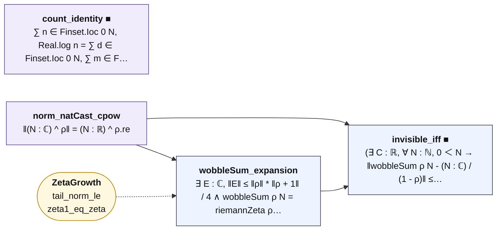

# `lean_stage3/Stage3/WobbleCount.lean`

WobbleCount — block W1 of `lean_stage3/design/joints.md`. 2026-11-22. Why the number line has zeros, as a statement about counting. Each integer is built from primes in one way; summed over the integers up to `N` that says the prime content read at `N`, `N/2`, `N/3`, … adds to the logarithms of the integers, which are as smooth as the integers are evenly spaced (`count_identity`). A wobble `x^ρ` in the prime content therefore enters that sum as `wobbleSum ρ N`: the wobble read at `N/1, …, N/N` and added. After its …

4 theorems, 1 definition, 191 lines. Arrows are Lean's own record of what each proof uses.

**Imports:** [`ZetaGrowth`](../lean_stage3/ZetaGrowth.md)  
**Imported by:** [`Stage3`](../lean_stage3/Stage3.md)

## The picture



An arrow A → B reads "A is used in the proof of B". Green: counting, integers only. Violet: shape, analysis with no ζ. Blue: reads ζ. A name ending in ■ is an end: nothing else uses it. Red: contains `sorry`. Yellow: theorems in another file, counted; a dotted arrow crosses files. Definitions are not drawn; they are listed below the diagram.

## Definitions

<a name="WobbleCount-wobbleSum"></a>
### `WobbleCount.wobbleSum`

def · line 54

A wobble `x^ρ` read at `N/1, N/2, …, N/N` and added.

- **Is:** `` wobbleSum (ρ : ℂ) (N : ℕ) : ℂ := ∑ n ∈ Finset.range N, (N : ℂ) ^ ρ / ((n : ℂ) + 1) ^ ρ ``
- **Used by 2:** [`WobbleCount.invisible_iff`](#WobbleCount-invisible_iff), [`WobbleCount.wobbleSum_expansion`](#WobbleCount-wobbleSum_expansion)

## Theorems

<a name="WobbleCount-count_identity"></a>
### `WobbleCount.count_identity`

line 40

**Shape.** Uses real or complex analysis; nothing in it or beneath it reads ζ.

**Why.** The integers, counted through their primes. The logarithms of the integers up to `N` add to the prime content read at `N`, `N/2`, `N/3`, …

**Proves**

```lean
∑ n ∈ Finset.Ioc 0 N, Real.log n = ∑ d ∈ Finset.Ioc 0 N, ∑ m ∈ Finset.Ioc 0 (N / d), Λ m
```

**Needs** (its hypotheses)

  - `` N : ℕ ``

**Fed by:** no theorem of this repo; it stands on Mathlib.

**Feeds:** nothing. It connects to nothing.

<a name="WobbleCount-norm_natCast_cpow"></a>
### `WobbleCount.norm_natCast_cpow`

line 58

**Shape.** Uses real or complex analysis; nothing in it or beneath it reads ζ.

**Why.** The size of a power of a positive integer is the power of its real part.

**Proves**

```lean
‖(N : ℂ) ^ ρ‖ = (N : ℝ) ^ ρ.re
```

**Needs** (its hypotheses)

  - `` hN : 0 < N ``
  - `` ρ : ℂ ``

**Fed by:** no theorem of this repo; it stands on Mathlib.

**Feeds** (2 that use it)

  - [`WobbleCount.invisible_iff`](#WobbleCount-invisible_iff) — `` (∃ C : ℝ, ∀ N : ℕ, 0 < N → ‖wobbleSum ρ N - (N : ℂ) / (1 - ρ)‖ ≤ C) ↔ riemannZeta ρ = 0 ``
  - [`WobbleCount.wobbleSum_expansion`](#WobbleCount-wobbleSum_expansion) — `` ∃ E : ℂ, ‖E‖ ≤ ‖ρ‖ * ‖ρ + 1‖ / 4 ∧ wobbleSum ρ N = riemannZeta ρ * (N : ℂ) ^ ρ + (N : ℂ) / (1 - ρ) + 1 / 2 + E ``

<a name="WobbleCount-wobbleSum_expansion"></a>
### `WobbleCount.wobbleSum_expansion`

line 64

**Reads ζ.** It, or something it rests on, uses the zeta function, its zeros or the Riemann hypothesis.

**Why.** The wobble sum, expanded. It is `ζ(ρ)·N^ρ`, plus a smooth term, plus one half, plus a term that stays bounded as `N` grows.

**Proves**

```lean
∃ E : ℂ, ‖E‖ ≤ ‖ρ‖ * ‖ρ + 1‖ / 4 ∧ wobbleSum ρ N = riemannZeta ρ * (N : ℂ) ^ ρ + (N : ℂ) / (1 - ρ) + 1 / 2 + E
```

**Needs** (its hypotheses)

  - `` hN : 0 < N ``
  - `` hρ : 0 < ρ.re ``
  - `` hρ1 : ρ ≠ 1 ``

**Stated with:** [`WobbleCount.wobbleSum`](#WobbleCount-wobbleSum)

**Fed by** (3 theorems its proof uses)

  - [`WobbleCount.norm_natCast_cpow`](#WobbleCount-norm_natCast_cpow) — `` ‖(N : ℂ) ^ ρ‖ = (N : ℝ) ^ ρ.re ``
  - [`ZetaGrowth.tail_norm_le`](../lean_stage3/ZetaGrowth.md#ZetaGrowth-tail_norm_le) (ZetaGrowth) — `` ‖∫ x in Ioi (N:ℝ), (emA x : ℂ) * (x:ℂ) ^ (-(s+2))‖ ≤ (1/4) * (N:ℝ) ^ (-s.re - 1) ``
  - [`ZetaGrowth.zeta1_eq_zeta`](../lean_stage3/ZetaGrowth.md#ZetaGrowth-zeta1_eq_zeta) (ZetaGrowth) — `` zeta1 N s = riemannZeta s ``

**Definitions its proof touches:** [`ZetaGrowth.emA`](../lean_stage3/ZetaGrowth.md#ZetaGrowth-emA), [`ZetaGrowth.zeta1`](../lean_stage3/ZetaGrowth.md#ZetaGrowth-zeta1)

**Feeds** (1 that use it)

  - [`WobbleCount.invisible_iff`](#WobbleCount-invisible_iff) — `` (∃ C : ℝ, ∀ N : ℕ, 0 < N → ‖wobbleSum ρ N - (N : ℂ) / (1 - ρ)‖ ≤ C) ↔ riemannZeta ρ = 0 ``

<a name="WobbleCount-invisible_iff"></a>
### `WobbleCount.invisible_iff`

line 116

**Reads ζ.** It, or something it rests on, uses the zeta function, its zeros or the Riemann hypothesis.

**Why.** A wobble is invisible to the integer count exactly at a zero. Read at `N/1, …, N/N` and added, with its smooth term taken off, a wobble `x^ρ` stays bounded as `N` grows if and only if `ζ(ρ) = 0`.

**Proves**

```lean
(∃ C : ℝ, ∀ N : ℕ, 0 < N → ‖wobbleSum ρ N - (N : ℂ) / (1 - ρ)‖ ≤ C) ↔ riemannZeta ρ = 0
```

**Needs** (its hypotheses)

  - `` hρ : 0 < ρ.re ``
  - `` hρ1 : ρ ≠ 1 ``

**Stated with:** [`WobbleCount.wobbleSum`](#WobbleCount-wobbleSum)

**Fed by** (2 theorems its proof uses)

  - [`WobbleCount.norm_natCast_cpow`](#WobbleCount-norm_natCast_cpow) — `` ‖(N : ℂ) ^ ρ‖ = (N : ℝ) ^ ρ.re ``
  - [`WobbleCount.wobbleSum_expansion`](#WobbleCount-wobbleSum_expansion) — `` ∃ E : ℂ, ‖E‖ ≤ ‖ρ‖ * ‖ρ + 1‖ / 4 ∧ wobbleSum ρ N = riemannZeta ρ * (N : ℂ) ^ ρ + (N : ℂ) / (1 - ρ) + 1 / 2 + E ``

**Feeds:** nothing. It is an end.

