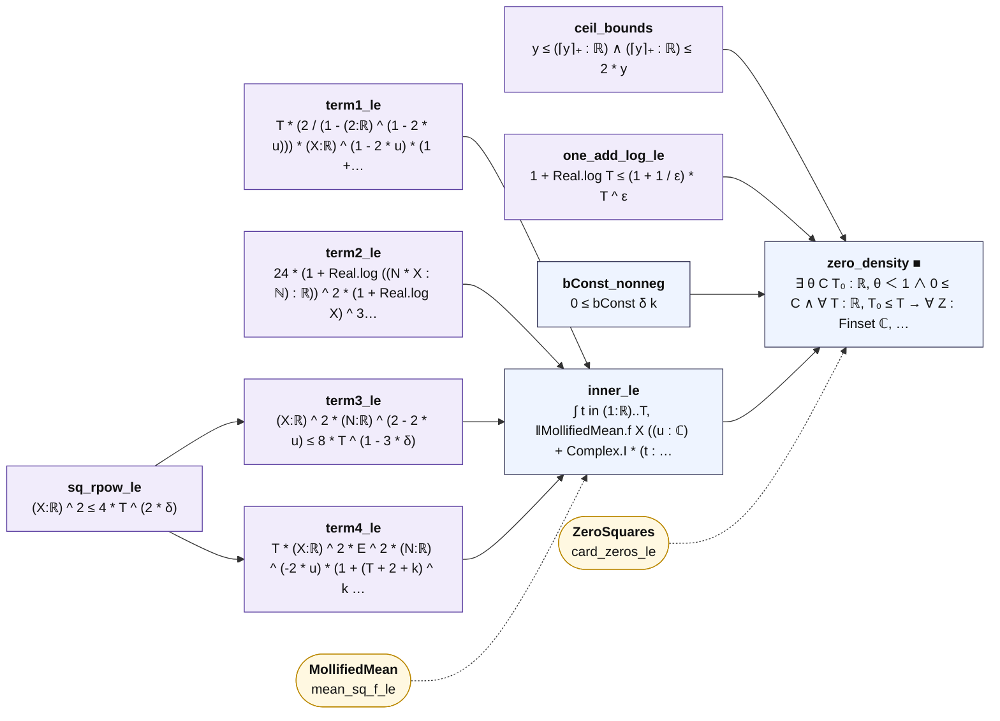

# `lean_stage3/Stage3/ZeroDensity.lean`

ZeroDensity — block C6 of `lean_stage3/design/carlson.md`. 2026-11-23. The zero-density bound with a power saving. Fix `σ > 1/2` and put `δ = (σ − 1/2)/4`. For a height `T` take `X = ⌈T^δ⌉₊`, `N = ⌈T^(1+δ)⌉₊` and the order `k = ⌈1/δ⌉₊ + 1`. On every line `u ∈ (σ − δ, 1 + δ]` the four terms of `MollifiedMean.mean_sq_f_le` are each at most a constant times `T^(1 − 6δ²)·(1 + log T)^5`. Integrating over `u` and feeding the result to `ZeroSquares.card_zeros_le` bounds the number of zeros by a constant times `T^(1 − 6δ²)…

10 theorems, 1 definition, 490 lines. Arrows are Lean's own record of what each proof uses.

**Imports:** [`ZeroSquares`](../lean_stage3/ZeroSquares.md)  
**Imported by:** [`Stage3`](../lean_stage3/Stage3.md)

## The picture



An arrow A → B reads "A is used in the proof of B". Green: counting, integers only. Violet: shape, analysis with no ζ. Blue: reads ζ. A name ending in ■ is an end: nothing else uses it. Red: contains `sorry`. Yellow: theorems in another file, counted; a dotted arrow crosses files. Definitions are not drawn; they are listed below the diagram.

## Definitions

<a name="ZeroDensity-bConst"></a>
### `ZeroDensity.bConst`

def · line 241

The constant `B(δ, k)` of the mean-square bound `inner_le`.

- **Is:** `` bConst (δ : ℝ) (k : ℕ) : ℝ := 3 * (8 * (2 / (1 - (2:ℝ) ^ (-(6 * δ)))) + 12296 + 4 * ZetaEM.emConst k ^ 2 * (1 + 2 ^ k) ^ 2) ``
- **Built from:** [`ZetaEM.emConst`](../lean_stage3/ZetaEM.md#ZetaEM-emConst)
- **Used by 3:** [`ZeroDensity.bConst_nonneg`](#ZeroDensity-bConst_nonneg), [`ZeroDensity.inner_le`](#ZeroDensity-inner_le), [`ZeroDensity.zero_density`](#ZeroDensity-zero_density)

## Theorems

<a name="ZeroDensity-ceil_bounds"></a>
### `ZeroDensity.ceil_bounds`

line 40

**Shape.** Uses real or complex analysis; nothing in it or beneath it reads ζ.

**Why.** For `y ≥ 1` the ceiling `⌈y⌉₊` lies between `y` and `2y`.

**Proves**

```lean
y ≤ (⌈y⌉₊ : ℝ) ∧ (⌈y⌉₊ : ℝ) ≤ 2 * y
```

**Needs** (its hypotheses)

  - `` hy : 1 ≤ y ``

**Fed by:** no theorem of this repo; it stands on Mathlib.

**Feeds** (1 that use it)

  - [`ZeroDensity.zero_density`](#ZeroDensity-zero_density) — `` ∃ θ C T₀ : ℝ, θ < 1 ∧ 0 ≤ C ∧ ∀ T : ℝ, T₀ ≤ T → ∀ Z : Finset ℂ, (∀ ρ ∈ Z, riemannZeta ρ = 0 ∧ σ ≤ ρ.re ∧ ρ.re < 1 ∧ 2 ≤ ρ.im ∧ ρ.im ≤ T - 2) → (Z.card… ``

<a name="ZeroDensity-one_add_log_le"></a>
### `ZeroDensity.one_add_log_le`

line 46

**Shape.** Uses real or complex analysis; nothing in it or beneath it reads ζ.

**Why.** For `T ≥ 1` and `ε > 0`, the quantity `1 + log T` is at most `(1 + 1/ε)·T^ε`.

**Proves**

```lean
1 + Real.log T ≤ (1 + 1 / ε) * T ^ ε
```

**Needs** (its hypotheses)

  - `` hT : 1 ≤ T ``
  - `` hε : 0 < ε ``

**Fed by:** no theorem of this repo; it stands on Mathlib.

**Feeds** (1 that use it)

  - [`ZeroDensity.zero_density`](#ZeroDensity-zero_density) — `` ∃ θ C T₀ : ℝ, θ < 1 ∧ 0 ≤ C ∧ ∀ T : ℝ, T₀ ≤ T → ∀ Z : Finset ℂ, (∀ ρ ∈ Z, riemannZeta ρ = 0 ∧ σ ≤ ρ.re ∧ ρ.re < 1 ∧ 2 ≤ ρ.im ∧ ρ.im ≤ T - 2) → (Z.card… ``

<a name="ZeroDensity-sq_rpow_le"></a>
### `ZeroDensity.sq_rpow_le`

line 56

**Shape.** Uses real or complex analysis; nothing in it or beneath it reads ζ.

**Why.** For `T > 0`, the bound `X ≤ 2·T^δ` gives `X² ≤ 4·T^(2δ)`.

**Proves**

```lean
(X:ℝ) ^ 2 ≤ 4 * T ^ (2 * δ)
```

**Needs** (its hypotheses)

  - `` hT0 : 0 < T ``
  - `` hX2 : (X:ℝ) ≤ 2 * T ^ δ ``

**Fed by:** no theorem of this repo; it stands on Mathlib.

**Feeds** (2 that use it)

  - [`ZeroDensity.term3_le`](#ZeroDensity-term3_le) — `` (X:ℝ) ^ 2 * (N:ℝ) ^ (2 - 2 * u) ≤ 8 * T ^ (1 - 3 * δ) ``
  - [`ZeroDensity.term4_le`](#ZeroDensity-term4_le) — `` T * (X:ℝ) ^ 2 * E ^ 2 * (N:ℝ) ^ (-2 * u) * (1 + (T + 2 + k) ^ k * (N:ℝ) ^ (1 - (k:ℝ))) ^ 2 ≤ 4 * E ^ 2 * (1 + 2 ^ k) ^ 2 * T ^ δ ``

<a name="ZeroDensity-term1_le"></a>
### `ZeroDensity.term1_le`

line 71

**Shape.** Uses real or complex analysis; nothing in it or beneath it reads ζ.

**Why.** The diagonal term of `MollifiedMean.mean_sq_f_le` on a line with `2u − 1 ≥ 6δ`, when `X ≥ T^δ`, is at most `T·(2/(1 − 2^(−6δ)))·T^(−6δ²)·L³`, where `L` bounds `1 + log X`.

**Proves**

```lean
T * (2 / (1 - (2:ℝ) ^ (1 - 2 * u))) * (X:ℝ) ^ (1 - 2 * u) * (1 + Real.log X) ^ 3 ≤ T * (2 / (1 - (2:ℝ) ^ (-(6 * δ)))) * T ^ (-(6 * δ ^ 2)) * L ^ 3
```

**Needs** (its hypotheses)

  - `` hδ : 0 < δ ``
  - `` hT : 1 ≤ T ``
  - `` hu : 6 * δ ≤ 2 * u - 1 ``
  - `` hX : T ^ δ ≤ X ``
  - `` hL : 1 + Real.log X ≤ L ``

**Fed by:** no theorem of this repo; it stands on Mathlib.

**Feeds** (1 that use it)

  - [`ZeroDensity.inner_le`](#ZeroDensity-inner_le) — `` ∫ t in (1:ℝ)..T, ‖MollifiedMean.f X ((u : ℂ) + Complex.I * (t : ℂ))‖ ^ 2 ≤ bConst δ k * T ^ (1 - 6 * δ ^ 2) * (1 + Real.log T) ^ 5 ``

<a name="ZeroDensity-term2_le"></a>
### `ZeroDensity.term2_le`

line 106

**Shape.** Uses real or complex analysis; nothing in it or beneath it reads ζ.

**Why.** The off-diagonal term of `MollifiedMean.mean_sq_f_le` on a line with `2u − 1 ≥ 6δ`, when `N·X ≤ 4·T^(1+2δ)`, is at most `24·(4L)²·(2L)³·4·T^(1−4δ)`.

**Proves**

```lean
24 * (1 + Real.log ((N * X : ℕ) : ℝ)) ^ 2 * (1 + Real.log X) ^ 3 * max 1 (((N * X : ℕ) : ℝ) ^ (2 - 2 * u)) ≤ 24 * (4 * L) ^ 2 * (2 * L) ^ 3 * (4 * T ^ (1 - 4 * δ))
```

**Needs** (its hypotheses)

  - `` hδ : 0 < δ ``
  - `` hδ8 : δ ≤ 1 / 8 ``
  - `` hT : 1 ≤ T ``
  - `` hu : 6 * δ ≤ 2 * u - 1 ``
  - `` hX1 : 1 ≤ X ``
  - `` hN1 : 1 ≤ N ``
  - `` hNX : ((N * X : ℕ) : ℝ) ≤ 4 * T ^ (1 + 2 * δ) ``
  - `` hL1 : 1 + Real.log X ≤ 2 * L ``
  - `` hL2 : 1 + Real.log ((N * X : ℕ) : ℝ) ≤ 4 * L ``
  - `` hL0 : 0 ≤ L ``

**Fed by:** no theorem of this repo; it stands on Mathlib.

**Feeds** (1 that use it)

  - [`ZeroDensity.inner_le`](#ZeroDensity-inner_le) — `` ∫ t in (1:ℝ)..T, ‖MollifiedMean.f X ((u : ℂ) + Complex.I * (t : ℂ))‖ ^ 2 ≤ bConst δ k * T ^ (1 - 6 * δ ^ 2) * (1 + Real.log T) ^ 5 ``

<a name="ZeroDensity-term3_le"></a>
### `ZeroDensity.term3_le`

line 147

**Shape.** Uses real or complex analysis; nothing in it or beneath it reads ζ.

**Why.** The term `X²·N^(2−2u)` of `MollifiedMean.mean_sq_f_le` on a line with `2u − 1 ≥ 6δ`, when `X ≤ 2·T^δ` and `N ≤ 2·T^(1+δ)`, is at most `8·T^(1−3δ)`.

**Proves**

```lean
(X:ℝ) ^ 2 * (N:ℝ) ^ (2 - 2 * u) ≤ 8 * T ^ (1 - 3 * δ)
```

**Needs** (its hypotheses)

  - `` hδ : 0 < δ ``
  - `` hδ8 : δ ≤ 1 / 8 ``
  - `` hT : 1 ≤ T ``
  - `` hu : 6 * δ ≤ 2 * u - 1 ``
  - `` hX2 : (X:ℝ) ≤ 2 * T ^ δ ``
  - `` hN1 : (1:ℝ) ≤ N ``
  - `` hN2 : (N:ℝ) ≤ 2 * T ^ (1 + δ) ``

**Fed by** (1 theorem its proof uses)

  - [`ZeroDensity.sq_rpow_le`](#ZeroDensity-sq_rpow_le) — `` (X:ℝ) ^ 2 ≤ 4 * T ^ (2 * δ) ``

**Feeds** (1 that use it)

  - [`ZeroDensity.inner_le`](#ZeroDensity-inner_le) — `` ∫ t in (1:ℝ)..T, ‖MollifiedMean.f X ((u : ℂ) + Complex.I * (t : ℂ))‖ ^ 2 ≤ bConst δ k * T ^ (1 - 6 * δ ^ 2) * (1 + Real.log T) ^ 5 ``

<a name="ZeroDensity-term4_le"></a>
### `ZeroDensity.term4_le`

line 176

**Shape.** Uses real or complex analysis; nothing in it or beneath it reads ζ.

**Why.** The Euler–Maclaurin remainder term of `MollifiedMean.mean_sq_f_le`, when `δ·(k − 1) ≥ 1`, `X ≤ 2·T^δ`, `N ≥ T^(1+δ)` and `T + 2 + k ≤ 2T`, is at most `4·E²·(1 + 2^k)²·T^δ`.

**Proves**

```lean
T * (X:ℝ) ^ 2 * E ^ 2 * (N:ℝ) ^ (-2 * u) * (1 + (T + 2 + k) ^ k * (N:ℝ) ^ (1 - (k:ℝ))) ^ 2 ≤ 4 * E ^ 2 * (1 + 2 ^ k) ^ 2 * T ^ δ
```

**Needs** (its hypotheses)

  - `` hδ : 0 < δ ``
  - `` hT : 1 ≤ T ``
  - `` hk : 1 ≤ δ * ((k:ℝ) - 1) ``
  - `` hTk : T + 2 + k ≤ 2 * T ``
  - `` hu : 1 / 2 ≤ u ``
  - `` hX2 : (X:ℝ) ≤ 2 * T ^ δ ``
  - `` hN : T ^ (1 + δ) ≤ N ``

**Fed by** (1 theorem its proof uses)

  - [`ZeroDensity.sq_rpow_le`](#ZeroDensity-sq_rpow_le) — `` (X:ℝ) ^ 2 ≤ 4 * T ^ (2 * δ) ``

**Feeds** (1 that use it)

  - [`ZeroDensity.inner_le`](#ZeroDensity-inner_le) — `` ∫ t in (1:ℝ)..T, ‖MollifiedMean.f X ((u : ℂ) + Complex.I * (t : ℂ))‖ ^ 2 ≤ bConst δ k * T ^ (1 - 6 * δ ^ 2) * (1 + Real.log T) ^ 5 ``

<a name="ZeroDensity-bConst_nonneg"></a>
### `ZeroDensity.bConst_nonneg`

line 246

**Reads ζ.** It, or something it rests on, uses the zeta function, its zeros or the Riemann hypothesis.

**Why.** For `δ > 0` the constant `B(δ, k)` is nonnegative.

**Proves**

```lean
0 ≤ bConst δ k
```

**Needs** (its hypotheses)

  - `` hδ : 0 < δ ``
  - `` k : ℕ ``

**Stated with:** [`ZeroDensity.bConst`](#ZeroDensity-bConst)

**Fed by:** no theorem of this repo; it stands on Mathlib and the definitions below.

**Definitions its proof touches:** [`ZetaEM.emConst`](../lean_stage3/ZetaEM.md#ZetaEM-emConst)

**Feeds** (1 that use it)

  - [`ZeroDensity.zero_density`](#ZeroDensity-zero_density) — `` ∃ θ C T₀ : ℝ, θ < 1 ∧ 0 ≤ C ∧ ∀ T : ℝ, T₀ ≤ T → ∀ Z : Finset ℂ, (∀ ρ ∈ Z, riemannZeta ρ = 0 ∧ σ ≤ ρ.re ∧ ρ.re < 1 ∧ 2 ≤ ρ.im ∧ ρ.im ≤ T - 2) → (Z.card… ``

<a name="ZeroDensity-inner_le"></a>
### `ZeroDensity.inner_le`

line 257

**Reads ζ.** It, or something it rests on, uses the zeta function, its zeros or the Riemann hypothesis.

**Why.** On a line `u` with `2u − 1 ≥ 6δ` and `u ≤ 2`, with `X` and `N` within a factor two of `T^δ` and `T^(1+δ)`, the mean square `∫_1^T ‖f X (u + i t)‖²` is at most `B(δ, k)·T^(1−6δ²)·(1 + log T)^5`.

**Proves**

```lean
∫ t in (1:ℝ)..T, ‖MollifiedMean.f X ((u : ℂ) + Complex.I * (t : ℂ))‖ ^ 2 ≤ bConst δ k * T ^ (1 - 6 * δ ^ 2) * (1 + Real.log T) ^ 5
```

**Needs** (its hypotheses)

  - `` hδ : 0 < δ ``
  - `` hδ8 : δ ≤ 1 / 8 ``
  - `` hk2 : 2 ≤ k ``
  - `` hk : 1 ≤ δ * ((k:ℝ) - 1) ``
  - `` hT2 : 2 ≤ T ``
  - `` hTk : (k:ℝ) + 2 ≤ T ``
  - `` hX : T ^ δ ≤ X ``
  - `` hX2 : (X:ℝ) ≤ 2 * T ^ δ ``
  - `` hN : T ^ (1 + δ) ≤ N ``
  - `` hN2 : (N:ℝ) ≤ 2 * T ^ (1 + δ) ``
  - `` hX2' : 2 ≤ X ``
  - `` hXN : X ≤ N ``
  - `` hTN : T + 3 + k ≤ N ``
  - `` hu : 6 * δ ≤ 2 * u - 1 ``
  - `` hu2 : u ≤ 2 ``

**Stated with:** [`MollifiedMean.f`](../lean_stage3/MollifiedMean.md#MollifiedMean-f), [`ZeroDensity.bConst`](#ZeroDensity-bConst)

**Fed by** (5 theorems its proof uses)

  - [`MollifiedMean.mean_sq_f_le`](../lean_stage3/MollifiedMean.md#MollifiedMean-mean_sq_f_le) (MollifiedMean) — `` ∫ t in (1:ℝ)..T, ‖f X ((u : ℂ) + Complex.I * (t : ℂ))‖ ^ 2 ≤ 3 * (T * (2 / (1 - (2:ℝ) ^ (1 - 2 * u))) * (X:ℝ) ^ (1 - 2 * u) * (1 + Real.log X) ^ 3 + 2… ``
  - [`ZeroDensity.term1_le`](#ZeroDensity-term1_le) — `` T * (2 / (1 - (2:ℝ) ^ (1 - 2 * u))) * (X:ℝ) ^ (1 - 2 * u) * (1 + Real.log X) ^ 3 ≤ T * (2 / (1 - (2:ℝ) ^ (-(6 * δ)))) * T ^ (-(6 * δ ^ 2)) * L ^ 3 ``
  - [`ZeroDensity.term2_le`](#ZeroDensity-term2_le) — `` 24 * (1 + Real.log ((N * X : ℕ) : ℝ)) ^ 2 * (1 + Real.log X) ^ 3 * max 1 (((N * X : ℕ) : ℝ) ^ (2 - 2 * u)) ≤ 24 * (4 * L) ^ 2 * (2 * L) ^ 3 * (4 * T ^… ``
  - [`ZeroDensity.term3_le`](#ZeroDensity-term3_le) — `` (X:ℝ) ^ 2 * (N:ℝ) ^ (2 - 2 * u) ≤ 8 * T ^ (1 - 3 * δ) ``
  - [`ZeroDensity.term4_le`](#ZeroDensity-term4_le) — `` T * (X:ℝ) ^ 2 * E ^ 2 * (N:ℝ) ^ (-2 * u) * (1 + (T + 2 + k) ^ k * (N:ℝ) ^ (1 - (k:ℝ))) ^ 2 ≤ 4 * E ^ 2 * (1 + 2 ^ k) ^ 2 * T ^ δ ``

**Definitions its proof touches:** [`ZetaEM.emConst`](../lean_stage3/ZetaEM.md#ZetaEM-emConst)

**Feeds** (1 that use it)

  - [`ZeroDensity.zero_density`](#ZeroDensity-zero_density) — `` ∃ θ C T₀ : ℝ, θ < 1 ∧ 0 ≤ C ∧ ∀ T : ℝ, T₀ ≤ T → ∀ Z : Finset ℂ, (∀ ρ ∈ Z, riemannZeta ρ = 0 ∧ σ ≤ ρ.re ∧ ρ.re < 1 ∧ 2 ≤ ρ.im ∧ ρ.im ≤ T - 2) → (Z.card… ``

<a name="ZeroDensity-zero_density"></a>
### `ZeroDensity.zero_density`

line 361

**Reads ζ.** It, or something it rests on, uses the zeta function, its zeros or the Riemann hypothesis.

**Why.** Zero density with a power saving. For `1/2 < σ ≤ 1` there are `θ < 1`, `C ≥ 0` and `T₀` such that for `T ≥ T₀` every finite set of zeros of ζ with `σ ≤ Re ρ < 1` and `2 ≤ Im ρ ≤ T − 2` has at most `C·T^θ` elements; here `θ = 1 − 5δ²`, `δ = (σ − 1/2)/4`.

**Proves**

```lean
∃ θ C T₀ : ℝ, θ < 1 ∧ 0 ≤ C ∧ ∀ T : ℝ, T₀ ≤ T → ∀ Z : Finset ℂ, (∀ ρ ∈ Z, riemannZeta ρ = 0 ∧ σ ≤ ρ.re ∧ ρ.re < 1 ∧ 2 ≤ ρ.im ∧ ρ.im ≤ T - 2) → (Z.card : ℝ) ≤ C * T ^ θ
```

**Needs** (its hypotheses)

  - `` hσ : 1 / 2 < σ ``
  - `` hσ1 : σ ≤ 1 ``

**Fed by** (5 theorems its proof uses)

  - [`ZeroDensity.bConst_nonneg`](#ZeroDensity-bConst_nonneg) — `` 0 ≤ bConst δ k ``
  - [`ZeroDensity.ceil_bounds`](#ZeroDensity-ceil_bounds) — `` y ≤ (⌈y⌉₊ : ℝ) ∧ (⌈y⌉₊ : ℝ) ≤ 2 * y ``
  - [`ZeroDensity.inner_le`](#ZeroDensity-inner_le) — `` ∫ t in (1:ℝ)..T, ‖MollifiedMean.f X ((u : ℂ) + Complex.I * (t : ℂ))‖ ^ 2 ≤ bConst δ k * T ^ (1 - 6 * δ ^ 2) * (1 + Real.log T) ^ 5 ``
  - [`ZeroDensity.one_add_log_le`](#ZeroDensity-one_add_log_le) — `` 1 + Real.log T ≤ (1 + 1 / ε) * T ^ ε ``
  - [`ZeroSquares.card_zeros_le`](../lean_stage3/ZeroSquares.md#ZeroSquares-card_zeros_le) (ZeroSquares) — `` Real.pi * δ ^ 2 * (Z.card : ℝ) ≤ 3 * (15 * Real.log T + 73) * ∫ u in (σ - δ)..(1 + δ), ∫ t in (1:ℝ)..T, ‖MollifiedMean.f X ((u : ℂ) + Complex.I * (t :… ``

**Definitions its proof touches:** [`MollifiedMean.f`](../lean_stage3/MollifiedMean.md#MollifiedMean-f), [`ZeroDensity.bConst`](#ZeroDensity-bConst)

**Feeds:** nothing. It is an end.

