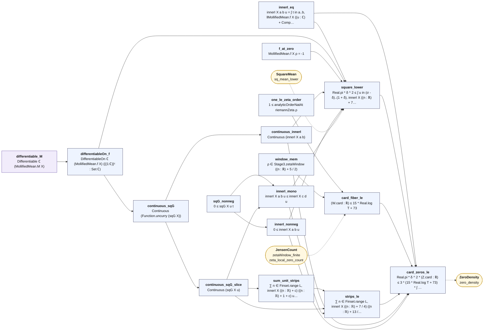

# `lean_stage3/Stage3/ZeroSquares.lean`

ZeroSquares — block C5 of `lean_stage3/design/carlson.md`. 2026-11-23. The number of zeros of ζ to the right of a line is bounded by the mean square of the mollified function `f X s = ζ(s)·M X s − 1` over a strip. At a zero `ρ` the function `f X` takes the value `−1`, so the mean-square lower bound of `SquareMean.sq_mean_lower` on the square of half-side `δ` about `ρ` gives `π δ² ≤` the integral of `‖f X‖²` over that square. The square sits in the strip `[σ − δ, 1 + δ] × [j − 1/4, j + 5/4]` with `j = ⌊Im ρ⌋₊`. The …

17 theorems, 2 definitions, 402 lines. Arrows are Lean's own record of what each proof uses.

**Imports:** [`JensenCount`](../lean_stage3/JensenCount.md), [`MollifiedMean`](../lean_stage3/MollifiedMean.md), [`SquareMean`](../lean_stage3/SquareMean.md)  
**Imported by:** [`Stage3`](../lean_stage3/Stage3.md), [`ZeroDensity`](../lean_stage3/ZeroDensity.md)

## The picture



An arrow A → B reads "A is used in the proof of B". Green: counting, integers only. Violet: shape, analysis with no ζ. Blue: reads ζ. A name ending in ■ is an end: nothing else uses it. Red: contains `sorry`. Yellow: theorems in another file, counted; a dotted arrow crosses files. Definitions are not drawn; they are listed below the diagram.

## Definitions

<a name="ZeroSquares-sqG"></a>
### `ZeroSquares.sqG`

def · line 111

The integrand `‖f X (u + i·max t 1)‖²`; it agrees with `‖f X (u + i t)‖²` for `t ≥ 1` and is continuous on the whole plane.

- **Is:** `` sqG (X : ℕ) (u t : ℝ) : ℝ := ‖MollifiedMean.f X ((u : ℂ) + Complex.I * ((max t 1 : ℝ) : ℂ))‖ ^ 2 ``
- **Built from:** [`MollifiedMean.f`](../lean_stage3/MollifiedMean.md#MollifiedMean-f)
- **Used by 10:** [`ZeroSquares.continuous_innerI`](#ZeroSquares-continuous_innerI), [`ZeroSquares.continuous_sqG`](#ZeroSquares-continuous_sqG), [`ZeroSquares.continuous_sqG_slice`](#ZeroSquares-continuous_sqG_slice), [`ZeroSquares.innerI`](#ZeroSquares-innerI), [`ZeroSquares.innerI_eq`](#ZeroSquares-innerI_eq), [`ZeroSquares.innerI_mono`](#ZeroSquares-innerI_mono), [`ZeroSquares.innerI_nonneg`](#ZeroSquares-innerI_nonneg), [`ZeroSquares.sqG_nonneg`](#ZeroSquares-sqG_nonneg), [`ZeroSquares.strips_le`](#ZeroSquares-strips_le), [`ZeroSquares.sum_unit_strips`](#ZeroSquares-sum_unit_strips)

<a name="ZeroSquares-innerI"></a>
### `ZeroSquares.innerI`

def · line 135

The inner integral `∫_a^b sqG X u t dt`, as a function of `u`.

- **Is:** `` innerI (X : ℕ) (a b u : ℝ) : ℝ := ∫ t in a..b, sqG X u t ``
- **Built from:** [`ZeroSquares.sqG`](#ZeroSquares-sqG)
- **Used by 8:** [`ZeroSquares.card_zeros_le`](#ZeroSquares-card_zeros_le), [`ZeroSquares.continuous_innerI`](#ZeroSquares-continuous_innerI), [`ZeroSquares.innerI_eq`](#ZeroSquares-innerI_eq), [`ZeroSquares.innerI_mono`](#ZeroSquares-innerI_mono), [`ZeroSquares.innerI_nonneg`](#ZeroSquares-innerI_nonneg), [`ZeroSquares.square_lower`](#ZeroSquares-square_lower), [`ZeroSquares.strips_le`](#ZeroSquares-strips_le), [`ZeroSquares.sum_unit_strips`](#ZeroSquares-sum_unit_strips)

## Theorems

<a name="ZeroSquares-one_le_zeta_order"></a>
### `ZeroSquares.one_le_zeta_order`

line 48

**Reads ζ.** It, or something it rests on, uses the zeta function, its zeros or the Riemann hypothesis.

**Why.** At a zero `ρ ≠ 1` of ζ, the analytic order of ζ at `ρ` is at least one.

**Proves**

```lean
1 ≤ analyticOrderNatAt riemannZeta ρ
```

**Needs** (its hypotheses)

  - `` hρ1 : ρ ≠ 1 ``
  - `` hz : riemannZeta ρ = 0 ``

**Fed by:** no theorem of this repo; it stands on Mathlib.

**Feeds** (1 that use it)

  - [`ZeroSquares.card_fiber_le`](#ZeroSquares-card_fiber_le) — `` (W.card : ℝ) ≤ 15 * Real.log T + 73 ``

<a name="ZeroSquares-differentiable_M"></a>
### `ZeroSquares.differentiable_M`

line 86

**Shape.** Uses real or complex analysis; nothing in it or beneath it reads ζ.

**Why.** The Möbius sum `M X` is complex differentiable on the whole plane.

**Proves**

```lean
Differentiable ℂ (MollifiedMean.M X)
```

**Needs** (its hypotheses)

  - `` X : ℕ ``

**Stated with:** [`MollifiedMean.M`](../lean_stage3/MollifiedMean.md#MollifiedMean-M)

**Fed by:** no theorem of this repo; it stands on Mathlib and the definitions below.

**Feeds** (1 that use it)

  - [`ZeroSquares.differentiableOn_f`](#ZeroSquares-differentiableOn_f) — `` DifferentiableOn ℂ (MollifiedMean.f X) ({(1:ℂ)}ᶜ : Set ℂ) ``

<a name="ZeroSquares-differentiableOn_f"></a>
### `ZeroSquares.differentiableOn_f`

line 98

**Reads ζ.** It, or something it rests on, uses the zeta function, its zeros or the Riemann hypothesis.

**Why.** The mollified function `f X` is complex differentiable on the plane with the point `1` removed.

**Proves**

```lean
DifferentiableOn ℂ (MollifiedMean.f X) ({(1:ℂ)}ᶜ : Set ℂ)
```

**Needs** (its hypotheses)

  - `` X : ℕ ``

**Stated with:** [`MollifiedMean.f`](../lean_stage3/MollifiedMean.md#MollifiedMean-f)

**Fed by** (1 theorem its proof uses)

  - [`ZeroSquares.differentiable_M`](#ZeroSquares-differentiable_M) — `` Differentiable ℂ (MollifiedMean.M X) ``

**Definitions its proof touches:** [`MollifiedMean.M`](../lean_stage3/MollifiedMean.md#MollifiedMean-M)

**Feeds** (2 that use it)

  - [`ZeroSquares.continuous_sqG`](#ZeroSquares-continuous_sqG) — `` Continuous (Function.uncurry (sqG X)) ``
  - [`ZeroSquares.square_lower`](#ZeroSquares-square_lower) — `` Real.pi * δ ^ 2 ≤ ∫ u in (σ - δ)..(1 + δ), innerI X ((n : ℝ) + 7 / 4) ((n : ℝ) + 13 / 4) u ``

<a name="ZeroSquares-f_at_zero"></a>
### `ZeroSquares.f_at_zero`

line 106

**Reads ζ.** It, or something it rests on, uses the zeta function, its zeros or the Riemann hypothesis.

**Why.** At a zero of ζ the mollified function takes the value `−1`.

**Proves**

```lean
MollifiedMean.f X ρ = -1
```

**Needs** (its hypotheses)

  - `` X : ℕ ``
  - `` hz : riemannZeta ρ = 0 ``

**Stated with:** [`MollifiedMean.f`](../lean_stage3/MollifiedMean.md#MollifiedMean-f)

**Fed by:** no theorem of this repo; it stands on Mathlib and the definitions below.

**Definitions its proof touches:** [`MollifiedMean.M`](../lean_stage3/MollifiedMean.md#MollifiedMean-M)

**Feeds** (1 that use it)

  - [`ZeroSquares.square_lower`](#ZeroSquares-square_lower) — `` Real.pi * δ ^ 2 ≤ ∫ u in (σ - δ)..(1 + δ), innerI X ((n : ℝ) + 7 / 4) ((n : ℝ) + 13 / 4) u ``

<a name="ZeroSquares-continuous_sqG"></a>
### `ZeroSquares.continuous_sqG`

line 115

**Reads ζ.** It, or something it rests on, uses the zeta function, its zeros or the Riemann hypothesis.

**Why.** The integrand `sqG X` is jointly continuous in `(u, t)`.

**Proves**

```lean
Continuous (Function.uncurry (sqG X))
```

**Needs** (its hypotheses)

  - `` X : ℕ ``

**Stated with:** [`ZeroSquares.sqG`](#ZeroSquares-sqG)

**Fed by** (1 theorem its proof uses)

  - [`ZeroSquares.differentiableOn_f`](#ZeroSquares-differentiableOn_f) — `` DifferentiableOn ℂ (MollifiedMean.f X) ({(1:ℂ)}ᶜ : Set ℂ) ``

**Definitions its proof touches:** [`MollifiedMean.f`](../lean_stage3/MollifiedMean.md#MollifiedMean-f)

**Feeds** (2 that use it)

  - [`ZeroSquares.continuous_innerI`](#ZeroSquares-continuous_innerI) — `` Continuous (innerI X a b) ``
  - [`ZeroSquares.continuous_sqG_slice`](#ZeroSquares-continuous_sqG_slice) — `` Continuous (sqG X u) ``

<a name="ZeroSquares-sqG_nonneg"></a>
### `ZeroSquares.sqG_nonneg`

line 131

**Reads ζ.** It, or something it rests on, uses the zeta function, its zeros or the Riemann hypothesis.

**Why.** For fixed `u`, the integrand `sqG X u` is nonnegative.

**Proves**

```lean
0 ≤ sqG X u t
```

**Needs** (its hypotheses)

  - `` X : ℕ ``
  - `` u t : ℝ ``

**Stated with:** [`ZeroSquares.sqG`](#ZeroSquares-sqG)

**Fed by:** no theorem of this repo; it stands on Mathlib and the definitions below.

**Definitions its proof touches:** [`MollifiedMean.f`](../lean_stage3/MollifiedMean.md#MollifiedMean-f)

**Feeds** (2 that use it)

  - [`ZeroSquares.innerI_mono`](#ZeroSquares-innerI_mono) — `` innerI X a b u ≤ innerI X c d u ``
  - [`ZeroSquares.innerI_nonneg`](#ZeroSquares-innerI_nonneg) — `` 0 ≤ innerI X a b u ``

<a name="ZeroSquares-continuous_sqG_slice"></a>
### `ZeroSquares.continuous_sqG_slice`

line 138

**Reads ζ.** It, or something it rests on, uses the zeta function, its zeros or the Riemann hypothesis.

**Why.** For fixed `u`, the integrand `t ↦ sqG X u t` is continuous.

**Proves**

```lean
Continuous (sqG X u)
```

**Needs** (its hypotheses)

  - `` X : ℕ ``
  - `` u : ℝ ``

**Stated with:** [`ZeroSquares.sqG`](#ZeroSquares-sqG)

**Fed by** (1 theorem its proof uses)

  - [`ZeroSquares.continuous_sqG`](#ZeroSquares-continuous_sqG) — `` Continuous (Function.uncurry (sqG X)) ``

**Feeds** (3 that use it)

  - [`ZeroSquares.innerI_mono`](#ZeroSquares-innerI_mono) — `` innerI X a b u ≤ innerI X c d u ``
  - [`ZeroSquares.strips_le`](#ZeroSquares-strips_le) — `` ∑ n ∈ Finset.range L, innerI X ((n : ℝ) + 7 / 4) ((n : ℝ) + 13 / 4) u ≤ 3 * innerI X 1 T u ``
  - [`ZeroSquares.sum_unit_strips`](#ZeroSquares-sum_unit_strips) — `` ∑ n ∈ Finset.range L, innerI X ((n : ℝ) + c) ((n : ℝ) + 1 + c) u = innerI X c ((L : ℝ) + c) u ``

<a name="ZeroSquares-continuous_innerI"></a>
### `ZeroSquares.continuous_innerI`

line 142

**Reads ζ.** It, or something it rests on, uses the zeta function, its zeros or the Riemann hypothesis.

**Why.** The inner integral `innerI X a b` is continuous in `u`.

**Proves**

```lean
Continuous (innerI X a b)
```

**Needs** (its hypotheses)

  - `` X : ℕ ``
  - `` a b : ℝ ``

**Stated with:** [`ZeroSquares.innerI`](#ZeroSquares-innerI)

**Fed by** (1 theorem its proof uses)

  - [`ZeroSquares.continuous_sqG`](#ZeroSquares-continuous_sqG) — `` Continuous (Function.uncurry (sqG X)) ``

**Definitions its proof touches:** [`ZeroSquares.sqG`](#ZeroSquares-sqG)

**Feeds** (2 that use it)

  - [`ZeroSquares.card_zeros_le`](#ZeroSquares-card_zeros_le) — `` Real.pi * δ ^ 2 * (Z.card : ℝ) ≤ 3 * (15 * Real.log T + 73) * ∫ u in (σ - δ)..(1 + δ), ∫ t in (1:ℝ)..T, ‖MollifiedMean.f X ((u : ℂ) + Complex.I * (t :… ``
  - [`ZeroSquares.square_lower`](#ZeroSquares-square_lower) — `` Real.pi * δ ^ 2 ≤ ∫ u in (σ - δ)..(1 + δ), innerI X ((n : ℝ) + 7 / 4) ((n : ℝ) + 13 / 4) u ``

<a name="ZeroSquares-innerI_nonneg"></a>
### `ZeroSquares.innerI_nonneg`

line 146

**Reads ζ.** It, or something it rests on, uses the zeta function, its zeros or the Riemann hypothesis.

**Why.** The inner integral over an interval `a ≤ b` is nonnegative.

**Proves**

```lean
0 ≤ innerI X a b u
```

**Needs** (its hypotheses)

  - `` X : ℕ ``
  - `` hab : a ≤ b ``
  - `` u : ℝ ``

**Stated with:** [`ZeroSquares.innerI`](#ZeroSquares-innerI)

**Fed by** (1 theorem its proof uses)

  - [`ZeroSquares.sqG_nonneg`](#ZeroSquares-sqG_nonneg) — `` 0 ≤ sqG X u t ``

**Definitions its proof touches:** [`ZeroSquares.sqG`](#ZeroSquares-sqG)

**Feeds** (2 that use it)

  - [`ZeroSquares.card_zeros_le`](#ZeroSquares-card_zeros_le) — `` Real.pi * δ ^ 2 * (Z.card : ℝ) ≤ 3 * (15 * Real.log T + 73) * ∫ u in (σ - δ)..(1 + δ), ∫ t in (1:ℝ)..T, ‖MollifiedMean.f X ((u : ℂ) + Complex.I * (t :… ``
  - [`ZeroSquares.square_lower`](#ZeroSquares-square_lower) — `` Real.pi * δ ^ 2 ≤ ∫ u in (σ - δ)..(1 + δ), innerI X ((n : ℝ) + 7 / 4) ((n : ℝ) + 13 / 4) u ``

<a name="ZeroSquares-innerI_mono"></a>
### `ZeroSquares.innerI_mono`

line 150

**Reads ζ.** It, or something it rests on, uses the zeta function, its zeros or the Riemann hypothesis.

**Why.** The inner integral over `[a, b]` is at most the one over a larger interval `[c, d]`.

**Proves**

```lean
innerI X a b u ≤ innerI X c d u
```

**Needs** (its hypotheses)

  - `` X : ℕ ``
  - `` hca : c ≤ a ``
  - `` hab : a ≤ b ``
  - `` hbd : b ≤ d ``
  - `` u : ℝ ``

**Stated with:** [`ZeroSquares.innerI`](#ZeroSquares-innerI)

**Fed by** (2 theorems its proof uses)

  - [`ZeroSquares.continuous_sqG_slice`](#ZeroSquares-continuous_sqG_slice) — `` Continuous (sqG X u) ``
  - [`ZeroSquares.sqG_nonneg`](#ZeroSquares-sqG_nonneg) — `` 0 ≤ sqG X u t ``

**Definitions its proof touches:** [`ZeroSquares.sqG`](#ZeroSquares-sqG)

**Feeds** (2 that use it)

  - [`ZeroSquares.square_lower`](#ZeroSquares-square_lower) — `` Real.pi * δ ^ 2 ≤ ∫ u in (σ - δ)..(1 + δ), innerI X ((n : ℝ) + 7 / 4) ((n : ℝ) + 13 / 4) u ``
  - [`ZeroSquares.strips_le`](#ZeroSquares-strips_le) — `` ∑ n ∈ Finset.range L, innerI X ((n : ℝ) + 7 / 4) ((n : ℝ) + 13 / 4) u ≤ 3 * innerI X 1 T u ``

<a name="ZeroSquares-innerI_eq"></a>
### `ZeroSquares.innerI_eq`

line 157

**Reads ζ.** It, or something it rests on, uses the zeta function, its zeros or the Riemann hypothesis.

**Why.** For `1 ≤ a ≤ b`, the inner integral is the integral of `‖f X (u + i t)‖²` over `[a, b]`.

**Proves**

```lean
innerI X a b u = ∫ t in a..b, ‖MollifiedMean.f X ((u : ℂ) + Complex.I * (t : ℂ))‖ ^ 2
```

**Needs** (its hypotheses)

  - `` X : ℕ ``
  - `` ha : 1 ≤ a ``
  - `` hab : a ≤ b ``
  - `` u : ℝ ``

**Stated with:** [`MollifiedMean.f`](../lean_stage3/MollifiedMean.md#MollifiedMean-f), [`ZeroSquares.innerI`](#ZeroSquares-innerI)

**Fed by:** no theorem of this repo; it stands on Mathlib and the definitions below.

**Definitions its proof touches:** [`ZeroSquares.sqG`](#ZeroSquares-sqG)

**Feeds** (2 that use it)

  - [`ZeroSquares.card_zeros_le`](#ZeroSquares-card_zeros_le) — `` Real.pi * δ ^ 2 * (Z.card : ℝ) ≤ 3 * (15 * Real.log T + 73) * ∫ u in (σ - δ)..(1 + δ), ∫ t in (1:ℝ)..T, ‖MollifiedMean.f X ((u : ℂ) + Complex.I * (t :… ``
  - [`ZeroSquares.square_lower`](#ZeroSquares-square_lower) — `` Real.pi * δ ^ 2 ≤ ∫ u in (σ - δ)..(1 + δ), innerI X ((n : ℝ) + 7 / 4) ((n : ℝ) + 13 / 4) u ``

<a name="ZeroSquares-square_lower"></a>
### `ZeroSquares.square_lower`

line 167

**Reads ζ.** It, or something it rests on, uses the zeta function, its zeros or the Riemann hypothesis.

**Why.** One zero `ρ` with `σ ≤ Re ρ < 1` and `n + 2 ≤ Im ρ < n + 3` gives `π δ² ≤ ∫_{σ−δ}^{1+δ} ∫_{n+7/4}^{n+13/4} sqG X u t dt du`.

**Proves**

```lean
Real.pi * δ ^ 2 ≤ ∫ u in (σ - δ)..(1 + δ), innerI X ((n : ℝ) + 7 / 4) ((n : ℝ) + 13 / 4) u
```

**Needs** (its hypotheses)

  - `` X : ℕ ``
  - `` hδ : 0 < δ ``
  - `` hδ4 : δ ≤ 1 / 4 ``
  - `` hz : riemannZeta ρ = 0 ``
  - `` hσρ : σ ≤ ρ.re ``
  - `` hρ1 : ρ.re < 1 ``
  - `` n : ℕ ``
  - `` hn1 : (n : ℝ) + 2 ≤ ρ.im ``
  - `` hn2 : ρ.im < (n : ℝ) + 3 ``

**Stated with:** [`ZeroSquares.innerI`](#ZeroSquares-innerI)

**Fed by** (7 theorems its proof uses)

  - [`SquareMean.sq_mean_lower`](../lean_stage3/SquareMean.md#SquareMean-sq_mean_lower) (SquareMean) — `` π * δ ^ 2 * ‖f c‖ ^ 2 ≤ ∫ u in (c.re - δ)..(c.re + δ), ∫ t in (c.im - δ)..(c.im + δ), ‖f ((u : ℂ) + Complex.I * (t : ℂ))‖ ^ 2 ``
  - [`ZeroSquares.continuous_innerI`](#ZeroSquares-continuous_innerI) — `` Continuous (innerI X a b) ``
  - [`ZeroSquares.differentiableOn_f`](#ZeroSquares-differentiableOn_f) — `` DifferentiableOn ℂ (MollifiedMean.f X) ({(1:ℂ)}ᶜ : Set ℂ) ``
  - [`ZeroSquares.f_at_zero`](#ZeroSquares-f_at_zero) — `` MollifiedMean.f X ρ = -1 ``
  - [`ZeroSquares.innerI_eq`](#ZeroSquares-innerI_eq) — `` innerI X a b u = ∫ t in a..b, ‖MollifiedMean.f X ((u : ℂ) + Complex.I * (t : ℂ))‖ ^ 2 ``
  - [`ZeroSquares.innerI_mono`](#ZeroSquares-innerI_mono) — `` innerI X a b u ≤ innerI X c d u ``
  - [`ZeroSquares.innerI_nonneg`](#ZeroSquares-innerI_nonneg) — `` 0 ≤ innerI X a b u ``

**Definitions its proof touches:** [`MollifiedMean.f`](../lean_stage3/MollifiedMean.md#MollifiedMean-f)

**Feeds** (1 that use it)

  - [`ZeroSquares.card_zeros_le`](#ZeroSquares-card_zeros_le) — `` Real.pi * δ ^ 2 * (Z.card : ℝ) ≤ 3 * (15 * Real.log T + 73) * ∫ u in (σ - δ)..(1 + δ), ∫ t in (1:ℝ)..T, ‖MollifiedMean.f X ((u : ℂ) + Complex.I * (t :… ``

<a name="ZeroSquares-window_mem"></a>
### `ZeroSquares.window_mem`

line 203

**Reads ζ.** It, or something it rests on, uses the zeta function, its zeros or the Riemann hypothesis.

**Why.** A zero `ρ` of ζ with `1/2 < Re ρ < 1` and `n + 2 ≤ Im ρ < n + 3` lies in the Jensen window `Stage3.zetaWindow (n + 5/2)`.

**Proves**

```lean
ρ ∈ Stage3.zetaWindow ((n : ℝ) + 5 / 2)
```

**Needs** (its hypotheses)

  - `` hz : riemannZeta ρ = 0 ``
  - `` h1 : 1 / 2 < ρ.re ``
  - `` h2 : ρ.re < 1 ``
  - `` n : ℕ ``
  - `` hn1 : (n : ℝ) + 2 ≤ ρ.im ``
  - `` hn2 : ρ.im < (n : ℝ) + 3 ``

**Stated with:** [`Stage3.zetaWindow`](../lean_stage3/JensenCount.md#Stage3-zetaWindow)

**Fed by:** no theorem of this repo; it stands on Mathlib and the definitions below.

**Feeds** (1 that use it)

  - [`ZeroSquares.card_fiber_le`](#ZeroSquares-card_fiber_le) — `` (W.card : ℝ) ≤ 15 * Real.log T + 73 ``

<a name="ZeroSquares-card_fiber_le"></a>
### `ZeroSquares.card_fiber_le`

line 220

**Reads ζ.** It, or something it rests on, uses the zeta function, its zeros or the Riemann hypothesis.

**Why.** If every point of `W` is a zero of ζ with `1/2 < Re ρ < 1` and `n + 2 ≤ Im ρ < n + 3`, and `n + 5/2 ≤ T`, then `W` has at most `15 log T + 73` elements.

**Proves**

```lean
(W.card : ℝ) ≤ 15 * Real.log T + 73
```

**Needs** (its hypotheses)

  - `` n : ℕ ``
  - `` hnT : (n : ℝ) + 5 / 2 ≤ T ``
  - `` W : Finset ℂ ``
  - `` hW : ∀ ρ ∈ W, riemannZeta ρ = 0 ∧ 1 / 2 < ρ.re ∧ ρ.re < 1 ∧ (n : ℝ) + 2 ≤ ρ.im ∧ ρ.im < (n : ℝ) + 3 ``

**Fed by** (4 theorems its proof uses)

  - [`Stage3.zetaWindow_finite`](../lean_stage3/JensenCount.md#Stage3-zetaWindow_finite) (JensenCount) — `` (zetaWindow T).Finite ``
  - [`Stage3.zeta_local_zero_count`](../lean_stage3/JensenCount.md#Stage3-zeta_local_zero_count) (JensenCount) — `` ∑ ρ ∈ (zetaWindow_finite hT).toFinset, (analyticOrderNatAt ζ ρ : ℝ) ≤ 15 * Real.log T + 73 ``
  - [`ZeroSquares.one_le_zeta_order`](#ZeroSquares-one_le_zeta_order) — `` 1 ≤ analyticOrderNatAt riemannZeta ρ ``
  - [`ZeroSquares.window_mem`](#ZeroSquares-window_mem) — `` ρ ∈ Stage3.zetaWindow ((n : ℝ) + 5 / 2) ``

**Definitions its proof touches:** [`Stage3.zetaWindow`](../lean_stage3/JensenCount.md#Stage3-zetaWindow)

**Feeds** (1 that use it)

  - [`ZeroSquares.card_zeros_le`](#ZeroSquares-card_zeros_le) — `` Real.pi * δ ^ 2 * (Z.card : ℝ) ≤ 3 * (15 * Real.log T + 73) * ∫ u in (σ - δ)..(1 + δ), ∫ t in (1:ℝ)..T, ‖MollifiedMean.f X ((u : ℂ) + Complex.I * (t :… ``

<a name="ZeroSquares-sum_unit_strips"></a>
### `ZeroSquares.sum_unit_strips`

line 249

**Reads ζ.** It, or something it rests on, uses the zeta function, its zeros or the Riemann hypothesis.

**Why.** The unit strips `[n + c, n + 1 + c]`, `n < L`, tile `[c, L + c]`: the sum of the inner integrals over them is the inner integral over `[c, L + c]`.

**Proves**

```lean
∑ n ∈ Finset.range L, innerI X ((n : ℝ) + c) ((n : ℝ) + 1 + c) u = innerI X c ((L : ℝ) + c) u
```

**Needs** (its hypotheses)

  - `` X : ℕ ``
  - `` c : ℝ ``
  - `` L : ℕ ``
  - `` u : ℝ ``

**Stated with:** [`ZeroSquares.innerI`](#ZeroSquares-innerI)

**Fed by** (1 theorem its proof uses)

  - [`ZeroSquares.continuous_sqG_slice`](#ZeroSquares-continuous_sqG_slice) — `` Continuous (sqG X u) ``

**Definitions its proof touches:** [`ZeroSquares.sqG`](#ZeroSquares-sqG)

**Feeds** (1 that use it)

  - [`ZeroSquares.strips_le`](#ZeroSquares-strips_le) — `` ∑ n ∈ Finset.range L, innerI X ((n : ℝ) + 7 / 4) ((n : ℝ) + 13 / 4) u ≤ 3 * innerI X 1 T u ``

<a name="ZeroSquares-strips_le"></a>
### `ZeroSquares.strips_le`

line 261

**Reads ζ.** It, or something it rests on, uses the zeta function, its zeros or the Riemann hypothesis.

**Why.** If `L + 3 ≤ T`, the strips `[n + 7/4, n + 13/4]`, `n < L`, cover each height in `[1, T]` at most three times: the sum of their inner integrals is at most `3·∫_1^T sqG X u t dt`.

**Proves**

```lean
∑ n ∈ Finset.range L, innerI X ((n : ℝ) + 7 / 4) ((n : ℝ) + 13 / 4) u ≤ 3 * innerI X 1 T u
```

**Needs** (its hypotheses)

  - `` X : ℕ ``
  - `` L : ℕ ``
  - `` hLT : (L : ℝ) + 3 ≤ T ``
  - `` u : ℝ ``

**Stated with:** [`ZeroSquares.innerI`](#ZeroSquares-innerI)

**Fed by** (3 theorems its proof uses)

  - [`ZeroSquares.continuous_sqG_slice`](#ZeroSquares-continuous_sqG_slice) — `` Continuous (sqG X u) ``
  - [`ZeroSquares.innerI_mono`](#ZeroSquares-innerI_mono) — `` innerI X a b u ≤ innerI X c d u ``
  - [`ZeroSquares.sum_unit_strips`](#ZeroSquares-sum_unit_strips) — `` ∑ n ∈ Finset.range L, innerI X ((n : ℝ) + c) ((n : ℝ) + 1 + c) u = innerI X c ((L : ℝ) + c) u ``

**Definitions its proof touches:** [`ZeroSquares.sqG`](#ZeroSquares-sqG)

**Feeds** (1 that use it)

  - [`ZeroSquares.card_zeros_le`](#ZeroSquares-card_zeros_le) — `` Real.pi * δ ^ 2 * (Z.card : ℝ) ≤ 3 * (15 * Real.log T + 73) * ∫ u in (σ - δ)..(1 + δ), ∫ t in (1:ℝ)..T, ‖MollifiedMean.f X ((u : ℂ) + Complex.I * (t :… ``

<a name="ZeroSquares-card_zeros_le"></a>
### `ZeroSquares.card_zeros_le`

line 306

**Reads ζ.** It, or something it rests on, uses the zeta function, its zeros or the Riemann hypothesis.

**Why.** For a finite set `Z` of zeros of ζ with `σ ≤ Re ρ < 1` and `2 ≤ Im ρ ≤ T − 2`, where `1/2 < σ − δ`, `0 < δ ≤ 1/4`, `σ ≤ 1` and `T ≥ 5`, the count of `Z` times `π δ²` is at most `3 (15 log T + 73)` times the integral of `‖f X‖²` over the strip `[σ − δ, 1 + δ] × [1, T]`.

**Proves**

```lean
Real.pi * δ ^ 2 * (Z.card : ℝ) ≤ 3 * (15 * Real.log T + 73) * ∫ u in (σ - δ)..(1 + δ), ∫ t in (1:ℝ)..T, ‖MollifiedMean.f X ((u : ℂ) + Complex.I * (t : ℂ))‖ ^ 2
```

**Needs** (its hypotheses)

  - `` hσ : 1 / 2 < σ - δ ``
  - `` hσ1 : σ ≤ 1 ``
  - `` hδ : 0 < δ ``
  - `` hδ4 : δ ≤ 1 / 4 ``
  - `` hT : 5 ≤ T ``
  - `` X : ℕ ``
  - `` Z : Finset ℂ ``
  - `` hZ : ∀ ρ ∈ Z, riemannZeta ρ = 0 ∧ σ ≤ ρ.re ∧ ρ.re < 1 ∧ 2 ≤ ρ.im ∧ ρ.im ≤ T - 2 ``

**Stated with:** [`MollifiedMean.f`](../lean_stage3/MollifiedMean.md#MollifiedMean-f)

**Fed by** (6 theorems its proof uses)

  - [`ZeroSquares.card_fiber_le`](#ZeroSquares-card_fiber_le) — `` (W.card : ℝ) ≤ 15 * Real.log T + 73 ``
  - [`ZeroSquares.continuous_innerI`](#ZeroSquares-continuous_innerI) — `` Continuous (innerI X a b) ``
  - [`ZeroSquares.innerI_eq`](#ZeroSquares-innerI_eq) — `` innerI X a b u = ∫ t in a..b, ‖MollifiedMean.f X ((u : ℂ) + Complex.I * (t : ℂ))‖ ^ 2 ``
  - [`ZeroSquares.innerI_nonneg`](#ZeroSquares-innerI_nonneg) — `` 0 ≤ innerI X a b u ``
  - [`ZeroSquares.square_lower`](#ZeroSquares-square_lower) — `` Real.pi * δ ^ 2 ≤ ∫ u in (σ - δ)..(1 + δ), innerI X ((n : ℝ) + 7 / 4) ((n : ℝ) + 13 / 4) u ``
  - [`ZeroSquares.strips_le`](#ZeroSquares-strips_le) — `` ∑ n ∈ Finset.range L, innerI X ((n : ℝ) + 7 / 4) ((n : ℝ) + 13 / 4) u ≤ 3 * innerI X 1 T u ``

**Definitions its proof touches:** [`ZeroSquares.innerI`](#ZeroSquares-innerI)

**Feeds** (1 that use it)

  - [`ZeroDensity.zero_density`](../lean_stage3/ZeroDensity.md#ZeroDensity-zero_density) (ZeroDensity) — `` ∃ θ C T₀ : ℝ, θ < 1 ∧ 0 ≤ C ∧ ∀ T : ℝ, T₀ ≤ T → ∀ Z : Finset ℂ, (∀ ρ ∈ Z, riemannZeta ρ = 0 ∧ σ ≤ ρ.re ∧ ρ.re < 1 ∧ 2 ≤ ρ.im ∧ ρ.im ≤ T - 2) → (Z.card… ``

