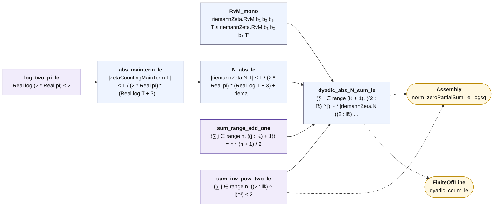

# `lean_stage3/Stage3/ZeroSum.lean`

ZeroSum — step 4: the dyadic zero-count arithmetic under hNT. The hNT leaf is IEANTN's `riemannZeta.Riemann_vonMangoldt_bound b₁ b₂ b₃` (Rosser Th. 19 shape; the literature instantiates (0.137, 0.443, 6.1)). O69 measured what it asserts: the angle count IS the logarithm curve, the fluctuation under 2 windings in 10⁵. This module proves the counting arithmetic that the explicit-formula assembly (step 5) consumes:

7 theorems, 0 definitions, 282 lines. Arrows are Lean's own record of what each proof uses.

**Imports:** nothing in this tree  
**Imported by:** [`Stage3`](../lean_stage3/Stage3.md), [`Assembly`](../lean_stage3/Assembly.md), [`RvMCrude`](../lean_stage3/RvMCrude.md)

## The picture



An arrow A → B reads "A is used in the proof of B". Green: counting, integers only. Violet: shape, analysis with no ζ. Blue: reads ζ. A name ending in ■ is an end: nothing else uses it. Red: contains `sorry`. Yellow: theorems in another file, counted; a dotted arrow crosses files. Definitions are not drawn; they are listed below the diagram.

## Theorems

<a name="Stage3-log_two_pi_le"></a>
### `Stage3.log_two_pi_le`

line 39

**Shape.** Uses real or complex analysis; nothing in it or beneath it reads ζ.

**Why.** `log(2π) ≤ 2`, i.e. `2π ≤ e²`. Carries the main-term constant.

**Proves**

```lean
Real.log (2 * Real.pi) ≤ 2
```

**Fed by:** no theorem of this repo; it stands on Mathlib.

**Feeds** (1 that use it)

  - [`Stage3.abs_mainterm_le`](#Stage3-abs_mainterm_le) — `` |zetaCountingMainTerm T| ≤ T / (2 * Real.pi) * (Real.log T + 3) + 7 / 8 ``

<a name="Stage3-RvM_mono"></a>
### `Stage3.RvM_mono`

line 49

**Reads ζ.** It, or something it rests on, uses the zeta function, its zeros or the Riemann hypothesis.

**Why.** The RvM band is monotone in `T` on `[2, ∞)` for nonnegative `b₁, b₂`.

**Proves**

```lean
riemannZeta.RvM b₁ b₂ b₃ T ≤ riemannZeta.RvM b₁ b₂ b₃ T'
```

**Needs** (its hypotheses)

  - `` hb₁ : 0 ≤ b₁ ``
  - `` hb₂ : 0 ≤ b₂ ``
  - `` h2 : 2 ≤ T ``
  - `` hTT' : T ≤ T' ``

**Fed by:** no theorem of this repo; it stands on Mathlib.

**Feeds** (1 that use it)

  - [`Stage3.dyadic_abs_N_sum_le`](#Stage3-dyadic_abs_N_sum_le) — `` (∑ j ∈ range (K + 1), ((2 : ℝ) ^ j)⁻¹ * |riemannZeta.N ((2 : ℝ) ^ (j + 1))|) ≤ Real.log 2 / (2 * Real.pi) * (K + 1) * (K + 2) + 3 * (K + 1) / Real.pi … ``

<a name="Stage3-abs_mainterm_le"></a>
### `Stage3.abs_mainterm_le`

line 66

**Reads ζ.** It, or something it rests on, uses the zeta function, its zeros or the Riemann hypothesis.

**Why.** The main term is at most `(T/2π)(log T + 3) + 7/8` in absolute value: `|log(T/2π)| ≤ log T + log 2π ≤ log T + 2`.

**Proves**

```lean
|zetaCountingMainTerm T| ≤ T / (2 * Real.pi) * (Real.log T + 3) + 7 / 8
```

**Needs** (its hypotheses)

  - `` h2 : 2 ≤ T ``

**Fed by** (1 theorem its proof uses)

  - [`Stage3.log_two_pi_le`](#Stage3-log_two_pi_le) — `` Real.log (2 * Real.pi) ≤ 2 ``

**Feeds** (1 that use it)

  - [`Stage3.N_abs_le`](#Stage3-N_abs_le) — `` |riemannZeta.N T| ≤ T / (2 * Real.pi) * (Real.log T + 3) + riemannZeta.RvM b₁ b₂ b₃ T + 7 / 8 ``

<a name="Stage3-N_abs_le"></a>
### `Stage3.N_abs_le`

line 107

**Reads ζ.** It, or something it rests on, uses the zeta function, its zeros or the Riemann hypothesis.

**Why.** The T·log T majorant under hNT, explicit: `|N(T)| ≤ (T/2π)(log T + 3) + RvM(T) + 7/8`. This is the count shape the census needs — the unconditional route only gives `T^(3/2)`.

**Proves**

```lean
|riemannZeta.N T| ≤ T / (2 * Real.pi) * (Real.log T + 3) + riemannZeta.RvM b₁ b₂ b₃ T + 7 / 8
```

**Needs** (its hypotheses)

  - `` hNT : riemannZeta.Riemann_vonMangoldt_bound b₁ b₂ b₃ ``
  - `` h2 : 2 ≤ T ``

**Fed by** (1 theorem its proof uses)

  - [`Stage3.abs_mainterm_le`](#Stage3-abs_mainterm_le) — `` |zetaCountingMainTerm T| ≤ T / (2 * Real.pi) * (Real.log T + 3) + 7 / 8 ``

**Feeds** (1 that use it)

  - [`Stage3.dyadic_abs_N_sum_le`](#Stage3-dyadic_abs_N_sum_le) — `` (∑ j ∈ range (K + 1), ((2 : ℝ) ^ j)⁻¹ * |riemannZeta.N ((2 : ℝ) ^ (j + 1))|) ≤ Real.log 2 / (2 * Real.pi) * (K + 1) * (K + 2) + 3 * (K + 1) / Real.pi … ``

<a name="Stage3-sum_range_add_one"></a>
### `Stage3.sum_range_add_one`

line 130

**Shape.** Uses real or complex analysis; nothing in it or beneath it reads ζ.

**Why.** Gauss sum over ℝ: `Σ_{j<n} (j+1) = n(n+1)/2`.

**Proves**

```lean
(∑ j ∈ range n, ((j : ℝ) + 1)) = n * (n + 1) / 2
```

**Needs** (its hypotheses)

  - `` n : ℕ ``

**Fed by:** no theorem of this repo; it stands on Mathlib.

**Feeds** (1 that use it)

  - [`Stage3.dyadic_abs_N_sum_le`](#Stage3-dyadic_abs_N_sum_le) — `` (∑ j ∈ range (K + 1), ((2 : ℝ) ^ j)⁻¹ * |riemannZeta.N ((2 : ℝ) ^ (j + 1))|) ≤ Real.log 2 / (2 * Real.pi) * (K + 1) * (K + 2) + 3 * (K + 1) / Real.pi … ``

<a name="Stage3-sum_inv_pow_two_le"></a>
### `Stage3.sum_inv_pow_two_le`

line 140

**Shape.** Uses real or complex analysis; nothing in it or beneath it reads ζ.

**Why.** Geometric tail: `Σ_{j<n} (2^j)⁻¹ ≤ 2`.

**Proves**

```lean
(∑ j ∈ range n, ((2 : ℝ) ^ j)⁻¹) ≤ 2
```

**Needs** (its hypotheses)

  - `` n : ℕ ``

**Fed by:** no theorem of this repo; it stands on Mathlib.

**Feeds** (2 that use it)

  - [`Stage3.norm_zeroPartialSum_le_logsq`](../lean_stage3/Assembly.md#Stage3-norm_zeroPartialSum_le_logsq) (Assembly) — `` ‖zeroPartialSum x ((2 : ℝ) ^ (K + 1))‖ ≤ 2 * Real.sqrt x * (2 * (Real.log 2 / (2 * Real.pi) * (K + 1) * (K + 2) + 3 * (K + 1) / Real.pi + 2 * (riemann… ``
  - [`Stage3.dyadic_abs_N_sum_le`](#Stage3-dyadic_abs_N_sum_le) — `` (∑ j ∈ range (K + 1), ((2 : ℝ) ^ j)⁻¹ * |riemannZeta.N ((2 : ℝ) ^ (j + 1))|) ≤ Real.log 2 / (2 * Real.pi) * (K + 1) * (K + 2) + 3 * (K + 1) / Real.pi … ``

<a name="Stage3-dyadic_abs_N_sum_le"></a>
### `Stage3.dyadic_abs_N_sum_le`

line 160

**Reads ζ.** It, or something it rests on, uses the zeta function, its zeros or the Riemann hypothesis.

**Why.** The dyadic zero-count sum under hNT — the (log T)² arithmetic: `Σ_{j≤K} (2^j)⁻¹·|N(2^(j+1))| ≤ (log 2/2π)(K+1)(K+2) + 3(K+1)/π + 2(RvM(2^(K+1)) + 7/8)`. Leading constant `log 2/2π`: the classical `Σ 1/γ ~ (log T)²/4π` up to the dyadic overcount.

**Proves**

```lean
(∑ j ∈ range (K + 1), ((2 : ℝ) ^ j)⁻¹ * |riemannZeta.N ((2 : ℝ) ^ (j + 1))|) ≤ Real.log 2 / (2 * Real.pi) * (K + 1) * (K + 2) + 3 * (K + 1) / Real.pi + 2 * (riemannZeta.RvM b₁ b₂ b₃ ((2 : ℝ) ^ (K + 1)) + 7 / 8)
```

**Needs** (its hypotheses)

  - `` hb₁ : 0 ≤ b₁ ``
  - `` hb₂ : 0 ≤ b₂ ``
  - `` hRvM2 : 0 ≤ riemannZeta.RvM b₁ b₂ b₃ 2 ``
  - `` hNT : riemannZeta.Riemann_vonMangoldt_bound b₁ b₂ b₃ ``
  - `` K : ℕ ``

**Fed by** (4 theorems its proof uses)

  - [`Stage3.N_abs_le`](#Stage3-N_abs_le) — `` |riemannZeta.N T| ≤ T / (2 * Real.pi) * (Real.log T + 3) + riemannZeta.RvM b₁ b₂ b₃ T + 7 / 8 ``
  - [`Stage3.RvM_mono`](#Stage3-RvM_mono) — `` riemannZeta.RvM b₁ b₂ b₃ T ≤ riemannZeta.RvM b₁ b₂ b₃ T' ``
  - [`Stage3.sum_inv_pow_two_le`](#Stage3-sum_inv_pow_two_le) — `` (∑ j ∈ range n, ((2 : ℝ) ^ j)⁻¹) ≤ 2 ``
  - [`Stage3.sum_range_add_one`](#Stage3-sum_range_add_one) — `` (∑ j ∈ range n, ((j : ℝ) + 1)) = n * (n + 1) / 2 ``

**Feeds** (2 that use it)

  - [`Stage3.norm_zeroPartialSum_le_logsq`](../lean_stage3/Assembly.md#Stage3-norm_zeroPartialSum_le_logsq) (Assembly) — `` ‖zeroPartialSum x ((2 : ℝ) ^ (K + 1))‖ ≤ 2 * Real.sqrt x * (2 * (Real.log 2 / (2 * Real.pi) * (K + 1) * (K + 2) + 3 * (K + 1) / Real.pi + 2 * (riemann… ``
  - [`FiniteOffLine.dyadic_count_le`](../lean_stage3/FiniteOffLine.md#FiniteOffLine-dyadic_count_le) (FiniteOffLine) — `` ∑ j ∈ range (K + 1), ((2 : ℝ) ^ j)⁻¹ * (2 * |riemannZeta.N ((2 : ℝ) ^ (j + 1))| + weightedZeroHeightBucket) ≤ 3000 * ((K : ℝ) + 2) ^ 2 ``

