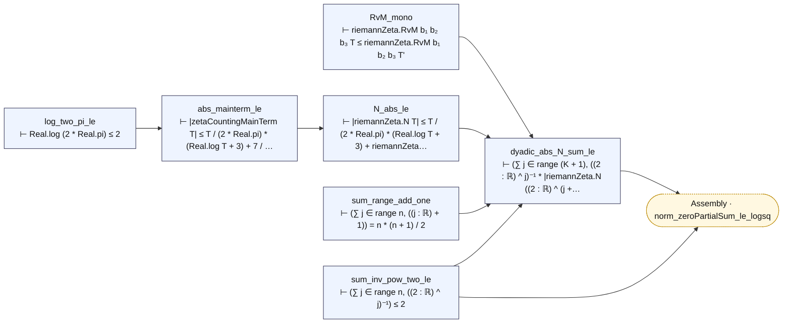

# `lean_stage3/Stage3/ZeroSum.lean`

**What it does** (its own header): ZeroSum — step 4: the dyadic zero-count arithmetic under hNT. The hNT leaf is IEANTN's `riemannZeta.Riemann_vonMangoldt_bound b₁ b₂ b₃` (Rosser Th. 19 shape; the literature instantiates (0.137, 0.443, 6.1)). O69 measured what it asserts: the angle count IS the logarithm curve, the fluctuation under 2 windings in 10⁵. This module proves the counting arithmetic that the explicit-formula assembly (step 5) consumes:

**Imports:** nothing in this tree.
**Imported by:** [`Stage3`](../lean_stage3/Stage3.md), [`Assembly`](../lean_stage3/Assembly.md), [`RvMCrude`](../lean_stage3/RvMCrude.md).

Blue: theorem. Green: a theorem nothing else uses (an end). Dashed white: connects to nothing. Grey: definition. Red: contains `sorry`. Yellow: in another file. An arrow A → B reads "A is used by B".

## Every declaration

| declaration | proves (output) | needs (input) | why (its own docstring) | uses | used by |
|---|---|---|---|---|---|
| `Stage3.log_two_pi_le` theorem, line 39 | Real.log (2 * Real.pi) ≤ 2 | — | `log(2π) ≤ 2`, i.e. `2π ≤ e²`. Carries the main-term constant. | — | `Stage3.abs_mainterm_le` |
| `Stage3.RvM_mono` theorem, line 49 | riemannZeta.RvM b₁ b₂ b₃ T ≤ riemannZeta.RvM b₁ b₂ b₃ T' | hb₁ : 0 ≤ b₁; hb₂ : 0 ≤ b₂; h2 : 2 ≤ T; hTT' : T ≤ T' | The RvM band is monotone in `T` on `[2, ∞)` for nonnegative `b₁, b₂`. | — | `Stage3.dyadic_abs_N_sum_le` |
| `Stage3.abs_mainterm_le` theorem, line 66 | \|zetaCountingMainTerm T\| ≤ T / (2 * Real.pi) * (Real.log T + 3) + 7 / 8 | h2 : 2 ≤ T | The main term is at most `(T/2π)(log T + 3) + 7/8` in absolute value: `\|log(T/2π)\| ≤ log T + log 2π ≤ log T + 2`. | `Stage3.log_two_pi_le` | `Stage3.N_abs_le` |
| `Stage3.N_abs_le` theorem, line 107 | \|riemannZeta.N T\| ≤ T / (2 * Real.pi) * (Real.log T + 3) + riemannZeta.RvM b₁ b₂ b₃ T + 7 / 8 | hNT : riemannZeta.Riemann_vonMangoldt_bound b₁ b₂ b₃; h2 : 2 ≤ T | The T·log T majorant under hNT, explicit: `\|N(T)\| ≤ (T/2π)(log T + 3) + RvM(T) + 7/8`. This is the count shape the census needs — the unconditional route only gives `T^(3/2)`. | `Stage3.abs_mainterm_le` | `Stage3.dyadic_abs_N_sum_le` |
| `Stage3.sum_range_add_one` theorem, line 130 | (∑ j ∈ range n, ((j : ℝ) + 1)) = n * (n + 1) / 2 | n : ℕ | Gauss sum over ℝ: `Σ_{j&lt;n} (j+1) = n(n+1)/2`. | — | `Stage3.dyadic_abs_N_sum_le` |
| `Stage3.sum_inv_pow_two_le` theorem, line 140 | (∑ j ∈ range n, ((2 : ℝ) ^ j)⁻¹) ≤ 2 | n : ℕ | Geometric tail: `Σ_{j&lt;n} (2^j)⁻¹ ≤ 2`. | — | `Stage3.norm_zeroPartialSum_le_logsq`, `Stage3.dyadic_abs_N_sum_le` |
| `Stage3.dyadic_abs_N_sum_le` theorem, line 160 | (∑ j ∈ range (K + 1), ((2 : ℝ) ^ j)⁻¹ * \|riemannZeta.N ((2 : ℝ) ^ (j + 1))\|) ≤ Real.log 2 / (2 * Real.pi) * (K + 1) * (K + 2) + 3 * (K + 1) / Real.pi + 2 * (riemannZeta.RvM b₁ b₂ b₃ ((2 : ℝ) ^ (K + 1)) + 7 / 8) | hb₁ : 0 ≤ b₁; hb₂ : 0 ≤ b₂; hRvM2 : 0 ≤ riemannZeta.RvM b₁ b₂ b₃ 2; hNT : riemannZeta.Riemann_vonMangoldt_bound b₁ b₂ b₃; K : ℕ | The dyadic zero-count sum under hNT — the (log T)² arithmetic: `Σ_{j≤K} (2^j)⁻¹·\|N(2^(j+1))\| ≤ (log 2/2π)(K+1)(K+2) + 3(K+1)/π + 2(RvM(2^(K+1)) + 7/8)`. Leading constant `log 2/2π`: the classical `Σ 1/γ ~ (log T)²/4π` up to the dyadic overcount. | `Stage3.N_abs_le`, `Stage3.RvM_mono`, `Stage3.sum_inv_pow_two_le`, `Stage3.sum_range_add_one` | `Stage3.norm_zeroPartialSum_le_logsq` |
