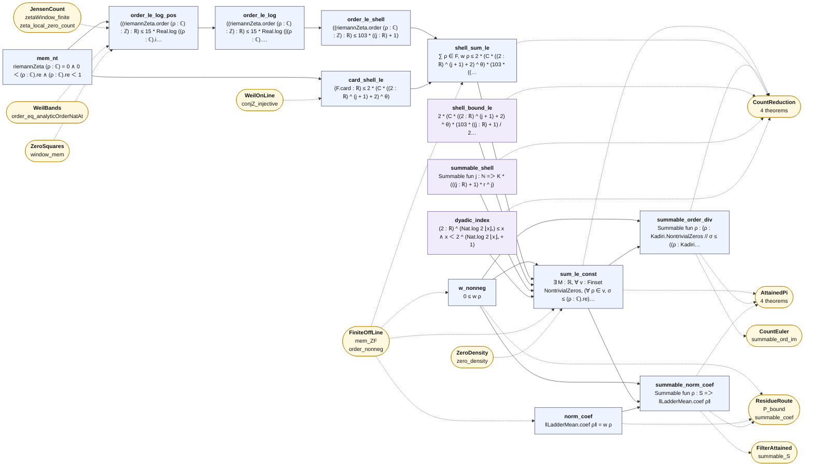

# `lean_stage3/Stage3/ZeroSummable.lean`

ZeroSummable — block C6b of `lean_stage3/design/carlson.md`. 2026-11-23. The zeros of ζ to the right of a line `Re s = σ > 1/2` have summable weights `m(ρ)/|ρ|`. A zero in the shell `2^j ≤ |Im ρ| < 2^(j+1)` has order at most `103·(j + 1)` (the local count of `Stage3.zeta_local_zero_count`, with conjugation for the lower half plane) and modulus at least `2^j`. `ZeroDensity.zero_density` at height `2^(j+1) + 2`, applied to the upper half and to the conjugates of the lower half, bounds the number of zeros in the shell…

14 theorems, 1 definition, 402 lines. Arrows are Lean's own record of what each proof uses.

**Imports:** [`FiniteOffLine`](../lean_stage3/FiniteOffLine.md), [`WeilBands`](../lean_stage3/WeilBands.md), [`WeilOnLine`](../lean_stage3/WeilOnLine.md), [`ZeroDensity`](../lean_stage3/ZeroDensity.md)  
**Imported by:** [`Stage3`](../lean_stage3/Stage3.md), [`AttainedPi`](../lean_stage3/AttainedPi.md), [`CountReduction`](../lean_stage3/CountReduction.md), [`FilterAttained`](../lean_stage3/FilterAttained.md)

## The picture



An arrow A → B reads "A is used in the proof of B". Green: counting, integers only. Violet: shape, analysis with no ζ. Blue: reads ζ. A name ending in ■ is an end: nothing else uses it. Red: contains `sorry`. Yellow: theorems in another file, counted; a dotted arrow crosses files. Definitions are not drawn; they are listed below the diagram.

## Definitions

<a name="ZeroSummable-w"></a>
### `ZeroSummable.w`

def · line 48

The weight of a nontrivial zero: its order over its modulus.

- **Is:** `` w (ρ : NontrivialZeros) : ℝ := ((riemannZeta.order (ρ : ℂ) : ℤ) : ℝ) / ‖(ρ : ℂ)‖ ``
- **Used by 11:** [`AttainedPi.fin_bound`](../lean_stage3/AttainedPi.md#AttainedPi-fin_bound), [`AttainedPi.fin_eventually`](../lean_stage3/AttainedPi.md#AttainedPi-fin_eventually), [`CountReduction.count_modes_small`](../lean_stage3/CountReduction.md#CountReduction-count_modes_small), [`CountReduction.tail_rate`](../lean_stage3/CountReduction.md#CountReduction-tail_rate), [`ResidueRoute.P_bound`](../lean_stage3/ResidueRoute.md#ResidueRoute-P_bound), [`ZeroSummable.norm_coef`](#ZeroSummable-norm_coef), [`ZeroSummable.shell_sum_le`](#ZeroSummable-shell_sum_le), [`ZeroSummable.sum_le_const`](#ZeroSummable-sum_le_const), [`ZeroSummable.summable_norm_coef`](#ZeroSummable-summable_norm_coef), [`ZeroSummable.summable_order_div`](#ZeroSummable-summable_order_div), [`ZeroSummable.w_nonneg`](#ZeroSummable-w_nonneg)

## Theorems

<a name="ZeroSummable-w_nonneg"></a>
### `ZeroSummable.w_nonneg`

line 52

**Reads ζ.** It, or something it rests on, uses the zeta function, its zeros or the Riemann hypothesis.

**Why.** The weight `w ρ` of a nontrivial zero is nonnegative.

**Proves**

```lean
0 ≤ w ρ
```

**Needs** (its hypotheses)

  - `` ρ : NontrivialZeros ``

**Stated with:** [`ZeroSummable.w`](#ZeroSummable-w)

**Fed by** (1 theorem its proof uses)

  - [`FiniteOffLine.order_nonneg`](../lean_stage3/FiniteOffLine.md#FiniteOffLine-order_nonneg) (FiniteOffLine) — `` (0 : ℝ) ≤ ((riemannZeta.order (ρ : ℂ) : ℤ) : ℝ) ``

**Feeds** (4 that use it)

  - [`ResidueRoute.P_bound`](../lean_stage3/ResidueRoute.md#ResidueRoute-P_bound) (ResidueRoute) — `` ∃ θ' Ct : ℝ, θ' < 1 ∧ 0 ≤ Ct ∧ ∀ σ : ℝ, σ₀ ≤ σ → Θ ≤ σ + (1 - θ') → ∀ k : ℕ, 2 ≤ k → ‖P σ k‖ ≤ (|FilterLadder.Afl C| + Ct) * (k:ℝ) ^ 2 * ((2:ℝ) ^ σ) ^… ``
  - [`ZeroSummable.sum_le_const`](#ZeroSummable-sum_le_const) — `` ∃ M : ℝ, ∀ v : Finset NontrivialZeros, (∀ ρ ∈ v, σ ≤ (ρ : ℂ).re) → ∑ ρ ∈ v, w ρ ≤ M ``
  - [`ZeroSummable.summable_norm_coef`](#ZeroSummable-summable_norm_coef) — `` Summable fun ρ : S => ‖LadderMean.coef ρ‖ ``
  - [`ZeroSummable.summable_order_div`](#ZeroSummable-summable_order_div) — `` Summable fun ρ : {ρ : Kadiri.NontrivialZeros // σ ≤ ((ρ : Kadiri.NontrivialZeros) : ℂ).re} => ((riemannZeta.order ((ρ : Kadiri.NontrivialZeros) : ℂ) :… ``

<a name="ZeroSummable-mem_nt"></a>
### `ZeroSummable.mem_nt`

line 56

**Reads ζ.** It, or something it rests on, uses the zeta function, its zeros or the Riemann hypothesis.

**Why.** A nontrivial zero is a zero of ζ with real part strictly between zero and one.

**Proves**

```lean
riemannZeta (ρ : ℂ) = 0 ∧ 0 < (ρ : ℂ).re ∧ (ρ : ℂ).re < 1
```

**Needs** (its hypotheses)

  - `` ρ : NontrivialZeros ``

**Fed by:** no theorem of this repo; it stands on Mathlib.

**Feeds** (2 that use it)

  - [`ZeroSummable.card_shell_le`](#ZeroSummable-card_shell_le) — `` (F.card : ℝ) ≤ 2 * (C * ((2 : ℝ) ^ (j + 1) + 2) ^ θ) ``
  - [`ZeroSummable.order_le_log_pos`](#ZeroSummable-order_le_log_pos) — `` ((riemannZeta.order (ρ : ℂ) : ℤ) : ℝ) ≤ 15 * Real.log ((ρ : ℂ).im + 1) + 73 ``

<a name="ZeroSummable-order_le_log_pos"></a>
### `ZeroSummable.order_le_log_pos`

line 66

**Reads ζ.** It, or something it rests on, uses the zeta function, its zeros or the Riemann hypothesis.

**Why.** A nontrivial zero with real part above `1/2` and imaginary part at least two has order at most `15·log(Im ρ + 1) + 73`.

**Proves**

```lean
((riemannZeta.order (ρ : ℂ) : ℤ) : ℝ) ≤ 15 * Real.log ((ρ : ℂ).im + 1) + 73
```

**Needs** (its hypotheses)

  - `` ρ : NontrivialZeros ``
  - `` h1 : 1 / 2 < (ρ : ℂ).re ``
  - `` h2 : 2 ≤ (ρ : ℂ).im ``

**Fed by** (5 theorems its proof uses)

  - [`Stage3.zetaWindow_finite`](../lean_stage3/JensenCount.md#Stage3-zetaWindow_finite) (JensenCount) — `` (zetaWindow T).Finite ``
  - [`Stage3.zeta_local_zero_count`](../lean_stage3/JensenCount.md#Stage3-zeta_local_zero_count) (JensenCount) — `` ∑ ρ ∈ (zetaWindow_finite hT).toFinset, (analyticOrderNatAt ζ ρ : ℝ) ≤ 15 * Real.log T + 73 ``
  - [`WeilBands.order_eq_analyticOrderNatAt`](../lean_stage3/WeilBands.md#WeilBands-order_eq_analyticOrderNatAt) (WeilBands) — `` ((riemannZeta.order (ρ : ℂ) : ℤ) : ℝ) = (analyticOrderNatAt riemannZeta (ρ : ℂ) : ℝ) ``
  - [`ZeroSquares.window_mem`](../lean_stage3/ZeroSquares.md#ZeroSquares-window_mem) (ZeroSquares) — `` ρ ∈ Stage3.zetaWindow ((n : ℝ) + 5 / 2) ``
  - [`ZeroSummable.mem_nt`](#ZeroSummable-mem_nt) — `` riemannZeta (ρ : ℂ) = 0 ∧ 0 < (ρ : ℂ).re ∧ (ρ : ℂ).re < 1 ``

**Definitions its proof touches:** [`Stage3.zetaWindow`](../lean_stage3/JensenCount.md#Stage3-zetaWindow)

**Feeds** (1 that use it)

  - [`ZeroSummable.order_le_log`](#ZeroSummable-order_le_log) — `` ((riemannZeta.order (ρ : ℂ) : ℤ) : ℝ) ≤ 15 * Real.log (|(ρ : ℂ).im| + 1) + 73 ``

<a name="ZeroSummable-order_le_log"></a>
### `ZeroSummable.order_le_log`

line 90

**Reads ζ.** It, or something it rests on, uses the zeta function, its zeros or the Riemann hypothesis.

**Why.** A nontrivial zero with real part above `1/2` and `|Im ρ| ≥ 2` has order at most `15·log(|Im ρ| + 1) + 73`.

**Proves**

```lean
((riemannZeta.order (ρ : ℂ) : ℤ) : ℝ) ≤ 15 * Real.log (|(ρ : ℂ).im| + 1) + 73
```

**Needs** (its hypotheses)

  - `` ρ : NontrivialZeros ``
  - `` h1 : 1 / 2 < (ρ : ℂ).re ``
  - `` h2 : 2 ≤ |(ρ : ℂ).im| ``

**Fed by** (1 theorem its proof uses)

  - [`ZeroSummable.order_le_log_pos`](#ZeroSummable-order_le_log_pos) — `` ((riemannZeta.order (ρ : ℂ) : ℤ) : ℝ) ≤ 15 * Real.log ((ρ : ℂ).im + 1) + 73 ``

**Definitions its proof touches:** [`WeilOnLine.conjZ`](../lean_stage3/WeilOnLine.md#WeilOnLine-conjZ)

**Feeds** (1 that use it)

  - [`ZeroSummable.order_le_shell`](#ZeroSummable-order_le_shell) — `` ((riemannZeta.order (ρ : ℂ) : ℤ) : ℝ) ≤ 103 * ((j : ℝ) + 1) ``

<a name="ZeroSummable-order_le_shell"></a>
### `ZeroSummable.order_le_shell`

line 113

**Reads ζ.** It, or something it rests on, uses the zeta function, its zeros or the Riemann hypothesis.

**Why.** A nontrivial zero with real part above `1/2` in the shell `2^j ≤ |Im ρ| < 2^(j+1)`, `j ≥ 1`, has order at most `103·(j + 1)`.

**Proves**

```lean
((riemannZeta.order (ρ : ℂ) : ℤ) : ℝ) ≤ 103 * ((j : ℝ) + 1)
```

**Needs** (its hypotheses)

  - `` hj : 1 ≤ j ``
  - `` ρ : NontrivialZeros ``
  - `` h1 : 1 / 2 < (ρ : ℂ).re ``
  - `` hlo : (2 : ℝ) ^ j ≤ |(ρ : ℂ).im| ``
  - `` hhi : |(ρ : ℂ).im| < 2 ^ (j + 1) ``

**Fed by** (1 theorem its proof uses)

  - [`ZeroSummable.order_le_log`](#ZeroSummable-order_le_log) — `` ((riemannZeta.order (ρ : ℂ) : ℤ) : ℝ) ≤ 15 * Real.log (|(ρ : ℂ).im| + 1) + 73 ``

**Feeds** (1 that use it)

  - [`ZeroSummable.shell_sum_le`](#ZeroSummable-shell_sum_le) — `` ∑ ρ ∈ F, w ρ ≤ 2 * (C * ((2 : ℝ) ^ (j + 1) + 2) ^ θ) * (103 * ((j : ℝ) + 1) / 2 ^ j) ``

<a name="ZeroSummable-card_shell_le"></a>
### `ZeroSummable.card_shell_le`

line 138

**Reads ζ.** It, or something it rests on, uses the zeta function, its zeros or the Riemann hypothesis.

**Why.** Given the zero-density bound at all heights from `T₀`, a finite set of nontrivial zeros with `Re ρ ≥ σ` in the shell `2^j ≤ |Im ρ| < 2^(j+1)`, `j ≥ 1`, `2^(j+1) + 2 ≥ T₀`, has at most `2·C·(2^(j+1) + 2)^θ` elements.

**Proves**

```lean
(F.card : ℝ) ≤ 2 * (C * ((2 : ℝ) ^ (j + 1) + 2) ^ θ)
```

**Needs** (its hypotheses)

  - `` hd : ∀ T : ℝ, T₀ ≤ T → ∀ Z : Finset ℂ, (∀ ρ ∈ Z, riemannZeta ρ = 0 ∧ σ ≤ ρ.re ∧ ρ.re < 1 ∧ 2 ≤ ρ.im ∧ ρ.im ≤ T - 2) → (Z.card : ℝ) ≤ C * T ^ θ ``
  - `` hj : 1 ≤ j ``
  - `` hT : T₀ ≤ (2 : ℝ) ^ (j + 1) + 2 ``
  - `` F : Finset NontrivialZeros ``
  - `` hF : ∀ ρ ∈ F, σ ≤ (ρ : ℂ).re ∧ (2 : ℝ) ^ j ≤ |(ρ : ℂ).im| ∧ |(ρ : ℂ).im| < 2 ^ (j + 1) ``

**Fed by** (2 theorems its proof uses)

  - [`WeilOnLine.conjZ_injective`](../lean_stage3/WeilOnLine.md#WeilOnLine-conjZ_injective) (WeilOnLine) — `` Function.Injective conjZ ``
  - [`ZeroSummable.mem_nt`](#ZeroSummable-mem_nt) — `` riemannZeta (ρ : ℂ) = 0 ∧ 0 < (ρ : ℂ).re ∧ (ρ : ℂ).re < 1 ``

**Definitions its proof touches:** [`WeilOnLine.conjZ`](../lean_stage3/WeilOnLine.md#WeilOnLine-conjZ)

**Feeds** (1 that use it)

  - [`ZeroSummable.shell_sum_le`](#ZeroSummable-shell_sum_le) — `` ∑ ρ ∈ F, w ρ ≤ 2 * (C * ((2 : ℝ) ^ (j + 1) + 2) ^ θ) * (103 * ((j : ℝ) + 1) / 2 ^ j) ``

<a name="ZeroSummable-shell_sum_le"></a>
### `ZeroSummable.shell_sum_le`

line 194

**Reads ζ.** It, or something it rests on, uses the zeta function, its zeros or the Riemann hypothesis.

**Why.** Under the same hypotheses, with `σ > 1/2`, the weights over a finite set of zeros in the shell `2^j ≤ |Im ρ| < 2^(j+1)` sum to at most `2·C·(2^(j+1) + 2)^θ·103·(j + 1)/2^j`.

**Proves**

```lean
∑ ρ ∈ F, w ρ ≤ 2 * (C * ((2 : ℝ) ^ (j + 1) + 2) ^ θ) * (103 * ((j : ℝ) + 1) / 2 ^ j)
```

**Needs** (its hypotheses)

  - `` hσ : 1 / 2 < σ ``
  - `` hd : ∀ T : ℝ, T₀ ≤ T → ∀ Z : Finset ℂ, (∀ ρ ∈ Z, riemannZeta ρ = 0 ∧ σ ≤ ρ.re ∧ ρ.re < 1 ∧ 2 ≤ ρ.im ∧ ρ.im ≤ T - 2) → (Z.card : ℝ) ≤ C * T ^ θ ``
  - `` hj : 1 ≤ j ``
  - `` hT : T₀ ≤ (2 : ℝ) ^ (j + 1) + 2 ``
  - `` F : Finset NontrivialZeros ``
  - `` hF : ∀ ρ ∈ F, σ ≤ (ρ : ℂ).re ∧ (2 : ℝ) ^ j ≤ |(ρ : ℂ).im| ∧ |(ρ : ℂ).im| < 2 ^ (j + 1) ``

**Stated with:** [`ZeroSummable.w`](#ZeroSummable-w)

**Fed by** (3 theorems its proof uses)

  - [`FiniteOffLine.order_nonneg`](../lean_stage3/FiniteOffLine.md#FiniteOffLine-order_nonneg) (FiniteOffLine) — `` (0 : ℝ) ≤ ((riemannZeta.order (ρ : ℂ) : ℤ) : ℝ) ``
  - [`ZeroSummable.card_shell_le`](#ZeroSummable-card_shell_le) — `` (F.card : ℝ) ≤ 2 * (C * ((2 : ℝ) ^ (j + 1) + 2) ^ θ) ``
  - [`ZeroSummable.order_le_shell`](#ZeroSummable-order_le_shell) — `` ((riemannZeta.order (ρ : ℂ) : ℤ) : ℝ) ≤ 103 * ((j : ℝ) + 1) ``

**Feeds** (2 that use it)

  - [`CountReduction.tail_rate`](../lean_stage3/CountReduction.md#CountReduction-tail_rate) (CountReduction) — `` ∃ θ' Ct : ℝ, 0 ≤ θ' ∧ θ' < 1 ∧ 0 ≤ Ct ∧ ∀ (k : ℕ), 1 ≤ k → ∀ v : Finset Kadiri.NontrivialZeros, (∀ ρ ∈ v, σ ≤ (ρ:ℂ).re ∧ (2:ℝ)^k ≤ |(ρ:ℂ).im|) → ∑ ρ ∈… ``
  - [`ZeroSummable.sum_le_const`](#ZeroSummable-sum_le_const) — `` ∃ M : ℝ, ∀ v : Finset NontrivialZeros, (∀ ρ ∈ v, σ ≤ (ρ : ℂ).re) → ∑ ρ ∈ v, w ρ ≤ M ``

<a name="ZeroSummable-shell_bound_le"></a>
### `ZeroSummable.shell_bound_le`

line 219

**Shape.** Uses real or complex analysis; nothing in it or beneath it reads ζ.

**Why.** For `C ≥ 0` the shell bound `2·C·(2^(j+1) + 2)^θ·103·(j + 1)/2^j` is at most `206·C·4^θ'·(j + 1)·(2^θ'/2)^j` with `θ' = max θ 0`.

**Proves**

```lean
2 * (C * ((2 : ℝ) ^ (j + 1) + 2) ^ θ) * (103 * ((j : ℝ) + 1) / 2 ^ j) ≤ 206 * C * (4 : ℝ) ^ (max θ 0) * (((j : ℝ) + 1) * ((2 : ℝ) ^ (max θ 0) / 2) ^ j)
```

**Needs** (its hypotheses)

  - `` hC : 0 ≤ C ``
  - `` j : ℕ ``

**Fed by:** no theorem of this repo; it stands on Mathlib.

**Feeds** (2 that use it)

  - [`CountReduction.tail_rate`](../lean_stage3/CountReduction.md#CountReduction-tail_rate) (CountReduction) — `` ∃ θ' Ct : ℝ, 0 ≤ θ' ∧ θ' < 1 ∧ 0 ≤ Ct ∧ ∀ (k : ℕ), 1 ≤ k → ∀ v : Finset Kadiri.NontrivialZeros, (∀ ρ ∈ v, σ ≤ (ρ:ℂ).re ∧ (2:ℝ)^k ≤ |(ρ:ℂ).im|) → ∑ ρ ∈… ``
  - [`ZeroSummable.sum_le_const`](#ZeroSummable-sum_le_const) — `` ∃ M : ℝ, ∀ v : Finset NontrivialZeros, (∀ ρ ∈ v, σ ≤ (ρ : ℂ).re) → ∑ ρ ∈ v, w ρ ≤ M ``

<a name="ZeroSummable-summable_shell"></a>
### `ZeroSummable.summable_shell`

line 250

**Shape.** Uses real or complex analysis; nothing in it or beneath it reads ζ.

**Why.** For `0 ≤ r < 1` and any constant `K`, the series `Σ_j K·(j + 1)·r^j` converges.

**Proves**

```lean
Summable fun j : ℕ => K * (((j : ℝ) + 1) * r ^ j)
```

**Needs** (its hypotheses)

  - `` h0 : 0 ≤ r ``
  - `` h1 : r < 1 ``
  - `` K : ℝ ``

**Fed by:** no theorem of this repo; it stands on Mathlib.

**Feeds** (2 that use it)

  - [`CountReduction.sum_tail_le`](../lean_stage3/CountReduction.md#CountReduction-sum_tail_le) (CountReduction) — `` ∑ j ∈ s, ((j:ℝ) + 1) * r ^ j ≤ ((k:ℝ) + 1) * r ^ k * ∑' i : ℕ, ((i:ℝ) + 1) * r ^ i ``
  - [`ZeroSummable.sum_le_const`](#ZeroSummable-sum_le_const) — `` ∃ M : ℝ, ∀ v : Finset NontrivialZeros, (∀ ρ ∈ v, σ ≤ (ρ : ℂ).re) → ∑ ρ ∈ v, w ρ ≤ M ``

<a name="ZeroSummable-dyadic_index"></a>
### `ZeroSummable.dyadic_index`

line 261

**Shape.** Uses real or complex analysis; nothing in it or beneath it reads ζ.

**Why.** For `x ≥ 1` the index `k = Nat.log 2 ⌊x⌋₊` satisfies `2^k ≤ x < 2^(k+1)`.

**Proves**

```lean
(2 : ℝ) ^ (Nat.log 2 ⌊x⌋₊) ≤ x ∧ x < 2 ^ (Nat.log 2 ⌊x⌋₊ + 1)
```

**Needs** (its hypotheses)

  - `` hx : 1 ≤ x ``

**Fed by:** no theorem of this repo; it stands on Mathlib.

**Feeds** (2 that use it)

  - [`CountReduction.tail_rate`](../lean_stage3/CountReduction.md#CountReduction-tail_rate) (CountReduction) — `` ∃ θ' Ct : ℝ, 0 ≤ θ' ∧ θ' < 1 ∧ 0 ≤ Ct ∧ ∀ (k : ℕ), 1 ≤ k → ∀ v : Finset Kadiri.NontrivialZeros, (∀ ρ ∈ v, σ ≤ (ρ:ℂ).re ∧ (2:ℝ)^k ≤ |(ρ:ℂ).im|) → ∑ ρ ∈… ``
  - [`ZeroSummable.sum_le_const`](#ZeroSummable-sum_le_const) — `` ∃ M : ℝ, ∀ v : Finset NontrivialZeros, (∀ ρ ∈ v, σ ≤ (ρ : ℂ).re) → ∑ ρ ∈ v, w ρ ≤ M ``

<a name="ZeroSummable-sum_le_const"></a>
### `ZeroSummable.sum_le_const`

line 278

**Reads ζ.** It, or something it rests on, uses the zeta function, its zeros or the Riemann hypothesis.

**Why.** For `1/2 < σ ≤ 1` there is one constant bounding the sum of the weights `m(ρ)/|ρ|` over every finite set of nontrivial zeros with `Re ρ ≥ σ`.

**Proves**

```lean
∃ M : ℝ, ∀ v : Finset NontrivialZeros, (∀ ρ ∈ v, σ ≤ (ρ : ℂ).re) → ∑ ρ ∈ v, w ρ ≤ M
```

**Needs** (its hypotheses)

  - `` hσ : 1 / 2 < σ ``
  - `` hσ1 : σ ≤ 1 ``

**Stated with:** [`ZeroSummable.w`](#ZeroSummable-w)

**Fed by** (7 theorems its proof uses)

  - [`FiniteOffLine.mem_ZF`](../lean_stage3/FiniteOffLine.md#FiniteOffLine-mem_ZF) (FiniteOffLine) — `` ρ ∈ ZF T ↔ |(ρ : ℂ).im| < T ``
  - [`ZeroDensity.zero_density`](../lean_stage3/ZeroDensity.md#ZeroDensity-zero_density) (ZeroDensity) — `` ∃ θ C T₀ : ℝ, θ < 1 ∧ 0 ≤ C ∧ ∀ T : ℝ, T₀ ≤ T → ∀ Z : Finset ℂ, (∀ ρ ∈ Z, riemannZeta ρ = 0 ∧ σ ≤ ρ.re ∧ ρ.re < 1 ∧ 2 ≤ ρ.im ∧ ρ.im ≤ T - 2) → (Z.card… ``
  - [`ZeroSummable.dyadic_index`](#ZeroSummable-dyadic_index) — `` (2 : ℝ) ^ (Nat.log 2 ⌊x⌋₊) ≤ x ∧ x < 2 ^ (Nat.log 2 ⌊x⌋₊ + 1) ``
  - [`ZeroSummable.shell_bound_le`](#ZeroSummable-shell_bound_le) — `` 2 * (C * ((2 : ℝ) ^ (j + 1) + 2) ^ θ) * (103 * ((j : ℝ) + 1) / 2 ^ j) ≤ 206 * C * (4 : ℝ) ^ (max θ 0) * (((j : ℝ) + 1) * ((2 : ℝ) ^ (max θ 0) / 2) ^ j… ``
  - [`ZeroSummable.shell_sum_le`](#ZeroSummable-shell_sum_le) — `` ∑ ρ ∈ F, w ρ ≤ 2 * (C * ((2 : ℝ) ^ (j + 1) + 2) ^ θ) * (103 * ((j : ℝ) + 1) / 2 ^ j) ``
  - [`ZeroSummable.summable_shell`](#ZeroSummable-summable_shell) — `` Summable fun j : ℕ => K * (((j : ℝ) + 1) * r ^ j) ``
  - [`ZeroSummable.w_nonneg`](#ZeroSummable-w_nonneg) — `` 0 ≤ w ρ ``

**Definitions its proof touches:** [`FiniteOffLine.ZF`](../lean_stage3/FiniteOffLine.md#FiniteOffLine-ZF)

**Feeds** (5 that use it)

  - [`AttainedPi.fin_eventually`](../lean_stage3/AttainedPi.md#AttainedPi-fin_eventually) (AttainedPi) — `` ∀ᶠ r : ℕ in atTop, ‖∑ ρ ∈ topRow Θ r, LadderMean.coef ρ * ((2:ℂ) ^ (ρ : ℂ)) ^ r‖ ≤ ε * ((2:ℝ) ^ Θ) ^ r ``
  - [`CountReduction.count_modes_small`](../lean_stage3/CountReduction.md#CountReduction-count_modes_small) (CountReduction) — `` ∃ E A : ℝ, σ ≤ E ∧ E < Θ ∧ ∀ k : ℕ, 2 ≤ k → ‖∑' ρ : {ρ : Kadiri.NontrivialZeros // σ ≤ (ρ:ℂ).re}, ((riemannZeta.order ((ρ:Kadiri.NontrivialZeros):ℂ) :… ``
  - [`CountReduction.tail_rate`](../lean_stage3/CountReduction.md#CountReduction-tail_rate) (CountReduction) — `` ∃ θ' Ct : ℝ, 0 ≤ θ' ∧ θ' < 1 ∧ 0 ≤ Ct ∧ ∀ (k : ℕ), 1 ≤ k → ∀ v : Finset Kadiri.NontrivialZeros, (∀ ρ ∈ v, σ ≤ (ρ:ℂ).re ∧ (2:ℝ)^k ≤ |(ρ:ℂ).im|) → ∑ ρ ∈… ``
  - [`ZeroSummable.summable_norm_coef`](#ZeroSummable-summable_norm_coef) — `` Summable fun ρ : S => ‖LadderMean.coef ρ‖ ``
  - [`ZeroSummable.summable_order_div`](#ZeroSummable-summable_order_div) — `` Summable fun ρ : {ρ : Kadiri.NontrivialZeros // σ ≤ ((ρ : Kadiri.NontrivialZeros) : ℂ).re} => ((riemannZeta.order ((ρ : Kadiri.NontrivialZeros) : ℂ) :… ``

<a name="ZeroSummable-summable_order_div"></a>
### `ZeroSummable.summable_order_div`

line 348

**Reads ζ.** It, or something it rests on, uses the zeta function, its zeros or the Riemann hypothesis.

**Why.** The zeros right of a line have summable weights. For `σ > 1/2` the weights `m(ρ)/|ρ|` of the nontrivial zeros of ζ with `Re ρ ≥ σ` form a summable family.

**Proves**

```lean
Summable fun ρ : {ρ : Kadiri.NontrivialZeros // σ ≤ ((ρ : Kadiri.NontrivialZeros) : ℂ).re} => ((riemannZeta.order ((ρ : Kadiri.NontrivialZeros) : ℂ) : ℤ) : ℝ) / ‖((ρ : Kadiri.NontrivialZeros) : ℂ)‖
```

**Needs** (its hypotheses)

  - `` hσ : 1 / 2 < σ ``

**Fed by** (2 theorems its proof uses)

  - [`ZeroSummable.sum_le_const`](#ZeroSummable-sum_le_const) — `` ∃ M : ℝ, ∀ v : Finset NontrivialZeros, (∀ ρ ∈ v, σ ≤ (ρ : ℂ).re) → ∑ ρ ∈ v, w ρ ≤ M ``
  - [`ZeroSummable.w_nonneg`](#ZeroSummable-w_nonneg) — `` 0 ≤ w ρ ``

**Definitions its proof touches:** [`ZeroSummable.w`](#ZeroSummable-w)

**Feeds** (3 that use it)

  - [`AttainedPi.band_small`](../lean_stage3/AttainedPi.md#AttainedPi-band_small) (AttainedPi) — `` ∃ η : ℝ, 0 < η ∧ η ≤ (Θ - 1 / 2) / 2 ∧ ∀ F : Finset NontrivialZeros, (∀ ρ ∈ F, Θ - η < (ρ : ℂ).re ∧ (ρ : ℂ).re < Θ) → ∑ ρ ∈ F, ordR ρ * ‖(ρ : ℂ)‖⁻¹ ≤ … ``
  - [`CountEuler.summable_ord_im`](../lean_stage3/CountEuler.md#CountEuler-summable_ord_im) (CountEuler) — `` Summable fun ρ : {ρ : NontrivialZeros // σ ≤ (ρ:ℂ).re} => FiniteOffLinePi.ordR ρ.1 / |(wz ρ.1).im| ``
  - [`CountReduction.summable_J`](../lean_stage3/CountReduction.md#CountReduction-summable_J) (CountReduction) — `` Summable fun ρ : {ρ : Kadiri.NontrivialZeros // σ ≤ (ρ:ℂ).re} => ‖((riemannZeta.order ((ρ:Kadiri.NontrivialZeros):ℂ) : ℤ) : ℂ) * CountModes.J k (((ρ:K… ``

<a name="ZeroSummable-norm_coef"></a>
### `ZeroSummable.norm_coef`

line 363

**Reads ζ.** It, or something it rests on, uses the zeta function, its zeros or the Riemann hypothesis.

**Why.** The norm of the cell coefficient `LadderMean.coef ρ` is the weight `m(ρ)/|ρ|`.

**Proves**

```lean
‖LadderMean.coef ρ‖ = w ρ
```

**Needs** (its hypotheses)

  - `` ρ : NontrivialZeros ``

**Stated with:** [`LadderMean.coef`](../lean_stage3/LadderMean.md#LadderMean-coef), [`ZeroSummable.w`](#ZeroSummable-w)

**Fed by** (1 theorem its proof uses)

  - [`FiniteOffLine.order_nonneg`](../lean_stage3/FiniteOffLine.md#FiniteOffLine-order_nonneg) (FiniteOffLine) — `` (0 : ℝ) ≤ ((riemannZeta.order (ρ : ℂ) : ℤ) : ℝ) ``

**Feeds** (2 that use it)

  - [`ResidueRoute.P_bound`](../lean_stage3/ResidueRoute.md#ResidueRoute-P_bound) (ResidueRoute) — `` ∃ θ' Ct : ℝ, θ' < 1 ∧ 0 ≤ Ct ∧ ∀ σ : ℝ, σ₀ ≤ σ → Θ ≤ σ + (1 - θ') → ∀ k : ℕ, 2 ≤ k → ‖P σ k‖ ≤ (|FilterLadder.Afl C| + Ct) * (k:ℝ) ^ 2 * ((2:ℝ) ^ σ) ^… ``
  - [`ZeroSummable.summable_norm_coef`](#ZeroSummable-summable_norm_coef) — `` Summable fun ρ : S => ‖LadderMean.coef ρ‖ ``

<a name="ZeroSummable-summable_norm_coef"></a>
### `ZeroSummable.summable_norm_coef`

line 372

**Reads ζ.** It, or something it rests on, uses the zeta function, its zeros or the Riemann hypothesis.

**Why.** For `σ > 1/2` and any set `S` of nontrivial zeros all with `Re ρ ≥ σ`, the norms of the cell coefficients `‖LadderMean.coef ρ‖` are summable over `S`.

**Proves**

```lean
Summable fun ρ : S => ‖LadderMean.coef ρ‖
```

**Needs** (its hypotheses)

  - `` S : Set NontrivialZeros ``
  - `` hσ : 1 / 2 < σ ``
  - `` hS : ∀ ρ ∈ S, σ ≤ (ρ : ℂ).re ``

**Stated with:** [`LadderMean.coef`](../lean_stage3/LadderMean.md#LadderMean-coef)

**Fed by** (3 theorems its proof uses)

  - [`ZeroSummable.norm_coef`](#ZeroSummable-norm_coef) — `` ‖LadderMean.coef ρ‖ = w ρ ``
  - [`ZeroSummable.sum_le_const`](#ZeroSummable-sum_le_const) — `` ∃ M : ℝ, ∀ v : Finset NontrivialZeros, (∀ ρ ∈ v, σ ≤ (ρ : ℂ).re) → ∑ ρ ∈ v, w ρ ≤ M ``
  - [`ZeroSummable.w_nonneg`](#ZeroSummable-w_nonneg) — `` 0 ≤ w ρ ``

**Definitions its proof touches:** [`ZeroSummable.w`](#ZeroSummable-w)

**Feeds** (4 that use it)

  - [`AttainedPi.attained_off_line_pi`](../lean_stage3/AttainedPi.md#AttainedPi-attained_off_line_pi) (AttainedPi) — `` RiemannHypothesis ``
  - [`AttainedPi.summable_line`](../lean_stage3/AttainedPi.md#AttainedPi-summable_line) (AttainedPi) — `` Summable ((lineSet Θ).indicator fun ρ => ‖LadderMean.coef ρ‖) ``
  - [`FilterAttained.summable_S`](../lean_stage3/FilterAttained.md#FilterAttained-summable_S) (FilterAttained) — `` Summable ((S σ).indicator fun ρ => ‖LadderMean.coef ρ‖) ``
  - [`ResidueRoute.summable_coef`](../lean_stage3/ResidueRoute.md#ResidueRoute-summable_coef) (ResidueRoute) — `` Summable fun ρ : FilterAttained.S σ => ‖LadderMean.coef ρ.1‖ ``

