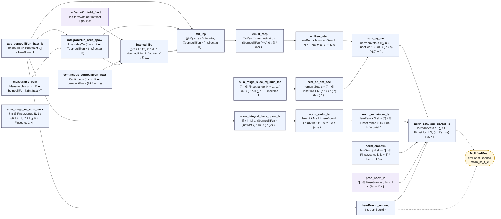

# `lean_stage3/Stage3/ZetaEM.lean`

ZetaEM — block C3 of `lean_stage3/design/carlson.md`. 2026-11-23. Euler–Maclaurin for the Riemann zeta function to any order `k ≥ 1` on `Re s > 0`, with the remainder bounded. The periodic Bernoulli function `P_k(x) = B_k({x})` has right derivative `k·P_{k-1}` everywhere and is continuous for `k ≠ 1`, so one integration by parts on `[a, b]` needs no splitting at the integers. Passing `b → ∞` gives the step `(k+1)·I_k = −B_{k+1}({a})·a^{−s−k} + (s+k)·I_{k+1}` for the tail integrals `I_k(a, s) = ∫_{x>a} P_k(x)·x^{−s−…

20 theorems, 7 definitions, 516 lines. Arrows are Lean's own record of what each proof uses.

**Imports:** nothing in this tree  
**Imported by:** [`Stage3`](../lean_stage3/Stage3.md), [`MollifiedMean`](../lean_stage3/MollifiedMean.md)

## The picture



An arrow A → B reads "A is used in the proof of B". Green: counting, integers only. Violet: shape, analysis with no ζ. Blue: reads ζ. A name ending in ■ is an end: nothing else uses it. Red: contains `sorry`. Yellow: theorems in another file, counted; a dotted arrow crosses files. Definitions are not drawn; they are listed below the diagram.

## Definitions

<a name="ZetaEM-emInt"></a>
### `ZetaEM.emInt`

def · line 54

The order-`k` tail integral `∫_{x>N} B_k({x})·x^{−(s+k)}`.

- **Is:** `` emInt (k N : ℕ) (s : ℂ) : ℂ := ∫ x in Ioi (N:ℝ), ((bernoulliFun k (Int.fract x) : ℝ) : ℂ) * (x:ℂ) ^ (-(s + k)) ``
- **Used by 7:** [`ZetaEM.emInt_step`](#ZetaEM-emInt_step), [`ZetaEM.emRem`](#ZetaEM-emRem), [`ZetaEM.emRem_step`](#ZetaEM-emRem_step), [`ZetaEM.norm_emInt_le`](#ZetaEM-norm_emInt_le), [`ZetaEM.norm_remainder_le`](#ZetaEM-norm_remainder_le), [`ZetaEM.zeta_eq_em`](#ZetaEM-zeta_eq_em), [`ZetaEM.zeta_eq_em_one`](#ZetaEM-zeta_eq_em_one)

<a name="ZetaEM-emCoef"></a>
### `ZetaEM.emCoef`

def · line 58

The coefficient `−s(s+1)⋯(s+k−1)/k!` of the order-`k` remainder.

- **Is:** `` emCoef (k : ℕ) (s : ℂ) : ℂ := -(∏ i ∈ Finset.range k, (s + i)) / (k.factorial : ℂ) ``
- **Used by 4:** [`ZetaEM.emRem`](#ZetaEM-emRem), [`ZetaEM.emRem_step`](#ZetaEM-emRem_step), [`ZetaEM.norm_remainder_le`](#ZetaEM-norm_remainder_le), [`ZetaEM.zeta_eq_em`](#ZetaEM-zeta_eq_em)

<a name="ZetaEM-emTerm"></a>
### `ZetaEM.emTerm`

def · line 62

The boundary term `s(s+1)⋯(s+j−1)·B_{j+1}(0)/(j+1)!·N^{−(s+j)}`.

- **Is:** `` emTerm (j N : ℕ) (s : ℂ) : ℂ := (∏ i ∈ Finset.range j, (s + i)) * (bernoulliFun (j+1) 0 : ℂ) / ((j+1).factorial : ℂ) * (N:ℂ) ^ (-(s + j)) ``
- **Used by 5:** [`ZetaEM.emBoundary`](#ZetaEM-emBoundary), [`ZetaEM.emRem_step`](#ZetaEM-emRem_step), [`ZetaEM.norm_emTerm`](#ZetaEM-norm_emTerm), [`ZetaEM.norm_zeta_sub_partial_le`](#ZetaEM-norm_zeta_sub_partial_le), [`ZetaEM.zeta_eq_em`](#ZetaEM-zeta_eq_em)

<a name="ZetaEM-emBoundary"></a>
### `ZetaEM.emBoundary`

def · line 67

The boundary sum `Σ_{1 ≤ j < k} emTerm j N s`.

- **Is:** `` emBoundary (k N : ℕ) (s : ℂ) : ℂ := ∑ j ∈ Finset.Ico 1 k, emTerm j N s ``
- **Built from:** [`ZetaEM.emTerm`](#ZetaEM-emTerm)
- **Used by 2:** [`ZetaEM.norm_zeta_sub_partial_le`](#ZetaEM-norm_zeta_sub_partial_le), [`ZetaEM.zeta_eq_em`](#ZetaEM-zeta_eq_em)

<a name="ZetaEM-emRem"></a>
### `ZetaEM.emRem`

def · line 71

The order-`k` remainder `emCoef k s · emInt k N s`.

- **Is:** `` emRem (k N : ℕ) (s : ℂ) : ℂ := emCoef k s * emInt k N s ``
- **Built from:** [`ZetaEM.emCoef`](#ZetaEM-emCoef), [`ZetaEM.emInt`](#ZetaEM-emInt)
- **Used by 4:** [`ZetaEM.emRem_step`](#ZetaEM-emRem_step), [`ZetaEM.norm_remainder_le`](#ZetaEM-norm_remainder_le), [`ZetaEM.norm_zeta_sub_partial_le`](#ZetaEM-norm_zeta_sub_partial_le), [`ZetaEM.zeta_eq_em`](#ZetaEM-zeta_eq_em)

<a name="ZetaEM-bernBound"></a>
### `ZetaEM.bernBound`

def · line 75

The supremum of `|B_k|` on `[0, 1]`.

- **Is:** `` bernBound (k : ℕ) : ℝ := sSup ((fun x : ℝ ↦ |bernoulliFun k x|) '' Icc 0 1) ``
- **Used by 10:** [`MollifiedMean.emConst_nonneg`](../lean_stage3/MollifiedMean.md#MollifiedMean-emConst_nonneg), [`ZetaEM.abs_bernoulliFun_fract_le`](#ZetaEM-abs_bernoulliFun_fract_le), [`ZetaEM.bernBound_nonneg`](#ZetaEM-bernBound_nonneg), [`ZetaEM.emConst`](#ZetaEM-emConst), [`ZetaEM.integrableOn_bern_cpow`](#ZetaEM-integrableOn_bern_cpow), [`ZetaEM.norm_emInt_le`](#ZetaEM-norm_emInt_le), [`ZetaEM.norm_integral_bern_cpow_le`](#ZetaEM-norm_integral_bern_cpow_le), [`ZetaEM.norm_remainder_le`](#ZetaEM-norm_remainder_le), [`ZetaEM.norm_zeta_sub_partial_le`](#ZetaEM-norm_zeta_sub_partial_le), [`ZetaEM.tail_ibp`](#ZetaEM-tail_ibp)

<a name="ZetaEM-emConst"></a>
### `ZetaEM.emConst`

def · line 406

The constant of the corollary: `1/2 + Σ_{1 ≤ j < k} |B_{j+1}(0)|/(j+1)! + bernBound k/k!`.

- **Is:** `` emConst (k : ℕ) : ℝ := 1 / 2 + (∑ j ∈ Finset.Ico 1 k, |bernoulliFun (j+1) 0| / (j+1).factorial) + bernBound k / k.factorial ``
- **Built from:** [`ZetaEM.bernBound`](#ZetaEM-bernBound)
- **Used by 3:** [`MollifiedMean.emConst_nonneg`](../lean_stage3/MollifiedMean.md#MollifiedMean-emConst_nonneg), [`MollifiedMean.mean_sq_f_le`](../lean_stage3/MollifiedMean.md#MollifiedMean-mean_sq_f_le), [`ZetaEM.norm_zeta_sub_partial_le`](#ZetaEM-norm_zeta_sub_partial_le)

## Theorems

<a name="ZetaEM-hasDerivWithinAt_fract"></a>
### `ZetaEM.hasDerivWithinAt_fract`

line 79

**Shape.** Uses real or complex analysis; nothing in it or beneath it reads ζ.

**Why.** The fractional part has right derivative `1` at every real `x`.

**Proves**

```lean
HasDerivWithinAt Int.fract 1 (Ioi x) x
```

**Needs** (its hypotheses)

  - `` x : ℝ ``

**Fed by:** no theorem of this repo; it stands on Mathlib.

**Feeds** (1 that use it)

  - [`ZetaEM.interval_ibp`](#ZetaEM-interval_ibp) — `` ((k:ℂ) + 1) * ∫ x in a..b, ((bernoulliFun k (Int.fract x) : ℝ) : ℂ) * (x:ℂ) ^ (-(s + k)) = ((bernoulliFun (k+1) (Int.fract b) : ℝ) : ℂ) * (b:ℂ) ^ (-(s… ``

<a name="ZetaEM-continuous_bernoulliFun_fract"></a>
### `ZetaEM.continuous_bernoulliFun_fract`

line 91

**Reads ζ.** It, or something it rests on, uses the zeta function, its zeros or the Riemann hypothesis.

**Why.** For `k ≠ 1` the periodic Bernoulli function `x ↦ B_k({x})` is continuous.

**Proves**

```lean
Continuous (fun x : ℝ ↦ bernoulliFun k (Int.fract x))
```

**Needs** (its hypotheses)

  - `` hk : k ≠ 1 ``

**Fed by:** no theorem of this repo; it stands on Mathlib.

**Feeds** (1 that use it)

  - [`ZetaEM.interval_ibp`](#ZetaEM-interval_ibp) — `` ((k:ℂ) + 1) * ∫ x in a..b, ((bernoulliFun k (Int.fract x) : ℝ) : ℂ) * (x:ℂ) ^ (-(s + k)) = ((bernoulliFun (k+1) (Int.fract b) : ℝ) : ℂ) * (b:ℂ) ^ (-(s… ``

<a name="ZetaEM-abs_bernoulliFun_fract_le"></a>
### `ZetaEM.abs_bernoulliFun_fract_le`

line 97

**Reads ζ.** It, or something it rests on, uses the zeta function, its zeros or the Riemann hypothesis.

**Why.** The periodic Bernoulli function is bounded in absolute value by `bernBound k`.

**Proves**

```lean
|bernoulliFun k (Int.fract x)| ≤ bernBound k
```

**Needs** (its hypotheses)

  - `` k : ℕ ``
  - `` x : ℝ ``

**Stated with:** [`ZetaEM.bernBound`](#ZetaEM-bernBound)

**Fed by:** no theorem of this repo; it stands on Mathlib and the definitions below.

**Feeds** (4 that use it)

  - [`ZetaEM.bernBound_nonneg`](#ZetaEM-bernBound_nonneg) — `` 0 ≤ bernBound k ``
  - [`ZetaEM.integrableOn_bern_cpow`](#ZetaEM-integrableOn_bern_cpow) — `` IntegrableOn (fun x : ℝ ↦ ((bernoulliFun k (Int.fract x) : ℝ) : ℂ) * (x:ℂ) ^ w) (Ioi a) ``
  - [`ZetaEM.norm_integral_bern_cpow_le`](#ZetaEM-norm_integral_bern_cpow_le) — `` ‖∫ x in Ioi a, ((bernoulliFun k (Int.fract x) : ℝ) : ℂ) * (x:ℂ) ^ w‖ ≤ bernBound k * (-a ^ (w.re + 1) / (w.re + 1)) ``
  - [`ZetaEM.tail_ibp`](#ZetaEM-tail_ibp) — `` ((k:ℂ) + 1) * ∫ x in Ioi a, ((bernoulliFun k (Int.fract x) : ℝ) : ℂ) * (x:ℂ) ^ (-(s + k)) = -(((bernoulliFun (k+1) (Int.fract a) : ℝ) : ℂ) * (a:ℂ) ^ (… ``

<a name="ZetaEM-bernBound_nonneg"></a>
### `ZetaEM.bernBound_nonneg`

line 104

**Reads ζ.** It, or something it rests on, uses the zeta function, its zeros or the Riemann hypothesis.

**Why.** The bound `bernBound k` is nonnegative.

**Proves**

```lean
0 ≤ bernBound k
```

**Needs** (its hypotheses)

  - `` k : ℕ ``

**Stated with:** [`ZetaEM.bernBound`](#ZetaEM-bernBound)

**Fed by** (1 theorem its proof uses)

  - [`ZetaEM.abs_bernoulliFun_fract_le`](#ZetaEM-abs_bernoulliFun_fract_le) — `` |bernoulliFun k (Int.fract x)| ≤ bernBound k ``

**Feeds** (2 that use it)

  - [`MollifiedMean.emConst_nonneg`](../lean_stage3/MollifiedMean.md#MollifiedMean-emConst_nonneg) (MollifiedMean) — `` 0 ≤ ZetaEM.emConst k ``
  - [`ZetaEM.norm_zeta_sub_partial_le`](#ZetaEM-norm_zeta_sub_partial_le) — `` ‖riemannZeta s - ∑ n ∈ Finset.Icc 1 N, (n : ℂ) ^ (-s) + (N : ℂ) ^ (1 - s) / (1 - s)‖ ≤ emConst k * (N : ℝ) ^ (-s.re) * (1 + (‖s‖ + k) ^ k * (N : ℝ) ^ … ``

<a name="ZetaEM-measurable_bern"></a>
### `ZetaEM.measurable_bern`

line 108

**Reads ζ.** It, or something it rests on, uses the zeta function, its zeros or the Riemann hypothesis.

**Why.** The periodic Bernoulli function is measurable.

**Proves**

```lean
Measurable (fun x : ℝ ↦ bernoulliFun k (Int.fract x))
```

**Needs** (its hypotheses)

  - `` k : ℕ ``

**Fed by:** no theorem of this repo; it stands on Mathlib.

**Feeds** (1 that use it)

  - [`ZetaEM.integrableOn_bern_cpow`](#ZetaEM-integrableOn_bern_cpow) — `` IntegrableOn (fun x : ℝ ↦ ((bernoulliFun k (Int.fract x) : ℝ) : ℂ) * (x:ℂ) ^ w) (Ioi a) ``

<a name="ZetaEM-integrableOn_bern_cpow"></a>
### `ZetaEM.integrableOn_bern_cpow`

line 112

**Reads ζ.** It, or something it rests on, uses the zeta function, its zeros or the Riemann hypothesis.

**Why.** For `Re w < −1` and `0 < a`, the function `B_k({x})·x^w` is integrable on `(a, ∞)`.

**Proves**

```lean
IntegrableOn (fun x : ℝ ↦ ((bernoulliFun k (Int.fract x) : ℝ) : ℂ) * (x:ℂ) ^ w) (Ioi a)
```

**Needs** (its hypotheses)

  - `` k : ℕ ``
  - `` ha : 0 < a ``
  - `` hw : w.re < -1 ``

**Fed by** (2 theorems its proof uses)

  - [`ZetaEM.abs_bernoulliFun_fract_le`](#ZetaEM-abs_bernoulliFun_fract_le) — `` |bernoulliFun k (Int.fract x)| ≤ bernBound k ``
  - [`ZetaEM.measurable_bern`](#ZetaEM-measurable_bern) — `` Measurable (fun x : ℝ ↦ bernoulliFun k (Int.fract x)) ``

**Definitions its proof touches:** [`ZetaEM.bernBound`](#ZetaEM-bernBound)

**Feeds** (2 that use it)

  - [`ZetaEM.interval_ibp`](#ZetaEM-interval_ibp) — `` ((k:ℂ) + 1) * ∫ x in a..b, ((bernoulliFun k (Int.fract x) : ℝ) : ℂ) * (x:ℂ) ^ (-(s + k)) = ((bernoulliFun (k+1) (Int.fract b) : ℝ) : ℂ) * (b:ℂ) ^ (-(s… ``
  - [`ZetaEM.tail_ibp`](#ZetaEM-tail_ibp) — `` ((k:ℂ) + 1) * ∫ x in Ioi a, ((bernoulliFun k (Int.fract x) : ℝ) : ℂ) * (x:ℂ) ^ (-(s + k)) = -(((bernoulliFun (k+1) (Int.fract a) : ℝ) : ℂ) * (a:ℂ) ^ (… ``

<a name="ZetaEM-norm_integral_bern_cpow_le"></a>
### `ZetaEM.norm_integral_bern_cpow_le`

line 137

**Reads ζ.** It, or something it rests on, uses the zeta function, its zeros or the Riemann hypothesis.

**Why.** For `Re w < −1` and `0 < a`, the integral of `B_k({x})·x^w` over `(a, ∞)` has norm at most `bernBound k · a^{Re w + 1}/(−(Re w + 1))`.

**Proves**

```lean
‖∫ x in Ioi a, ((bernoulliFun k (Int.fract x) : ℝ) : ℂ) * (x:ℂ) ^ w‖ ≤ bernBound k * (-a ^ (w.re + 1) / (w.re + 1))
```

**Needs** (its hypotheses)

  - `` k : ℕ ``
  - `` ha : 0 < a ``
  - `` hw : w.re < -1 ``

**Stated with:** [`ZetaEM.bernBound`](#ZetaEM-bernBound)

**Fed by** (1 theorem its proof uses)

  - [`ZetaEM.abs_bernoulliFun_fract_le`](#ZetaEM-abs_bernoulliFun_fract_le) — `` |bernoulliFun k (Int.fract x)| ≤ bernBound k ``

**Feeds** (1 that use it)

  - [`ZetaEM.norm_emInt_le`](#ZetaEM-norm_emInt_le) — `` ‖emInt k N s‖ ≤ bernBound k * ((N:ℝ) ^ (1 - s.re - k) / (s.re + k - 1)) ``

<a name="ZetaEM-interval_ibp"></a>
### `ZetaEM.interval_ibp`

line 163

**Reads ζ.** It, or something it rests on, uses the zeta function, its zeros or the Riemann hypothesis.

**Why.** One integration by parts on `[a, b]`: for `k ≥ 1`, `0 < a ≤ b` and `Re s + k > 1`, `(k+1)·∫_a^b P_k x^{−(s+k)}` is the boundary term of `P_{k+1} x^{−(s+k)}` plus `(s+k)·∫_a^b P_{k+1} x^{−(s+k+1)}`.

**Proves**

```lean
((k:ℂ) + 1) * ∫ x in a..b, ((bernoulliFun k (Int.fract x) : ℝ) : ℂ) * (x:ℂ) ^ (-(s + k)) = ((bernoulliFun (k+1) (Int.fract b) : ℝ) : ℂ) * (b:ℂ) ^ (-(s + k)) - ((bernoulliFun (k+1) (Int.fract a) : ℝ) : ℂ) * (a:ℂ) ^ (-(s + k)) + (s + k) * ∫ x in a..b, ((bernoulliFun (k+1) (Int.fract x) : ℝ) : ℂ) * (x:ℂ) ^ (-(s + ((k+1 : ℕ) : ℂ)))
```

**Needs** (its hypotheses)

  - `` hk : 1 ≤ k ``
  - `` ha : 0 < a ``
  - `` hab : a ≤ b ``
  - `` hs : 1 < s.re + k ``

**Fed by** (3 theorems its proof uses)

  - [`ZetaEM.continuous_bernoulliFun_fract`](#ZetaEM-continuous_bernoulliFun_fract) — `` Continuous (fun x : ℝ ↦ bernoulliFun k (Int.fract x)) ``
  - [`ZetaEM.hasDerivWithinAt_fract`](#ZetaEM-hasDerivWithinAt_fract) — `` HasDerivWithinAt Int.fract 1 (Ioi x) x ``
  - [`ZetaEM.integrableOn_bern_cpow`](#ZetaEM-integrableOn_bern_cpow) — `` IntegrableOn (fun x : ℝ ↦ ((bernoulliFun k (Int.fract x) : ℝ) : ℂ) * (x:ℂ) ^ w) (Ioi a) ``

**Feeds** (1 that use it)

  - [`ZetaEM.tail_ibp`](#ZetaEM-tail_ibp) — `` ((k:ℂ) + 1) * ∫ x in Ioi a, ((bernoulliFun k (Int.fract x) : ℝ) : ℂ) * (x:ℂ) ^ (-(s + k)) = -(((bernoulliFun (k+1) (Int.fract a) : ℝ) : ℂ) * (a:ℂ) ^ (… ``

<a name="ZetaEM-tail_ibp"></a>
### `ZetaEM.tail_ibp`

line 223

**Reads ζ.** It, or something it rests on, uses the zeta function, its zeros or the Riemann hypothesis.

**Why.** The step on the tail: for `k ≥ 1`, `0 < a` and `Re s + k > 1`, `(k+1)·I_k(a) = −B_{k+1}({a})·a^{−(s+k)} + (s+k)·I_{k+1}(a)`.

**Proves**

```lean
((k:ℂ) + 1) * ∫ x in Ioi a, ((bernoulliFun k (Int.fract x) : ℝ) : ℂ) * (x:ℂ) ^ (-(s + k)) = -(((bernoulliFun (k+1) (Int.fract a) : ℝ) : ℂ) * (a:ℂ) ^ (-(s + k))) + (s + k) * ∫ x in Ioi a, ((bernoulliFun (k+1) (Int.fract x) : ℝ) : ℂ) * (x:ℂ) ^ (-(s + ((k+1 : ℕ) : ℂ)))
```

**Needs** (its hypotheses)

  - `` hk : 1 ≤ k ``
  - `` ha : 0 < a ``
  - `` hs : 1 < s.re + k ``

**Fed by** (3 theorems its proof uses)

  - [`ZetaEM.abs_bernoulliFun_fract_le`](#ZetaEM-abs_bernoulliFun_fract_le) — `` |bernoulliFun k (Int.fract x)| ≤ bernBound k ``
  - [`ZetaEM.integrableOn_bern_cpow`](#ZetaEM-integrableOn_bern_cpow) — `` IntegrableOn (fun x : ℝ ↦ ((bernoulliFun k (Int.fract x) : ℝ) : ℂ) * (x:ℂ) ^ w) (Ioi a) ``
  - [`ZetaEM.interval_ibp`](#ZetaEM-interval_ibp) — `` ((k:ℂ) + 1) * ∫ x in a..b, ((bernoulliFun k (Int.fract x) : ℝ) : ℂ) * (x:ℂ) ^ (-(s + k)) = ((bernoulliFun (k+1) (Int.fract b) : ℝ) : ℂ) * (b:ℂ) ^ (-(s… ``

**Definitions its proof touches:** [`ZetaEM.bernBound`](#ZetaEM-bernBound)

**Feeds** (1 that use it)

  - [`ZetaEM.emInt_step`](#ZetaEM-emInt_step) — `` ((k:ℂ) + 1) * emInt k N s = -((bernoulliFun (k+1) 0 : ℂ) * (N:ℂ) ^ (-(s + k))) + (s + k) * emInt (k+1) N s ``

<a name="ZetaEM-emInt_step"></a>
### `ZetaEM.emInt_step`

line 263

**Reads ζ.** It, or something it rests on, uses the zeta function, its zeros or the Riemann hypothesis.

**Why.** The recursion for the tail integrals: for `k ≥ 1`, `0 < N` and `Re s + k > 1`, `(k+1)·I_k(N, s) = −B_{k+1}(0)·N^{−(s+k)} + (s+k)·I_{k+1}(N, s)`.

**Proves**

```lean
((k:ℂ) + 1) * emInt k N s = -((bernoulliFun (k+1) 0 : ℂ) * (N:ℂ) ^ (-(s + k))) + (s + k) * emInt (k+1) N s
```

**Needs** (its hypotheses)

  - `` hk : 1 ≤ k ``
  - `` hN : 0 < N ``
  - `` hs : 1 < s.re + k ``

**Stated with:** [`ZetaEM.emInt`](#ZetaEM-emInt)

**Fed by** (1 theorem its proof uses)

  - [`ZetaEM.tail_ibp`](#ZetaEM-tail_ibp) — `` ((k:ℂ) + 1) * ∫ x in Ioi a, ((bernoulliFun k (Int.fract x) : ℝ) : ℂ) * (x:ℂ) ^ (-(s + k)) = -(((bernoulliFun (k+1) (Int.fract a) : ℝ) : ℂ) * (a:ℂ) ^ (… ``

**Feeds** (1 that use it)

  - [`ZetaEM.emRem_step`](#ZetaEM-emRem_step) — `` emRem k N s = emTerm k N s + emRem (k+1) N s ``

<a name="ZetaEM-emRem_step"></a>
### `ZetaEM.emRem_step`

line 276

**Reads ζ.** It, or something it rests on, uses the zeta function, its zeros or the Riemann hypothesis.

**Why.** The remainder step: the order-`k` remainder is the `k`-th boundary term plus the order-`(k+1)` remainder, for `k ≥ 1`, `0 < N`, `Re s + k > 1`.

**Proves**

```lean
emRem k N s = emTerm k N s + emRem (k+1) N s
```

**Needs** (its hypotheses)

  - `` hk : 1 ≤ k ``
  - `` hN : 0 < N ``
  - `` hs : 1 < s.re + k ``

**Stated with:** [`ZetaEM.emRem`](#ZetaEM-emRem), [`ZetaEM.emTerm`](#ZetaEM-emTerm)

**Fed by** (1 theorem its proof uses)

  - [`ZetaEM.emInt_step`](#ZetaEM-emInt_step) — `` ((k:ℂ) + 1) * emInt k N s = -((bernoulliFun (k+1) 0 : ℂ) * (N:ℂ) ^ (-(s + k))) + (s + k) * emInt (k+1) N s ``

**Definitions its proof touches:** [`ZetaEM.emCoef`](#ZetaEM-emCoef), [`ZetaEM.emInt`](#ZetaEM-emInt)

**Feeds** (1 that use it)

  - [`ZetaEM.zeta_eq_em`](#ZetaEM-zeta_eq_em) — `` riemannZeta s = ∑ n ∈ Finset.Icc 1 N, (n : ℂ) ^ (-s) - (N:ℂ) ^ (1 - s) / (1 - s) - (N:ℂ) ^ (-s) / 2 + emBoundary k N s + emRem k N s ``

<a name="ZetaEM-sum_range_succ_eq_sum_Icc"></a>
### `ZetaEM.sum_range_succ_eq_sum_Icc`

line 292

**Reads ζ.** It, or something it rests on, uses the zeta function, its zeros or the Riemann hypothesis.

**Why.** The sum `Σ_{n ≤ N} 1/n^s` equals `Σ_{n ∈ [1, N]} n^{−s}` for `s ≠ 0`.

**Proves**

```lean
∑ n ∈ Finset.range (N + 1), 1 / (n : ℂ) ^ s = ∑ n ∈ Finset.Icc 1 N, (n : ℂ) ^ (-s)
```

**Needs** (its hypotheses)

  - `` N : ℕ ``
  - `` hs : s ≠ 0 ``

**Fed by:** no theorem of this repo; it stands on Mathlib.

**Feeds** (1 that use it)

  - [`ZetaEM.zeta_eq_em_one`](#ZetaEM-zeta_eq_em_one) — `` riemannZeta s = ∑ n ∈ Finset.Icc 1 N, (n : ℂ) ^ (-s) - (N:ℂ) ^ (1 - s) / (1 - s) - (N:ℂ) ^ (-s) / 2 - s * emInt 1 N s ``

<a name="ZetaEM-sum_range_eq_sum_Icc"></a>
### `ZetaEM.sum_range_eq_sum_Icc`

line 304

**Reads ζ.** It, or something it rests on, uses the zeta function, its zeros or the Riemann hypothesis.

**Why.** The shifted sum `Σ_{n < N} 1/(n+1)^s` equals `Σ_{n ∈ [1, N]} n^{−s}`.

**Proves**

```lean
∑ n ∈ Finset.range N, 1 / ((n:ℂ) + 1) ^ s = ∑ n ∈ Finset.Icc 1 N, (n : ℂ) ^ (-s)
```

**Needs** (its hypotheses)

  - `` N : ℕ ``
  - `` s : ℂ ``

**Fed by:** no theorem of this repo; it stands on Mathlib.

**Feeds:** nothing. It connects to nothing.

<a name="ZetaEM-zeta_eq_em_one"></a>
### `ZetaEM.zeta_eq_em_one`

line 315

**Reads ζ.** It, or something it rests on, uses the zeta function, its zeros or the Riemann hypothesis.

**Why.** The order-one formula: for `0 < N`, `Re s > 0`, `s ≠ 1`, `ζ(s) = Σ_{n ∈ [1,N]} n^{−s} − N^{1−s}/(1−s) − N^{−s}/2 − s·I_1(N, s)`.

**Proves**

```lean
riemannZeta s = ∑ n ∈ Finset.Icc 1 N, (n : ℂ) ^ (-s) - (N:ℂ) ^ (1 - s) / (1 - s) - (N:ℂ) ^ (-s) / 2 - s * emInt 1 N s
```

**Needs** (its hypotheses)

  - `` hN : 0 < N ``
  - `` hs : 0 < s.re ``
  - `` hs1 : s ≠ 1 ``

**Stated with:** [`ZetaEM.emInt`](#ZetaEM-emInt)

**Fed by** (1 theorem its proof uses)

  - [`ZetaEM.sum_range_succ_eq_sum_Icc`](#ZetaEM-sum_range_succ_eq_sum_Icc) — `` ∑ n ∈ Finset.range (N + 1), 1 / (n : ℂ) ^ s = ∑ n ∈ Finset.Icc 1 N, (n : ℂ) ^ (-s) ``

**Feeds** (1 that use it)

  - [`ZetaEM.zeta_eq_em`](#ZetaEM-zeta_eq_em) — `` riemannZeta s = ∑ n ∈ Finset.Icc 1 N, (n : ℂ) ^ (-s) - (N:ℂ) ^ (1 - s) / (1 - s) - (N:ℂ) ^ (-s) / 2 + emBoundary k N s + emRem k N s ``

<a name="ZetaEM-zeta_eq_em"></a>
### `ZetaEM.zeta_eq_em`

line 338

**Reads ζ.** It, or something it rests on, uses the zeta function, its zeros or the Riemann hypothesis.

**Why.** Euler–Maclaurin of order `k`: for every `k ≥ 1`, `0 < N`, `Re s > 0`, `s ≠ 1`, `ζ(s) = Σ_{n ∈ [1,N]} n^{−s} − N^{1−s}/(1−s) − N^{−s}/2 + emBoundary k N s + emRem k N s`.

**Proves**

```lean
riemannZeta s = ∑ n ∈ Finset.Icc 1 N, (n : ℂ) ^ (-s) - (N:ℂ) ^ (1 - s) / (1 - s) - (N:ℂ) ^ (-s) / 2 + emBoundary k N s + emRem k N s
```

**Needs** (its hypotheses)

  - `` hk : 1 ≤ k ``
  - `` hN : 0 < N ``
  - `` hs : 0 < s.re ``
  - `` hs1 : s ≠ 1 ``

**Stated with:** [`ZetaEM.emBoundary`](#ZetaEM-emBoundary), [`ZetaEM.emRem`](#ZetaEM-emRem)

**Fed by** (2 theorems its proof uses)

  - [`ZetaEM.emRem_step`](#ZetaEM-emRem_step) — `` emRem k N s = emTerm k N s + emRem (k+1) N s ``
  - [`ZetaEM.zeta_eq_em_one`](#ZetaEM-zeta_eq_em_one) — `` riemannZeta s = ∑ n ∈ Finset.Icc 1 N, (n : ℂ) ^ (-s) - (N:ℂ) ^ (1 - s) / (1 - s) - (N:ℂ) ^ (-s) / 2 - s * emInt 1 N s ``

**Definitions its proof touches:** [`ZetaEM.emCoef`](#ZetaEM-emCoef), [`ZetaEM.emInt`](#ZetaEM-emInt), [`ZetaEM.emTerm`](#ZetaEM-emTerm)

**Feeds** (1 that use it)

  - [`ZetaEM.norm_zeta_sub_partial_le`](#ZetaEM-norm_zeta_sub_partial_le) — `` ‖riemannZeta s - ∑ n ∈ Finset.Icc 1 N, (n : ℂ) ^ (-s) + (N : ℂ) ^ (1 - s) / (1 - s)‖ ≤ emConst k * (N : ℝ) ^ (-s.re) * (1 + (‖s‖ + k) ^ k * (N : ℝ) ^ … ``

<a name="ZetaEM-norm_emInt_le"></a>
### `ZetaEM.norm_emInt_le`

line 357

**Reads ζ.** It, or something it rests on, uses the zeta function, its zeros or the Riemann hypothesis.

**Why.** The order-`k` tail integral has norm at most `bernBound k · N^{1−σ−k}/(σ+k−1)` when `σ + k > 1`.

**Proves**

```lean
‖emInt k N s‖ ≤ bernBound k * ((N:ℝ) ^ (1 - s.re - k) / (s.re + k - 1))
```

**Needs** (its hypotheses)

  - `` k : ℕ ``
  - `` hN : 0 < N ``
  - `` hs : 1 < s.re + k ``

**Stated with:** [`ZetaEM.bernBound`](#ZetaEM-bernBound), [`ZetaEM.emInt`](#ZetaEM-emInt)

**Fed by** (1 theorem its proof uses)

  - [`ZetaEM.norm_integral_bern_cpow_le`](#ZetaEM-norm_integral_bern_cpow_le) — `` ‖∫ x in Ioi a, ((bernoulliFun k (Int.fract x) : ℝ) : ℂ) * (x:ℂ) ^ w‖ ≤ bernBound k * (-a ^ (w.re + 1) / (w.re + 1)) ``

**Feeds** (1 that use it)

  - [`ZetaEM.norm_remainder_le`](#ZetaEM-norm_remainder_le) — `` ‖emRem k N s‖ ≤ (∏ i ∈ Finset.range k, ‖s + i‖) / k.factorial * (bernBound k * ((N:ℝ) ^ (1 - s.re - k) / (s.re + k - 1))) ``

<a name="ZetaEM-norm_remainder_le"></a>
### `ZetaEM.norm_remainder_le`

line 373

**Reads ζ.** It, or something it rests on, uses the zeta function, its zeros or the Riemann hypothesis.

**Why.** The remainder bound: for `σ + k > 1` and `0 < N`, the order-`k` remainder has norm at most `(∏_{i<k}‖s+i‖/k!)·bernBound k·N^{1−σ−k}/(σ+k−1)`.

**Proves**

```lean
‖emRem k N s‖ ≤ (∏ i ∈ Finset.range k, ‖s + i‖) / k.factorial * (bernBound k * ((N:ℝ) ^ (1 - s.re - k) / (s.re + k - 1)))
```

**Needs** (its hypotheses)

  - `` k : ℕ ``
  - `` hN : 0 < N ``
  - `` hs : 1 < s.re + k ``

**Stated with:** [`ZetaEM.bernBound`](#ZetaEM-bernBound), [`ZetaEM.emRem`](#ZetaEM-emRem)

**Fed by** (1 theorem its proof uses)

  - [`ZetaEM.norm_emInt_le`](#ZetaEM-norm_emInt_le) — `` ‖emInt k N s‖ ≤ bernBound k * ((N:ℝ) ^ (1 - s.re - k) / (s.re + k - 1)) ``

**Definitions its proof touches:** [`ZetaEM.emCoef`](#ZetaEM-emCoef), [`ZetaEM.emInt`](#ZetaEM-emInt)

**Feeds** (1 that use it)

  - [`ZetaEM.norm_zeta_sub_partial_le`](#ZetaEM-norm_zeta_sub_partial_le) — `` ‖riemannZeta s - ∑ n ∈ Finset.Icc 1 N, (n : ℂ) ^ (-s) + (N : ℂ) ^ (1 - s) / (1 - s)‖ ≤ emConst k * (N : ℝ) ^ (-s.re) * (1 + (‖s‖ + k) ^ k * (N : ℝ) ^ … ``

<a name="ZetaEM-norm_emTerm"></a>
### `ZetaEM.norm_emTerm`

line 381

**Reads ζ.** It, or something it rests on, uses the zeta function, its zeros or the Riemann hypothesis.

**Why.** The `j`-th boundary term has norm `∏_{i<j}‖s+i‖·|B_{j+1}(0)|/(j+1)!·N^{−σ−j}`.

**Proves**

```lean
‖emTerm j N s‖ = (∏ i ∈ Finset.range j, ‖s + i‖) * |bernoulliFun (j+1) 0| / (j+1).factorial * (N:ℝ) ^ (-s.re - j)
```

**Needs** (its hypotheses)

  - `` j : ℕ ``
  - `` hN : 0 < N ``
  - `` s : ℂ ``

**Stated with:** [`ZetaEM.emTerm`](#ZetaEM-emTerm)

**Fed by:** no theorem of this repo; it stands on Mathlib and the definitions below.

**Feeds** (1 that use it)

  - [`ZetaEM.norm_zeta_sub_partial_le`](#ZetaEM-norm_zeta_sub_partial_le) — `` ‖riemannZeta s - ∑ n ∈ Finset.Icc 1 N, (n : ℂ) ^ (-s) + (N : ℂ) ^ (1 - s) / (1 - s)‖ ≤ emConst k * (N : ℝ) ^ (-s.re) * (1 + (‖s‖ + k) ^ k * (N : ℝ) ^ … ``

<a name="ZetaEM-prod_norm_le"></a>
### `ZetaEM.prod_norm_le`

line 392

**Shape.** Uses real or complex analysis; nothing in it or beneath it reads ζ.

**Why.** For `i < j ≤ k`, the product `∏_{i<j}‖s+i‖` is at most `(‖s‖+k)^j`.

**Proves**

```lean
∏ i ∈ Finset.range j, ‖s + i‖ ≤ (‖s‖ + k) ^ j
```

**Needs** (its hypotheses)

  - `` s : ℂ ``
  - `` hjk : j ≤ k ``

**Fed by:** no theorem of this repo; it stands on Mathlib.

**Feeds** (1 that use it)

  - [`ZetaEM.norm_zeta_sub_partial_le`](#ZetaEM-norm_zeta_sub_partial_le) — `` ‖riemannZeta s - ∑ n ∈ Finset.Icc 1 N, (n : ℂ) ^ (-s) + (N : ℂ) ^ (1 - s) / (1 - s)‖ ≤ emConst k * (N : ℝ) ^ (-s.re) * (1 + (‖s‖ + k) ^ k * (N : ℝ) ^ … ``

<a name="ZetaEM-norm_zeta_sub_partial_le"></a>
### `ZetaEM.norm_zeta_sub_partial_le`

line 412

**Reads ζ.** It, or something it rests on, uses the zeta function, its zeros or the Riemann hypothesis.

**Why.** The corollary: for `k ≥ 2`, `0 < N`, `Re s > 0`, `s ≠ 1` and `‖s‖ + k ≤ N`, `‖ζ(s) − Σ_{n ∈ [1,N]} n^{−s} + N^{1−s}/(1−s)‖ ≤ A_k·N^{−σ}·(1 + (‖s‖+k)^k·N^{1−k})`.

**Proves**

```lean
‖riemannZeta s - ∑ n ∈ Finset.Icc 1 N, (n : ℂ) ^ (-s) + (N : ℂ) ^ (1 - s) / (1 - s)‖ ≤ emConst k * (N : ℝ) ^ (-s.re) * (1 + (‖s‖ + k) ^ k * (N : ℝ) ^ (1 - (k : ℝ)))
```

**Needs** (its hypotheses)

  - `` k : ℕ ``
  - `` hk : 2 ≤ k ``
  - `` hN : 0 < N ``
  - `` hσ : 0 < s.re ``
  - `` hs1 : s ≠ 1 ``
  - `` hsN : ‖s‖ + k ≤ N ``

**Stated with:** [`ZetaEM.emConst`](#ZetaEM-emConst)

**Fed by** (5 theorems its proof uses)

  - [`ZetaEM.bernBound_nonneg`](#ZetaEM-bernBound_nonneg) — `` 0 ≤ bernBound k ``
  - [`ZetaEM.norm_emTerm`](#ZetaEM-norm_emTerm) — `` ‖emTerm j N s‖ = (∏ i ∈ Finset.range j, ‖s + i‖) * |bernoulliFun (j+1) 0| / (j+1).factorial * (N:ℝ) ^ (-s.re - j) ``
  - [`ZetaEM.norm_remainder_le`](#ZetaEM-norm_remainder_le) — `` ‖emRem k N s‖ ≤ (∏ i ∈ Finset.range k, ‖s + i‖) / k.factorial * (bernBound k * ((N:ℝ) ^ (1 - s.re - k) / (s.re + k - 1))) ``
  - [`ZetaEM.prod_norm_le`](#ZetaEM-prod_norm_le) — `` ∏ i ∈ Finset.range j, ‖s + i‖ ≤ (‖s‖ + k) ^ j ``
  - [`ZetaEM.zeta_eq_em`](#ZetaEM-zeta_eq_em) — `` riemannZeta s = ∑ n ∈ Finset.Icc 1 N, (n : ℂ) ^ (-s) - (N:ℂ) ^ (1 - s) / (1 - s) - (N:ℂ) ^ (-s) / 2 + emBoundary k N s + emRem k N s ``

**Definitions its proof touches:** [`ZetaEM.bernBound`](#ZetaEM-bernBound), [`ZetaEM.emBoundary`](#ZetaEM-emBoundary), [`ZetaEM.emRem`](#ZetaEM-emRem), [`ZetaEM.emTerm`](#ZetaEM-emTerm)

**Feeds** (1 that use it)

  - [`MollifiedMean.mean_sq_f_le`](../lean_stage3/MollifiedMean.md#MollifiedMean-mean_sq_f_le) (MollifiedMean) — `` ∫ t in (1:ℝ)..T, ‖f X ((u : ℂ) + Complex.I * (t : ℂ))‖ ^ 2 ≤ 3 * (T * (2 / (1 - (2:ℝ) ^ (1 - 2 * u))) * (X:ℝ) ^ (1 - 2 * u) * (1 + Real.log X) ^ 3 + 2… ``

