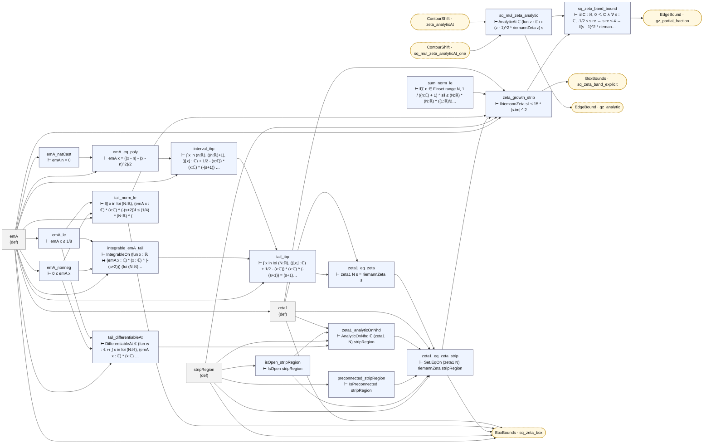

# `lean_stage3/Stage3/ZetaGrowth.lean`

**What it does** (its own header): # Zeta growth on the strip `re > −1` (S3a — the load-bearing unknown of S3) Second-order Euler–Maclaurin: one integration by parts past PNT+'s `riemannZeta0`. The antiderivative `emA x = ({x} − {x}²)/2` of `⌊x⌋ + 1/2 − x` vanishes at every integer, so the per-interval boundary terms die and the new tail converges absolutely on `re s > −1`.

**Imports:** [`ContourShift`](../lean_stage3/ContourShift.md).
**Imported by:** [`Stage3`](../lean_stage3/Stage3.md), [`BoxBounds`](../lean_stage3/BoxBounds.md), [`EdgeBound`](../lean_stage3/EdgeBound.md).

Blue: theorem. Green: a theorem nothing else uses (an end). Dashed white: connects to nothing. Grey: definition. Red: contains `sorry`. Yellow: in another file. An arrow A → B reads "A is used by B".

## Every declaration

| declaration | proves (output) | needs (input) | why (its own docstring) | uses | used by |
|---|---|---|---|---|---|
| `ZetaGrowth.emA` def, line 22 | ℝ | x : ℝ | The Euler–Maclaurin antiderivative: `({x} − {x}²)/2`. | — | `BoxBounds.sq_zeta_box`, `ZetaGrowth.emA_eq_poly`, `ZetaGrowth.emA_le`, `ZetaGrowth.emA_natCast`, `ZetaGrowth.emA_nonneg`, `ZetaGrowth.integrable_emA_tail`, `ZetaGrowth.interval_ibp`, `ZetaGrowth.tail_differentiableAt`, `ZetaGrowth.tail_ibp`, `ZetaGrowth.tail_norm_le`, `ZetaGrowth.zeta1`, `ZetaGrowth.zeta_growth_strip` |
| `ZetaGrowth.emA_nonneg` theorem, line 24 | 0 ≤ emA x | x : ℝ | — | `ZetaGrowth.emA` | `ZetaGrowth.integrable_emA_tail`, `ZetaGrowth.tail_differentiableAt`, `ZetaGrowth.tail_norm_le` |
| `ZetaGrowth.emA_le` theorem, line 30 | emA x ≤ 1/8 | x : ℝ | — | `ZetaGrowth.emA` | `ZetaGrowth.integrable_emA_tail`, `ZetaGrowth.tail_differentiableAt`, `ZetaGrowth.tail_norm_le` |
| `ZetaGrowth.emA_natCast` theorem, line 34 | emA n = 0 | n : ℕ | — | `ZetaGrowth.emA` | `ZetaGrowth.emA_eq_poly` |
| `ZetaGrowth.emA_eq_poly` theorem, line 40 | emA x = ((x - n) - (x - n)^2)/2 | h1 : (n:ℝ) ≤ x; h2 : x ≤ n+1 | On `[n, n+1]`, `emA` agrees with the polynomial `((x−n) − (x−n)²)/2` — including at the right endpoint, where both vanish. | `ZetaGrowth.emA`, `ZetaGrowth.emA_natCast` | `ZetaGrowth.interval_ibp` |
| `ZetaGrowth.integrable_emA_tail` theorem, line 58 | IntegrableOn (fun x : ℝ ↦ (emA x : ℂ) * (x : ℂ) ^ (-(s+2))) (Ioi (N:ℝ)) | Npos : 0 &lt; N; hs : -1 &lt; s.re | The second-order tail integrand is integrable on `Ioi N` whenever `re s &gt; −1`. | `ZetaGrowth.emA`, `ZetaGrowth.emA_le`, `ZetaGrowth.emA_nonneg` | `ZetaGrowth.tail_ibp` |
| `ZetaGrowth.interval_ibp` theorem, line 97 | ∫ x in (n:ℝ)..((n:ℝ)+1), ((⌊x⌋ : ℂ) + 1/2 - (x:ℂ)) * (x:ℂ) ^ (-(s+1)) = (s+1) * ∫ x in (n:ℝ)..((n:ℝ)+1), (emA x : ℂ) * (x:ℂ) ^ (-(s+2)) | hn : 1 ≤ n; hs1 : s ≠ -1 | The per-interval integration by parts. On `[n, n+1]` with `n ≥ 1`, the first-order tail integrand integrates to `(s+1)` times the second-order one — the boundary terms vanish at the integers. | `ZetaGrowth.emA`, `ZetaGrowth.emA_eq_poly` | `ZetaGrowth.tail_ibp` |
| `ZetaGrowth.tail_ibp` theorem, line 211 | ∫ x in Ioi (N:ℝ), ((⌊x⌋ : ℂ) + 1/2 - (x:ℂ)) * (x:ℂ) ^ (-(s+1)) = (s+1) * ∫ x in Ioi (N:ℝ), (emA x : ℂ) * (x:ℂ) ^ (-(s+2)) | Npos : 0 &lt; N; hs : 0 &lt; s.re | The tail identity on `Ioi N` for `re s &gt; 0`: the per-interval IBP summed over adjacent intervals and passed to the limit. | `ZetaGrowth.emA`, `ZetaGrowth.integrable_emA_tail`, `ZetaGrowth.interval_ibp` | `ZetaGrowth.zeta1_eq_zeta` |
| `ZetaGrowth.zeta1` def, line 283 | ℂ | N : ℕ; s : ℂ | The continued Euler–Maclaurin form: every piece converges absolutely on `re s &gt; −1`. | `ZetaGrowth.emA` | `BoxBounds.sq_zeta_box`, `ZetaGrowth.zeta1_analyticOnNhd`, `ZetaGrowth.zeta1_eq_zeta`, `ZetaGrowth.zeta1_eq_zeta_strip`, `ZetaGrowth.zeta_growth_strip` |
| `ZetaGrowth.zeta1_eq_zeta` theorem, line 289 | zeta1 N s = riemannZeta s | Npos : 0 &lt; N; hs : 0 &lt; s.re; hs1 : s ≠ 1 | On `re s &gt; 0` the continued form agrees with `ζ`. | `ZetaGrowth.tail_ibp`, `ZetaGrowth.zeta1` | `ZetaGrowth.zeta1_eq_zeta_strip` |
| `ZetaGrowth.tail_differentiableAt` theorem, line 312 | DifferentiableAt ℂ (fun w : ℂ ↦ ∫ x in Ioi (N:ℝ), (emA x : ℂ) * (x:ℂ) ^ (-(w+2))) z | Npos : 0 &lt; N; hz : -1 &lt; z.re | The tail integral is differentiable in `s` on `re s &gt; −1`: it is a Mellin transform of a bounded function vanishing near `0`. | `ZetaGrowth.emA`, `ZetaGrowth.emA_le`, `ZetaGrowth.emA_nonneg` | `ZetaGrowth.zeta1_analyticOnNhd` |
| `ZetaGrowth.stripRegion` def, line 386 | Set ℂ | — | The strip on which the continued form lives. | — | `BoxBounds.sq_zeta_box`, `ZetaGrowth.isOpen_stripRegion`, `ZetaGrowth.preconnected_stripRegion`, `ZetaGrowth.zeta1_analyticOnNhd`, `ZetaGrowth.zeta1_eq_zeta_strip`, `ZetaGrowth.zeta_growth_strip` |
| `ZetaGrowth.isOpen_stripRegion` theorem, line 388 | IsOpen stripRegion | — | — | `ZetaGrowth.stripRegion` | `ZetaGrowth.zeta1_analyticOnNhd`, `ZetaGrowth.zeta1_eq_zeta_strip` |
| `ZetaGrowth.preconnected_stripRegion` theorem, line 395 | IsPreconnected stripRegion | — | — | `ZetaGrowth.stripRegion` | `ZetaGrowth.zeta1_eq_zeta_strip` |
| `ZetaGrowth.zeta1_analyticOnNhd` theorem, line 449 | AnalyticOnNhd ℂ (zeta1 N) stripRegion | Npos : 0 &lt; N | `zeta1` is analytic on the strip. | `ZetaGrowth.isOpen_stripRegion`, `ZetaGrowth.stripRegion`, `ZetaGrowth.tail_differentiableAt`, `ZetaGrowth.zeta1` | `ZetaGrowth.zeta1_eq_zeta_strip` |
| `ZetaGrowth.zeta1_eq_zeta_strip` theorem, line 489 | Set.EqOn (zeta1 N) riemannZeta stripRegion | Npos : 0 &lt; N | The continuation: `zeta1 = ζ` on the whole strip. | `ZetaGrowth.isOpen_stripRegion`, `ZetaGrowth.preconnected_stripRegion`, `ZetaGrowth.stripRegion`, `ZetaGrowth.zeta1`, `ZetaGrowth.zeta1_analyticOnNhd`, `ZetaGrowth.zeta1_eq_zeta` | `BoxBounds.sq_zeta_box`, `ZetaGrowth.zeta_growth_strip` |
| `ZetaGrowth.tail_norm_le` theorem, line 519 | ‖∫ x in Ioi (N:ℝ), (emA x : ℂ) * (x:ℂ) ^ (-(s+2))‖ ≤ (1/4) * (N:ℝ) ^ (-s.re - 1) | Npos : 0 &lt; N; hσ : -1/2 ≤ s.re | Crude norm bound for the tail integral: `(1/4)·N^(−σ−1)`. | `ZetaGrowth.emA`, `ZetaGrowth.emA_le`, `ZetaGrowth.emA_nonneg` | `BoxBounds.sq_zeta_box`, `ZetaGrowth.zeta_growth_strip` |
| `ZetaGrowth.sum_norm_le` theorem, line 570 | ‖∑ n ∈ Finset.range N, 1 / ((n:ℂ) + 1) ^ s‖ ≤ (N:ℝ) * (N:ℝ) ^ ((1:ℝ)/2) | hσ : -1/2 ≤ s.re; hN : 1 ≤ N | Crude bound for the shifted finite sum: `N·N^(1/2)`. | — | `ZetaGrowth.zeta_growth_strip` |
| `ZetaGrowth.zeta_growth_strip` theorem, line 599 | ‖riemannZeta s‖ ≤ 15 * \|s.im\| ^ 2 | hσ1 : -1/2 ≤ s.re; hσ2 : s.re ≤ 4; ht : 2 ≤ \|s.im\| | Polynomial growth of `ζ` on the strip — crude and explicit: `‖ζ(σ+it)‖ ≤ 15·t²` on `σ ∈ [−1/2, 4]`, `\|t\| ≥ 2`. | `ZetaGrowth.emA`, `ZetaGrowth.stripRegion`, `ZetaGrowth.sum_norm_le`, `ZetaGrowth.tail_norm_le`, `ZetaGrowth.zeta1`, `ZetaGrowth.zeta1_eq_zeta_strip` | `BoxBounds.sq_zeta_band_explicit`, `ZetaGrowth.sq_zeta_band_bound` |
| `ZetaGrowth.sq_mul_zeta_analytic` theorem, line 719 | AnalyticAt ℂ (fun z : ℂ ↦ (z - 1)^2 * riemannZeta z) s | s : ℂ | `(s−1)²·ζ` is analytic everywhere. | `ContourShift.sq_mul_zeta_analyticAt_one`, `ContourShift.zeta_analyticAt` | `EdgeBound.gz_analytic`, `ZetaGrowth.sq_zeta_band_bound` |
| `ZetaGrowth.sq_zeta_band_bound` theorem, line 730 | ∃ C : ℝ, 0 &lt; C ∧ ∀ s : ℂ, -1/2 ≤ s.re → s.re ≤ 4 → ‖(s - 1)^2 * riemannZeta s‖ ≤ C * (2 + \|s.im\|) ^ 4 | — | The Landau-ball input: `(s−1)²·ζ` bounded on the band `re ∈ [−1/2, 4]` by a power of the height — explicit for `\|im\| ≥ 2`, an existential constant absorbing the compact patch below. | `ZetaGrowth.sq_mul_zeta_analytic`, `ZetaGrowth.zeta_growth_strip` | `EdgeBound.gz_partial_fraction` |
