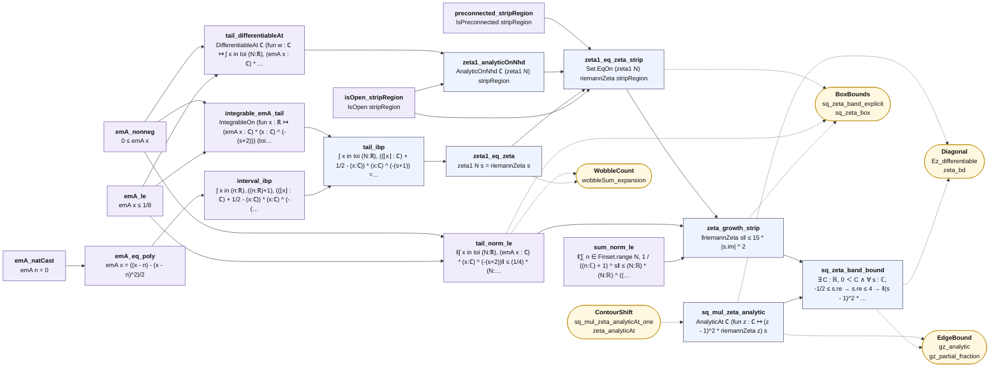

# `lean_stage3/Stage3/ZetaGrowth.lean`

# Zeta growth on the strip `re > −1` (S3a — the load-bearing unknown of S3) Second-order Euler–Maclaurin: one integration by parts past PNT+'s `riemannZeta0`. The antiderivative `emA x = ({x} − {x}²)/2` of `⌊x⌋ + 1/2 − x` vanishes at every integer, so the per-interval boundary terms die and the new tail converges absolutely on `re s > −1`.

18 theorems, 3 definitions, 834 lines. Arrows are Lean's own record of what each proof uses.

**Imports:** [`ContourShift`](../lean_stage3/ContourShift.md)  
**Imported by:** [`Stage3`](../lean_stage3/Stage3.md), [`BoxBounds`](../lean_stage3/BoxBounds.md), [`Diagonal`](../lean_stage3/Diagonal.md), [`EdgeBound`](../lean_stage3/EdgeBound.md), [`WobbleCount`](../lean_stage3/WobbleCount.md)

## The picture



An arrow A → B reads "A is used in the proof of B". Green: counting, integers only. Violet: shape, analysis with no ζ. Blue: reads ζ. A name ending in ■ is an end: nothing else uses it. Red: contains `sorry`. Yellow: theorems in another file, counted; a dotted arrow crosses files. Definitions are not drawn; they are listed below the diagram.

## Definitions

<a name="ZetaGrowth-emA"></a>
### `ZetaGrowth.emA`

def · line 22

The Euler–Maclaurin antiderivative: `({x} − {x}²)/2`.

- **Is:** `` emA (x : ℝ) : ℝ := (Int.fract x - Int.fract x ^ 2) / 2 ``
- **Used by 15:** [`BoxBounds.sq_zeta_box`](../lean_stage3/BoxBounds.md#BoxBounds-sq_zeta_box), [`WobbleCount.wobbleSum_expansion`](../lean_stage3/WobbleCount.md#WobbleCount-wobbleSum_expansion), [`ZetaGrowth.emA_eq_poly`](#ZetaGrowth-emA_eq_poly), [`ZetaGrowth.emA_le`](#ZetaGrowth-emA_le), [`ZetaGrowth.emA_natCast`](#ZetaGrowth-emA_natCast), [`ZetaGrowth.emA_nonneg`](#ZetaGrowth-emA_nonneg), [`ZetaGrowth.integrable_emA_tail`](#ZetaGrowth-integrable_emA_tail), [`ZetaGrowth.interval_ibp`](#ZetaGrowth-interval_ibp), [`ZetaGrowth.tail_differentiableAt`](#ZetaGrowth-tail_differentiableAt), [`ZetaGrowth.tail_ibp`](#ZetaGrowth-tail_ibp), [`ZetaGrowth.tail_norm_le`](#ZetaGrowth-tail_norm_le), [`ZetaGrowth.zeta1`](#ZetaGrowth-zeta1), [`ZetaGrowth.zeta1_analyticOnNhd`](#ZetaGrowth-zeta1_analyticOnNhd), [`ZetaGrowth.zeta1_eq_zeta`](#ZetaGrowth-zeta1_eq_zeta), [`ZetaGrowth.zeta_growth_strip`](#ZetaGrowth-zeta_growth_strip)

<a name="ZetaGrowth-zeta1"></a>
### `ZetaGrowth.zeta1`

def · line 286

The continued Euler–Maclaurin form: every piece converges absolutely on `re s > −1`.

- **Is:** `` zeta1 (N : ℕ) (s : ℂ) : ℂ := (∑ n ∈ Finset.range N, 1 / ((n:ℂ) + 1) ^ s) + (- (N:ℂ) ^ (1 - s)) / (1 - s) + (- (N:ℂ) ^ (-s)) / 2 + s * ((s+1) * ∫ x in Ioi (N:ℝ), (emA x : ℂ) * (x:ℂ) ^ (-(s+2))) ``
- **Built from:** [`ZetaGrowth.emA`](#ZetaGrowth-emA)
- **Used by 6:** [`BoxBounds.sq_zeta_box`](../lean_stage3/BoxBounds.md#BoxBounds-sq_zeta_box), [`WobbleCount.wobbleSum_expansion`](../lean_stage3/WobbleCount.md#WobbleCount-wobbleSum_expansion), [`ZetaGrowth.zeta1_analyticOnNhd`](#ZetaGrowth-zeta1_analyticOnNhd), [`ZetaGrowth.zeta1_eq_zeta`](#ZetaGrowth-zeta1_eq_zeta), [`ZetaGrowth.zeta1_eq_zeta_strip`](#ZetaGrowth-zeta1_eq_zeta_strip), [`ZetaGrowth.zeta_growth_strip`](#ZetaGrowth-zeta_growth_strip)

<a name="ZetaGrowth-stripRegion"></a>
### `ZetaGrowth.stripRegion`

def · line 389

The strip on which the continued form lives.

- **Is:** `` stripRegion : Set ℂ := {s : ℂ | -1 < s.re ∧ s ≠ 1} ``
- **Used by 6:** [`BoxBounds.sq_zeta_box`](../lean_stage3/BoxBounds.md#BoxBounds-sq_zeta_box), [`ZetaGrowth.isOpen_stripRegion`](#ZetaGrowth-isOpen_stripRegion), [`ZetaGrowth.preconnected_stripRegion`](#ZetaGrowth-preconnected_stripRegion), [`ZetaGrowth.zeta1_analyticOnNhd`](#ZetaGrowth-zeta1_analyticOnNhd), [`ZetaGrowth.zeta1_eq_zeta_strip`](#ZetaGrowth-zeta1_eq_zeta_strip), [`ZetaGrowth.zeta_growth_strip`](#ZetaGrowth-zeta_growth_strip)

## Theorems

<a name="ZetaGrowth-emA_nonneg"></a>
### `ZetaGrowth.emA_nonneg`

line 25

**Shape.** Uses real or complex analysis; nothing in it or beneath it reads ζ.

**Why.** The Euler–Maclaurin antiderivative `emA` is nonnegative at every real `x`.

**Proves**

```lean
0 ≤ emA x
```

**Needs** (its hypotheses)

  - `` x : ℝ ``

**Stated with:** [`ZetaGrowth.emA`](#ZetaGrowth-emA)

**Fed by:** no theorem of this repo; it stands on Mathlib and the definitions below.

**Feeds** (3 that use it)

  - [`ZetaGrowth.integrable_emA_tail`](#ZetaGrowth-integrable_emA_tail) — `` IntegrableOn (fun x : ℝ ↦ (emA x : ℂ) * (x : ℂ) ^ (-(s+2))) (Ioi (N:ℝ)) ``
  - [`ZetaGrowth.tail_differentiableAt`](#ZetaGrowth-tail_differentiableAt) — `` DifferentiableAt ℂ (fun w : ℂ ↦ ∫ x in Ioi (N:ℝ), (emA x : ℂ) * (x:ℂ) ^ (-(w+2))) z ``
  - [`ZetaGrowth.tail_norm_le`](#ZetaGrowth-tail_norm_le) — `` ‖∫ x in Ioi (N:ℝ), (emA x : ℂ) * (x:ℂ) ^ (-(s+2))‖ ≤ (1/4) * (N:ℝ) ^ (-s.re - 1) ``

<a name="ZetaGrowth-emA_le"></a>
### `ZetaGrowth.emA_le`

line 32

**Shape.** Uses real or complex analysis; nothing in it or beneath it reads ζ.

**Why.** The Euler–Maclaurin antiderivative `emA` is at most `1/8` at every real `x`.

**Proves**

```lean
emA x ≤ 1/8
```

**Needs** (its hypotheses)

  - `` x : ℝ ``

**Stated with:** [`ZetaGrowth.emA`](#ZetaGrowth-emA)

**Fed by:** no theorem of this repo; it stands on Mathlib and the definitions below.

**Feeds** (3 that use it)

  - [`ZetaGrowth.integrable_emA_tail`](#ZetaGrowth-integrable_emA_tail) — `` IntegrableOn (fun x : ℝ ↦ (emA x : ℂ) * (x : ℂ) ^ (-(s+2))) (Ioi (N:ℝ)) ``
  - [`ZetaGrowth.tail_differentiableAt`](#ZetaGrowth-tail_differentiableAt) — `` DifferentiableAt ℂ (fun w : ℂ ↦ ∫ x in Ioi (N:ℝ), (emA x : ℂ) * (x:ℂ) ^ (-(w+2))) z ``
  - [`ZetaGrowth.tail_norm_le`](#ZetaGrowth-tail_norm_le) — `` ‖∫ x in Ioi (N:ℝ), (emA x : ℂ) * (x:ℂ) ^ (-(s+2))‖ ≤ (1/4) * (N:ℝ) ^ (-s.re - 1) ``

<a name="ZetaGrowth-emA_natCast"></a>
### `ZetaGrowth.emA_natCast`

line 37

**Shape.** Uses real or complex analysis; nothing in it or beneath it reads ζ.

**Why.** The Euler–Maclaurin antiderivative `emA` vanishes at every natural number.

**Proves**

```lean
emA n = 0
```

**Needs** (its hypotheses)

  - `` n : ℕ ``

**Stated with:** [`ZetaGrowth.emA`](#ZetaGrowth-emA)

**Fed by:** no theorem of this repo; it stands on Mathlib and the definitions below.

**Feeds** (1 that use it)

  - [`ZetaGrowth.emA_eq_poly`](#ZetaGrowth-emA_eq_poly) — `` emA x = ((x - n) - (x - n)^2)/2 ``

<a name="ZetaGrowth-emA_eq_poly"></a>
### `ZetaGrowth.emA_eq_poly`

line 43

**Shape.** Uses real or complex analysis; nothing in it or beneath it reads ζ.

**Why.** On `[n, n+1]`, `emA` agrees with the polynomial `((x−n) − (x−n)²)/2` — including at the right endpoint, where both vanish.

**Proves**

```lean
emA x = ((x - n) - (x - n)^2)/2
```

**Needs** (its hypotheses)

  - `` h1 : (n:ℝ) ≤ x ``
  - `` h2 : x ≤ n+1 ``

**Stated with:** [`ZetaGrowth.emA`](#ZetaGrowth-emA)

**Fed by** (1 theorem its proof uses)

  - [`ZetaGrowth.emA_natCast`](#ZetaGrowth-emA_natCast) — `` emA n = 0 ``

**Feeds** (1 that use it)

  - [`ZetaGrowth.interval_ibp`](#ZetaGrowth-interval_ibp) — `` ∫ x in (n:ℝ)..((n:ℝ)+1), ((⌊x⌋ : ℂ) + 1/2 - (x:ℂ)) * (x:ℂ) ^ (-(s+1)) = (s+1) * ∫ x in (n:ℝ)..((n:ℝ)+1), (emA x : ℂ) * (x:ℂ) ^ (-(s+2)) ``

<a name="ZetaGrowth-integrable_emA_tail"></a>
### `ZetaGrowth.integrable_emA_tail`

line 61

**Shape.** Uses real or complex analysis; nothing in it or beneath it reads ζ.

**Why.** The second-order tail integrand is integrable on `Ioi N` whenever `re s > −1`.

**Proves**

```lean
IntegrableOn (fun x : ℝ ↦ (emA x : ℂ) * (x : ℂ) ^ (-(s+2))) (Ioi (N:ℝ))
```

**Needs** (its hypotheses)

  - `` Npos : 0 < N ``
  - `` hs : -1 < s.re ``

**Stated with:** [`ZetaGrowth.emA`](#ZetaGrowth-emA)

**Fed by** (2 theorems its proof uses)

  - [`ZetaGrowth.emA_le`](#ZetaGrowth-emA_le) — `` emA x ≤ 1/8 ``
  - [`ZetaGrowth.emA_nonneg`](#ZetaGrowth-emA_nonneg) — `` 0 ≤ emA x ``

**Feeds** (1 that use it)

  - [`ZetaGrowth.tail_ibp`](#ZetaGrowth-tail_ibp) — `` ∫ x in Ioi (N:ℝ), ((⌊x⌋ : ℂ) + 1/2 - (x:ℂ)) * (x:ℂ) ^ (-(s+1)) = (s+1) * ∫ x in Ioi (N:ℝ), (emA x : ℂ) * (x:ℂ) ^ (-(s+2)) ``

<a name="ZetaGrowth-interval_ibp"></a>
### `ZetaGrowth.interval_ibp`

line 100

**Shape.** Uses real or complex analysis; nothing in it or beneath it reads ζ.

**Why.** The per-interval integration by parts. On `[n, n+1]` with `n ≥ 1`, the first-order tail integrand integrates to `(s+1)` times the second-order one — the boundary terms vanish at the integers.

**Proves**

```lean
∫ x in (n:ℝ)..((n:ℝ)+1), ((⌊x⌋ : ℂ) + 1/2 - (x:ℂ)) * (x:ℂ) ^ (-(s+1)) = (s+1) * ∫ x in (n:ℝ)..((n:ℝ)+1), (emA x : ℂ) * (x:ℂ) ^ (-(s+2))
```

**Needs** (its hypotheses)

  - `` hn : 1 ≤ n ``
  - `` hs1 : s ≠ -1 ``

**Stated with:** [`ZetaGrowth.emA`](#ZetaGrowth-emA)

**Fed by** (1 theorem its proof uses)

  - [`ZetaGrowth.emA_eq_poly`](#ZetaGrowth-emA_eq_poly) — `` emA x = ((x - n) - (x - n)^2)/2 ``

**Feeds** (1 that use it)

  - [`ZetaGrowth.tail_ibp`](#ZetaGrowth-tail_ibp) — `` ∫ x in Ioi (N:ℝ), ((⌊x⌋ : ℂ) + 1/2 - (x:ℂ)) * (x:ℂ) ^ (-(s+1)) = (s+1) * ∫ x in Ioi (N:ℝ), (emA x : ℂ) * (x:ℂ) ^ (-(s+2)) ``

<a name="ZetaGrowth-tail_ibp"></a>
### `ZetaGrowth.tail_ibp`

line 214

**Reads ζ.** It, or something it rests on, uses the zeta function, its zeros or the Riemann hypothesis.

**Why.** The tail identity on `Ioi N` for `re s > 0`: the per-interval IBP summed over adjacent intervals and passed to the limit.

**Proves**

```lean
∫ x in Ioi (N:ℝ), ((⌊x⌋ : ℂ) + 1/2 - (x:ℂ)) * (x:ℂ) ^ (-(s+1)) = (s+1) * ∫ x in Ioi (N:ℝ), (emA x : ℂ) * (x:ℂ) ^ (-(s+2))
```

**Needs** (its hypotheses)

  - `` Npos : 0 < N ``
  - `` hs : 0 < s.re ``

**Stated with:** [`ZetaGrowth.emA`](#ZetaGrowth-emA)

**Fed by** (2 theorems its proof uses)

  - [`ZetaGrowth.integrable_emA_tail`](#ZetaGrowth-integrable_emA_tail) — `` IntegrableOn (fun x : ℝ ↦ (emA x : ℂ) * (x : ℂ) ^ (-(s+2))) (Ioi (N:ℝ)) ``
  - [`ZetaGrowth.interval_ibp`](#ZetaGrowth-interval_ibp) — `` ∫ x in (n:ℝ)..((n:ℝ)+1), ((⌊x⌋ : ℂ) + 1/2 - (x:ℂ)) * (x:ℂ) ^ (-(s+1)) = (s+1) * ∫ x in (n:ℝ)..((n:ℝ)+1), (emA x : ℂ) * (x:ℂ) ^ (-(s+2)) ``

**Feeds** (1 that use it)

  - [`ZetaGrowth.zeta1_eq_zeta`](#ZetaGrowth-zeta1_eq_zeta) — `` zeta1 N s = riemannZeta s ``

<a name="ZetaGrowth-zeta1_eq_zeta"></a>
### `ZetaGrowth.zeta1_eq_zeta`

line 292

**Reads ζ.** It, or something it rests on, uses the zeta function, its zeros or the Riemann hypothesis.

**Why.** On `re s > 0` the continued form agrees with `ζ`.

**Proves**

```lean
zeta1 N s = riemannZeta s
```

**Needs** (its hypotheses)

  - `` Npos : 0 < N ``
  - `` hs : 0 < s.re ``
  - `` hs1 : s ≠ 1 ``

**Stated with:** [`ZetaGrowth.zeta1`](#ZetaGrowth-zeta1)

**Fed by** (1 theorem its proof uses)

  - [`ZetaGrowth.tail_ibp`](#ZetaGrowth-tail_ibp) — `` ∫ x in Ioi (N:ℝ), ((⌊x⌋ : ℂ) + 1/2 - (x:ℂ)) * (x:ℂ) ^ (-(s+1)) = (s+1) * ∫ x in Ioi (N:ℝ), (emA x : ℂ) * (x:ℂ) ^ (-(s+2)) ``

**Definitions its proof touches:** [`ZetaGrowth.emA`](#ZetaGrowth-emA)

**Feeds** (2 that use it)

  - [`WobbleCount.wobbleSum_expansion`](../lean_stage3/WobbleCount.md#WobbleCount-wobbleSum_expansion) (WobbleCount) — `` ∃ E : ℂ, ‖E‖ ≤ ‖ρ‖ * ‖ρ + 1‖ / 4 ∧ wobbleSum ρ N = riemannZeta ρ * (N : ℂ) ^ ρ + (N : ℂ) / (1 - ρ) + 1 / 2 + E ``
  - [`ZetaGrowth.zeta1_eq_zeta_strip`](#ZetaGrowth-zeta1_eq_zeta_strip) — `` Set.EqOn (zeta1 N) riemannZeta stripRegion ``

<a name="ZetaGrowth-tail_differentiableAt"></a>
### `ZetaGrowth.tail_differentiableAt`

line 315

**Shape.** Uses real or complex analysis; nothing in it or beneath it reads ζ.

**Why.** The tail integral is differentiable in `s` on `re s > −1`: it is a Mellin transform of a bounded function vanishing near `0`.

**Proves**

```lean
DifferentiableAt ℂ (fun w : ℂ ↦ ∫ x in Ioi (N:ℝ), (emA x : ℂ) * (x:ℂ) ^ (-(w+2))) z
```

**Needs** (its hypotheses)

  - `` Npos : 0 < N ``
  - `` hz : -1 < z.re ``

**Stated with:** [`ZetaGrowth.emA`](#ZetaGrowth-emA)

**Fed by** (2 theorems its proof uses)

  - [`ZetaGrowth.emA_le`](#ZetaGrowth-emA_le) — `` emA x ≤ 1/8 ``
  - [`ZetaGrowth.emA_nonneg`](#ZetaGrowth-emA_nonneg) — `` 0 ≤ emA x ``

**Feeds** (1 that use it)

  - [`ZetaGrowth.zeta1_analyticOnNhd`](#ZetaGrowth-zeta1_analyticOnNhd) — `` AnalyticOnNhd ℂ (zeta1 N) stripRegion ``

<a name="ZetaGrowth-isOpen_stripRegion"></a>
### `ZetaGrowth.isOpen_stripRegion`

line 392

**Shape.** Uses real or complex analysis; nothing in it or beneath it reads ζ.

**Why.** The strip region `{s | −1 < Re s ∧ s ≠ 1}` is open.

**Proves**

```lean
IsOpen stripRegion
```

**Stated with:** [`ZetaGrowth.stripRegion`](#ZetaGrowth-stripRegion)

**Fed by:** no theorem of this repo; it stands on Mathlib and the definitions below.

**Feeds** (2 that use it)

  - [`ZetaGrowth.zeta1_analyticOnNhd`](#ZetaGrowth-zeta1_analyticOnNhd) — `` AnalyticOnNhd ℂ (zeta1 N) stripRegion ``
  - [`ZetaGrowth.zeta1_eq_zeta_strip`](#ZetaGrowth-zeta1_eq_zeta_strip) — `` Set.EqOn (zeta1 N) riemannZeta stripRegion ``

<a name="ZetaGrowth-preconnected_stripRegion"></a>
### `ZetaGrowth.preconnected_stripRegion`

line 400

**Shape.** Uses real or complex analysis; nothing in it or beneath it reads ζ.

**Why.** The strip region `{s | −1 < Re s ∧ s ≠ 1}` is preconnected.

**Proves**

```lean
IsPreconnected stripRegion
```

**Stated with:** [`ZetaGrowth.stripRegion`](#ZetaGrowth-stripRegion)

**Fed by:** no theorem of this repo; it stands on Mathlib and the definitions below.

**Feeds** (1 that use it)

  - [`ZetaGrowth.zeta1_eq_zeta_strip`](#ZetaGrowth-zeta1_eq_zeta_strip) — `` Set.EqOn (zeta1 N) riemannZeta stripRegion ``

<a name="ZetaGrowth-zeta1_analyticOnNhd"></a>
### `ZetaGrowth.zeta1_analyticOnNhd`

line 454

**Reads ζ.** It, or something it rests on, uses the zeta function, its zeros or the Riemann hypothesis.

**Why.** `zeta1` is analytic on the strip.

**Proves**

```lean
AnalyticOnNhd ℂ (zeta1 N) stripRegion
```

**Needs** (its hypotheses)

  - `` Npos : 0 < N ``

**Stated with:** [`ZetaGrowth.stripRegion`](#ZetaGrowth-stripRegion), [`ZetaGrowth.zeta1`](#ZetaGrowth-zeta1)

**Fed by** (2 theorems its proof uses)

  - [`ZetaGrowth.isOpen_stripRegion`](#ZetaGrowth-isOpen_stripRegion) — `` IsOpen stripRegion ``
  - [`ZetaGrowth.tail_differentiableAt`](#ZetaGrowth-tail_differentiableAt) — `` DifferentiableAt ℂ (fun w : ℂ ↦ ∫ x in Ioi (N:ℝ), (emA x : ℂ) * (x:ℂ) ^ (-(w+2))) z ``

**Definitions its proof touches:** [`ZetaGrowth.emA`](#ZetaGrowth-emA)

**Feeds** (1 that use it)

  - [`ZetaGrowth.zeta1_eq_zeta_strip`](#ZetaGrowth-zeta1_eq_zeta_strip) — `` Set.EqOn (zeta1 N) riemannZeta stripRegion ``

<a name="ZetaGrowth-zeta1_eq_zeta_strip"></a>
### `ZetaGrowth.zeta1_eq_zeta_strip`

line 494

**Reads ζ.** It, or something it rests on, uses the zeta function, its zeros or the Riemann hypothesis.

**Why.** The continuation: `zeta1 = ζ` on the whole strip.

**Proves**

```lean
Set.EqOn (zeta1 N) riemannZeta stripRegion
```

**Needs** (its hypotheses)

  - `` Npos : 0 < N ``

**Stated with:** [`ZetaGrowth.stripRegion`](#ZetaGrowth-stripRegion), [`ZetaGrowth.zeta1`](#ZetaGrowth-zeta1)

**Fed by** (4 theorems its proof uses)

  - [`ZetaGrowth.isOpen_stripRegion`](#ZetaGrowth-isOpen_stripRegion) — `` IsOpen stripRegion ``
  - [`ZetaGrowth.preconnected_stripRegion`](#ZetaGrowth-preconnected_stripRegion) — `` IsPreconnected stripRegion ``
  - [`ZetaGrowth.zeta1_analyticOnNhd`](#ZetaGrowth-zeta1_analyticOnNhd) — `` AnalyticOnNhd ℂ (zeta1 N) stripRegion ``
  - [`ZetaGrowth.zeta1_eq_zeta`](#ZetaGrowth-zeta1_eq_zeta) — `` zeta1 N s = riemannZeta s ``

**Feeds** (2 that use it)

  - [`BoxBounds.sq_zeta_box`](../lean_stage3/BoxBounds.md#BoxBounds-sq_zeta_box) (BoxBounds) — `` ‖(s - 1) ^ 2 * riemannZeta s‖ ≤ 135 ``
  - [`ZetaGrowth.zeta_growth_strip`](#ZetaGrowth-zeta_growth_strip) — `` ‖riemannZeta s‖ ≤ 15 * |s.im| ^ 2 ``

<a name="ZetaGrowth-tail_norm_le"></a>
### `ZetaGrowth.tail_norm_le`

line 524

**Shape.** Uses real or complex analysis; nothing in it or beneath it reads ζ.

**Why.** Crude norm bound for the tail integral: `(1/4)·N^(−σ−1)`.

**Proves**

```lean
‖∫ x in Ioi (N:ℝ), (emA x : ℂ) * (x:ℂ) ^ (-(s+2))‖ ≤ (1/4) * (N:ℝ) ^ (-s.re - 1)
```

**Needs** (its hypotheses)

  - `` Npos : 0 < N ``
  - `` hσ : -1/2 ≤ s.re ``

**Stated with:** [`ZetaGrowth.emA`](#ZetaGrowth-emA)

**Fed by** (2 theorems its proof uses)

  - [`ZetaGrowth.emA_le`](#ZetaGrowth-emA_le) — `` emA x ≤ 1/8 ``
  - [`ZetaGrowth.emA_nonneg`](#ZetaGrowth-emA_nonneg) — `` 0 ≤ emA x ``

**Feeds** (3 that use it)

  - [`BoxBounds.sq_zeta_box`](../lean_stage3/BoxBounds.md#BoxBounds-sq_zeta_box) (BoxBounds) — `` ‖(s - 1) ^ 2 * riemannZeta s‖ ≤ 135 ``
  - [`WobbleCount.wobbleSum_expansion`](../lean_stage3/WobbleCount.md#WobbleCount-wobbleSum_expansion) (WobbleCount) — `` ∃ E : ℂ, ‖E‖ ≤ ‖ρ‖ * ‖ρ + 1‖ / 4 ∧ wobbleSum ρ N = riemannZeta ρ * (N : ℂ) ^ ρ + (N : ℂ) / (1 - ρ) + 1 / 2 + E ``
  - [`ZetaGrowth.zeta_growth_strip`](#ZetaGrowth-zeta_growth_strip) — `` ‖riemannZeta s‖ ≤ 15 * |s.im| ^ 2 ``

<a name="ZetaGrowth-sum_norm_le"></a>
### `ZetaGrowth.sum_norm_le`

line 575

**Shape.** Uses real or complex analysis; nothing in it or beneath it reads ζ.

**Why.** Crude bound for the shifted finite sum: `N·N^(1/2)`.

**Proves**

```lean
‖∑ n ∈ Finset.range N, 1 / ((n:ℂ) + 1) ^ s‖ ≤ (N:ℝ) * (N:ℝ) ^ ((1:ℝ)/2)
```

**Needs** (its hypotheses)

  - `` hσ : -1/2 ≤ s.re ``
  - `` hN : 1 ≤ N ``

**Fed by:** no theorem of this repo; it stands on Mathlib.

**Feeds** (1 that use it)

  - [`ZetaGrowth.zeta_growth_strip`](#ZetaGrowth-zeta_growth_strip) — `` ‖riemannZeta s‖ ≤ 15 * |s.im| ^ 2 ``

<a name="ZetaGrowth-zeta_growth_strip"></a>
### `ZetaGrowth.zeta_growth_strip`

line 604

**Reads ζ.** It, or something it rests on, uses the zeta function, its zeros or the Riemann hypothesis.

**Why.** Polynomial growth of `ζ` on the strip — crude and explicit: `‖ζ(σ+it)‖ ≤ 15·t²` on `σ ∈ [−1/2, 4]`, `|t| ≥ 2`.

**Proves**

```lean
‖riemannZeta s‖ ≤ 15 * |s.im| ^ 2
```

**Needs** (its hypotheses)

  - `` hσ1 : -1/2 ≤ s.re ``
  - `` hσ2 : s.re ≤ 4 ``
  - `` ht : 2 ≤ |s.im| ``

**Fed by** (3 theorems its proof uses)

  - [`ZetaGrowth.sum_norm_le`](#ZetaGrowth-sum_norm_le) — `` ‖∑ n ∈ Finset.range N, 1 / ((n:ℂ) + 1) ^ s‖ ≤ (N:ℝ) * (N:ℝ) ^ ((1:ℝ)/2) ``
  - [`ZetaGrowth.tail_norm_le`](#ZetaGrowth-tail_norm_le) — `` ‖∫ x in Ioi (N:ℝ), (emA x : ℂ) * (x:ℂ) ^ (-(s+2))‖ ≤ (1/4) * (N:ℝ) ^ (-s.re - 1) ``
  - [`ZetaGrowth.zeta1_eq_zeta_strip`](#ZetaGrowth-zeta1_eq_zeta_strip) — `` Set.EqOn (zeta1 N) riemannZeta stripRegion ``

**Definitions its proof touches:** [`ZetaGrowth.emA`](#ZetaGrowth-emA), [`ZetaGrowth.stripRegion`](#ZetaGrowth-stripRegion), [`ZetaGrowth.zeta1`](#ZetaGrowth-zeta1)

**Feeds** (2 that use it)

  - [`BoxBounds.sq_zeta_band_explicit`](../lean_stage3/BoxBounds.md#BoxBounds-sq_zeta_band_explicit) (BoxBounds) — `` ‖(s - 1) ^ 2 * riemannZeta s‖ ≤ 135 * (2 + |s.im|) ^ 4 ``
  - [`ZetaGrowth.sq_zeta_band_bound`](#ZetaGrowth-sq_zeta_band_bound) — `` ∃ C : ℝ, 0 < C ∧ ∀ s : ℂ, -1/2 ≤ s.re → s.re ≤ 4 → ‖(s - 1)^2 * riemannZeta s‖ ≤ C * (2 + |s.im|) ^ 4 ``

<a name="ZetaGrowth-sq_mul_zeta_analytic"></a>
### `ZetaGrowth.sq_mul_zeta_analytic`

line 724

**Reads ζ.** It, or something it rests on, uses the zeta function, its zeros or the Riemann hypothesis.

**Why.** `(s−1)²·ζ` is analytic everywhere.

**Proves**

```lean
AnalyticAt ℂ (fun z : ℂ ↦ (z - 1)^2 * riemannZeta z) s
```

**Needs** (its hypotheses)

  - `` s : ℂ ``

**Fed by** (2 theorems its proof uses)

  - [`ContourShift.sq_mul_zeta_analyticAt_one`](../lean_stage3/ContourShift.md#ContourShift-sq_mul_zeta_analyticAt_one) (ContourShift) — `` AnalyticAt ℂ (fun s ↦ (s - 1)^2 * riemannZeta s) 1 ``
  - [`ContourShift.zeta_analyticAt`](../lean_stage3/ContourShift.md#ContourShift-zeta_analyticAt) (ContourShift) — `` AnalyticAt ℂ riemannZeta ρ ``

**Feeds** (3 that use it)

  - [`Diagonal.Ez_differentiable`](../lean_stage3/Diagonal.md#Diagonal-Ez_differentiable) (Diagonal) — `` Differentiable ℂ Ez ``
  - [`EdgeBound.gz_analytic`](../lean_stage3/EdgeBound.md#EdgeBound-gz_analytic) (EdgeBound) — `` AnalyticAt ℂ gz s ``
  - [`ZetaGrowth.sq_zeta_band_bound`](#ZetaGrowth-sq_zeta_band_bound) — `` ∃ C : ℝ, 0 < C ∧ ∀ s : ℂ, -1/2 ≤ s.re → s.re ≤ 4 → ‖(s - 1)^2 * riemannZeta s‖ ≤ C * (2 + |s.im|) ^ 4 ``

<a name="ZetaGrowth-sq_zeta_band_bound"></a>
### `ZetaGrowth.sq_zeta_band_bound`

line 735

**Reads ζ.** It, or something it rests on, uses the zeta function, its zeros or the Riemann hypothesis.

**Why.** The Landau-ball input: `(s−1)²·ζ` bounded on the band `re ∈ [−1/2, 4]` by a power of the height — explicit for `|im| ≥ 2`, an existential constant absorbing the compact patch below.

**Proves**

```lean
∃ C : ℝ, 0 < C ∧ ∀ s : ℂ, -1/2 ≤ s.re → s.re ≤ 4 → ‖(s - 1)^2 * riemannZeta s‖ ≤ C * (2 + |s.im|) ^ 4
```

**Fed by** (2 theorems its proof uses)

  - [`ZetaGrowth.sq_mul_zeta_analytic`](#ZetaGrowth-sq_mul_zeta_analytic) — `` AnalyticAt ℂ (fun z : ℂ ↦ (z - 1)^2 * riemannZeta z) s ``
  - [`ZetaGrowth.zeta_growth_strip`](#ZetaGrowth-zeta_growth_strip) — `` ‖riemannZeta s‖ ≤ 15 * |s.im| ^ 2 ``

**Feeds** (2 that use it)

  - [`Diagonal.zeta_bd`](../lean_stage3/Diagonal.md#Diagonal-zeta_bd) (Diagonal) — `` ∃ Cz : ℝ, 0 ≤ Cz ∧ ∀ w : ℂ, -(1 / 2) ≤ w.re → w.re ≤ 4 → 3 / 10 ≤ ‖w - 1‖ → ‖riemannZeta w‖ ≤ Cz * Real.exp |w.im| ``
  - [`EdgeBound.gz_partial_fraction`](../lean_stage3/EdgeBound.md#EdgeBound-gz_partial_fraction) (EdgeBound) — `` ∃ C : ℝ, 0 < C ∧ ∀ T' : ℝ, 2 ≤ T' → ∀ u : ℂ, u.im = T' → -1/4 ≤ u.re → u.re ≤ 2 → gz u ≠ 0 → ‖deriv gz u / gz u - ∑ w ∈ (gz_zeros_ball_finite T' (by n… ``

